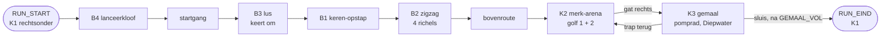

# Kamers: de grijze flow-kamer (mijlpaal 1, F0)

Versie 0.1 · Eigenaar: World & Level Designer (met Gameplay Programmer) · Taak T16b (`docs/productie/fase-2-kader.md` §2) · Reviewer: Lead Game Designer
Bron: `docs/design/gdd.md` v0.4 §2.5a, §2.12, §4 (flow-kamer-spec, bouwstenen B1–B4, FK-1–FK-6, MP-1–MP-7) en `docs/concept/pitch.md` v0.4.
Scène: `game/levels/flowkamer/flowkamer.tscn` (hoofdscène van het project). Code: `game/levels/flowkamer/` (kamer, maten, vijanden, meetlog, gescripte run, normberekening) en `game/scripts/light/` (lichtmeter, gemaal, pomprad). Tests: `game/tests/test_flowkamer.gd`.

*Zes momenten uit de gescripte run bij D = 120 (headless gedraaid onder Xvfb, placeholder-art). Geel is P1, paars de echo, rood een basisvijand, grijs het pantserdoel.*

## 1. Doel

Eén grijze kamer waarin we meten of de echo je in beweging houdt (pillar 1, normen (1)–(3)), bij welke staartlengte D, en of de springplank vóór je ligt (R-V12). Geen puzzel, geen slot (FK-1, FK-2). De kamer is af als de QA Lead er de flow-test (T17) in kan draaien: een speler of een gescripte run speelt, het meetlog schrijft één CSV per run.

## 2. Indeling

Drie kamers in één scène, buren in een lus K1 → K2 → K3 → K1 (FK-3, E-04a). Maten in wereldpixels, y naar beneden; "vloer" is de bovenkant van een blok.

| Kamer | Rect (x, y, b, h) | Inhoud |
|---|---|---|
| **K1 Sprongketen** | 0, 0, 1440, 720 | B4 (start), startgang van 860 px, B3 (links onder), B1 en B2 (midden), bovenroute op y = 90 naar K2 |
| **K2 Merk-arena** | 1440, 0, 640, 360 | Vloer op 340, twee eenrichtingsplatforms op 70 px (y = 270), gat rechts (x 2000–2060) naar K3 |
| **K3 Gemaal** | 1440, 360, 960, 360 | Vloer op 610. Rechts de oever met het pomprad, links de ondergelopen straat met `Diepwater` en de sluis naar K1; rechts een trap van vijf richels terug naar het gat van K2 |

K1 is 1440 breed in plaats van ± 1280: B4 heeft aan de landingskant ≥ 180 px vrije hoogte nodig en mag niet onder de schacht van B2 liggen.

## 3. Bouwstenen (gdd §4.3) en hoe ze hier liggen

Alle maten uit gdd §4.3; per bouwsteen alleen wat ik koos of moest kiezen.

| Bouwsteen | Ligging | Echolijn | Langzame lijn | Keuzes |
|---|---|---|---|---|
| **B4 Lanceerkloof** | Vloer 610, kloof x 1190–1350 (160 px), bodem 700; aanloop 90 px; ≥ 180 px vrij boven kloof en aanloop | Lancering (C-11): solo slaan en AANVAL ≥ 30 ticks vasthouden aan de rand, op de echo springen. **Werkt pas met T16c (#78)**; de maten liggen er nu al voor | Kloof in, 160 px, trede van 45 en dan de vloer | Ligt aan het begin van de run, met de gezichtsrichting naar links (naar de kloof). De landing aan de overkant (± 190 px) blijft vrij van het plafond van de startgang (x < 1150). Nog niet getest met een lancering |
| **B3 Lus** | Kom links onder: vloer 190 px (x 140–330), blok van 45 px tegen de linkerwand met bovenkant B = D − 60 (30 / 60 / 120), galerij op 70 px (y = 540) die 40 px de kom in steekt | Door de kom, op het blok, keren, **van de blokrand afspringen** en op de echo landen die net door de ingang komt, bounce (zo nodig dash) naar de galerij | Eenrichtingstrede van 35 px (x 250–290) en dan de galerij | Gespiegeld (ingang rechts, blok links), want de route komt van rechts. De trede is een dunne eenrichtingsrichel: P1 en de echo lopen eronder door de kom in. Het blok wisselt van breedte met D (debugmenu start dan een nieuwe run) |
| **B1 Keren-opstap** | Gang van 320 px op y = 540 (x 330–650), wand rechts, galerij op 90 px (y = 450) over de hele gang | Naar de wand, keren, op de echo als hij ± 130 px vóór je is, bounce naar de galerij | Eenrichtingstrede op 45 px tegen de wand, dan de wandtop | De gang is ook de B3-galerij; de wandtop is de vloer van B2 |
| **B2 Zigzag omhoog** | Schacht x 650–1130 (480 px), vloer 450, richels van 416 px op 90 / 180 / 270 / 360 (y 360, 270, 180, 90), om en om tegen links en rechts | Per verdieping keren, op de echo, bounce naar de volgende richel | Per verdieping een eenrichtingstrede op 45 px tegen de keerwand | Ingang links onder; de vierde richel loopt over in de bovenroute |

**Treden als eenrichtingsrichel.** De gdd rekent het keerpunt van B1 en B2 vanaf de wand (D + 24 px vlakke vloer, landing ≥ 216 px van de wand). Een massieve trede tegen de wand schuift het keerpunt 40 px op; bij D = 180 komt P1 op richel 1 en 3 dan te dicht bij de wand (128 in plaats van ≥ 204 px). Daarom zijn de treden dunne eenrichtingsrichels op 45 px: je loopt eronder door tot de wand, en springt er recht omhoog op voor de langzame lijn.

**Vallen (vangen, C-13)** heeft geen eigen bouwsteen (gdd §4.3, O-11). De start­gang (860 px rechtdoor) is de plek waar zo'n bouwsteen in T3c kan komen.

## 4. Encounters: K2 merk-arena

| | Inhoud | Wanneer |
|---|---|---|
| Golf 1 | 4 basisvijanden (x 1600, 1720, 1840, 1940) | P1 komt K2 voor het eerst binnen |
| Golf 2 | 4 basisvijanden (x 1580, 1700, 1820, 1940) + 1 pantserdoel (x 1840) | Alle basisvijanden van golf 1 zijn op |
| Terugkeer | De basisvijanden van golf 2 die op zijn, komen terug; een pantserdoel dat nog staat, blijft | Elke keer dat P1 K2 binnenkomt na golf 2, zolang het gemaal niet vol is |

Vijanden blijven in K2 (x 1458–1992) en doen alleen iets zolang P1 in K2 is. De arena sluit niet af. Waarden van de basisvijand en het pantserdoel: gdd §4.3 (werkaanname LGD).

**4 in plaats van 3 per golf.** Met 3 + 3 haalde de gescripte run 92 LP na K1 en één keer K2; het doel is ≥ 100 (gdd §4.2). Met 4 + 4 is het 102 bij elke D. De LP-waarden zijn ongewijzigd (gdd §4.2: eerst de aantallen bijstellen).

## 5. K3 gemaal en lichtmeter

- **Pomprad** (32 × 48, niet `Merkbaar`) op x = 1960, middelpunt 30 px boven de vloer (FK-5: 15–40). Je raakt het lopend en vanuit een sprong, van links en van rechts. Geen vijand binnen 80 px (K2 ligt erboven, achter de vloer).
- **Straat met `Diepwater`**: x 1470–1800, waterlijn 570 (40 px boven de vloer), zakt na `GEMAAL_VOL` in 180 ticks naar 610; dan verdwijnt de sluis (x 1440–1460). Alleen het middelpunt van P1 telt; 30 ticks in het water = terug op de laatste droge vloerpositie (respawn, E-04b).
- **Trap terug naar K2**: vijf eenrichtingsrichels van 45 px (y 565 … 385), de bovenste onder het gat van K2. Zo kan wie te weinig licht had, terug naar de arena voor meer (FK-2), zonder de sluis.
- **Lichtmeter** (LM-01, LM-02): `game/scripts/light/light_meter.gd`. **Gemaal** (LM-03, LM-04, LM-06): `game/scripts/light/gemaal.gd`. Na het gemaal wordt de achtergrond van K3 warm (geen `FelLicht`).

## 6. Geheimen en shortcuts

Geen. De flow-kamer meet flow; geheimen komen met de slice (T8a).

## 7. Meetlog

Elke run schrijft `user://meetlog_<datum-tijd>_<solo|coop>_D<D>_p1.csv` (gdd §4.5) bij `RUN_EIND`, en opnieuw na de scores. Op Linux staat `user://` in `~/.local/share/godot/app_userdata/Echoborn/`, op Windows in `%APPDATA%\Godot\app_userdata\Echoborn\`. Een run die je afbreekt (F1–F4, F6) wordt bewaard als `…_afgebroken.csv`.

| Norm | Wat in de CSV | Event(s) |
|---|---|---|
| (1) stilstand, MP-1 | Elke stilstand van P1 met lengte | `STIL_START`, `STIL_EIND` (definitie T16a, `meetlog.gd`) |
| (2) echo-acties, MP-2 | Springplank-landing, merksprong met ontploffing (eerste schakel), later lancering en vang | `SPRINGPLANK`, `BOUNCE`, `MERKSPRONG`, `ONTPLOFFING`, (`LANCERING`, `VANGEN`: T16c) |
| (3) vloeiend, MP-5 | Score 1–5 per kamer na de run | `SCORE` (waarde = score, bron = kamer) |
| R-V12, MP-3 | Landingen en de stilstanden ervoor | `SPRINGPLANK` + `STIL_*` |
| MP-4 | Echo Leeg | `ECHO_LEEG_START`, `ECHO_LEEG_EIND` (de echo begint Leeg tot tick D) |
| MP-6 | Licht per bron, pompslagen | `LP` (bron `<bron>_<wie>`, bv. `springplank_echo`), `POMP`, `GEMAAL_VOL` |
| Overig | Kamer, drop-in/out | `KAMER`, `DROP_IN`, `DROP_OUT`, `RESPAWN`, `LOSLATEN`, `BREEK` |

`game/levels/flowkamer/flow_report.gd` rekent MP-1–MP-4 en MP-6 uit een log; de tests gebruiken het, en de QA Lead kan het voor T17 gebruiken (het rapport zelf is van de QA Lead).

## 8. Spelen en testen

- **Spelen**: open `game/` in Godot 4.6.3 en start het project (F5). P1: A/D lopen, spatie springen, linker Shift dash, E aanval/pompen, Q 0,5 s = Loslaten. P2: Enter doet mee, Backspace 1 s stopt (via de InputRouter; de echte drop-in/out is T16c).
- **Debugmenu** (§4.1): F1/F2/F3 = D 90/120/180 (nieuwe run, met het B3-blok van die D), F4 = echo aan/uit (nieuwe run), F5 = meetlog aan/uit, F6 = herstart. Na de run: 1–5 per kamer.
- **Headless**: `godot --headless --path game --fixed-fps 60 -s res://tests/run_tests.gd`. `test_flowkamer.gd` bouwt de kamer per D, draait de gescripte run (moet `RUN_EIND` en de normen halen), speelt de run van D = 90 opnieuw af met een `ScriptedInput` (zelfde log), en draait de run met echo uit (FK-2).

## 9. Gemeten met de gescripte geoefende run

Solo, uit het meetlog berekend (`flow_report.gd`). Dit zijn geen speltestresultaten: de bot laat zien dat de kamer de normen **kan** halen (gdd §4.5). Mensen meten in T17.

| | D = 90 | D = 120 | D = 180 | Norm |
|---|---|---|---|---|
| Runtijd | 64,2 s | 65,4 s | 76,3 s | ≤ 120 s |
| LP na K1 + één keer K2 | 102 | 102 | 102 | ≥ 100 |
| MP-1 langste stilstand | 107 ticks | 137 | 197 | ≤ 300 |
| MP-2 echo-acties/min (K1 / K2) | 14,0 (8,8 / 38,2) | 12,8 (8,6 / 34,5) | 11,8 (8,1 / 25,4) | ≥ 3,0, ook per kamer |
| MP-2 langste gat | 13,6 s | 12,8 s | 14,9 s | ≤ 40 s |
| MP-3 landingen/min, zonder wachten | 5,6 / 100 % | 5,5 / 100 % | 4,7 / 100 % | ≥ 75 % |
| MP-4 echo Leeg | 2 % | 3 % | 4 % | ≤ 40 % |
| MP-6 LP met de echo, pompslagen echo | 82 %, 5 | 82 %, 5 | 82 %, 5 | ≥ 40 %, ≥ 1 |
| Echo breekt | 0 | 0 | 0 | 0 (FK-4) |
| **Echo uit** (FK-2): runtijd, terugkeren K2 | 113,4 s (1,77×), 3 | 113,9 s (1,74×), 3 | 114,9 s (1,51×), 3 | ≤ 2×, ≤ 4 |

De langste stilstand zit telkens aan de waterkant in K3: P1 wacht tot de echo zijn pompslagen herhaald heeft en het water zakt (± D + 40 ticks).

## 10. Checklist levelregels (WLD; review LGD)

| Regel | Oordeel | Toelichting |
|---|---|---|
| FK-1 geen puzzel | ja | Elke bouwsteen: lopen, keren, springen; nergens een volgorde of schakelaar. B3 vraagt timing (afspringen als de echo de kom in komt), met de langzame lijn ernaast |
| FK-2 nooit een slot | ja | Elke echolijn heeft een langzame lijn; met echo uit gemeten ≤ 1,77× en 3 terugkeren (tabel §9) |
| FK-3 open doorgangen | ja | Geen deur valt achter P1 dicht; kamerwissels resetten de echo niet (0 × `ECHO_LEEG_START` in de runs) |
| FK-4 echo breekt niet | ja | Geen schaduwgeometrie, `FelLicht` of `Schaduwgevaar`; 0 × `BREEK` |
| FK-5 pomprad in de route | ja | 30 px boven de vloer, lopend en springend te raken, geen vijand binnen 80 px |
| FK-6 maten | ja | Echolijnen 70–90 px; treden ≤ 45 px; te overspringen gaten ≤ 64 px (B2, trap). De kloof van B4 (160) en het gat van B3 (150) hoef je niet over te springen: de langzame lijn gaat erdoorheen |
| C-15 optioneel samenwerken | ja (solo) | Geen object of poort vraagt een samenwerkingsactie; één kamer voor solo en co-op. De co-op-run (C-15 (2)) volgt met T16c |
| L-02 | ja | Elke plek op de route is lopend te halen; geen plek alleen voor een live P2 |
| L-03 | ja | De enige poort (sluis) gaat open door het gemaal |

## 11. Werkaannames (kader §5)

Uit de gdd (van de LGD): beweging §2.5a, basisvijand en pantserdoel §4.3, D = 90 / 120 / 180, lichtmeter LM-01–LM-06, MP-1-definitie zoals T16a hem bouwde. Van mij (WLD), voor deze kamer:

1. **De "scripted geoefende run" is een deterministische bot** (`flow_bot.gd`), geen vaste lijst bits: hij kijkt waar P1 en de echo staan. Zijn bits, afgespeeld als `ScriptedInput`, geven hetzelfde log (test). Zo hoeft de run niet opnieuw bij elke maatwijziging.
2. **4 basisvijanden per golf** in plaats van 3 (§4).
3. **Treden van B1, B2 en B3 zijn eenrichtingsrichels** (§3).
4. **K3 heeft een trap terug naar K2**, zodat wie te weinig licht heeft niet vastzit achter de dichte sluis.
5. **`SCORE`** als extra event voor norm (3), in dezelfde CSV.
6. **Drop-in/out is een plaatshouder** (P2 verschijnt op de echo of op P1); C-03–C-13 komen in T16c. In co-op telt de lichtmeter P2 als drager en ontsteker.
7. **B4 neemt nu de langzame lijn**; de lancering werkt pas na T16c.
8. Een wissel van D of echo aan/uit in het debugmenu start een nieuwe run (één CSV per D).

## 12. Bevindingen en vragen

**Voor de Lead Game Designer**

1. **In K1 is de echolijn niet sneller dan de langzame lijn.** Tijd tot K2: D = 90 2452 tegen 2469 ticks, D = 120 2512 tegen 2499, D = 180 2666 tegen 2559. Keren en teruglopen naar de echo kost evenveel als twee sprongen via de trede. De echo levert in K1 dus licht op (30 LP), geen tempo. Voor R-V2 en F4b(b) kan dat een probleem zijn: wie snel wil, laat de echo liggen. Opties: de langzame lijn langer maken (drie treden, of de trede een eind van de wand), of het zo laten omdat K2 de echo wel nodig heeft (merk-afmaker). Graag een keuze vóór T17.
2. **B2 bij D = 180: de regel "afzetten als de echo ± 130 px vóór je is"** vraagt dat de echo 33 ticks vóór de ontmoeting al op de richel loopt, dus een landing ≥ D + 66 px van de wand. Met 216 px is de echo er pas ± 76 px vóór je; de bot springt dan zodra de echo landt en stuurt in de lucht bij. Het lukt, maar het venster is krap voor mensen.
3. **B3: "stap terug" is te vroeg.** Wie van het blok stapt, landt na ± 20 ticks naast de echo; wie **afspringt**, landt in het venster van 29–49 ticks. Die landing is snel vallen (v.y ≥ 4): na T16c is dat een **vang** (C-13), geen gewone landing. Graag bevestigen dat dat de bedoeling is.
4. **Diepwater vóór het gemaal vol is**: P1 wordt teruggezet en dat telt als respawn, dus de echo wordt Leeg en de pompslagen die hij nog zou herhalen, gaan verloren. Klopt dat met LM-06?
5. **MP-1** gebruikt de definitie uit T16a; de open vraag van de Gameplay Programmer over keren (3–4 stille ticks) en ter plaatse springen (2) geldt hier ook.

**Voor de Gameplay Programmer** (code van T16a)

1. **E-08a en eenrichtingsrichels**: de echo brak als hij (zoals P1) van onder door een eenrichtingsrichel ging. In `tail_echo.gd` telt de vrij-controle een eenrichtingsvorm nu niet mee (`_is_free`), met een test (`test_echo_passes_one_way_ledge`). Graag review.
2. **P1 tegen een wand of trede**: wie een richting vasthoudt tegen een wand op de vloer, is in `Motor.step` niet `on_floor` en kan niet springen. Spelers merken dat bij elke trede. De bot laat één tick los als workaround.
3. **Springplank-reeks in het meetlog**: `n` begon niet opnieuw als P1 van de echo áfliep op de vloer. `flow_meetlog.gd` doet dat nu; mag naar `meetlog.gd`.

## 13. Wijzigingen

| Versie | Wat |
|---|---|
| 0.1 | Eerste blockout van de flow-kamer (T16b) |
