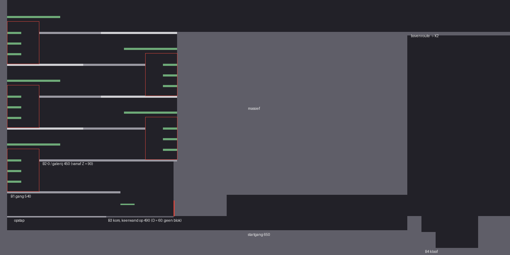
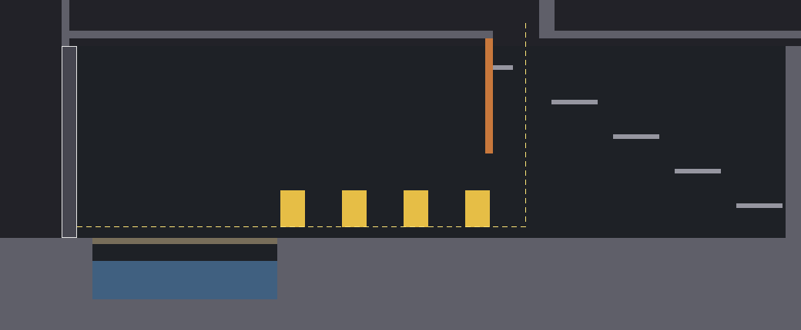

# Kamers: de grijze flow-kamer (mijlpaal 1, F0; na F0)

Versie 0.7.1 · Eigenaar: World & Level Designer (met Gameplay Programmer) · Taken T16b (`docs/productie/fase-2-kader.md` §2), T16d ([#176](https://github.com/cesarvangerwen-glitch/echoborn/issues/176)) en T16f ([#189](https://github.com/cesarvangerwen-glitch/echoborn/issues/189)) · Reviewer: Lead Game Designer
Bron: `docs/design/gdd.md` v0.8 §2.5a, §2.12, §4 (flow-kamer-spec, bouwstenen B1–B4, FK-1–FK-6, MP-1–MP-7), §4.7 (herontwerp na F0, W-1–W-7) en §4.8 (bijstellen na F0-2 en D = 60, W-8–W-11), `docs/qa/rapport-f0-2-flowtest.md` (§5.3, §8.3), `docs/concept/pitch.md` v0.4.
Scène: `game/levels/flowkamer/flowkamer.tscn` (hoofdscène van het project). Code: `game/levels/flowkamer/` (kamer, maten, vijanden, meetlog, gescripte run, normberekening) en `game/scripts/light/` (lichtmeter, gemaal, pomprad). Tests: `game/tests/test_flowkamer.gd` (solo, met LM-04 in K3), `game/tests/test_flowkamer_na_f0.gd` (keerzone, paren, pompgang, keren per D), `game/tests/test_wachtbot.gd` (wachtbot, late bot en afzetvenster) en `game/tests/test_flowtest_duo.gd` (co-op, [#125](https://github.com/cesarvangerwen-glitch/echoborn/issues/125)).

**Stand van deze versie.** De kamer staat op **D = 60** (CEO-besluit 2026-11-12, gdd v0.8 §4.8.4): K1 met een keerzone van **Z = D + 30 = 90 px**, **zonder overhang**, met **drie treden van 30 px** als langzame lijn (W-8), en B3 zonder blok, met de rechterwand als keerwand (W-9). K2 (paren, W-3) en K3 (pompgang, W-4) zijn niet veranderd. De gescripte run, het duo, de wachtbot en de late bot draaien op D = 60, met 90, 120 en 180 als regressie (W-10); de metingen staan in §9. De keuze voor de bovenste trede in K3 en de afwijkingen staan in §12.

*K1 op D = 60, uit `flow_layout.gd` getekend (1 px = 1 wereldpixel). Donkergrijs is dicht, middengrijs eenrichting, wit het dichte stuk van een richel, groen de langzame lijn (treden op 30, 60 en 90, richel op 135, en de trede van B3), rood de keerzone (Z × 120 = 90 × 120 px) bij elk keerpunt en de keerwand van B3.*

*K3 na F0 (x 1360–2400, y 300–730), uit `flow_layout.gd` getekend. Geel de vier pompschoepen, bruin de kade boven de ondergelopen straat (blauw, `Diepwater`), oranje de wand van het gemaalhuis, lichtgrijs de trap terug naar K2, wit omrand de sluis. De gele stippellijn is de route van de gescripte run: door het gat van K2, op de vloer bij x ± 2040, naar links door de schoepen en over de kade naar de sluis.*

## 1. Doel

Eén grijze kamer waarin we meten of de echo je in beweging houdt (pillar 1, normen (1)–(3)), bij welke staartlengte D, en of de springplank vóór je ligt (R-V12). Geen puzzel, geen slot (FK-1, FK-2). De kamer is af als de QA Lead er de flow-test (T17) in kan draaien: een speler of een gescripte run speelt, het meetlog schrijft één CSV per run. Na F0 (gdd §4.7): **wachten loont zo min mogelijk, en de echo komt je tegemoet**. Op D = 60 (gdd §4.8): de echo is bij het keren al 120 px van je, dus je springt op het keren; wachten kost hooguit 60 ticks. In K1 is keren ≥ 30 ticks sneller dan de treden, en wie tegen de keerwand wacht, komt zonder dash nergens (keerzone); in K2 staan de vijanden in paren, zodat er altijd een volgend doel is; in K3 pomp je in het voorbijlopen en is de sluis open als je er bent.

## 2. Indeling

Drie kamers in één scène, buren in een lus K1 → K2 → K3 → K1 (FK-3, E-04a). Maten in wereldpixels, y naar beneden; "vloer" is de bovenkant van een blok.

```mermaid
flowchart LR
    S([RUN_START<br/>K1 rechtsonder]) --> B4[B4 lanceerkloof] --> G[startgang<br/>40 px lager] --> O[opstap<br/>omkeren] --> B3[B3 keerpunt<br/>bij D = 60] --> B1[B1 keren-opstap<br/>keerzone] --> B2[B2 zigzag<br/>4 richels, keerzones] --> T[bovenroute]
    T --> K2[K2 merk-arena<br/>golf 1 + 2 in paren]
    K2 -- gat rechts --> K3[K3 pompgang<br/>4 schoepen, kade]
    K3 -- trap terug --> K2
    K3 -- sluis, open op GEMAAL_VOL --> E([RUN_EIND<br/>K1])
```

| Kamer | Rect (x, y, b, h) | Inhoud |
|---|---|---|
| **K1 Sprongketen** | 0, 0, 1440, 720 | B4 (start, rechtsonder), startgang op 650 naar links onder de kom van B3 door, opstap (x 20–300), B3 (kom x 300–490), B1 tegen de linkerwand (gang x 20–340 op 540), B2 in een schacht recht boven B1 (x 20–500), bovenroute op y = 90 naar K2; rechts van de schacht massief |
| **K2 Merk-arena** | 1440, 0, 640, 360 | Vloer op 340, twee eenrichtingsplatforms op 70 px (y = 270), gat rechts (x 2000–2060) naar K3; vijanden in paren (§4) |
| **K3 Gemaal** | 1440, 360, 960, 360 | Vloer op 610. Onder het gat van K2 de landing; naar links de **pompgang** (vier schoepen, x 1980 … 1740), dan **280 px kade** boven de ondergelopen straat met `Diepwater` naar de sluis (x 1440–1460); rechts een trap van vijf richels terug naar het gat (§5) |

K1 is 1440 breed in plaats van ± 1280: B4 heeft aan de landingskant ≥ 180 px vrije hoogte nodig.

**Waarom de opstap (omkeren zonder echo).** K1 begint naar links (de sluis van K3 komt rechtsonder uit) en eindigt naar rechts (de bovenroute naar K2). Elk keerpunt met de echo keert je om: B3 één keer, B1 één keer, B2 vier keer; samen zes, een even aantal. Er is dus precies één omkeer zonder echo nodig. In F0 zat die in B1 (bounce recht omhoog bij de wand, dan terug over de wand de schacht in); de keerzone maakt dat onmogelijk, en dat is de bedoeling. Nu zit hij aan het eind van de startgang: een eenrichtingsrichel van 40 px boven de startgang, waar je op springt en naar rechts de kom van B3 in loopt (± 30 ticks, 0,5 s). Daarvoor ligt de startgang 40 px lager dan B4 (650 in plaats van 610) en loopt hij onder de kom door (36–40 px vrij; P1 is 30 px hoog). Zo blijven B3, B1 en B2 op dezelfde hoogtes als in F0 en past de richel op 135 van de bovenste verdieping van B2 onder het plafond (y = 45).

## 3. Bouwstenen (gdd §4.3) en hoe ze hier liggen

Alle maten uit gdd v0.8 §4.3 en §4.8.4; per bouwsteen alleen wat ik koos of moest kiezen. Afstanden "van de wand" zijn vanaf het wandvlak. **De kamer is op D = 60 gebouwd** (W-8, W-9). Alleen het B3-blok volgt D (`max(D − 60, 0)`, G-6); de rest is bij elke D dezelfde: de kamer wordt op D = 60 gebouwd en draait bij 90, 120 en 180 als regressie (gdd §4.6, §4.8.4 W-8).

| Bouwsteen | Ligging | Echolijn | Langzame lijn | Keuzes |
|---|---|---|---|---|
| **B4 Lanceerkloof** | Vloer 610, kloof x 1190–1350 (160 px), bodem 700; aanloop 90 px; aan de overkant 40 px vloer op 610 (x 1150–1190), dan de stap van 40 px naar de startgang; ≥ 180 px vrij boven kloof en aanloop | Lancering (C-11). Solo: aan de rand (x 1352) slaan en AANVAL 32 ticks vasthouden, dan **een stap terug** (een dash van de rand af, W-10) en springen als de echo nog 24 px van de rand is; je landt op hem terwijl hij in houding staat. Co-op: P1 staat in houding aan de rand, P2 springt op hem; P1 neemt de langzame lijn | Kloof in, 160 px, trede van 45 en dan de vloer | Geometrie ongewijzigd. De stap terug is een dash: de DASH-flank telt in MP-1 als beweging, dus wie zo wacht, staat bij D = 60 15 ticks stil (zonder stap terug 30). Lopend een stap terug haalt het niet: binnen 24 px blijf je "stil" (§11 punt 7) |
| **B3** (bij D = 60 een keerpunt, W-9) | Kom x 300–490 (190 px) op 610, ingang links via de opstap; **bij D = 60 geen blok**: de keerwand is de wand op x 490 (G-6). Bij D ≥ 90 een blok van 45 px hoog met bovenkant `D − 60` (30 / 60 / 120). Galerij op 70 px (y = 540) van de linkerwand tot x 340, 40 px de kom in, dus 150 px van de keerwand | **D = 60:** door de kom naar de keerwand, keren en meteen springen, op de echo landen op ± 56 px van de wand, bouncen en **met de dash op de top** naar de galerij. **D ≥ 90:** op het blok, keren, van de blokrand afspringen en op de echo landen die net de kom in komt (een vang, C-13), dan naar de galerij | Eenrichtingstrede van 35 px (x 340–380) en dan de galerij | Zonder dash haal je bij D = 60 de galerij niet: de bounce komt onder de rand door (§9, late bot). Dat zegt gdd §4.3 ook ("zonder dash niet"); de dash is een vaardigheid die P1 altijd heeft, dus B3 blijft een echolijn zonder puzzel |
| **B1 Keren-opstap** (W-1, W-8) | Gang van 320 px op y = 540 (x 20–340, = de B3-galerij), keerwand = linkerwand (x 20). Galerij op 90 px (y = 450) van **90 tot 480 px** van de wand (x 110–500); die galerij is de vloer van B2. Keerzone x 20–110 | Naar de wand (naar links), keren en **meteen springen** (de echo is bij het keren 2D = 120 px van je, het plank-signaal staat al aan), op de echo landen op ± 54 px van de wand, bounce naar de galerij zonder dash; je landt op ± 120 px van de wand | **Drie treden van 30 px** op 30, 60 en 90 px tegen de wand (x 20–60): recht omhoog op 30, op 60, en van de trede op 60 schuin naar de galerij. De richel op 135 px (y = 405, x 20–170) blijft, maar de snelste langzame lijn gebruikt hem niet | Achter de wand ligt niets (buitenwand). Geen overhang meer; dicht stuk: zie hieronder |
| **B2 Zigzag omhoog** (W-2, W-8) | Schacht x 20–500 (480 px), vloer 450 (= galerij van B1), vier richels van **390 px** (`450 − D`) op 90 / 180 / 270 / 360 (y 360, 270, 180, 90), om en om tegen links en rechts; aan de open kant een gat van **90 px** (Z) boven de keerwand van de richel eronder (de keerzone). Keerwanden: vloer rechts (x 500), richel 1 links, richel 2 rechts, richel 3 links | Per verdieping naar de keerwand, keren, meteen springen, op de echo, bounce naar de volgende richel en doorlopen naar de andere wand. Landing op ± 120 px van de vorige wand, dus ± 360 px van de volgende (≥ D + 24 = 84) | Per verdieping treden op 30, 60 en 90 tegen de keerwand en van de trede op 60 schuin naar de volgende richel | Richel 4 loopt over in de bovenroute. De rechterwand van de schacht is het massief, met de bovenroute erop |

**Keerzone (W-1, W-2, W-8).** Bij elk keerpunt ligt binnen **Z = 90 px** van de keerwand niets waarop P1 kan landen lager dan 120 px boven zijn vloer, behalve de drie treden. De weg omhoog begint op 90 px van de wand en loopt door tot 480 px (galerij van B1 en richels van B2). De test controleert per keerpunt dat 90–240 px gedekt is, dat de weg omhoog op 90 begint, en dat er tussen de wand en Z van de vloer tot 135 px erboven niets dichts is (`test_keerzone_geometry`).

**Geen overhang (W-8; gdd v0.8 §4.8.3 punt 1).** De overhang van F0-2 (40–70 px van de wand, 85–129 px hoog) is weg: bij D = 60 bounct de echolijn op 40–62 px van de wand, precies daar. Gemeten bounct de geoefende run op 54 px, de late bot op 38–56 px.

**Langzame lijn: drie treden van 30 px (W-8).** Eis van gdd v0.8 §4.3: keren is ≥ 30 ticks sneller dan de snelste langzame lijn, en die is ≤ 2× keren, beide vanaf de wand. Met de treden op 30, 60 en 90 heb je drie sprongen nodig (een sprong haalt 50 px; een eenrichtingstrede land je pas in de val, ± 33 ticks per sprong): vloer → 30, 30 → 60 (in de lucht tot de buitenrand van de trede sturen), en van 60 schuin naar de weg omhoog op 90 (de sprong van 60 komt pas na de top op 90 px hoogte, en dan ben je ± 66 px opzij: voorbij de rand op Z − 8 = 82 als je van de buitenrand van de trede afzet). Gemeten: **langzame lijn 104–105 ticks, keren 68 ticks: 36–37 ticks verschil, 1,53–1,54×** (§9). Een snellere langzame lijn is er niet: van de vloer haal je de trede op 60 niet (60 > 50), en van de trede op 30 de weg omhoog niet (60 > 50); de dash geeft geen hoogte. De trede op 90 ligt even hoog als de weg omhoog: wie trede op trede klimt, stapt daar opzij over (± 30 ticks langer).

**Dicht stuk aan de wandkant van elke richel (afwijking, WLD; blijft).** De richel op 135 van een verdieping ligt 45 px onder de richel twee hoger, en een sprong haalt 50 px. Met een gewone eenrichtingsrichel spring je dus van de richel op 135 naar de richel twee hoger en sla je een verdieping over. Daarom zijn de eerste **215 px** van elke richel aan de wandkant dicht: van onder spring je ertegen, van boven land je er gewoon op. De echolijn raakt het dichte stuk niet: de bounce passeert de volgende richel op ± 120 px van de keerwand, en het dichte stuk van de richel daarboven begint op 480 − 215 = 265 px (W-8: "mogen blijven als ze de echolijn niet raken"). Hetzelfde geldt voor B1: richel 1 boven de richel op 135 van B1 is ook dicht.

**Treden als eenrichtingsrichel** (sinds F0). De gdd rekent het keerpunt vanaf de wand (D + 24 px vlakke vloer). Een massieve trede tegen de wand schuift het keerpunt op; daarom zijn de treden dunne eenrichtingsrichels: je loopt eronder door tot de wand, en springt er recht omhoog op voor de langzame lijn. De bounce van de echolijn gaat er van onder doorheen.

**Nagerekend per D** (gdd §4.3, met deze kamer; `test_keerzone_geometry` controleert de maten per D, de runs in §9 meten de rest):

| | **D = 60** | D = 90 | D = 120 | D = 180 |
|---|---|---|---|---|
| Vlakke vloer vóór elke keerwand (nodig D + 24) | **B1 320, B2 390 (nodig 84)** | gelijk (114) | gelijk (144) | gelijk (204) |
| Afzet naar de echo, na het keren | **0 ticks** (meteen; venster gemeten 0–20 ticks) | 12 | 27 | 57 |
| Bounce van de geoefende run, van de wand | **54 px** | 92 | 122 | 166–182 |
| Landing na keren zonder dash (rand weg omhoog op Z + 8 = 98) | **120 px (22 px marge)** | 160 (62) | 190 (92) | 234–250 |
| B2: landing tot de volgende wand (nodig D + 24) | **± 360 px** | ± 320 | ± 290 | 230–246 |
| Gemeten: keren / langzame lijn vanaf de wand | **68 / 104–105 ticks (+ 36–37, 1,53×)** | 80 / 104–105 (1,3×) | 95 / 104–105 (1,1×) | 125–133 / 104–105: **de langzame lijn is sneller** |
| B3 | **keerpunt, geen blok**: bounce 56 px van de wand, met de dash 26 px voorbij de galerijrand | blok 30 px, vang | blok 60 px, vang | blok 120 px, vang |

Bij D = 180 is de langzame lijn nu 20–29 ticks sneller dan keren. Dat volgt uit de eis van W-8: bij D = 60 moet de langzame lijn ≤ 2 × 68 = 136 ticks blijven, en keren duurt bij D = 180 `D/2 + 34` ≈ 124–133. Beide samen kan alleen als de kamer met D meeschaalt. De kamer is op D = 60 gebouwd; 180 draait alleen als regressie (bevinding in §12).

**Restgat** (gdd §4.3, bekend risico; bij D = 60 "groter in plaats, kleiner in prijs", §4.8.2): wie ergens stilstaat, heeft na D ticks zijn echo onder zich. De wachtbot (§9) bevestigt de gdd: bij D = 60 kom je **met de dash overal** in B1 en B2 omhoog, ook tegen de wand, en **zonder dash vanaf 40 px** van de wand (gdd: ± 30). Tegen de wand zonder dash val je terug op de vloer (de keerzone werkt); op 20 px kom je op een trede. De stilstand is altijd D = 60 ticks. Wie springt zodra het plank-signaal aangaat, staat geen 20 ticks stil (de geoefende run: 0 stilstand vóór elke landing).

**Vallen (vangen, C-13)** heeft geen eigen bouwsteen (gdd §4.3, O-11). Bij D = 60 is er ook in B3 geen vang meer (de vang van B3 komt pas terug bij D ≥ 90). De startgang (± 850 px rechtdoor) is de plek waar zo'n bouwsteen in T3c kan komen.

## 4. Encounters: K2 merk-arena (W-3)

| | Inhoud | Wanneer |
|---|---|---|
| Golf 1 | 3 paren basisvijanden: x 1560 + 1588, 1750 + 1778, 1940 + 1968 | P1 komt K2 voor het eerst binnen |
| Golf 2 | 3 paren basisvijanden aan de kant van de ingang: x 1470 + 1498, 1660 + 1688, 1850 + 1878, en 1 pantserdoel (x 1579, tussen de eerste twee paren) | Op de eerste tick waarop elke basisvijand van golf 1 een merk heeft of op is (G-3, gdd §4.2) |
| Terugkeer | De basisvijanden van golf 2 die op zijn, komen terug; een pantserdoel dat nog staat, blijft | Elke keer dat P1 K2 binnenkomt na golf 2, zolang het gemaal niet vol is |

**Paren** (gdd §4.2, §4.7.1 (c)): de twee vijanden van een paar beginnen **28 px** uit elkaar (≤ 32: één merk raakt ze allebei; ≤ 48 = K: L-13 (d)), paren beginnen **≥ 162 px** uit elkaar (tussen de naaste vijanden; eis ≥ 160). Beide vijanden van een paar lopen even snel naar P1, dus de afstand blijft tot een van de twee een treffer krijgt. De ingang is links (de bovenroute komt linksboven binnen); golf 2 staat dus links, en wie golf 1 rechts afmaakt, keert ernaartoe. Vijanden blijven in K2 (x 1458–1992) en doen alleen iets zolang P1 in K2 is. De arena sluit niet af. Waarden van de basisvijand en het pantserdoel: gdd §4.3 (werkaanname LGD).

**3 + 3 paren** (gdd §4.2: eerst de aantallen bijstellen, niet de LP). Gemeten met de gescripte run (LP na K1 + één keer K2, doel ≥ 100; run zonder echo bij D = 180):

| Golf 1 + golf 2 | LP na K1 + K2 | Zonder echo: terugkeren, run D = 180 |
|---|---|---|
| 2 + 2 paren | 97 | 3 (niet gemeten: > 7000 ticks) |
| 3 + 2 paren | 109 | 2, 6895 ticks |
| **3 + 3 paren** | **119 / 119 / 121** (D = 90 / 120 / 180); na G-3 (golf 2 bij "alles gemerkt of op"): **121 / 121 / 111**; bij D = 60 (T16f): **123** | **1, 5822 ticks** (na G-3: 5696; met de pompgang: 5806; op de kamer van D = 60: 5848; bij D = 60 zelf 5727) |

De rijen 2 + 2 en 3 + 2 zijn gemeten vóór G-3. Met 2 + 2 paren haalt de run de 100 LP niet. 3 + 2 haalt ze wel, maar dan duurt de run zonder echo bij D = 180 6895 ticks (twee terugkeren), en de co-op-ondergrenzen van T17 (schaduwpartner, meeloper) halen `RUN_EIND` niet binnen 7000 ticks; de testrunner geeft een test 7200 frames. Met 3 + 3 paren is één terugkeer genoeg.

**Een paar levert minder licht dan twee losse vijanden** (bevinding voor de LGD). P1 raakt met één slag allebei (aanvalsvlak 20 px, de vijanden 28 px uit elkaar): twee merken. De echo laat het eerste merk knallen; de ontploffing (20 SE, E = 32) doodt allebei, zodat het tweede merk niet meer knalt en er geen ketting komt. Een paar geeft met echo dus ± 2 + 2 + 2 + 6 = 12 LP, twee losse vijanden 16. De verwachting in gdd §4.7.2 ("de paren geven meer kettingschakels") komt in deze kamer niet uit; MP-6 blijft gehaald (66–69 % van de LP met de echo). Een ketting in K2 komt er alleen als de tweede vijand de eerste ontploffing overleeft (bv. een paar op 33–48 px: buiten E, binnen K).

**FK-2-grens met 3 + 3 paren** (gdd §4.4; zonder echo komt licht alleen uit P1-treffers: 3 treffers × 2 LP = 6 LP per basisvijand, en één slag raakt beide vijanden van een paar; het pantser breekt niet en geeft 0 LP):

| | Basisvijanden | LP | Totaal |
|---|---|---|---|
| Eerste keer K2 (golf 1 + 2) | 6 + 6 | 12 × 6 = 72 | 72 |
| Terugkeer 1 | 6 | 6 × 6 = 36 | **108 ≥ 100** |

Het gemaal is zonder echo dus vol na **1 terugkeer** (grens FK-2: ≤ 4). Gemeten: 1 bij elke D, ook bij D = 60.

**Hooguit 5 vijanden tegelijk (L-13 (f))** haalt K2 niet: een golf heeft 6 basisvijanden (golf 2 met het pantserdoel 7), en na G-3 staat golf 2 er al terwijl de gemerkte vijanden van golf 1 nog niet geknald zijn (tot 13). In F0 waren het er 6 (golf 2). Dat volgt uit het LP-doel met paren en de tijdgrens van de tests; de LGD laat (f) voor de flow-kamer vallen tot de tweede flow-test (§12). Gemeten met de gescripte run (W-5, W-10): **hooguit 9 levende vijanden tegelijk** in K2 bij D = 60 (9 / 11 / 11 bij D = 90 / 120 / 180, §9). Bij D = 60 knallen de merken eerder, maar golf 2 staat er nog steeds terwijl de gemerkte vijanden van golf 1 wachten op hun knal; de LGD laat K2 een uitzondering blijven (gdd v0.8 §4.8.3 punt 5).

## 5. K3 pompgang en lichtmeter (W-4)

| Onderdeel | Ligging | Waarom zo |
|---|---|---|
| **Landing** | Wie door het gat van K2 valt (x 2000–2060) met de knop naar rechts, landt op de vloer (610) bij ± 2124; de gescripte run laat bij ± 2042 los en landt daar. Wie meteen loslaat of naar links stuurt, landt op de bovenste trede (x 2000–2026) tegen de wand van het gemaalhuis en stapt er rechts af (gemeten: met de knop naar links in de val op de vloer bij ± 1982) | Rechts van de eerste schoep (x 1980), zodat je hem lopend naar links raakt |
| **Pompgang** | Vier pompschoepen van 32 × 48 (niet `Merkbaar`) op x **1980, 1900, 1820, 1740**, 80 px uit elkaar, middelpunt **38 px** boven de vloer (FK-5: 15–40). Vlakke vloer van x 1724 tot het gat; niets dichts tussen vloer en schoeptop | Je slaat ze lopend in de looprichting (naar links), elke 40 ticks een slag; op 38 px raak je een schoep ook op de top van een volle sprong (dat kan vanaf ± 37 px). Geen vijand binnen 80 px: K2 ligt erboven, achter de vloer |
| **Kade** | Van de laatste schoep tot de sluis **280 px** droge vloer op 610: vloer tot x 1720, dan de kade (x 1480–1720, dicht), dan vloer tot de sluis | LM-04 en FK-5: op loopsnelheid ≥ 140 ticks na de laatste schoep, zodat het gemaal bij elke D vol is als P1 bij de sluis is (vol op `t_4 − 40 + D`) |
| **Straat met `Diepwater`** | Onder de kade: x 1480–1720, waterlijn 640, bodem 690; zakt na `GEMAAL_VOL` in 180 ticks naar 690 (LM-06) | De route loopt er niet doorheen (FK-5); je ziet het water zakken als het gemaal vol is. P1 kan er niet in (de kade is dicht), dus `Diepwater` doet in de flow-kamer niets meer |
| **Sluis** | x 1440–1460, van 360 tot de vloer; verdwijnt op `t_v` (LM-06) | Ongewijzigd |
| **Wand van het gemaalhuis** | Dicht, x 1990–2000, van 350 (onder de vloer van K2) tot 500 | Wie van de bovenste trede valt en naar links stuurt, komt pas onder de wand vandaan als hij bijna op de vloer is: hij landt op ± 1982, de eerste schoep nog binnen bereik. Zonder de wand land je met de knop naar links tot ± 1890 en loop je de eerste schoep (en soms de tweede) voorbij |
| **Trap terug naar K2** | Vijf eenrichtingsrichels, oplopend naar links: x 2316–2376 (565), 2236–2296 (520), 2156–2216 (475), 2076–2136 (430) en de bovenste **2000–2026** (385), tegen de wand van het gemaalhuis, onder het linkerdeel van het gat | Van trede naar trede spring je vanaf de linkerkant met de knop naar links (± 53 px opzij); van de bovenste recht omhoog, en boven de vloer van K2 naar links. Wie door het gat valt met de knop naar rechts, raakt geen trede; wie meteen loslaat, kan op de bovenste landen en stapt er rechts af (links staat de wand) |

**Zo loopt de geoefende run** (gdd LM-04): P1 komt met 100 LP in K3 (de meter is vol na K1 en één keer K2), slaat elke schoep één keer (4 × 15 = 60 LP) en loopt door; de echo slaat dezelfde schoepen D ticks later (15 + 15 + 10) en maakt het gemaal vol op zijn derde schoep, op `t_4 − 40 + D`. De sluis gaat op die tick open. P1 is ± 153 ticks na zijn laatste slag bij de sluis: bij D = 60 **133 ticks** na `GEMAAL_VOL`, bij D = 90, 120 en 180 103, 73 en 13 ticks erna. Geen stilstand in K3 (§9).

**Zonder echo** (FK-2): P1 slaat de schoepen ook op de terugweg (naar rechts) zolang er licht in de meter is; is de meter leeg en het gemaal niet vol, dan de trap op naar K2. Met 72 LP na de eerste keer K2 (§4) pompt P1 72, haalt in K2 36 LP en maakt het gemaal bij de tweede keer K3 vol op de tweede schoep.

- **Lichtmeter** (LM-01, LM-02): `game/scripts/light/light_meter.gd`. **Gemaal** met `n` schoepen (LM-03, LM-04, LM-06): `game/scripts/light/gemaal.gd`; de schoepen komen uit `Layout.PUMP_VANES`. Na het gemaal wordt de achtergrond van K3 warm (geen `FelLicht`).

## 6. Geheimen en shortcuts

Geen. De flow-kamer meet flow; geheimen komen met de slice (T8a).

## 7. Meetlog

Elke run schrijft `user://meetlog_<datum-tijd>_<solo|coop>_D<D>_p1.csv` (gdd §4.5) bij `RUN_EIND`, en opnieuw na de scores. Op Linux staat `user://` in `~/.local/share/godot/app_userdata/Echoborn/`, op Windows in `%APPDATA%\Godot\app_userdata\Echoborn\`. Een run die je afbreekt (F1–F4, F6) wordt bewaard als `…_afgebroken.csv`.

| Norm | Wat in de CSV | Event(s) |
|---|---|---|
| (1) stilstand, MP-1 | Elke stilstand van P1 met lengte | `STIL_START`, `STIL_EIND` (definitie T16a, `meetlog.gd`) |
| MP-7 (b), co-op | Elke stilstand van P2 met lengte, in dezelfde CSV (werkaanname W5, `testplan-f0.md` §6; [#125](https://github.com/cesarvangerwen-glitch/echoborn/issues/125)) | `STIL_START`, `STIL_EIND` met bron `p2`; voor MP-1 van P1 filter je op bron `p1` |
| (2) echo-acties, MP-2 | Springplank-landing, merksprong met ontploffing (eerste schakel), later lancering en vang | `SPRINGPLANK`, `BOUNCE`, `MERKSPRONG`, `ONTPLOFFING`, (`LANCERING`, `VANGEN`: T16c) |
| (3) vloeiend, MP-5 | Score 1–5 per kamer na de run | `SCORE` (waarde = score, bron = kamer) |
| R-V12, MP-3 | Landingen en de stilstanden ervoor | `SPRINGPLANK` + `STIL_*` |
| MP-4 | Echo Leeg | `ECHO_LEEG_START`, `ECHO_LEEG_EIND` (de echo begint Leeg tot tick D) |
| MP-6 | Licht per bron, pompslagen | `LP` (bron `<bron>_<wie>`, bv. `springplank_echo`), `POMP`, `GEMAAL_VOL` |
| Overig | Kamer, drop-in/out | `KAMER`, `DROP_IN`, `DROP_OUT`, `RESPAWN`, `LOSLATEN`, `BREEK` |

`game/levels/flowkamer/flow_report.gd` rekent MP-1–MP-4 en MP-6 uit een log; de tests gebruiken het, en de QA Lead kan het voor T17 gebruiken (het rapport zelf is van de QA Lead).

## 8. Spelen en testen

- **Spelen**: open `game/` in Godot 4.6.3 en start het project (F5). P1: A/D lopen, spatie springen, linker Shift dash, E aanval/pompen, Q 0,5 s = Loslaten. P2: Enter doet mee, Backspace 1 s stopt (via de InputRouter; de echte drop-in/out is T16c).
- **Debugmenu** (§4.1, G-6): de build start zonder toets op **D = 60**. **F1 = D 60 (1 s) · F2 = D 90 (1,5 s) · F3 = D 120 (2 s) · F7 = D 180 (3 s)**: elk een nieuwe run, met het B3-blok van die D (bij 60 geen blok). F4 = echo aan/uit (nieuwe run), F5 = meetlog aan/uit, F6 = herstart. De HUD toont "F1/F2/F3/F7 D 60/90/120/180" (de getallen komen uit `game/data/echo_v04.json`, `echo.tail_options`). Na de run: 1–5 per kamer (K1, K2, K3); pas daarna start F1–F4, F6 of F7 een nieuwe run. Het scorescherm toont de D van de run; het meetlog heet `…_D60_p1.csv`. Op een laptop: Fn + F-toets.
- **Headless**: `godot --headless --path game --fixed-fps 60 -s res://tests/run_tests.gd`. Alle kamer-tests draaien op **D = 60**, met 90, 120 en 180 als regressie (W-10):
  - `test_flowkamer.gd` bouwt de kamer per D, draait de gescripte run (moet `RUN_EIND`, de normen, LP ≥ 100 na K1 + K2, elke bouwsteen via de echolijn en LM-04 in K3 halen: elke schoep één slag, `GEMAAL_VOL` vóór P1 bij de sluis is, geen stilstand > 30 ticks in K3), speelt de run van **D = 60** opnieuw af met een `ScriptedInput` (zelfde log) en draait per D de run met echo uit (FK-2).
  - `test_flowkamer_na_f0.gd` controleert de keerzone (Z = 90, geen overhang, treden 30/60/90) en de maten van B1 en B2 per D, de paren van K2 (ook in de kamer), de pompgang van K3, en per D dat de gescripte run bij elk keerpunt keert en via de echo omhoog gaat zonder stilstand van 20 ticks vóór de landing (L-08 (c), MP-3 per keerpunt). Bij **D = 60**: landing ≥ 9 px voorbij de rand, en **langzame lijn − keren ≥ 30 ticks en ≤ 2×** (W-8). Bij 90 en 120: keren sneller en ≤ 2×; bij 180: ≤ 2× en de langzame lijn hooguit 32 ticks sneller dan keren, ≥ 100 ticks (zie §12).
  - `test_wachtbot.gd` draait per D de wachtbot (`flow_wachtbot.gd`; tegen de wand met en zonder dash als check, bij D = 60 de hele rij ook zonder dash), de late bot (`flow_bot.gd` met `bounce_delay`, `dash_delay` en bij D = 60 ook B3, met en zonder dash) en bij D = 60 het **afzetvenster** (`jump_delay` 0–23 ticks; moet ≥ 10 zijn). Elke run in een eigen SubViewport met een eigen World2D; de uitkomsten staan als `note` in de uitvoer (§9).
  - `test_flowtest_duo.gd` draait per D de gescripte co-op-run (`flow_duo.gd`, §9; moet MP-1, MP-2, MP-4, MP-6, MP-7 (b)–(d) en LP ≥ 100 na K1 + K2 halen) en die van D = 60 en D = 120 twee keer (zelfde log). `test_flowtest_t17.gd` (QA) meet solo, schaduwpartner en meeloper, nu ook op D = 60.

## 9. Gemeten met de gescripte geoefende run

Uit het meetlog berekend (`flow_report.gd`; co-op met de MP-7-code van `test_flowtest_t17.gd`). Dit zijn geen speltestresultaten: de runs laten zien dat de kamer de normen **kan** halen (gdd §4.5). Mensen meten in MT1. **D = 60 is de standaard** (W-10); 90, 120 en 180 draaien op dezelfde kamer als regressie.

**Solo** (`flow_bot.gd`, W-10; kamer op D = 60: keerzone 90, geen overhang, treden 30/60/90, B3 zonder blok, B4 met een stap terug):

| | **D = 60** | D = 90 | D = 120 | D = 180 | Norm |
|---|---|---|---|---|---|
| Runtijd | **62,5 s** | 63,5 s | 65,5 s | 70,3 s | ≤ 120 s |
| LP na K1 + één keer K2 | **123** | 121 | 121 | 111 | ≥ 100 |
| MP-1 langste stilstand (waar) | **45 ticks (K2)** | 45 (K2) | 45 (K2) | 102 (B4) | ≤ 300 |
| B4: stilstand vóór de lancering | **15 ticks** | 15 + 12 | 15 + 42 | 15 + 102 | geen 20 ticks (W-10, bij D = 60) |
| MP-2 echo-acties/min (K1 / K2) | **14,4 (10,8 / 34,4)** | 14,2 (10,7 / 32,4) | 12,8 (10,5 / 25,8) | 11,9 (9,9 / 22,2) | ≥ 3,0, ook per kamer |
| MP-2 langste gat | **13,4 s** | 13,6 s | 13,9 s | 14,4 s | ≤ 40 s |
| MP-3 landingen/min, zonder wachten | **6,7 / 100 % (7 van 7)** | 5,7 / 100 % | 5,5 / 83 % | 5,1 / 83 % | ≥ 75 % |
| MP-3 per keerpunt (B3, B1, B2-0 … B2-3): echolijn zonder stilstand | **6 van 6** | 5 van 5 (B3: vang) | 5 van 5 | 5 van 5 | rapporteren (gdd §4.5) |
| Keren tot het volgende niveau / langzame lijn zonder dash vanaf de wand | **68 / 104–105 ticks (verschil 36–37, 1,53×)** | 80 / 104–105 | 95 / 104–105 | 125–133 / 104–105 | D = 60: verschil ≥ 30, ≤ 2× (W-8) |
| Snelste langzame lijn met dash (W-12, tabel onder het afzetvenster) | **94–95 ticks (verschil 26–27, 1,38–1,40×)** | 94–95 (+14–15) | 94–95 (−1 … 0) | 94–95 (−30 … −39) | D = 60: verschil ≥ 20, ≤ 2× (gdd v0.8.2 §4.8.7) |
| Landing na keren zonder dash, van de wand (rand op 98) | **120 px (22 px marge)** | 160 | 190 | 234–250 | ≥ 9 px marge (§8.3 punt 3) |
| MP-4 echo Leeg | **2 %** | 2 % | 3 % | 4 % | ≤ 40 % |
| MP-6 LP met de echo, pompslagen echo | **69 %, 4** | 69 %, 4 | 69 %, 4 | 66 %, 3 | ≥ 40 %, ≥ 1 |
| Echo breekt | **0** | 0 | 0 | 0 | 0 (FK-4) |
| **K3 (LM-04):** pompslagen P1 · langste stilstand | **4 (elke schoep één) · 0** | gelijk | gelijk | gelijk | LM-04: ≤ 30 ticks |
| K3: `GEMAAL_VOL` vóór P1 bij de sluis is | **133 ticks** | 103 | 73 | 13 | > 0 (LM-04) |
| K2: hooguit levende vijanden tegelijk | **9** | 9 | 11 | 11 | L-13 (f): uitzondering (gdd §4.8.3 punt 5) |
| **Echo uit** (FK-2): runtijd, terugkeren K2 | **95,5 s (1,53×), 1** | 96,0 s (1,51×), 1 | 96,5 s (1,47×), 1 | 97,5 s (1,39×), 1 | ≤ 2×, ≤ 4 |

Wat het zegt:

- **Bij D = 60 haalt de kamer elke norm die de bots kunnen meten**, met elke bouwsteen via de echolijn (B4 lancering, B3 bounce met dash, B1 en vier keer B2 keren). MP-3 is 100 %: geen enkele landing met 20 ticks stilstand ervoor (in F0-2 bij de mens: 0 van 4). De langste stilstand van de run is 45 ticks in K2 (de bot wacht tot een merk knalt; gdd §4.7.2: ≤ 60).
- **Keren is 36–37 ticks sneller dan de snelste langzame lijn** (eis ≥ 30), en de langzame lijn is 1,53× keren (eis ≤ 2×). Dat is krap boven de ondergrens: een snellere langzame lijn dan drie sprongen is er niet (§3).
- **B4 met een stap terug:** bij D = 60 staat P1 15 ticks stil vóór de lancering (eerder 30). Bij een langere D wacht hij na de stap terug nog `D − 78` ticks op de echo (12 / 42 / 102); dat is de prijs van een lange staart, binnen MP-1. Daardoor is MP-3 bij 120 en 180 83 % (6 van 7).
- **Regressie:** bij 90, 120 en 180 haalt de run nog alle normen op de kamer van D = 60. Bij 180 is de langzame lijn sneller dan keren (§3, §12).
- Met echo uit is het gemaal bij elke D vol na 1 terugkeer, in ≤ 1,53× de tijd.

**Co-op** (`flow_duo.gd`, #125): een geoefend duo, P1 en P2 allebei gescript. B4: P1 in houding aan de rand, P2 vliegt over. B3, B1 en B2: op elk niveau loopt de drager heen en weer onder het volgende niveau, de springer springt al lopend op hem en bounct omhoog, de drager neemt de langzame lijn (de treden op 30 en 60, van de buitenrand van de trede op 60 schuin omhoog); de rollen wisselen elk niveau (springer P1 in B3, B2-0, B2-2; P2 in B4, B1, B2-1, B2-3). K2: wie een merk van de ander ziet, laat het knallen; anders zet hij een merk. K3: beiden lopen door de pompgang en slaan elke schoep één keer (P1 vooraan); vol, dan naar de sluis. P2 doet mee vóór de eerste tick.

| | **D = 60** (gelijk bij 90, 120, 180) | Norm |
|---|---|---|
| Runtijd | **65,8 s** (in v0.6: 67,1 s) | — |
| LP na K1 + K2 | **117** | ≥ 100 (nu een check) |
| MP-1 langste stilstand P1 | **42 ticks** | ≤ 300 |
| MP-2 samenwerkingsacties/min (K1 / K2) | **14,6 (9,9 / 41,4)** | ≥ 3,0, ook per kamer |
| MP-2 langste gat | **925 ticks (15,4 s)** | ≤ 2400 |
| MP-3 landingen/min, zonder wachten | **6,4 / 71 % (5 van 7)**, met de stilstand van de **springer** (LGD, antwoord 7): **7 van 7** | ≥ 75 % (co-op: indicatief, zie hieronder) |
| Lancering (B4) · bounce P1 / P2 · merk-combo (K2) | 1 · 3 / 3 · 8 | vraag 8: lancering ≥ 1 |
| MP-4 zonder tweede lichaam (W4) | 0 % | ≤ 40 % |
| MP-6 LP met P2 of samen; pompslagen P1 / P2 | 93 % van 117; 4 / 3 | ≥ 40 %; P2 ≥ 1 |
| MP-7 (a) runtijd co-op ÷ solo | **1,05** (0,94–1,04 bij 90–180) | ≥ 0,5 |
| MP-7 (b) langste stilstand P2 (W5) | 30 ticks | ≤ 300 |
| MP-7 (c) samenwerkingsacties/min per speler (W6) | 14,6 | ≥ 1,0 |
| MP-7 (d) P2 opgelost | 0 % | ≤ 10 % |

- **De kamer haalt de normen in co-op ook op D = 60**, met de lancering, bounce in beide richtingen, merk-combo's en pompslagen van P2. In co-op maakt D voor deze kamer niets uit: er is geen echo (C-01), en een merk leeft in co-op vast 150 ticks (C-12e).
- **MP-3 in co-op daalde van 86 naar 71 %** door de treden: de drager (P1 in B1, B2-1, B2-3) loopt heen en weer en blijft staan zodra de springer afzet. In de nieuwe timing valt bij twee landingen van P2 op P1 een stilstand van P1 van 22–42 ticks in de 120 ticks ervoor. Dat is wachten van de **drager**, niet van de springer: met de stilstand van de springer (antwoord 7 van de LGD in §12; de code daarvoor is nog open bij de Gameplay Programmer) is het 7 van 7. MP-3 is in de duo-test geen check, net als vóór T16f.

**Wachtbot** (`flow_wachtbot.gd`, W-6, W-10, gdd L-08 (a); rapport, geen voorwaarde). Bij elk keerpunt en per D staat P1 stil op `x` px van de keerwand, op weg naar binnen (`x` = 0 … de ingang: 300 in B1, 360 in B2) en na het keren (`x` = 0 … D), tot de echo stilstaat onder hem. Dan springt hij op hem, bounct, stuurt van de wand af en dasht op de top. Tegen de wand ook zonder dash; bij D = 60 de hele rij "op weg naar binnen" ook zonder dash. Uitkomst bij **D = 60** (de vijf keerpunten geven hetzelfde beeld, behalve waar B1 en B2 verschillen; "na het keren" geeft per `x` dezelfde uitkomst als "op weg naar binnen"):

| `x` van de keerwand | Met dash: B1 | Met dash: B2-0 … B2-3 | Zonder dash: B1 | Zonder dash: B2 | Waarom |
|---|---|---|---|---|---|
| 0 | omhoog | omhoog | **vloer** | **vloer** | Tegen de wand: de bounce gaat recht omhoog, en zonder dash kom je niet voorbij Z; met dash wel (gdd §4.8.2: "tegen de wand met de dash") |
| 20 | omhoog | omhoog | trede | trede | Zonder dash land je op de trede op 90 |
| **40 … 240** | omhoog | omhoog | **omhoog** | **omhoog** | Het restgat (gdd §4.3, §4.8.2: "vanaf ± 30 px") |
| 260, 280 | omhoog (tot 300, de ingang) | **anders** | omhoog | vloer | In B2 ligt hier boven je het dichte stuk van de volgende richel: zonder dash stoot de bounce ertegen; met dash land je op de richel op 135 van het niveau eronder, die hier 45 px boven je vloer uitsteekt ("anders": niet omhoog) |
| 300 … 360 | — | anders | — | anders | Idem: op de richel op 135 van het niveau eronder |
| **Stilstand vóór de sprong** | **60 ticks** | gelijk | gelijk | gelijk | De echo staat pas onder je als hij D ticks later op jouw plek is |

Bij D = 90, 120 en 180 is het beeld met dash hetzelfde (omhoog van 0 tot 240, in B1 tot 300), met D ticks stilstand; tegen de wand zonder dash: vloer (test). Dat komt doordat Z in deze kamer vast op 90 staat. gdd §4.3 laat Z meegroeien (`Z = D + 30`): alleen dan houdt de keerzone het wachten bij de wand bij een langere D tegen. Met Z = 90 doet ze dat bij D ≥ 90 met de dash niet.

**Late bot** (`flow_bot.gd` met `bounce_delay` / `dash_delay`, W-6, W-10, gdd L-08 (b)). De geoefende run met de bounce 4 of 8 ticks te laat (P1 blijft zolang zonder input op de echo staan; de plank neemt hem 2 px/tick mee naar de wand), en apart met een dash 0, 4 of 8 ticks na de top van de bounce (de geoefende run dasht in B1 en B2 niet). In B3 dasht de bot altijd (op de top, of `dash_delay` ticks erna); "B3 zonder dash" laat die dash weg. Afstand tot de keerwand bij de bounce / bij de landing op het volgende niveau, in px; B3: bounce van de keerwand / landing voorbij de galerijrand (x 340):

| Variant | **D = 60: B1, B2** (rand op 98) | **D = 60: B3** | D = 90 | D = 120 | D = 180 | Weg omhoog |
|---|---|---|---|---|---|---|
| Geoefend (geen dash in B1, B2) | **54 / 120** | 56 / 26 | 92 / 160 | 122 / 190 | 166–182 / 234–250 | alle keerpunten, elke D |
| Bounce 4 ticks te laat | **46 / 112** | 48 / 18 | 84 / 152 | 114 / 182 | 166–174 / 234–242 | idem |
| Bounce 8 ticks te laat | **38 / 104 (6 px marge)** | 40 / 10 | 76 / 144 | 106 / 174 | 166 / 234 | idem |
| Dash op de top | **54 / 160** | 56 / 26 | 92 / 200 | 122 / 230 | 128–182 / 236–290 | idem |
| Dash 4 ticks na de top | **54 / 166** | 56 / 32 | 92 / 206 | 122 / 236 | 124–182 / 238–296 | idem |
| Dash 8 ticks na de top | **54 / 168** | 56 / 36 | 92 / 208 | 122 / 238 | 124–182 / 240–298 | idem |
| B3 zonder dash | 54 / 120 | **56 / mist**: de bounce komt onder de rand van de galerij door en P1 landt eronder, op de opstap (x 298) | — | — | — | B3: langzame lijn |

De krapste landing in B1 en B2 bij D = 60 is de bounce 8 ticks te laat: 104 px, **6 px marge** tot de rand op 98 (> 0, rapport §8.3 punt 3). De geoefende run heeft **22 px marge** (≥ 9). B3 haalt de galerij met de dash in elke variant, de krapste met 10 px (bounce 8 te laat); zonder dash niet (W-9: zo bedoeld, gdd §4.3).

**Afzetvenster bij D = 60** (`test_afzetvenster_d60`, rapport §8.3 punt 3). De geoefende run, maar bij elk keerpunt van B1 en B2 pas `j` ticks na het keren afzetten, zonder dash:

| Afzet na het keren | 0–1 | 2 | 5 | 8 | 10 | 13 | 15 | 17–20 | 21–23 |
|---|---|---|---|---|---|---|---|---|---|
| Bounce / landing (px van de wand) | 54 / 120 | 52 / 118 | 46 / 112 | 40 / 106 | 36 / 102 | 32 / 98 | 28 / 94 | 18–24 / 90 | gemist |
| Weg omhoog (alle 5 keerpunten) | ja | ja | ja | ja | ja | ja | ja | ja | **nee** |

Het venster is **21 ticks** (0–20; eis ≥ 10, gdd §4.3: "0–12 ticks"). Vanaf 14 ticks ligt de landing vóór Z + 8 = 98, maar met het lichaam (16 px breed) sta je nog op de rand op 90; vanaf 21 ticks is de echo al onder je door.

**Langzame lijn met dash** (W-12, gdd v0.8.2 §4.8.7 en §4.6; `test_turns_slow_line_with_dash_d60` … `_d180` in `test_flowkamer_na_f0.gd`, met `tests/slow_dash_input.gd`). Echo uit; `flow_bot.gd` neemt de langzame lijn zoals in de tabel hierboven en dasht `n` ticks na de afzet van de trede op 60 (de sprong naar de weg omhoog). Ticks van het keren tegen de wand tot het volgende niveau; "mist" = terug op de vloer. Geen nieuwe geometrie; zonder echo is het bij elke D hetzelfde, alleen keren groeit mee.

| Dash na de afzet | B1 | B2-0 … B2-3 |
|---|---|---|
| geen dash (de bot) | 105 | 104–105 |
| 4 | mist | mist |
| **8** | **95** | **94–95** |
| 12 | 104 | 103 |
| 16 | 111 | 110–111 |
| 20 | 115 | 114–115 |
| 24 | 119 | 118–119 |

| | **D = 60** | D = 90 | D = 120 | D = 180 |
|---|---|---|---|---|
| Keren | **68** | 80 | 95 | 125–133 |
| Snelste met dash − keren | **+26 … +27 (1,38–1,40×)**: eis ≥ 20 en ≤ 2× ✓ | +14 … +15 | −1 … 0 | −30 … −39 |

Bij D = 60 (de kamer is erop gebouwd) haalt de dash-variant de eis van v0.8.2: keren blijft ≥ 20 ticks sneller. Bij 90, 120 en 180 rapporteert de test alleen, zoals de eis zonder dash (Z en de treden staan in deze kamer vast op de maten van D = 60, §12); in de slice staan ze per D in data en geldt de eis bij elke D (`kamers/kadewijk.md` §6: +23 … +26).

**W-13** (K2 na de hoogtegrens van de basisvijand, G-9–G-11): wacht op de Gameplay Programmer (#218). Veranderen de cijfers van K2, dan werkt de WLD deze paragraaf bij; anders komt hier één regel "K2 ongewijzigd na de hoogtegrens".

## 10. Checklist levelregels (WLD; review LGD)

| Regel | Oordeel | Toelichting |
|---|---|---|
| FK-1 geen puzzel | ja | Elke bouwsteen: lopen, keren, springen; nergens een volgorde of schakelaar. Keren (B1, B2, en bij D = 60 ook B3) is geen timing om te bedenken: de echo loopt naar je toe, je springt op het keren erop (gdd §4.7.6), met een afzetvenster van 21 ticks (§9). B3 vraagt bij D = 60 een dash na de bounce; bij D ≥ 90 timing (afspringen als de echo de kom in komt), met de langzame lijn ernaast. De opstap is één sprong |
| FK-2 nooit een slot | ja | Elke echolijn heeft een langzame lijn. B1 en B2 bij D = 60: langzame lijn 104–105 ticks vanaf de wand tegen keren 68 (1,53×, verschil 36–37; test: ≥ 30 en ≤ 2×). Met echo uit gemeten ≤ 1,53× en 1 terugkeer bij elke D (tabel §9). K3: de trap terug naar K2 blijft (W-4, W-11); zonder echo slaat P1 de schoepen ook op de terugweg |
| FK-3 open doorgangen | ja | Geen deur valt achter P1 dicht; kamerwissels resetten de echo niet (0 × `ECHO_LEEG_START` in de runs) |
| FK-4 echo breekt niet | ja | Geen schaduwgeometrie, `FelLicht` of `Schaduwgevaar`; 0 × `BREEK` |
| FK-5 pompgang in de route (W-4) | ja | Vier schoepen op een vlak stuk vloer, 80 px uit elkaar in de looprichting naar de sluis, middelpunt 38 px boven de vloer (lopend en op de top van een sprong te raken); 280 px droge vloer (kade) van de laatste schoep tot de sluis, niet door `Diepwater`; geen vijand binnen 80 px; test op de maten (`test_k3_pompgang_geometry`) en LM-04 in de run per D |
| LM-04 (W-4) | ja | De gescripte run slaat elke schoep één keer, `GEMAAL_VOL` valt 133 ticks (D = 60; 103 / 73 / 13 bij 90 / 120 / 180) vóór P1 bij de sluis is, geen stilstand in K3 (test per D) |
| FK-6 maten | ja | Echolijnen 70–90 px; treden ≤ 45 px (B1, B2: 30, 60, 90, richel op 135; opstap 40); te overspringen gaten ≤ 64 px (van de trede op 60 naar de weg omhoog: 50 px opzij, 30 px hoger; trap K3: 20 en 50 px, treden 45 px hoger). Het gat van 90 px aan de open kant van elke richel van B2 hoef je niet over te springen: je keert eronder (echolijn) of komt erin via de treden (langzame lijn). De kloof van B4 (160) en het gat van B3 (150) idem |
| Keerzone (gdd §4.3, W-1, W-2, W-8) | ja | Bij elk van de 5 keerpunten binnen Z = 90 px van de wand niets landbaars lager dan 120 px behalve de drie treden, en niets dichts tot 135 px boven de vloer (geen overhang); weg omhoog 90–480 px (B1 en B2); richels van B2 390 px; test per D |
| B3 op D = 60 (W-9) | ja | Geen blok (G-6), de wand op x 490 is de keerwand; de echolijn bounct met dash naar de galerij (26 px voorbij de rand; krapst 10 px), zonder dash niet (§9) |
| K2 in paren (W-3, L-13 (d)) | naar de letter (28 px ≤ K) | Een ketting kan in K2 niet: de eerste ontploffing doodt het paar (§4); zo bedoeld (besluit LGD, §12). Paren 28 px, paren ≥ 162 px uit elkaar, golf 2 aan de ingang; test op de maten en in de kamer |
| L-13 (f) ≤ 5 vijanden tegelijk | uitzondering flow-kamer (LGD, gdd v0.8 §4.8.3 punt 5) | 6 per golf (golf 2 met pantserdoel 7); gemeten hooguit **9** tegelijk bij D = 60 (9 / 11 / 11 bij 90 / 120 / 180, §9); zie §4 en §12 |
| C-15 optioneel samenwerken | ja | Geen object of poort vraagt een samenwerkingsactie; één kamer voor solo en co-op. Met een meeloper ≤ 2× de run met echo uit (`test_coop_deel2.gd`); de gescripte co-op-run haalt de normen (§9) |
| L-02 | ja | Elke plek op de route is lopend te halen; geen plek alleen voor een live P2 |
| L-03 | ja | De enige poort (sluis) gaat open door het gemaal |

## 11. Werkaannames (kader §5)

Besluiten (kader §5): **D = 60 als werkaanname, bereik 1–3 s, en fase 2 parallel** (CEO, 2026-11-12, `docs/beslissingen.md`); #51 deel 2, #124 (F0 solo), #18 (2D). Uit de gdd (van de LGD): beweging §2.5a, basisvijand en pantserdoel §4.3, de maten van v0.8 §4.3 en §4.8 (Z = D + 30, geen overhang, langzame lijn ≥ 30 ticks trager dan keren en ≤ 2×, B3 `max(D − 60, 0)`) als startwaarden (werkaanname LGD (5)), lichtmeter LM-01–LM-06, MP-1-definitie zoals T16a hem bouwde. D = 60 komt uit data (`echo_v04.json`, G-6). Van mij (WLD), voor deze kamer:

1. **De "scripted geoefende run" is een deterministische bot** (`flow_bot.gd`), geen vaste lijst bits: hij kijkt waar P1 en de echo staan. Zijn bits, afgespeeld als `ScriptedInput`, geven hetzelfde log (test). Zo hoeft de run niet opnieuw bij elke maatwijziging.
2. **K2: 3 paren in golf 1 en 3 paren in golf 2** (§4; F0: 4 + 5 losse basisvijanden).
3. **Treden van B1, B2 en B3 zijn eenrichtingsrichels** (§3).
4. **K3 heeft een trap terug naar K2**, zodat wie te weinig licht heeft niet vastzit achter de dichte sluis. Na W-4 loopt hij op naar links, met de bovenste trede (26 px) onder het linkerdeel van het gat (§5).
5. **`SCORE`** als extra event voor norm (3), in dezelfde CSV.
6. **Drop-in/out is een plaatshouder** (P2 verschijnt op de echo of op P1); C-03–C-13 komen in T16c. In co-op telt de lichtmeter P2 als drager en ontsteker.
7. **B4: de bot lanceert** (#125). Hij kijkt naar de echo, niet naar de klok: springen als de echo nog 24 px van de rand is (12 ticks vóór hij stilstaat), zodat de landing midden in de houding valt (gdd §4.3: afzet op T + D − 21 … T + D − 3). Wacht de bot 300 ticks zonder echo, of mist hij, dan de langzame lijn. **Sinds T16f (W-10) zet hij na 32 ticks houding een stap terug als een dash van de rand af**, loopt langzaam terug tot 30 px van de rand en springt van daar naar de echo. Een stap lopen kan het niet: MP-1 telt stil zolang je binnen 24 px blijft, en in de 39 ticks van slag tot sprong (bij D = 60) haal je die 24 px niet weg én terug. Een DASH-flank telt wel als beweging (MP-1-definitie). Gevolg: 15 ticks stilstand bij D = 60.
8. Een wissel van D of echo aan/uit in het debugmenu start een nieuwe run (één CSV per D).
9. **De gescripte geoefende co-op-run is een duo van twee bots** (`flow_duo.gd`, #125), elk een inputbron, net als `flow_bot.gd` alleen met wat spelers zien. Het duo gebruikt niet de proxy `_CoopView` uit `test_flowtest_t17.gd`: die laat de solo-bot P2 als echo lezen, en een levend lichaam kan, anders dan de echo, niet zelf omhoog zonder plank (`docs/qa/rapport-f0-flowtest.md` §4). Wel de MP-7-code van dat script, met W4–W6 (`docs/qa/testplan-f0.md` §6).
10. **Het duo begint samen**: P2 doet mee vóór de eerste tick (C-03, echo Leeg: P2 verschijnt bij P1). Een geoefend duo drukt samen op start; de ondergrenzen van T17 laten P2 pas op tick D + 1 meedoen.
11. **De drager wacht lopend** (± 30 px rond zijn plek) en blijft pas staan als de springer afzet; de springer springt al lopend (aanloop ≤ 66 px). Zo meet MP-3 geen wachten dat bij een geoefend duo niet hoort.
12. **Opstap aan het eind van de startgang** (na F0, §2): de enige omkeer zonder echo in K1; de startgang ligt daarvoor 40 px lager dan B4.
13. **Dicht stuk van 215 px** aan de wandkant van elke richel van B2 en van richel 1 boven B1 (§3), om de langzame lijn langzaam te houden; het raakt de echolijn niet (W-8). De **overhang** van v0.5–v0.6 is weg (W-8).
14. **B1 en B2 in één kolom** tegen de linkerwand: de galerij van B1 is de vloer van B2, en de richel op 135 van B1 ligt 45 px onder richel 1 (zoals bij B2).
15. **De langzame lijn van de bot is de snelste zonder echo**: recht omhoog op de trede op 30, in de lucht tot de buitenrand van de trede op 60 sturen, en van 60 schuin naar de weg omhoog (drie sprongen, §3). Daarmee meten we keren tegen de beste langzame lijn (W-8, FK-2). De richel op 135 blijft liggen, maar is geen deel van de snelste lijn.
16. **K3 als pompgang** (W-4, §5): schoepen op **38 px** boven de vloer (binnen FK-5, en op de top van een volle sprong te raken); de **kade** ligt op vloerhoogte boven de straat met `Diepwater`, die lager ligt en niet bereikbaar is (alleen beeld); een **wand van het gemaalhuis** onder de rand van het gat, zodat iedereen rechts van de eerste schoep op de vloer komt.
17. **De bot in K3** slaat elke schoep één keer in het voorbijlopen en loopt door zodra het gemaal vol is of de echo het vol maakt met de slagen die hij nog herhaalt; anders keert hij en slaat de schoepen op de terugweg (zolang er licht is), en met een lege meter neemt hij de trap. Het duo doet hetzelfde met twee lichamen.
18. **Wachtbot** (W-6, §9): wacht tot de echo **stilstaat** onder hem (de echo die op dezelfde plek stond als P1 D ticks eerder), springt, bounct, stuurt van de wand af en dasht op de top: de beste poging van iemand die wacht. Begint "op weg naar binnen" 20 px verder van de wand dan zijn plek, "na het keren" op 140 px.
19. **Late bot** (W-6, §9): de bounce te laat = zonder input op de echo blijven staan; de dash te laat = 4 en 8 ticks na de top van de bounce (de dash "op tijd" is op de top: daar geeft hij het meeste opzij, gdd §4.3 "+ 20 px"); "dash weggelaten" is de gewone geoefende run. In B3 bij D = 60 dasht hij altijd (de dash is daar nodig), behalve in de variant "B3 zonder dash".
20. **Kamer op D = 60, één geometrie voor elke D** (W-8): de keerzone, de treden en de richels volgen D niet; alleen het B3-blok volgt D (G-6). Bij 90, 120 en 180 draaien de runs als regressie. Daarom geldt de eis "verschil ≥ 30 ticks" alleen bij D = 60 (§12).
21. **B3 bij D = 60 in de bot** (W-9): naar de keerwand, keren, op de echo springen zodra die ≤ 130 px is (meteen), bouncen en op de top van de bounce dashen.
22. **Afzetvenster** (§9): de bot zet bij elk keerpunt pas `jump_delay` ticks na het keren af; het venster is het aantal opeenvolgende `jump_delay` vanaf 0 waarbij alle vijf keerpunten via de echo omhoog gaan, zonder dash.
23. **Wachtbot zonder dash** (§9): tegen de wand bij elke D, en bij D = 60 de hele rij "op weg naar binnen". De voorwaarde van de test is nu "wie tegen de wand wacht en **niet dasht**, haalt de weg omhoog niet" (gdd v0.8 §4.3 *Restgat*: "tegen de wand alleen met de dash").
24. **De bovenste trede in K3 blijft** (W-11, keuze en reden in §12).

## 12. Bevindingen, antwoorden en open punten

**Antwoorden van de Lead Game Designer** (Lead-review)

1. K1, echolijn niet sneller dan de langzame lijn: zo laten voor T17; K1 moet norm (2) en R-V12 halen, geen tempowinst. T17 telt per bouwsteen welke lijn spelers kiezen; kiest meer dan 50 % de langzame lijn, dan zet de WLD de trede verder van de wand.
2. B2 bij D = 180 (afzetten zodra de echo landt, ± 76 px): akkoord, dat is de prijs van D = 180; T17 meet het.
3. B3: afspringen van het blok wordt na T16c een vang (C-13); zo is het bedoeld.
4. Diepwater vóór het gemaal vol: klopt met LM-06 en E-04b; er gaat geen LP verloren, wat de echo niet pompt, blijft in de meter.
5. MP-1: de definitie uit T16a is de maat; `flow_report.gd` blijft zoals het is.
6. Lancering (#125, PR #131): één contact = één actie (gdd §4.5 blijft). Een lancering of vang telt in MP-2 en MP-7 (c) één keer en in MP-3 als één landing; het log houdt beide events.
7. MP-3 in co-op (#125, PR #131): de stilstand van de **springer** in de 120 ticks vóór zijn landing (R-V12: wie op zijn plank wacht). Wachten van de drager valt onder MP-1 en MP-7 (b).

**Open punten**

- K1–K3 worden na de AreaLoader (T5b) `Kamer`-nodes met de AreaLoader, in plaats van `Layout.NEIGHBOURS` (WLD).
- Gameplay Programmer, in T16c: review van de fix in `tail_echo.gd` (E-08a negeert eenrichtingsrichels, `_is_free`).
- Gameplay Programmer, in T16c: P1 die een richting vasthoudt tegen een wand op de vloer, is niet `on_floor` en springt niet (de bot laat één tick los).
- Gameplay Programmer, met punt 3 van #125: `flow_report.gd` en MP-7 (c) tellen `SPRINGPLANK` + `LANCERING`/`VANGEN` van dezelfde springer op dezelfde tick als één actie (antwoord 6); MP-3 in co-op meet de stilstand van de springer (antwoord 7).
- ~~LGD of QA Lead (uit de TD-review van PR #127): de CSV `…_p1.csv` bevat in co-op ook P2-regels.~~ Afgehandeld: gdd v0.8 §4.5 (§4.8.3 punt 8).
- QA Lead (MT1, [#80](https://github.com/cesarvangerwen-glitch/echoborn/issues/80)): de solo-, duo-, wachtbot-, late-bot- en afzetvenster-cijfers op D = 60 staan in §9; de runs van `test_flowtest_t17.gd` op deze kamer: solo **62,5 s** bij D = 60 (63,5 / 65,5 / 70,3 s bij 90 / 120 / 180). Rapport F0-2 §8.3 punt 9 (`rekenen.gd` op de logs van de gescripte run en de wachtbot) is van QA.
- QA Lead of Gameplay Programmer: co-op-replay per speler (de `recorded` van beide stoelen van `flow_duo.gd` afspelen als twee `ScriptedInput`s, met hetzelfde log; gdd §4.6). Tot die er is, volstaat twee keer de duo-bots draaien (gdd v0.8 §4.8.3 punt 9); de duo-test doet dat nu bij D = 60 en D = 120.
- Gameplay Programmer: de springplank-reeks `n` opnieuw laten beginnen bij aflopen van de echo kan van `flow_meetlog.gd` naar `meetlog.gd`.
- ~~LGD: gdd §4.2/FK-2 naar 3 + 3 paren; L-13 (d) gelijktrekken; bredere overhang of keerzone van 160 px; B3-vang +3.~~ Afgehandeld in gdd v0.8 §4.8.3 (punten 4, 2, 1 en 7).
- ~~QA Lead (T17-2): wachtplek per keerpunt, de bovenste trede van K3, de stilstand bij de sluis.~~ Gemeten in rapport F0-2 (§4.2, §5.3: geen stilstand bij de sluis); de bovenste trede: keuze in het blok *Op D = 60* hieronder.
- QA Lead (MT1): per keerpunt welke lijn de speler neemt (echolijn zonder wachten, na wachten, de treden) en waar hij wacht; of hij na de val door het gat op de bovenste trede van K3 landt en terug naar K2 springt (zie de keuze hieronder).

**Na F0, deel 1 (W-1–W-3): afwijkingen van de startmaten (werkaanname LGD (5))**

**Besluit LGD:** afwijkingen 1–5 akkoord, binnen werkaanname LGD (5).

- **Opstap (omkeer zonder echo)** en de startgang 40 px lager (§2): niet in de gdd, nodig omdat K1 zes keerpunten met de echo heeft en naar de andere kant uit moet. Kost ± 0,5 s per run.
- **Overhang** (§3): de langzame lijn uit §4.3 is zonder overhang via de trede op 45 (sprong + dash) of de trede op 90 (opzij springen) even snel als keren of sneller. De LGD neemt de overhang over in gdd §4.3 (*Keerzone*).
- **Dicht stuk van 215 px** aan de wandkant van de richels (§3): de richel op 135 ligt 45 px onder de richel twee hoger, zodat je anders een verdieping overslaat. De LGD neemt het dichte stuk over in gdd §4.3 (*B2*).
- **B1: galerij van 120 tot 480 px**, en het is de vloer van B2 (gdd: "tot ≥ 270"). Achter de keerwand ligt niets (buitenwand), dus "de vloer van B2 hoger, of een overhang" was niet nodig.
- **K2: 3 + 3 paren** in plaats van een open aantal (§4), en paren **28 px** uit elkaar.
- **Bevinding: paren geven geen ketting** (§4). Eén slag merkt beide vijanden van een paar, de eerste ontploffing doodt ze allebei, het tweede merk knalt niet. MP-6 met echo: 66–69 % (F0: 83 %). **Besluit LGD:** paren blijven op 28 px. "Eén knal, twee doden" was in F0 precies wat de speler niet zag (M2); MP-6 haalde 69–70 % (vóór G-3; nu 66–69 %). De LGD zet de gdd recht: in §4.2 en §4.7.1 (c) vervalt "twee merken geven een ketting", in §4.7.2 vervalt de MP-6-verwachting. Paren op 33–48 px gaan naar [#81](https://github.com/cesarvangerwen-glitch/echoborn/issues/81).
- **L-13 (f)** (≤ 5 vijanden tegelijk) haalt K2 niet: 6 per golf, en na G-3 overlappen de golven (tot 13). **Besluit LGD:** (f) geldt niet voor de flow-kamer tot de tweede flow-test (T17-2). F0 had er ook 6; drie golven breken G-3 open (scope T16e). W-5 meet per D het maximum aantal vijanden tegelijk in K2 en zet dat in §9; de QA Lead ziet het terug bij vraag 6.
- **Keren bij D = 180 nog maar 9–17 ticks sneller** dan de langzame lijn (142 ticks). **Besluit LGD:** de geometrie blijft zoals hij is. Een langzamere langzame lijn komt bij D = 90 te dicht bij FK-2 (2 × 80 = 160). Weinig winst bij D = 180 is de prijs van een lange staart en invoer voor de keuzeregel (§4.5); de tweede flow-test meet welke lijn spelers kiezen.

**Na F0, deel 2 (W-4–W-6): afwijkingen van de startmaten en bevindingen (werkaanname LGD (5))**

- **Schoepen op 38 px** boven de vloer (FK-5: 15–40). Lopend raak je ze van 15 tot 40 px; op de top van een volle sprong pas vanaf ± 37 px. Met 38 px kan beide (FK-5: "lopend en vanuit een sprong").
- **Kade boven de straat** (§5). De straat met `Diepwater` ligt 30–80 px onder de kade en is niet te bereiken: `Diepwater` doet in de flow-kamer niets meer, het water is alleen beeld (zakt na `GEMAAL_VOL`, LM-06). De gdd zegt "een kade langs de ondergelopen straat"; in een zijaanzicht kan dat alleen erboven of ernaast, en ernaast past niet (de sluis zit links, de 280 px moeten droog).
- **Wand van het gemaalhuis** (nieuw, §5): een dichte wand van 150 px onder de rand van het gat. Zonder de wand land je met de knop naar links in de val tot ± 90 px verder en loop je de eerste schoep voorbij (berekend ± 1890; met de wand gemeten 1982). De vier schoepen en 280 px kade passen precies tussen de sluis en het gat (x 1460–1980); er is geen ruimte om de schoepen verder naar links te leggen.
- **Trap terug naar K2 omgebouwd**: oplopend naar links (was naar rechts), de bovenste trede 26 px breed onder het linkerdeel van het gat, tegen de wand van het gemaalhuis. Zo valt de gescripte run (en wie met de knop naar rechts door het gat valt) langs alle treden op de vloer. **Bekend risico (mens):** wie in het gat meteen loslaat of naar links drukt, landt op de bovenste trede tegen de wand en moet er rechts af; gemeten komt hij dan op ± 1982 op de vloer, rechts van de eerste schoep. Geen slot.
- **Zonder echo slaat de bot de schoepen ook op de terugweg** (gdd LM-04: "Zonder echo slaat P1 de schoepen op de terugweg nog eens"), in plaats van stil op één schoep te pompen. Met echo uit: 1 terugkeer in K2, 1,38–1,50× de run met echo (§9).
- **Bevinding wachtbot (voor de LGD):** het restgat begint op **80 px** van de keerwand, niet op 120 (§9): wie na de bounce van de wand af stuurt, komt vanaf 80 px over de rand van de weg omhoog, ook zonder dash. Tegen de wand (0–40 px) werkt de keerzone zoals bedoeld (alleen de treden), op 60 px stoot je tegen de overhang. De stilstand is in elk geval D ticks. Geen ombouw vóór de tweede flow-test (de keerzone is een startwaarde, werkaanname LGD (5)); als MP-3 per keerpunt laat zien dat spelers op 80–119 px wachten, kan een bredere overhang (tot 120 px) of een keerzone van 160 px naar [#81](https://github.com/cesarvangerwen-glitch/echoborn/issues/81).
- **Late bot:** haalt de weg omhoog in elke variant bij elke D (§9); de krapste marge is 14 px (D = 90, bounce 8 ticks te laat). De dash bij D = 180 komt niet tegen het dichte stuk; de keuze "dicht stuk of echolijn" hoeft niet naar #81.
- **K2 na G-3:** de bot en het duo hoefden niet anders: golf 2 start eerder en de bot slaat het dichtstbijzijnde doel zonder merk, dus ook golf 2 terwijl de echo golf 1 laat knallen. Langste stilstand in K2 45 ticks (gdd §4.7.2: ≤ 60), hooguit 9 / 11 / 11 vijanden tegelijk.

**Op D = 60 (T16f, W-8–W-11): keuzes, afwijkingen en bevindingen (werkaanname LGD (5))**

- **Keuze: de bovenste trede in K3 blijft** (W-11; rapport F0-2 §5.3 en open punt 3). In 2 van de 3 getelde runs van F0-2 landde de CEO na de val door het gat zonder de knop naar rechts op de bovenste trede (x 2000–2026, op 385), sprong terug naar K2 en vocht daar 220 en 954 ticks (K3 → K2 → K3). Ik heb de opties van gdd §4.8.4 nagerekend:
  - *De bovenste trede niet onder het gat.* De trap terug (FK-2) eindigt met één sprong van een trede de vloer van K2 op (45 px hoger, een sprong haalt 50). Rechts van het gat hangen de rechterwand van K2 (x 2060–2080, tot y 350) en het plafond van K3 (vanaf x 2080, tot y 350): een trede daar ligt ≤ 5–15 px onder een plafond, en een sprong naar links stoot tegen de wand voordat het lichaam onder het gat is (het lichaam moet binnen 2–3 ticks 12–17 px opzij). Links van het gat ligt de vloer van K2 zelf. Elke trede vanwaar je K2 in springt, ligt dus onder het gat, en elke trede onder het gat vangt wie zonder knop door het gat valt. Een andere route terug (bv. een tweede opening) kost een nieuwe kamervorm en is buiten T16f.
  - *Een gat waar je zonder knop rechts van de eerste schoep landt.* Dat doet dit gat al: wie zonder knop valt, landt op de vloer op x 2008–2052 als er geen trede is, rechts van de eerste schoep (1980). Het probleem is de trede, niet het gat. De trede aan de rechterkant van het gat leggen helpt niet: wie met de knop naar rechts valt (de gewone manier, en de bot), drijft er in ± 19 ticks naartoe en landt er dan op.
  - **Dus blijft hij**, met deze redenen: het is geen slot (FK-2), wie er landt stapt er rechts af of springt bewust terug; de terugweg naar K2 is in FK-2 nodig (zonder echo 1 terugkeer); en in de run van F0-2 met D = 90 leverde de omweg juist het licht op dat de CEO tekortkwam (74 → 110 LP). Bij D = 60 komt de gescripte run met 123 LP in K3, dus de omweg is minder nodig. **Wat MT1 moet laten zien:** komt het bij D = 60 weer voor, en kost het dan meer dan ± 10 s, dan is de hefboom geen geometrie maar de terugkeerregel van K2 (golf 2 alleen terug als het gemaal nog licht nodig heeft en de meter niet vol is). Dat is een regel van de LGD (§4.2), geen keuze van mij.
- **Langzame lijn op 1,53× keren, verschil 36–37 ticks** (eis ≥ 30, ≤ 2×). Krap boven de ondergrens, en een snellere langzame lijn is er niet (§3). Kiest de mens in MT1 toch vaak de treden, dan zijn de volgende stappen in de geometrie: Z naar D + 40 = 100 (gdd §4.3 staat dat toe; de echolijn landt op 120, dus nog 12 px marge) of de treden verder van de weg omhoog. In F0-2 nam de CEO de treden omdat bouncen bij de wand hem erop bracht: bij D = 60 gebeurt dat alleen zonder dash op 20 px (§9, wachtbot).
- **Bevinding (voor de LGD): bij D = 180 is de langzame lijn sneller dan keren** (104–105 tegen 125–133 ticks; bij 90 en 120 nog trager: 80 en 95 tegen 104–105). Eén geometrie kan "≥ 30 ticks sneller" niet bij elke D halen: bij D = 60 moet de langzame lijn ≤ 2 × 68 = 136 ticks blijven, en keren duurt bij D = 180 ± 124–133. De tests toetsen daarom: bij D = 60 het verschil ≥ 30 en ≤ 2× (W-8), bij 90 en 120 dat keren sneller is (zoals vóór T16f), bij 180 ≤ 2× (FK-2) plus een ondergrens: de langzame lijn hooguit 32 ticks sneller dan keren (gemeten 20–29) en ≥ 100 ticks, zodat een verslechtering faalt; de omkering staat ook als note in de uitvoer. Zo was de test vóór T16f niet: die eiste bij elke D "keren sneller". Ik heb die eis bij 180 losgelaten omdat de kamer op D = 60 gebouwd wordt en 90, 120 en 180 als regressie draaien (gdd §4.6, §4.8.4 W-8), en W-8 de eis bij D = 60 stelt. Wil de LGD hem bij 180 houden, dan moeten de treden met D meeschalen (in data, zoals het B3-blok): dat is een nieuwe opdracht.
- **Wachtbot: de voorwaarde van de test is aangepast.** Vóór T16f eiste de test dat wie tegen de wand wacht, de weg omhoog niet haalt. Met Z = 90 haalt de wachtbot hem tegen de wand wél, met de dash, bij elke D. Dat zegt gdd v0.8 §4.8.2 ook ("tegen de wand met de dash"). De test eist nu: tegen de wand **zonder dash** niet omhoog (gemeten: terug op de vloer, bij elke D), en **met dash** wel omhoog, bij elke D (vastgelegd patroon: verandert het, dan is de keerzone veranderd). Het restgat begint zonder dash op 40 px van de wand (gdd: ± 30) en reikt tot de ingang (B1) of 240 px (B2).
- **B4: de stap terug is een dash** (W-10 zegt "een stap terug en springen"). Lopend kan het niet zonder 20 stille ticks (§11 punt 7). Afwijking van de letter, niet van het doel.
- **Duo, MP-3 in co-op 71 %** (was 86 %): wachten van de drager, niet van de springer (§9). Met de stilstand van de springer 7 van 7 (met de hand uit het log van de duo-run geteld, niet in een test). **Welke test controleert wat:** `test_flowtest_duo.gd` (`test_t17_coop_duo_d60` en de regressie bij 90/120/180) toetst MP-1, MP-2, MP-4, MP-6, MP-7 (b)–(d) en LP ≥ 100; MP-3 en MP-7 (a) staan daar alleen in de note (`T17 co-op duo …`), zoals vóór T16f. Een co-op-eis op MP-3 controleert dus nog geen test. Voor de Gameplay Programmer: het open punt "MP-3 in co-op meet de springer" (antwoord 7) maakt dit recht; daarna kan MP-3 van de springer een check in die test worden.
- **De richel op 135 van het niveau eronder** steekt bij de ingang van elk niveau van B2 45 px boven de vloer uit (B1 onder B2-0, enz.). De wachtbot landt erop als hij daar wacht en dasht ("anders" in §9). Onschuldig: hij is eenrichting, je loopt er af, en het dichte stuk erboven houdt je op je verdieping.
- **K2 bij D = 60:** hooguit 9 vijanden tegelijk (L-13 (f) blijft een uitzondering, gdd v0.8 §4.8.3 punt 5), langste stilstand 45 ticks (de bot wacht op een knal; merk solo D + 30 = 90 ticks).

## 13. Wijzigingen

| Versie | Wat |
|---|---|
| 0.1 | Eerste blockout van de flow-kamer (T16b) |
| 0.3 | Lead-review: vijfde basisvijand in golf 2 (108 LP na K1 + K2), FK-2-grens en metingen bijgewerkt |
| 0.2 | Merge met co-op 7A (#78): vang en lancering tellen in de lichtmeter (+3, +4), B3 landt met een vang; metingen bijgewerkt. Lead-review: FK-2-grens voor 4 + 4 vijanden voorgerekend (§4), FK-2-test per D, antwoorden van de LGD en open punten (§12) |
| 0.4 | #125: de bot lanceert in B4 (solo); gescripte co-op-run `flow_duo.gd` met test per D; §9 solo bijgewerkt en co-op erbij; werkaannames 7, 9–11; Lead-review: antwoorden 6 en 7 van de LGD, open punten; SM-review: B4-check op de rolverdeling, open punt co-op-replay |
| 0.5 | Na F0, deel 1 (T16d, W-1–W-3 en W-7 voor K1/K2): B1 en B2 met keerzone, overhang en dicht stuk in één kolom; B3 weer met de ingang links; opstap en lagere startgang; K2 in 3 + 3 paren; §2–§4, §9 (metingen), §10, §11 (werkaannames 2, 12–15) en §12 (afwijkingen, bevinding paren, vragen aan de LGD) bijgewerkt; nieuwe test `test_flowkamer_na_f0.gd`. Lead-review: marges bounce–dicht stuk en overhang per D (§3), besluiten van de LGD (§12), L-13 (f) uitzondering tot T17-2 (§10), open punten W-5 en W-6. Rebase op #178 (G-1–G-5): LP na K1 + K2 121 / 121 / 111, §4 en §9 opnieuw gemeten. Tweede Lead-review en SM-review: §9 co-op 86 % (was 88 %), §10 L-13 (d) "naar de letter" met de toevoeging over de ketting, open punten erbij |
| 0.6 | Na F0, deel 2 (T16d, W-4–W-7): K3 als pompgang (vier schoepen op 38 px, 80 px uit elkaar, 280 px kade boven de straat met `Diepwater`, wand van het gemaalhuis, trap oplopend naar links); de bot en het duo pompen in het voorbijlopen; wachtbot (`flow_wachtbot.gd`) en late bot (`bounce_delay`, `dash_delay`) met `test_wachtbot.gd`; LM-04 per D in `test_flowkamer.gd`, pompgang-geometrie in `test_flowkamer_na_f0.gd`; §2–§5, §8, §9 (opnieuw gemeten, wachtbot- en late-bot-tabel, vijanden tegelijk in K2), §10, §11 (werkaannames 4, 16–19) en §12 (afwijkingen deel 2, bevinding restgat vanaf 80 px) bijgewerkt; afbeelding van K3 |
| 0.7 | **D = 60** (T16f, [#189](https://github.com/cesarvangerwen-glitch/echoborn/issues/189), gdd v0.8 §4.8.4 W-8–W-11): keerzone Z = 90, overhang weg, treden 30/60/90 (langzame lijn 104–105 ticks, keren 68), richels van B2 390 px; B3 zonder blok als keerpunt (de bot bounct met dash); B4 met een stap terug (dash); alle bots op D = 60 met 90/120/180 als regressie, afzetvenster en B3 in de late bot, wachtbot ook zonder dash; LP ≥ 100 ook als check in de duo-test; §3, §5, §8 (debugmenu F1/F2/F3/F7), §9 (alle tabellen opnieuw), §10, §11 (besluiten, punten 7, 13, 15, 19–24) en §12 (bovenste trede K3, bevindingen D = 180, wachtbot, duo) bijgewerkt; afbeelding K1 op D = 60 |
| 0.7.1 | W-12 ([#217](https://github.com/cesarvangerwen-glitch/echoborn/issues/217), gdd v0.8.2 §4.8.7): de langzame lijn met dash als test (`test_flowkamer_na_f0.gd`) en de tabel in §9; de bestaande eis heet in de testtekst "langzame lijn zonder dash". Geen nieuwe geometrie. W-13 wacht op G-11 (#218) |
