# Kamers: de grijze flow-kamer (mijlpaal 1, F0; na F0)

Versie 0.6 · Eigenaar: World & Level Designer (met Gameplay Programmer) · Taken T16b (`docs/productie/fase-2-kader.md` §2) en T16d ([#176](https://github.com/cesarvangerwen-glitch/echoborn/issues/176)) · Reviewer: Lead Game Designer
Bron: `docs/design/gdd.md` v0.7.3 §2.5a, §2.12, §4 (flow-kamer-spec, bouwstenen B1–B4, FK-1–FK-6, MP-1–MP-7) en §4.7 (herontwerp na F0, bouwopdracht W-1–W-7), `docs/concept/pitch.md` v0.4.
Scène: `game/levels/flowkamer/flowkamer.tscn` (hoofdscène van het project). Code: `game/levels/flowkamer/` (kamer, maten, vijanden, meetlog, gescripte run, normberekening) en `game/scripts/light/` (lichtmeter, gemaal, pomprad). Tests: `game/tests/test_flowkamer.gd` (solo, met LM-04 in K3), `game/tests/test_flowkamer_na_f0.gd` (keerzone, paren, pompgang, keren per D), `game/tests/test_wachtbot.gd` (wachtbot en late bot) en `game/tests/test_flowtest_duo.gd` (co-op, [#125](https://github.com/cesarvangerwen-glitch/echoborn/issues/125)).

**Stand van deze versie.** De kamer is na F0 omgebouwd zoals gdd §4.7.4 vraagt: K1 met keerzones (W-1, W-2), K2 in paren (W-3), K3 als pompgang met een kade naar de sluis (W-4). De gescripte run, het duo, de wachtbot en de late bot lopen op deze kamer (W-5, W-6); de metingen staan in §9. Afwijkingen van de startmaten staan in §12.

*K1 na F0, uit `flow_layout.gd` getekend (1 px = 1 wereldpixel). Donkergrijs is dicht, lichtgrijs eenrichting, wit het dichte stuk van een richel, groen de langzame lijn (treden op 45 en 90, richel op 135), oranje de overhang, rood de keerzone (120 × 120 px) bij elk keerpunt.*

*K3 na F0 (x 1360–2400, y 300–730), uit `flow_layout.gd` getekend. Geel de vier pompschoepen, bruin de kade boven de ondergelopen straat (blauw, `Diepwater`), oranje de wand van het gemaalhuis, lichtgrijs de trap terug naar K2, wit omrand de sluis. De gele stippellijn is de route van de gescripte run: door het gat van K2, op de vloer bij x ± 2040, naar links door de schoepen en over de kade naar de sluis.*

## 1. Doel

Eén grijze kamer waarin we meten of de echo je in beweging houdt (pillar 1, normen (1)–(3)), bij welke staartlengte D, en of de springplank vóór je ligt (R-V12). Geen puzzel, geen slot (FK-1, FK-2). De kamer is af als de QA Lead er de flow-test (T17) in kan draaien: een speler of een gescripte run speelt, het meetlog schrijft één CSV per run. Na F0 (gdd §4.7): **wachten loont zo min mogelijk, en de echo komt je tegemoet**. In K1 brengt wachten bij de keerwand je nergens (keerzone) en is keren sneller dan de treden; in K2 staan de vijanden in paren, zodat er altijd een volgend doel is; in K3 pomp je in het voorbijlopen en is de sluis open als je er bent.

## 2. Indeling

Drie kamers in één scène, buren in een lus K1 → K2 → K3 → K1 (FK-3, E-04a). Maten in wereldpixels, y naar beneden; "vloer" is de bovenkant van een blok.

```mermaid
flowchart LR
    S([RUN_START<br/>K1 rechtsonder]) --> B4[B4 lanceerkloof] --> G[startgang<br/>40 px lager] --> O[opstap<br/>omkeren] --> B3[B3 lus<br/>keert om] --> B1[B1 keren-opstap<br/>keerzone] --> B2[B2 zigzag<br/>4 richels, keerzones] --> T[bovenroute]
    T --> K2[K2 merk-arena<br/>golf 1 + 2 in paren]
    K2 -- gat rechts --> K3[K3 pompgang<br/>4 schoepen, kade]
    K3 -- trap terug --> K2
    K3 -- sluis, open op GEMAAL_VOL --> E([RUN_EIND<br/>K1])
```

| Kamer | Rect (x, y, b, h) | Inhoud |
|---|---|---|
| **K1 Sprongketen** | 0, 0, 1440, 720 | B4 (start, rechtsonder), startgang op 650 naar links onder de kom van B3 door, opstap (x 20–300), B3 (kom x 300–490), B1 tegen de linkerwand (gang x 20–340 op 540), B2 in een schacht recht boven B1 (x 20–500), bovenroute op y = 90 naar K2; rechts van de schacht massief |
| **K2 Merk-arena** | 1440, 0, 640, 360 | Vloer op 340, twee eenrichtingsplatforms op 70 px (y = 270), gat rechts (x 2000–2060) naar K3; vijanden in paren (§4) |
| **K3 Gemaal** | 1440, 360, 960, 360 | Vloer op 610. Onder het gat van K2 de landing; naar links de **pompgang** (vier schoepen, x 1980 … 1740), dan **280 px kade** boven de ondergelopen straat met `Diepwater` naar de sluis (x 1440–1460); rechts een trap van vijf richels terug naar het gat (§5) |

K1 is 1440 breed in plaats van ± 1280: B4 heeft aan de landingskant ≥ 180 px vrije hoogte nodig.

**Waarom de opstap (omkeren zonder echo).** K1 begint naar links (de sluis van K3 komt rechtsonder uit) en eindigt naar rechts (de bovenroute naar K2). Elk keerpunt met de echo keert je om: B3 één keer, B1 één keer, B2 vier keer; samen zes, een even aantal. Er is dus precies één omkeer zonder echo nodig. In F0 zat die in B1 (bounce recht omhoog bij de wand, dan terug over de wand de schacht in); de keerzone maakt dat onmogelijk, en dat is de bedoeling. Nu zit hij aan het eind van de startgang: een eenrichtingsrichel van 40 px boven de startgang, waar je op springt en naar rechts de kom van B3 in loopt (± 30 ticks, 0,5 s). Daarvoor ligt de startgang 40 px lager dan B4 (650 in plaats van 610) en loopt hij onder de kom door (36–40 px vrij; P1 is 30 px hoog). Zo blijven B3, B1 en B2 op dezelfde hoogtes als in F0 en past de richel op 135 van de bovenste verdieping van B2 onder het plafond (y = 45).

## 3. Bouwstenen (gdd §4.3) en hoe ze hier liggen

Alle maten uit gdd §4.3 en §4.7.4; per bouwsteen alleen wat ik koos of moest kiezen. Afstanden "van de wand" zijn vanaf het wandvlak.

| Bouwsteen | Ligging | Echolijn | Langzame lijn | Keuzes |
|---|---|---|---|---|
| **B4 Lanceerkloof** | Vloer 610, kloof x 1190–1350 (160 px), bodem 700; aanloop 90 px; aan de overkant 40 px vloer op 610 (x 1150–1190), dan de stap van 40 px naar de startgang; ≥ 180 px vrij boven kloof en aanloop | Lancering (C-11). Solo: aan de rand (x 1352) slaan en AANVAL 32 ticks vasthouden, springen als de echo nog 24 px van je is; je landt op hem terwijl hij in houding staat. Co-op: P1 staat in houding aan de rand, P2 springt op hem; P1 neemt de langzame lijn | Kloof in, 160 px, trede van 45 en dan de vloer | Ongewijzigd na F0 (gdd §4.7.1). De landing aan de overkant (gemeten x ± 1158) valt op de 40 px vloer of de startgang erachter |
| **B3 Lus** | Kom x 300–490 (190 px) op 610, ingang links via de opstap; blok van 45 px tegen de rechterwand met bovenkant B = D − 60 (30 / 60 / 120); galerij op 70 px (y = 540) van de linkerwand tot x 340, 40 px de kom in | Door de kom naar rechts, op het blok, keren tegen de wand, **van de blokrand afspringen** en op de echo landen die net door de ingang komt (een vang, C-13), dan (zo nodig met dash) naar de galerij | Eenrichtingstrede van 35 px (x 340–380) en dan de galerij | Weer zoals in de gdd (ingang links, blok rechts); in F0 gespiegeld. De kom is een dichte vloer van 4 px boven de startgang: je komt er alleen in via de opstap. Het blok wisselt van breedte met D (debugmenu start dan een nieuwe run) |
| **B1 Keren-opstap** (W-1) | Gang van 320 px op y = 540 (x 20–340, = de B3-galerij), keerwand = linkerwand (x 20). Galerij op 90 px (y = 450) van **120 tot 480 px** van de wand (x 140–500); die galerij is de vloer van B2. Keerzone x 20–140 | Naar de wand (naar links), keren, je echo tegemoet, op hem als hij ± 130 px vóór je is, bounce naar de galerij zonder dash; je landt op D + 68 px van de wand | Treden van 45 px op 45 en 90 px tegen de wand (x 20–60), de richel op 135 px (y = 405, x 20–170) en je van de richel af laten vallen op de galerij | Achter de wand ligt niets (buitenwand). Overhang en dicht stuk: zie hieronder |
| **B2 Zigzag omhoog** (W-2) | Schacht x 20–500 (480 px), vloer 450 (= galerij van B1), vier richels van **360 px** op 90 / 180 / 270 / 360 (y 360, 270, 180, 90), om en om tegen links en rechts; aan de open kant een gat van **120 px** boven de keerwand van de richel eronder (de keerzone). Keerwanden: vloer rechts (x 500), richel 1 links, richel 2 rechts, richel 3 links | Per verdieping naar de keerwand, keren, je echo tegemoet, op hem, bounce naar de volgende richel en doorlopen naar de andere wand. Landing op ± D + 68 px van de vorige wand, dus ≥ 212 px van de volgende (≥ D + 24) | Per verdieping treden op 45 en 90 tegen de keerwand, de richel op 135 (45 px onder de richel daarboven) en je zakken op de volgende richel | Richel 4 loopt over in de bovenroute. De rechterwand van de schacht is het massief, met de bovenroute erop |

**Keerzone (W-1, W-2).** Bij elk keerpunt ligt binnen 120 px van de keerwand niets waarop P1 kan landen lager dan 120 px boven zijn vloer, behalve de twee treden. Wie bij de wand op zijn echo wacht en bounct (± 100 px), komt dus nergens behalve op de trede op 90, en is dan op de langzame lijn. De weg omhoog begint op 120 px van de wand en loopt door tot 480 px (galerij van B1) of 360 + 120 px (richels van B2); de test controleert per keerpunt dat 120–270 px gedekt is (`test_keerzone_geometry`).

**Overhang (afwijking, WLD).** Zonder extra blok haal je de weg omhoog ook vanaf de trede op 45: aflopen, coyote-sprong en op de top dashen geeft ± 105 px opzij op 90 px hoogte, genoeg voor de rand op 120 px. Dat is ± 78 ticks vanaf de wand, even snel als keren bij D = 90 (79) en sneller bij D = 120 en 180, en vanaf de trede op 90 kun je zelfs gewoon opzij springen. Daarom ligt tussen de treden en de weg omhoog een **overhang**: dicht, 40–70 px van de wand, van 85 tot 129 px boven de vloer (strak onder de richel op 135). Een sprong vanaf de vloer haalt met het lichaam 80 px en gaat eronder door (de echolijn bij D = 90 zet af op ± 32 px van de wand), een bounce vanaf de echo gebeurt op ≥ 90 px van de wand en dus ernaast; van de treden kun je alleen nog recht omhoog naar de richel op 135. Gemeten: de langzame lijn duurt vanaf de wand **142 ticks** bij elke D (gdd: ± 145), keren **80 / 95 / 125–133** (gdd: 79 / 94 / 124).

**Dicht stuk aan de wandkant van elke richel (afwijking, WLD).** De richel op 135 van een verdieping ligt 45 px onder de richel twee hoger (gdd: "45 px onder de richel daarboven"), en een sprong haalt 50 px. Met een gewone eenrichtingsrichel spring je dus van de richel op 135 naar de richel twee hoger en sla je een verdieping over (vier sprongen voor twee verdiepingen, sneller dan twee keer keren). Daarom zijn de eerste **215 px** van elke richel aan de wandkant dicht: van onder spring je ertegen, van boven land je er gewoon op. 215 px dekt de verste afzet vanaf de richel op 135 (rand + coyote met een dash ervoor, ± 181 px, en de sprong passeert de richel op ± 208 px); de echolijn passeert de richel op ≥ 256 px (D = 180) en blijft in het eenrichtingsdeel. Hetzelfde geldt voor B1: de galerij-richel 1 boven de richel op 135 van B1 is ook dicht.

**Treden als eenrichtingsrichel** (sinds F0). De gdd rekent het keerpunt vanaf de wand (D + 24 px vlakke vloer). Een massieve trede tegen de wand schuift het keerpunt op; daarom zijn de treden dunne eenrichtingsrichels: je loopt eronder door tot de wand, en springt er recht omhoog op voor de langzame lijn.

**Nagerekend per D** (gdd §4.3, met deze kamer; `test_keerzone_geometry` controleert het per D):

| | D = 90 | D = 120 | D = 180 |
|---|---|---|---|
| Vlakke vloer vóór elke keerwand (nodig D + 24) | B1 320, B2 480 | gelijk | gelijk (nodig 204) |
| Landing na keren zonder dash (rand weg omhoog op 120 + 8, ≥ 30 marge) | 158 px | 188 px | 248 px |
| B2: landing (≤ D + 88) tot de volgende wand (nodig D + 24) | 302 px | 272 px | 212 px |
| B2: marge van de bounce tot het dichte stuk van de volgende richel (begint op 480 − 215 = 265 px van de wand; de bounce passeert de richel op ± D + 76): zonder dash / met dash (+ 20 px) | ± 99 / ± 79 px | ± 69 / ± 49 px | **± 9 / ± −11 px**: zonder dash krap, met dash kan de bounce tegen het dichte stuk komen |
| Afzet onder de overhang (40–70 px van de wand): speling tussen lichaam en overhang | **5 px** (afzet op ± 32 px van de wand) | afzet verder van de wand, niet onder de overhang | idem |
| Gemeten: keren tot het volgende niveau / langzame lijn vanaf de wand | 80 / 142 ticks (1,8×) | 95 / 142 (1,5×) | 125–133 / 142 (1,1×) |

Bij D = 180 is keren nog maar 9–17 ticks sneller dan de langzame lijn (gdd: 124 tegen 145). Dat is de prijs van een lange staart; de tweede flow-test meet welke lijn spelers kiezen. De geometrie blijft zo (LGD, §12). De krappe marges (D = 180 met dash, D = 90 met een late bounce) heeft de late bot gemeten: hij haalt de weg omhoog in elke variant (§9).

**Restgat** (gdd §4.3, bekend risico): wie onder de weg omhoog stilstaat (120–270 px van de wand, ook op weg naar binnen), krijgt na ≤ D ticks zijn echo onder zich en haalt de weg omhoog. De geometrie sluit dat niet uit. De wachtbot (§9) laat zien dat het gat groter is dan 120–270 px: wie na de bounce van de wand af stuurt, haalt de weg omhoog al vanaf **80 px** van de wand (ook zonder dash), en in B2 tot 240 px (verder ligt het dichte stuk van de richel erboven). Tegen de wand (0–40 px) kom je op de treden, op 60 px stoot je tegen de overhang. De stilstand is altijd D ticks. Bevinding voor de LGD in §12.

**Vallen (vangen, C-13)** heeft geen eigen bouwsteen (gdd §4.3, O-11). De startgang (± 850 px rechtdoor) is de plek waar zo'n bouwsteen in T3c kan komen.

## 4. Encounters: K2 merk-arena (W-3)

| | Inhoud | Wanneer |
|---|---|---|
| Golf 1 | 3 paren basisvijanden: x 1560 + 1588, 1750 + 1778, 1940 + 1968 | P1 komt K2 voor het eerst binnen |
| Golf 2 | 3 paren basisvijanden aan de kant van de ingang: x 1470 + 1498, 1660 + 1688, 1850 + 1878, en 1 pantserdoel (x 1579, tussen de eerste twee paren) | Op de eerste tick waarop elke basisvijand van golf 1 een merk heeft of op is (G-3, gdd §4.2) |
| Terugkeer | De basisvijanden van golf 2 die op zijn, komen terug; een pantserdoel dat nog staat, blijft | Elke keer dat P1 K2 binnenkomt na golf 2, zolang het gemaal niet vol is |

**Paren** (gdd §4.2, §4.7.1 (c)): de twee vijanden van een paar beginnen **28 px** uit elkaar (≤ 32: één merk raakt ze allebei; ≤ 48 = K: L-13 (d)), paren beginnen **≥ 162 px** uit elkaar (tussen de naaste vijanden; eis ≥ 160). Beide vijanden van een paar lopen even snel naar P1, dus de afstand blijft tot een van de twee een treffer krijgt. De ingang is links (de bovenroute komt linksboven binnen); golf 2 staat dus links, en wie golf 1 rechts afmaakt, keert ernaartoe. Vijanden blijven in K2 (x 1458–1992) en doen alleen iets zolang P1 in K2 is. De arena sluit niet af. Waarden van de basisvijand en het pantserdoel: gdd §4.3 (werkaanname LGD).

**3 + 3 paren** (gdd §4.2: eerst de aantallen bijstellen, niet de LP). Gemeten met de gescripte run (LP na K1 + één keer K2, doel ≥ 100; run zonder echo bij D = 180):

| Golf 1 + golf 2 | LP na K1 + K2 | Zonder echo: terugkeren, run D = 180 |
|---|---|---|
| 2 + 2 paren | 97 | 3 (niet gemeten: > 7000 ticks) |
| 3 + 2 paren | 109 | 2, 6895 ticks |
| **3 + 3 paren** | **119 / 119 / 121** (D = 90 / 120 / 180); na G-3 (golf 2 bij "alles gemerkt of op"): **121 / 121 / 111** | **1, 5822 ticks** (na G-3: 5696; met de pompgang: 5806) |

De rijen 2 + 2 en 3 + 2 zijn gemeten vóór G-3. Met 2 + 2 paren haalt de run de 100 LP niet. 3 + 2 haalt ze wel, maar dan duurt de run zonder echo bij D = 180 6895 ticks (twee terugkeren), en de co-op-ondergrenzen van T17 (schaduwpartner, meeloper) halen `RUN_EIND` niet binnen 7000 ticks; de testrunner geeft een test 7200 frames. Met 3 + 3 paren is één terugkeer genoeg.

**Een paar levert minder licht dan twee losse vijanden** (bevinding voor de LGD). P1 raakt met één slag allebei (aanvalsvlak 20 px, de vijanden 28 px uit elkaar): twee merken. De echo laat het eerste merk knallen; de ontploffing (20 SE, E = 32) doodt allebei, zodat het tweede merk niet meer knalt en er geen ketting komt. Een paar geeft met echo dus ± 2 + 2 + 2 + 6 = 12 LP, twee losse vijanden 16. De verwachting in gdd §4.7.2 ("de paren geven meer kettingschakels") komt in deze kamer niet uit; MP-6 blijft gehaald (66–69 % van de LP met de echo). Een ketting in K2 komt er alleen als de tweede vijand de eerste ontploffing overleeft (bv. een paar op 33–48 px: buiten E, binnen K).

**FK-2-grens met 3 + 3 paren** (gdd §4.4; zonder echo komt licht alleen uit P1-treffers: 3 treffers × 2 LP = 6 LP per basisvijand, en één slag raakt beide vijanden van een paar; het pantser breekt niet en geeft 0 LP):

| | Basisvijanden | LP | Totaal |
|---|---|---|---|
| Eerste keer K2 (golf 1 + 2) | 6 + 6 | 12 × 6 = 72 | 72 |
| Terugkeer 1 | 6 | 6 × 6 = 36 | **108 ≥ 100** |

Het gemaal is zonder echo dus vol na **1 terugkeer** (grens FK-2: ≤ 4). Gemeten: 1 bij elke D.

**Hooguit 5 vijanden tegelijk (L-13 (f))** haalt K2 niet: een golf heeft 6 basisvijanden (golf 2 met het pantserdoel 7), en na G-3 staat golf 2 er al terwijl de gemerkte vijanden van golf 1 nog niet geknald zijn (tot 13). In F0 waren het er 6 (golf 2). Dat volgt uit het LP-doel met paren en de tijdgrens van de tests; de LGD laat (f) voor de flow-kamer vallen tot de tweede flow-test (§12). Gemeten met de gescripte run (W-5): **hooguit 9 / 11 / 11 levende vijanden tegelijk** in K2 bij D = 90 / 120 / 180 (§9).

## 5. K3 pompgang en lichtmeter (W-4)

| Onderdeel | Ligging | Waarom zo |
|---|---|---|
| **Landing** | Wie door het gat van K2 valt (x 2000–2060) met de knop naar rechts, landt op de vloer (610) bij ± 2124; de gescripte run laat bij ± 2042 los en landt daar. Wie meteen loslaat of naar links stuurt, landt op de bovenste trede (x 2000–2026) tegen de wand van het gemaalhuis en stapt er rechts af (gemeten: met de knop naar links in de val op de vloer bij ± 1982) | Rechts van de eerste schoep (x 1980), zodat je hem lopend naar links raakt |
| **Pompgang** | Vier pompschoepen van 32 × 48 (niet `Merkbaar`) op x **1980, 1900, 1820, 1740**, 80 px uit elkaar, middelpunt **38 px** boven de vloer (FK-5: 15–40). Vlakke vloer van x 1724 tot het gat; niets dichts tussen vloer en schoeptop | Je slaat ze lopend in de looprichting (naar links), elke 40 ticks een slag; op 38 px raak je een schoep ook op de top van een volle sprong (dat kan vanaf ± 37 px). Geen vijand binnen 80 px: K2 ligt erboven, achter de vloer |
| **Kade** | Van de laatste schoep tot de sluis **280 px** droge vloer op 610: vloer tot x 1720, dan de kade (x 1480–1720, dicht), dan vloer tot de sluis | LM-04 en FK-5: op loopsnelheid ≥ 140 ticks na de laatste schoep, zodat het gemaal bij elke D vol is als P1 bij de sluis is (vol op `t_4 − 40 + D`) |
| **Straat met `Diepwater`** | Onder de kade: x 1480–1720, waterlijn 640, bodem 690; zakt na `GEMAAL_VOL` in 180 ticks naar 690 (LM-06) | De route loopt er niet doorheen (FK-5); je ziet het water zakken als het gemaal vol is. P1 kan er niet in (de kade is dicht), dus `Diepwater` doet in de flow-kamer niets meer |
| **Sluis** | x 1440–1460, van 360 tot de vloer; verdwijnt op `t_v` (LM-06) | Ongewijzigd |
| **Wand van het gemaalhuis** | Dicht, x 1990–2000, van 350 (onder de vloer van K2) tot 500 | Wie van de bovenste trede valt en naar links stuurt, komt pas onder de wand vandaan als hij bijna op de vloer is: hij landt op ± 1982, de eerste schoep nog binnen bereik. Zonder de wand land je met de knop naar links tot ± 1890 en loop je de eerste schoep (en soms de tweede) voorbij |
| **Trap terug naar K2** | Vijf eenrichtingsrichels, oplopend naar links: x 2316–2376 (565), 2236–2296 (520), 2156–2216 (475), 2076–2136 (430) en de bovenste **2000–2026** (385), tegen de wand van het gemaalhuis, onder het linkerdeel van het gat | Van trede naar trede spring je vanaf de linkerkant met de knop naar links (± 53 px opzij); van de bovenste recht omhoog, en boven de vloer van K2 naar links. Wie door het gat valt met de knop naar rechts, raakt geen trede; wie meteen loslaat, kan op de bovenste landen en stapt er rechts af (links staat de wand) |

**Zo loopt de geoefende run** (gdd LM-04): P1 komt met 100 LP in K3 (de meter is vol na K1 en één keer K2), slaat elke schoep één keer (4 × 15 = 60 LP) en loopt door; de echo slaat dezelfde schoepen D ticks later (15 + 15 + 10) en maakt het gemaal vol op zijn derde schoep, op `t_4 − 40 + D`. De sluis gaat op die tick open. P1 is ± 153 ticks na zijn laatste slag bij de sluis: bij D = 180 13 ticks na `GEMAAL_VOL`, bij D = 90 en 120 103 en 73 ticks erna. Geen stilstand in K3 (§9).

**Zonder echo** (FK-2): P1 slaat de schoepen ook op de terugweg (naar rechts) zolang er licht in de meter is; is de meter leeg en het gemaal niet vol, dan de trap op naar K2. Met 72 LP na de eerste keer K2 (§4) pompt P1 72, haalt in K2 36 LP en maakt het gemaal bij de tweede keer K3 vol op de tweede schoep.

- **Lichtmeter** (LM-01, LM-02): `game/scripts/light/light_meter.gd`. **Gemaal** met `n` schoepen (LM-03, LM-04, LM-06): `game/scripts/light/gemaal.gd`; de schoepen komen uit `Layout.PUMP_VANES`. Na het gemaal wordt de achtergrond van K3 warm (geen `FelLicht`).

## 6. Geheimen en shortcuts

Geen. De flow-kamer meet flow; geheimen komen met de slice (T8a).

## 7. Meetlog

Elke run schrijft `user://meetlog_<datum-tijd>_<solo|coop>_D<D>_p1.csv` (gdd §4.5) bij `RUN_EIND`, en opnieuw na de scores. Op Linux staat `user://` in `~/.local/share/godot/app_userdata/Echoborn/`, op Windows in `%APPDATA%\Godot\app_userdata\Echoborn\`. Een run die je afbreekt (F1–F4, F6) wordt bewaard als `…_afgebroken.csv`.

| Norm | Wat in de CSV | Event(s) |
|---|---|---|
| (1) stilstand, MP-1 | Elke stilstand van P1 met lengte | `STIL_START`, `STIL_EIND` (definitie T16a, `meetlog.gd`) |
| MP-7 (b), co-op | Elke stilstand van P2 met lengte, in dezelfde CSV (werkaanname W5, `testplan-f0.md` §6; [#125](https://github.com/cesarvangerwen-glitch/echoborn/issues/125)) | `STIL_START`, `STIL_EIND` met bron `p2`; voor MP-1 van P1 filter je op bron `p1` |
| (2) echo-acties, MP-2 | Springplank-landing, merksprong met ontploffing (eerste schakel), later lancering en vang | `SPRINGPLANK`, `BOUNCE`, `MERKSPRONG`, `ONTPLOFFING`, (`LANCERING`, `VANGEN`: T16c) |
| (3) vloeiend, MP-5 | Score 1–5 per kamer na de run | `SCORE` (waarde = score, bron = kamer) |
| R-V12, MP-3 | Landingen en de stilstanden ervoor | `SPRINGPLANK` + `STIL_*` |
| MP-4 | Echo Leeg | `ECHO_LEEG_START`, `ECHO_LEEG_EIND` (de echo begint Leeg tot tick D) |
| MP-6 | Licht per bron, pompslagen | `LP` (bron `<bron>_<wie>`, bv. `springplank_echo`), `POMP`, `GEMAAL_VOL` |
| Overig | Kamer, drop-in/out | `KAMER`, `DROP_IN`, `DROP_OUT`, `RESPAWN`, `LOSLATEN`, `BREEK` |

`game/levels/flowkamer/flow_report.gd` rekent MP-1–MP-4 en MP-6 uit een log; de tests gebruiken het, en de QA Lead kan het voor T17 gebruiken (het rapport zelf is van de QA Lead).

## 8. Spelen en testen

- **Spelen**: open `game/` in Godot 4.6.3 en start het project (F5). P1: A/D lopen, spatie springen, linker Shift dash, E aanval/pompen, Q 0,5 s = Loslaten. P2: Enter doet mee, Backspace 1 s stopt (via de InputRouter; de echte drop-in/out is T16c).
- **Debugmenu** (§4.1): F1/F2/F3 = D 90/120/180 (nieuwe run, met het B3-blok van die D), F4 = echo aan/uit (nieuwe run), F5 = meetlog aan/uit, F6 = herstart. Na de run: 1–5 per kamer (K1, K2, K3); pas daarna start F1–F4 of F6 een nieuwe run. Het scorescherm toont de D van de run.
- **Headless**: `godot --headless --path game --fixed-fps 60 -s res://tests/run_tests.gd`. `test_flowkamer.gd` bouwt de kamer per D, draait de gescripte run (moet `RUN_EIND`, de normen en LM-04 in K3 halen: elke schoep één slag, `GEMAAL_VOL` vóór P1 bij de sluis is, geen stilstand > 30 ticks in K3), speelt de run van D = 90 opnieuw af met een `ScriptedInput` (zelfde log), en draait per D de run met echo uit (FK-2). De run met echo uit bij D = 180 duurt 5806 ticks; de runner geeft een test 7200 frames. `test_flowkamer_na_f0.gd` controleert de keerzone en de maten van B1 en B2 per D, de paren van K2 (ook in de kamer), de pompgang van K3, en per D dat de gescripte run bij elk keerpunt keert en via de echo omhoog gaat zonder stilstand van 20 ticks vóór de landing (L-08 (c), MP-3 per keerpunt), sneller dan de langzame lijn en die hooguit 2× zo lang (FK-2). `test_wachtbot.gd` draait per D de wachtbot (`flow_wachtbot.gd`) en de late bot (`flow_bot.gd` met `bounce_delay` en `dash_delay`), elke run in een eigen SubViewport met een eigen World2D, zodat de runs van één D tegelijk lopen; de uitkomsten staan als `note` in de uitvoer (§9). `test_flowtest_duo.gd` draait per D de gescripte co-op-run (`flow_duo.gd`, §9) en die van D = 120 twee keer (zelfde log).

## 9. Gemeten met de gescripte geoefende run

Uit het meetlog berekend (`flow_report.gd`; co-op met de MP-7-code van `test_flowtest_t17.gd`). Dit zijn geen speltestresultaten: de runs laten zien dat de kamer de normen **kan** halen (gdd §4.5). Mensen meten in T17.

**Solo** (`flow_bot.gd`, W-5; de hele kamer na F0: keerzones, paren met golf 2 bij "alles gemerkt of op", pompgang met de sluis open op `t_v`):

| | D = 90 | D = 120 | D = 180 | Norm |
|---|---|---|---|---|
| Runtijd | 63,5 s | 65,5 s | 70,3 s | ≤ 120 s |
| LP na K1 + één keer K2 | 121 | 121 | 111 | ≥ 100 |
| MP-1 langste stilstand (waar) | 60 ticks (B4) | 90 (B4) | 150 (B4) | ≤ 300 |
| Langste stilstand zonder de solo-lancering in B4 | 45 (K2) | 45 (K2) | 45 (K2) | gdd §4.7.2: ≤ 60 per run |
| MP-2 echo-acties/min (K1 / K2) | 14,2 (10,7 / 32,4) | 12,8 (10,5 / 25,8) | 11,9 (9,9 / 22,2) | ≥ 3,0, ook per kamer |
| MP-2 langste gat | 13,6 s | 13,9 s | 14,4 s | ≤ 40 s |
| MP-3 landingen/min, zonder wachten | 5,7 / 83 % | 5,5 / 83 % | 5,1 / 83 % | ≥ 75 % |
| MP-3 per keerpunt (B1, B2-0 … B2-3): echolijn zonder stilstand | 5 van 5 | 5 van 5 | 5 van 5 | rapporteren |
| Keren tot het volgende niveau / langzame lijn vanaf de wand | 80 / 142 ticks | 95 / 142 | 125–133 / 142 | keren sneller, ≤ 2× (FK-2) |
| MP-4 echo Leeg | 2 % | 3 % | 4 % | ≤ 40 % |
| MP-6 LP met de echo, pompslagen echo | 69 %, 4 | 69 %, 4 | 66 %, 3 | ≥ 40 %, ≥ 1 |
| Echo breekt | 0 | 0 | 0 | 0 (FK-4) |
| **K3 (LM-04, W-4):** tijd in K3 · pompslagen P1 · langste stilstand | 5,7 s · 4 (elke schoep één) · 0 | gelijk | gelijk | LM-04: ≤ 30 ticks |
| K3: `GEMAAL_VOL` vóór P1 bij de sluis is | 103 ticks | 73 | 13 | > 0 (LM-04) |
| K2: hooguit levende vijanden tegelijk | 9 | 11 | 11 | L-13 (f): uitzondering tot T17-2 |
| **Echo uit** (FK-2): runtijd, terugkeren K2 | 95,3 s (1,50×), 1 | 95,8 s (1,46×), 1 | 96,8 s (1,38×), 1 | ≤ 2×, ≤ 4 |

Met de pompgang is de run 2,7 / 3,2 / 4,3 s korter dan met het pomprad van F0 (vóór W-4: 66,2 / 68,7 / 74,6 s), en de langste stilstand in K3 is weg (vóór W-4 ± D − 4 ticks aan de waterkant). De langste stilstand van de run is nu de solo-lancering in B4: P1 springt pas als de echo eraan komt (± D − 12 ticks na zijn slag), en die telt volgens gdd §4.7.1 niet mee voor norm (1); daarom is het ook de enige landing met stilstand ervoor (MP-3 83 %, 6 van 7). Daarna is de langste stilstand 45 ticks in K2 (de bot wacht tot een merk knalt). Met de golf-2-regel van G-3 haalt D = 180 111 LP na K1 + K2 (marge 11). Bij D = 180 komt de 4e pompslag van de echo niet meer: het gemaal is vol op zijn 3e en P1 is al door de sluis (MP-6: 3 echo-pompslagen). Met echo uit is de run langer dan vóór W-4 (93,4–94,9 s): zonder echo pompt P1 alles zelf, in twee doorgangen per keer K3.

**Co-op** (`flow_duo.gd`, #125): een geoefend duo, P1 en P2 allebei gescript. B4: P1 in houding aan de rand, P2 vliegt over. B3, B1 en B2: op elk niveau loopt de drager heen en weer onder het volgende niveau, de springer springt al lopend op hem en bounct omhoog, de drager neemt de trede; de rollen wisselen elk niveau (springer P1 in B3, B2-0, B2-2; P2 in B4, B1, B2-1, B2-3). K2: wie een merk van de ander ziet, laat het knallen; anders zet hij een merk. K3: beiden lopen door de pompgang en slaan elke schoep één keer (P1 vooraan); vol, dan naar de sluis. P2 doet mee vóór de eerste tick.

| | D = 90 | D = 120 | D = 180 | Norm |
|---|---|---|---|---|
| Runtijd | 67,1 s | 67,1 s | 67,1 s | — |
| MP-1 langste stilstand P1 | 37 ticks | 37 | 37 | ≤ 300 |
| MP-2 samenwerkingsacties/min (K1 / K2) | 14,3 (9,6 / 41,3) | gelijk | gelijk | ≥ 3,0, ook per kamer |
| MP-2 langste gat | 940 ticks (15,7 s) | gelijk | gelijk | ≤ 2400 |
| MP-3 landingen/min, zonder wachten | 6,3 / 86 % | gelijk | gelijk | ≥ 75 % |
| Lancering (B4) · bounce P1 / P2 · merk-combo (K2) | 1 (1) · 3 / 3 · 8 (8) | gelijk | gelijk | vraag 8: lancering ≥ 1 |
| MP-4 zonder tweede lichaam (W4) | 0 % | 0 % | 0 % | ≤ 40 % |
| MP-6 LP met P2 of samen; pompslagen P1 / P2 | 93 % van 117; 4 / 3 | gelijk | gelijk | ≥ 40 %; P2 ≥ 1 |
| MP-7 (a) runtijd co-op ÷ solo | 1,06 | 1,03 | 0,95 | ≥ 0,5 |
| MP-7 (b) langste stilstand P2 (W5) | 30 ticks | 30 | 30 | ≤ 300 |
| MP-7 (c) samenwerkingsacties/min per speler (W6) | 14,3 | 14,3 | 14,3 | ≥ 1,0 |
| MP-7 (d) P2 opgelost | 0 % | 0 % | 0 % | ≤ 10 % |

Wat dit zegt:

- **De kamer kan de normen in co-op halen**, bij elke D, met de lancering, bounce in beide richtingen, merk-combo's en pompslagen van P2. MP-1, MP-2, MP-4, MP-6 en MP-7 (b)–(d) zijn daarom checks in de test (zoals de solo-run in `test_flowkamer.gd`); MP-3 en MP-7 (a) staan alleen in de uitvoer.
- **In co-op maakt D voor deze kamer niets uit**: er is geen echo (C-01), D zit alleen nog in de levensduur van een merk (D + 30), en het duo laat elk merk ruim binnen 120 ticks knallen. Het B3-blok gebruikt het duo niet: de drager gaat gewoon onder de galerij staan.
- **Na F0 is een geoefend duo ongeveer even snel als solo** (0,95–1,06×; in F0 0,73–0,89×). In K3 lopen beiden door de pompgang; P1 slaat vier schoepen, P2 drie, en het gemaal is vol op de derde slag van P2. In K1 en K2 is co-op niet ingekort: de drager wacht onder het open (eenrichtings)deel van de volgende richel en neemt daarna de langzame lijn met drie sprongen en de richel op 135, en dat is na F0 langer. De keerzone werkt voor de bounce op P2 net als voor de echo; het dichte stuk van de richels bepaalt waar de drager kan staan (§3).
- **Lancering en vang zijn één actie** (LGD, antwoord 6 in §12): MP-2 en MP-7 (c) in `test_flowtest_duo.gd` tellen een lancering nu nog twee keer (`SPRINGPLANK` en `LANCERING` op dezelfde tick); MP-3 telt haar al als één landing (`flow_report.gd` telt alleen `SPRINGPLANK`). Met één actie per contact blijven MP-2 en MP-7 (c) ruim gehaald (één actie minder per run).
- **MP-3 in co-op meet de stilstand van de springer** (LGD, antwoord 7 in §12). De 86 % hierboven komt nog uit de stilstand van P1, ook als P1 de drager is: tot punt 3 van #125 klaar is, is het alleen indicatief.

**Wachtbot** (`flow_wachtbot.gd`, W-6, gdd L-08 (a); rapport, geen voorwaarde). Bij elk keerpunt en per D staat P1 stil op `x` px van de keerwand, op weg naar binnen (`x` = 0 … de ingang: 300 in B1, 340 in B2) en na het keren (`x` = 0 … D), tot de echo stilstaat onder hem. Dan springt hij op hem, bounct, stuurt van de wand af en dasht op de top. Uitkomst per `x` (de vijf keerpunten en de drie D geven hetzelfde beeld; "na het keren" geeft per `x` dezelfde uitkomst als "op weg naar binnen"):

| `x` van de keerwand | B1 | B2-0 … B2-3 | Waarom |
|---|---|---|---|
| 0, 20, 40 | trede | trede | Recht omhoog land je op de trede op 45 of 90: de langzame lijn (keerzone) |
| 60 | vloer | vloer | De bounce stoot tegen de overhang (40–70 px) en je valt terug |
| **80, 100** | **omhoog** | **omhoog** | Nog in de keerzone, maar wie na de bounce van de wand af stuurt, komt over de rand op 120 (ook zonder dash) |
| 120 … 240 | omhoog | omhoog | Het restgat onder de weg omhoog (gdd §4.3) |
| 260 … 340 | omhoog (tot 300, de ingang) | elders | In B2 ligt hier het dichte stuk van de richel erboven: de bounce stoot ertegen en je valt van je niveau af (op de richel op 135 van het niveau eronder) |
| **Stilstand vóór de sprong** | **D ticks** (90 / 120 / 180) | gelijk | De echo staat pas onder je als hij D ticks later op jouw plek is |

Het restgat is dus groter dan gdd §4.3 zegt (120–270 px): het begint op **80 px** van de wand. Tegen de wand (0–40 px), waar de CEO in F0 wachtte, brengt wachten je alleen op de langzame lijn. Wie ergens anders wacht, haalt de weg omhoog na D ticks stilstand; de tweede flow-test meet of spelers dat doen (MP-3 per keerpunt). Bevinding voor de LGD in §12.

**Late bot** (`flow_bot.gd` met `bounce_delay` / `dash_delay`, W-6, gdd L-08 (b)). De geoefende run met de bounce 4 of 8 ticks te laat (P1 blijft zolang zonder input op de echo staan; de plank neemt hem 2 px/tick mee naar de wand), en apart met een dash 0, 4 of 8 ticks na de top van de bounce (de geoefende run dasht niet). Afstand tot de keerwand bij de bounce / bij de landing op het volgende niveau, in px (de rand van de weg omhoog ligt op 120, het middelpunt van P1 moet ≥ 128):

| Variant | D = 90 | D = 120 | D = 180 | Weg omhoog |
|---|---|---|---|---|
| Geoefend (geen dash) | 92 / 160 | 122 / 190 | 166–182 / 234–250 | alle 5 keerpunten, elke D |
| Bounce 4 ticks te laat | 84 / 150 | 114 / 182 | 166–174 / 234–242 | idem |
| Bounce 8 ticks te laat | **76 / 142** | 106 / 174 | 166 / 234 | idem |
| Dash op de top | 92 / 200 | 122 / 230 | 128–182 / 236–290 | idem |
| Dash 4 ticks na de top | 92 / 206 | 122 / 236 | 124–182 / 238–296 | idem |
| Dash 8 ticks na de top | 92 / 208 | 122 / 238 | 124–182 / 240–298 | idem |

De krapste landing is D = 90 met de bounce 8 ticks te laat: 142 px, **14 px marge** tot 128 (gdd §4.7.2 verwachtte ± 16 px verlies; gemeten 18). De overhang (40–70 px) raakt geen variant: de vroegste bounce is op 76 px. Bij D = 180 komt de dash niet tegen het dichte stuk van de richel erboven: de bounce is dan al voorbij de richel. Bij D = 180 bounct de bot in B2-0 en B2-2 eerder (166 px) dan in B1, B2-1 en B2-3 (182 px): daar komt de echo eerder binnen bereik; met een dash bounct hij in B2-0 en B2-2 op 124–130 px.

## 10. Checklist levelregels (WLD; review LGD)

| Regel | Oordeel | Toelichting |
|---|---|---|
| FK-1 geen puzzel | ja | Elke bouwsteen: lopen, keren, springen; nergens een volgorde of schakelaar. Keren (B1, B2) is geen timing om te bedenken: de echo loopt naar je toe en je springt erop (gdd §4.7.6). B3 vraagt timing (afspringen als de echo de kom in komt), met de langzame lijn ernaast. De opstap is één sprong |
| FK-2 nooit een slot | ja | Elke echolijn heeft een langzame lijn. B1 en B2: langzame lijn 142 ticks vanaf de wand tegen keren 80 / 95 / 125–133 (≤ 1,8×, test per D). Met echo uit gemeten ≤ 1,50× en 1 terugkeer (tabel §9). K3: de trap terug naar K2 blijft (W-4); zonder echo slaat P1 de schoepen ook op de terugweg |
| FK-3 open doorgangen | ja | Geen deur valt achter P1 dicht; kamerwissels resetten de echo niet (0 × `ECHO_LEEG_START` in de runs) |
| FK-4 echo breekt niet | ja | Geen schaduwgeometrie, `FelLicht` of `Schaduwgevaar`; 0 × `BREEK` |
| FK-5 pompgang in de route (W-4) | ja | Vier schoepen op een vlak stuk vloer, 80 px uit elkaar in de looprichting naar de sluis, middelpunt 38 px boven de vloer (lopend en op de top van een sprong te raken); 280 px droge vloer (kade) van de laatste schoep tot de sluis, niet door `Diepwater`; geen vijand binnen 80 px; test op de maten (`test_k3_pompgang_geometry`) en LM-04 in de run per D |
| LM-04 (W-4) | ja | De gescripte run slaat elke schoep één keer, `GEMAAL_VOL` valt 103 / 73 / 13 ticks vóór P1 bij de sluis is, geen stilstand in K3 (test per D) |
| FK-6 maten | ja | Echolijnen 70–90 px; treden ≤ 45 px (B1, B2: 45, 90, 135; opstap 40); te overspringen gaten ≤ 64 px (trap K3: 20 en 50 px, treden 45 px hoger). Het gat van 120 px aan de open kant van elke richel van B2 hoef je niet over te springen: je keert eronder (echolijn) of loopt er over de richel op 135 overheen (langzame lijn). De kloof van B4 (160) en het gat van B3 (150) idem |
| Keerzone (gdd §4.3, W-1, W-2) | ja | Bij elk van de 5 keerpunten binnen 120 px van de wand niets landbaars lager dan 120 px behalve de treden; weg omhoog 120–480 px (B1) en 120–480 px (B2); test per D |
| K2 in paren (W-3, L-13 (d)) | naar de letter (28 px ≤ K) | Een ketting kan in K2 niet: de eerste ontploffing doodt het paar (§4); zo bedoeld (besluit LGD, §12). Paren 28 px, paren ≥ 162 px uit elkaar, golf 2 aan de ingang; test op de maten en in de kamer |
| L-13 (f) ≤ 5 vijanden tegelijk | uitzondering flow-kamer (LGD) tot T17-2 | 6 per golf (golf 2 met pantserdoel 7); gemeten hooguit 9 / 11 / 11 tegelijk (D = 90 / 120 / 180, §9); zie §4 en §12 |
| C-15 optioneel samenwerken | ja | Geen object of poort vraagt een samenwerkingsactie; één kamer voor solo en co-op. Met een meeloper ≤ 2× de run met echo uit (`test_coop_deel2.gd`); de gescripte co-op-run haalt de normen (§9) |
| L-02 | ja | Elke plek op de route is lopend te halen; geen plek alleen voor een live P2 |
| L-03 | ja | De enige poort (sluis) gaat open door het gemaal |

## 11. Werkaannames (kader §5)

Uit de gdd (van de LGD): beweging §2.5a, basisvijand en pantserdoel §4.3, D = 90 / 120 / 180, lichtmeter LM-01–LM-06, MP-1-definitie zoals T16a hem bouwde. Van mij (WLD), voor deze kamer:

1. **De "scripted geoefende run" is een deterministische bot** (`flow_bot.gd`), geen vaste lijst bits: hij kijkt waar P1 en de echo staan. Zijn bits, afgespeeld als `ScriptedInput`, geven hetzelfde log (test). Zo hoeft de run niet opnieuw bij elke maatwijziging.
2. **K2: 3 paren in golf 1 en 3 paren in golf 2** (§4; F0: 4 + 5 losse basisvijanden).
3. **Treden van B1, B2 en B3 zijn eenrichtingsrichels** (§3).
4. **K3 heeft een trap terug naar K2**, zodat wie te weinig licht heeft niet vastzit achter de dichte sluis. Na W-4 loopt hij op naar links, met de bovenste trede (26 px) onder het linkerdeel van het gat (§5).
5. **`SCORE`** als extra event voor norm (3), in dezelfde CSV.
6. **Drop-in/out is een plaatshouder** (P2 verschijnt op de echo of op P1); C-03–C-13 komen in T16c. In co-op telt de lichtmeter P2 als drager en ontsteker.
7. **B4: de bot lanceert** (#125). Hij kijkt naar de echo, niet naar de klok: springen als de echo nog 24 px van P1 is (12 ticks vóór hij stilstaat), zodat de landing midden in de houding valt (gdd §4.3: afzet op T + D − 21 … T + D − 3). Wacht de bot 300 ticks zonder echo, of mist hij, dan de langzame lijn.
8. Een wissel van D of echo aan/uit in het debugmenu start een nieuwe run (één CSV per D).
9. **De gescripte geoefende co-op-run is een duo van twee bots** (`flow_duo.gd`, #125), elk een inputbron, net als `flow_bot.gd` alleen met wat spelers zien. Het duo gebruikt niet de proxy `_CoopView` uit `test_flowtest_t17.gd`: die laat de solo-bot P2 als echo lezen, en een levend lichaam kan, anders dan de echo, niet zelf omhoog zonder plank (`docs/qa/rapport-f0-flowtest.md` §4). Wel de MP-7-code van dat script, met W4–W6 (`docs/qa/testplan-f0.md` §6).
10. **Het duo begint samen**: P2 doet mee vóór de eerste tick (C-03, echo Leeg: P2 verschijnt bij P1). Een geoefend duo drukt samen op start; de ondergrenzen van T17 laten P2 pas op tick D + 1 meedoen.
11. **De drager wacht lopend** (± 30 px rond zijn plek) en blijft pas staan als de springer afzet; de springer springt al lopend (aanloop ≤ 66 px). Zo meet MP-3 geen wachten dat bij een geoefend duo niet hoort.
12. **Opstap aan het eind van de startgang** (na F0, §2): de enige omkeer zonder echo in K1; de startgang ligt daarvoor 40 px lager dan B4.
13. **Overhang** tussen de treden en de weg omhoog, en een **dicht stuk van 215 px** aan de wandkant van elke richel van B2 en van richel 1 boven B1 (§3). Beide zijn er alleen om de langzame lijn langzaam te houden; ze veranderen niets aan de echolijn.
14. **B1 en B2 in één kolom** tegen de linkerwand: de galerij van B1 is de vloer van B2, en de richel op 135 van B1 ligt 45 px onder richel 1 (zoals bij B2).
15. **De langzame lijn van de bot is de snelste zonder echo** (springen en al van de wand af sturen, dash op de richel op 135): daarmee meten we keren tegen de beste langzame lijn (FK-2).
16. **K3 als pompgang** (W-4, §5): schoepen op **38 px** boven de vloer (binnen FK-5, en op de top van een volle sprong te raken); de **kade** ligt op vloerhoogte boven de straat met `Diepwater`, die lager ligt en niet bereikbaar is (alleen beeld); een **wand van het gemaalhuis** onder de rand van het gat, zodat iedereen rechts van de eerste schoep op de vloer komt.
17. **De bot in K3** slaat elke schoep één keer in het voorbijlopen en loopt door zodra het gemaal vol is of de echo het vol maakt met de slagen die hij nog herhaalt; anders keert hij en slaat de schoepen op de terugweg (zolang er licht is), en met een lege meter neemt hij de trap. Het duo doet hetzelfde met twee lichamen.
18. **Wachtbot** (W-6, §9): wacht tot de echo **stilstaat** onder hem (de echo die op dezelfde plek stond als P1 D ticks eerder), springt, bounct, stuurt van de wand af en dasht op de top: de beste poging van iemand die wacht. Begint "op weg naar binnen" 20 px verder van de wand dan zijn plek, "na het keren" op 140 px.
19. **Late bot** (W-6, §9): de bounce te laat = zonder input op de echo blijven staan; de dash te laat = 4 en 8 ticks na de top van de bounce (de dash "op tijd" is op de top: daar geeft hij het meeste opzij, gdd §4.3 "+ 20 px"); "dash weggelaten" is de gewone geoefende run.

## 12. Bevindingen, antwoorden en open punten

**Antwoorden van de Lead Game Designer** (Lead-review)

1. K1, echolijn niet sneller dan de langzame lijn: zo laten voor T17; K1 moet norm (2) en R-V12 halen, geen tempowinst. T17 telt per bouwsteen welke lijn spelers kiezen; kiest meer dan 50 % de langzame lijn, dan zet de WLD de trede verder van de wand.
2. B2 bij D = 180 (afzetten zodra de echo landt, ± 76 px): akkoord, dat is de prijs van D = 180; T17 meet het.
3. B3: afspringen van het blok wordt na T16c een vang (C-13); zo is het bedoeld.
4. Diepwater vóór het gemaal vol: klopt met LM-06 en E-04b; er gaat geen LP verloren, wat de echo niet pompt, blijft in de meter.
5. MP-1: de definitie uit T16a is de maat; `flow_report.gd` blijft zoals het is.
6. Lancering (#125, PR #131): één contact = één actie (gdd §4.5 blijft). Een lancering of vang telt in MP-2 en MP-7 (c) één keer en in MP-3 als één landing; het log houdt beide events.
7. MP-3 in co-op (#125, PR #131): de stilstand van de **springer** in de 120 ticks vóór zijn landing (R-V12: wie op zijn plank wacht). Wachten van de drager valt onder MP-1 en MP-7 (b).

**Open punten**

- K1–K3 worden na de AreaLoader (T5b) `Kamer`-nodes met de AreaLoader, in plaats van `Layout.NEIGHBOURS` (WLD).
- Gameplay Programmer, in T16c: review van de fix in `tail_echo.gd` (E-08a negeert eenrichtingsrichels, `_is_free`).
- Gameplay Programmer, in T16c: P1 die een richting vasthoudt tegen een wand op de vloer, is niet `on_floor` en springt niet (de bot laat één tick los).
- Gameplay Programmer, met punt 3 van #125: `flow_report.gd` en MP-7 (c) tellen `SPRINGPLANK` + `LANCERING`/`VANGEN` van dezelfde springer op dezelfde tick als één actie (antwoord 6); MP-3 in co-op meet de stilstand van de springer (antwoord 7).
- LGD of QA Lead (uit de TD-review van PR #127): de CSV `…_p1.csv` bevat in co-op ook P2-regels, terwijl gdd §4.5 `_<speler>` zegt: bevestigen of gdd §4.5 aanpassen.
- QA Lead (tweede flow-test, [#80](https://github.com/cesarvangerwen-glitch/echoborn/issues/80)): de solo-, duo-, wachtbot- en late-bot-cijfers van de kamer na F0 staan in §9; de runs van `test_flowtest_t17.gd` op deze kamer: solo 63,5 / 65,5 / 70,3 s (D = 90 / 120 / 180).
- QA Lead of Gameplay Programmer bij T17 deel 2 ([#80](https://github.com/cesarvangerwen-glitch/echoborn/issues/80)), of de LGD past gdd §4.6 aan: co-op-replay per speler (de `recorded` van beide stoelen van `flow_duo.gd` afspelen als twee `ScriptedInput`s, met hetzelfde log; gdd §4.5/§4.6). De duo-test draait nu de bots twee keer opnieuw.
- Gameplay Programmer: de springplank-reeks `n` opnieuw laten beginnen bij aflopen van de echo kan van `flow_meetlog.gd` naar `meetlog.gd`.
- LGD: gdd §4.2/FK-2 naar 3 + 3 paren (72 + 36 per terugkeer, 1 terugkeer; was 36 + 18).
- LGD: L-13 (d) in de gdd gelijktrekken met het besluit over de paren ("een paar binnen K" of "een ketting kan"; de flow-kamer is tot T17-2 een uitzondering).
- LGD na T17: in B3 geeft de vang +3 tegen +5 voor landen plus bounce; met 3 + 3 paren en G-3 haalt de gescripte run 121 / 121 / 111 LP na K1 + K2 (marge 11 bij D = 180).

**Na F0, deel 1 (W-1–W-3): afwijkingen van de startmaten (werkaanname LGD (5))**

**Besluit LGD:** afwijkingen 1–5 akkoord, binnen werkaanname LGD (5).

- **Opstap (omkeer zonder echo)** en de startgang 40 px lager (§2): niet in de gdd, nodig omdat K1 zes keerpunten met de echo heeft en naar de andere kant uit moet. Kost ± 0,5 s per run.
- **Overhang** (§3): de langzame lijn uit §4.3 is zonder overhang via de trede op 45 (sprong + dash) of de trede op 90 (opzij springen) even snel als keren of sneller. De LGD neemt de overhang over in gdd §4.3 (*Keerzone*).
- **Dicht stuk van 215 px** aan de wandkant van de richels (§3): de richel op 135 ligt 45 px onder de richel twee hoger, zodat je anders een verdieping overslaat. De LGD neemt het dichte stuk over in gdd §4.3 (*B2*).
- **B1: galerij van 120 tot 480 px**, en het is de vloer van B2 (gdd: "tot ≥ 270"). Achter de keerwand ligt niets (buitenwand), dus "de vloer van B2 hoger, of een overhang" was niet nodig.
- **K2: 3 + 3 paren** in plaats van een open aantal (§4), en paren **28 px** uit elkaar.
- **Bevinding: paren geven geen ketting** (§4). Eén slag merkt beide vijanden van een paar, de eerste ontploffing doodt ze allebei, het tweede merk knalt niet. MP-6 met echo: 66–69 % (F0: 83 %). **Besluit LGD:** paren blijven op 28 px. "Eén knal, twee doden" was in F0 precies wat de speler niet zag (M2); MP-6 haalde 69–70 % (vóór G-3; nu 66–69 %). De LGD zet de gdd recht: in §4.2 en §4.7.1 (c) vervalt "twee merken geven een ketting", in §4.7.2 vervalt de MP-6-verwachting. Paren op 33–48 px gaan naar [#81](https://github.com/cesarvangerwen-glitch/echoborn/issues/81).
- **L-13 (f)** (≤ 5 vijanden tegelijk) haalt K2 niet: 6 per golf, en na G-3 overlappen de golven (tot 13). **Besluit LGD:** (f) geldt niet voor de flow-kamer tot de tweede flow-test (T17-2). F0 had er ook 6; drie golven breken G-3 open (scope T16e). W-5 meet per D het maximum aantal vijanden tegelijk in K2 en zet dat in §9; de QA Lead ziet het terug bij vraag 6.
- **Keren bij D = 180 nog maar 9–17 ticks sneller** dan de langzame lijn (142 ticks). **Besluit LGD:** de geometrie blijft zoals hij is. Een langzamere langzame lijn komt bij D = 90 te dicht bij FK-2 (2 × 80 = 160). Weinig winst bij D = 180 is de prijs van een lange staart en invoer voor de keuzeregel (§4.5); de tweede flow-test meet welke lijn spelers kiezen.

**Na F0, deel 2 (W-4–W-6): afwijkingen van de startmaten en bevindingen (werkaanname LGD (5))**

- **Schoepen op 38 px** boven de vloer (FK-5: 15–40). Lopend raak je ze van 15 tot 40 px; op de top van een volle sprong pas vanaf ± 37 px. Met 38 px kan beide (FK-5: "lopend en vanuit een sprong").
- **Kade boven de straat** (§5). De straat met `Diepwater` ligt 30–80 px onder de kade en is niet te bereiken: `Diepwater` doet in de flow-kamer niets meer, het water is alleen beeld (zakt na `GEMAAL_VOL`, LM-06). De gdd zegt "een kade langs de ondergelopen straat"; in een zijaanzicht kan dat alleen erboven of ernaast, en ernaast past niet (de sluis zit links, de 280 px moeten droog).
- **Wand van het gemaalhuis** (nieuw, §5): een dichte wand van 150 px onder de rand van het gat. Zonder de wand land je met de knop naar links in de val tot ± 90 px verder en loop je de eerste schoep voorbij (berekend ± 1890; met de wand gemeten 1982). De vier schoepen en 280 px kade passen precies tussen de sluis en het gat (x 1460–1980); er is geen ruimte om de schoepen verder naar links te leggen.
- **Trap terug naar K2 omgebouwd**: oplopend naar links (was naar rechts), de bovenste trede 26 px breed onder het linkerdeel van het gat, tegen de wand van het gemaalhuis. Zo valt de gescripte run (en wie met de knop naar rechts door het gat valt) langs alle treden op de vloer. **Bekend risico (mens):** wie in het gat meteen loslaat of naar links drukt, landt op de bovenste trede tegen de wand en moet er rechts af; gemeten komt hij dan op ± 1982 op de vloer, rechts van de eerste schoep. Geen slot.
- **Zonder echo slaat de bot de schoepen ook op de terugweg** (gdd LM-04: "Zonder echo slaat P1 de schoepen op de terugweg nog eens"), in plaats van stil op één schoep te pompen. Met echo uit: 1 terugkeer in K2, 1,38–1,50× de run met echo (§9).
- **Bevinding wachtbot (voor de LGD):** het restgat begint op **80 px** van de keerwand, niet op 120 (§9): wie na de bounce van de wand af stuurt, komt vanaf 80 px over de rand van de weg omhoog, ook zonder dash. Tegen de wand (0–40 px) werkt de keerzone zoals bedoeld (alleen de treden), op 60 px stoot je tegen de overhang. De stilstand is in elk geval D ticks. Geen ombouw vóór de tweede flow-test (de keerzone is een startwaarde, werkaanname LGD (5)); als MP-3 per keerpunt laat zien dat spelers op 80–119 px wachten, kan een bredere overhang (tot 120 px) of een keerzone van 160 px naar [#81](https://github.com/cesarvangerwen-glitch/echoborn/issues/81).
- **Late bot:** haalt de weg omhoog in elke variant bij elke D (§9); de krapste marge is 14 px (D = 90, bounce 8 ticks te laat). De dash bij D = 180 komt niet tegen het dichte stuk; de keuze "dicht stuk of echolijn" hoeft niet naar #81.
- **K2 na G-3:** de bot en het duo hoefden niet anders: golf 2 start eerder en de bot slaat het dichtstbijzijnde doel zonder merk, dus ook golf 2 terwijl de echo golf 1 laat knallen. Langste stilstand in K2 45 ticks (gdd §4.7.2: ≤ 60), hooguit 9 / 11 / 11 vijanden tegelijk.

## 13. Wijzigingen

| Versie | Wat |
|---|---|
| 0.1 | Eerste blockout van de flow-kamer (T16b) |
| 0.3 | Lead-review: vijfde basisvijand in golf 2 (108 LP na K1 + K2), FK-2-grens en metingen bijgewerkt |
| 0.2 | Merge met co-op 7A (#78): vang en lancering tellen in de lichtmeter (+3, +4), B3 landt met een vang; metingen bijgewerkt. Lead-review: FK-2-grens voor 4 + 4 vijanden voorgerekend (§4), FK-2-test per D, antwoorden van de LGD en open punten (§12) |
| 0.4 | #125: de bot lanceert in B4 (solo); gescripte co-op-run `flow_duo.gd` met test per D; §9 solo bijgewerkt en co-op erbij; werkaannames 7, 9–11; Lead-review: antwoorden 6 en 7 van de LGD, open punten; SM-review: B4-check op de rolverdeling, open punt co-op-replay |
| 0.5 | Na F0, deel 1 (T16d, W-1–W-3 en W-7 voor K1/K2): B1 en B2 met keerzone, overhang en dicht stuk in één kolom; B3 weer met de ingang links; opstap en lagere startgang; K2 in 3 + 3 paren; §2–§4, §9 (metingen), §10, §11 (werkaannames 2, 12–15) en §12 (afwijkingen, bevinding paren, vragen aan de LGD) bijgewerkt; nieuwe test `test_flowkamer_na_f0.gd`. Lead-review: marges bounce–dicht stuk en overhang per D (§3), besluiten van de LGD (§12), L-13 (f) uitzondering tot T17-2 (§10), open punten W-5 en W-6. Rebase op #178 (G-1–G-5): LP na K1 + K2 121 / 121 / 111, §4 en §9 opnieuw gemeten. Tweede Lead-review en SM-review: §9 co-op 86 % (was 88 %), §10 L-13 (d) "naar de letter" met de toevoeging over de ketting, open punten erbij |
| 0.6 | Na F0, deel 2 (T16d, W-4–W-7): K3 als pompgang (vier schoepen op 38 px, 80 px uit elkaar, 280 px kade boven de straat met `Diepwater`, wand van het gemaalhuis, trap oplopend naar links); de bot en het duo pompen in het voorbijlopen; wachtbot (`flow_wachtbot.gd`) en late bot (`bounce_delay`, `dash_delay`) met `test_wachtbot.gd`; LM-04 per D in `test_flowkamer.gd`, pompgang-geometrie in `test_flowkamer_na_f0.gd`; §2–§5, §8, §9 (opnieuw gemeten, wachtbot- en late-bot-tabel, vijanden tegelijk in K2), §10, §11 (werkaannames 4, 16–19) en §12 (afwijkingen deel 2, bevinding restgat vanaf 80 px) bijgewerkt; afbeelding van K3 |
