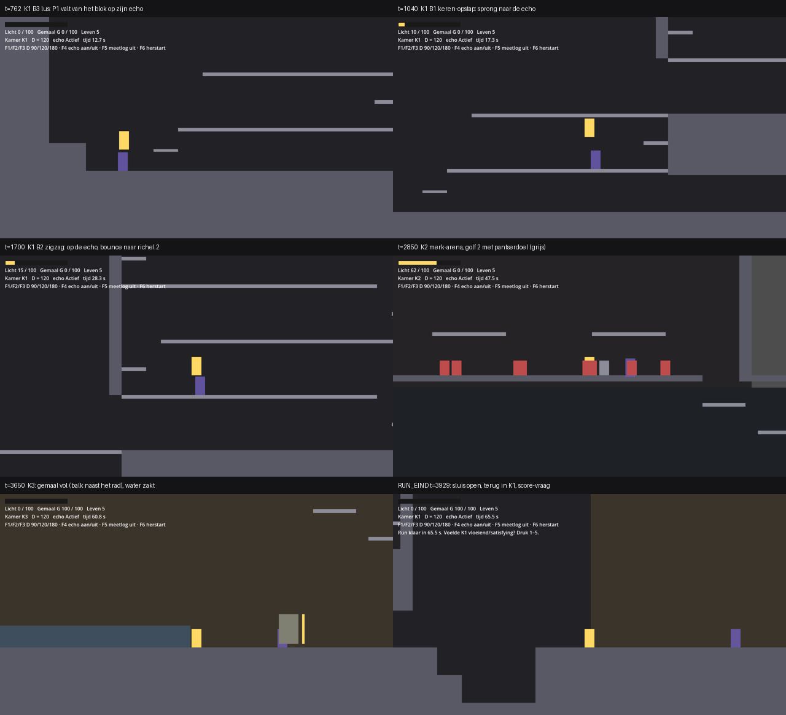

# Kamers: de grijze flow-kamer (mijlpaal 1, F0)

Versie 0.4 · Eigenaar: World & Level Designer (met Gameplay Programmer) · Taak T16b (`docs/productie/fase-2-kader.md` §2) · Reviewer: Lead Game Designer
Bron: `docs/design/gdd.md` v0.4 §2.5a, §2.12, §4 (flow-kamer-spec, bouwstenen B1–B4, FK-1–FK-6, MP-1–MP-7) en `docs/concept/pitch.md` v0.4.
Scène: `game/levels/flowkamer/flowkamer.tscn` (hoofdscène van het project). Code: `game/levels/flowkamer/` (kamer, maten, vijanden, meetlog, gescripte run, normberekening) en `game/scripts/light/` (lichtmeter, gemaal, pomprad). Tests: `game/tests/test_flowkamer.gd` (solo) en `game/tests/test_flowtest_duo.gd` (co-op, [#125](https://github.com/cesarvangerwen-glitch/echoborn/issues/125)).

*Zes momenten uit de gescripte run bij D = 120 (headless gedraaid onder Xvfb, placeholder-art). Geel is P1, paars de echo, rood een basisvijand, grijs het pantserdoel.*

## 1. Doel

Eén grijze kamer waarin we meten of de echo je in beweging houdt (pillar 1, normen (1)–(3)), bij welke staartlengte D, en of de springplank vóór je ligt (R-V12). Geen puzzel, geen slot (FK-1, FK-2). De kamer is af als de QA Lead er de flow-test (T17) in kan draaien: een speler of een gescripte run speelt, het meetlog schrijft één CSV per run.

## 2. Indeling

Drie kamers in één scène, buren in een lus K1 → K2 → K3 → K1 (FK-3, E-04a). Maten in wereldpixels, y naar beneden; "vloer" is de bovenkant van een blok.

| Kamer | Rect (x, y, b, h) | Inhoud |
|---|---|---|
| **K1 Sprongketen** | 0, 0, 1440, 720 | B4 (start), startgang van 860 px, B3 (links onder), B1 en B2 (midden), bovenroute op y = 90 naar K2 |
| **K2 Merk-arena** | 1440, 0, 640, 360 | Vloer op 340, twee eenrichtingsplatforms op 70 px (y = 270), gat rechts (x 2000–2060) naar K3 |
| **K3 Gemaal** | 1440, 360, 960, 360 | Vloer op 610. Rechts de oever met het pomprad, links de ondergelopen straat met `Diepwater` en de sluis naar K1; rechts een trap van vijf richels terug naar het gat van K2 |

K1 is 1440 breed in plaats van ± 1280: B4 heeft aan de landingskant ≥ 180 px vrije hoogte nodig en mag niet onder de schacht van B2 liggen.

## 3. Bouwstenen (gdd §4.3) en hoe ze hier liggen

Alle maten uit gdd §4.3; per bouwsteen alleen wat ik koos of moest kiezen.

| Bouwsteen | Ligging | Echolijn | Langzame lijn | Keuzes |
|---|---|---|---|---|
| **B4 Lanceerkloof** | Vloer 610, kloof x 1190–1350 (160 px), bodem 700; aanloop 90 px; ≥ 180 px vrij boven kloof en aanloop | Lancering (C-11). Solo: aan de rand (x 1352) slaan en AANVAL 32 ticks vasthouden, springen als de echo nog 24 px van je is; je landt op hem terwijl hij in houding staat. Co-op: P1 staat in houding aan de rand, P2 springt op hem; P1 neemt de langzame lijn | Kloof in, 160 px, trede van 45 en dan de vloer | Ligt aan het begin van de run, met de gezichtsrichting naar links (naar de kloof). De landing aan de overkant (± 190 px, gemeten x ± 1164 met LEFT vast na de lanceerstaat) blijft net vrij van het plafond van de startgang (x < 1150). Getest solo en co-op, alle D |
| **B3 Lus** | Kom links onder: vloer 190 px (x 140–330), blok van 45 px tegen de linkerwand met bovenkant B = D − 60 (30 / 60 / 120), galerij op 70 px (y = 540) die 40 px de kom in steekt | Door de kom, op het blok, keren, **van de blokrand afspringen** en op de echo landen die net door de ingang komt, bounce (zo nodig dash) naar de galerij | Eenrichtingstrede van 35 px (x 250–290) en dan de galerij | Gespiegeld (ingang rechts, blok links), want de route komt van rechts. De trede is een dunne eenrichtingsrichel: P1 en de echo lopen eronder door de kom in. Het blok wisselt van breedte met D (debugmenu start dan een nieuwe run) |
| **B1 Keren-opstap** | Gang van 320 px op y = 540 (x 330–650), wand rechts, galerij op 90 px (y = 450) over de hele gang | Naar de wand, keren, op de echo als hij ± 130 px vóór je is, bounce naar de galerij | Eenrichtingstrede op 45 px tegen de wand, dan de wandtop | De gang is ook de B3-galerij; de wandtop is de vloer van B2 |
| **B2 Zigzag omhoog** | Schacht x 650–1130 (480 px), vloer 450, richels van 416 px op 90 / 180 / 270 / 360 (y 360, 270, 180, 90), om en om tegen links en rechts | Per verdieping keren, op de echo, bounce naar de volgende richel | Per verdieping een eenrichtingstrede op 45 px tegen de keerwand | Ingang links onder; de vierde richel loopt over in de bovenroute |

**Treden als eenrichtingsrichel.** De gdd rekent het keerpunt van B1 en B2 vanaf de wand (D + 24 px vlakke vloer, landing ≥ 216 px van de wand). Een massieve trede tegen de wand schuift het keerpunt 40 px op; bij D = 180 komt P1 op richel 1 en 3 dan te dicht bij de wand (128 in plaats van ≥ 204 px). Daarom zijn de treden dunne eenrichtingsrichels op 45 px: je loopt eronder door tot de wand, en springt er recht omhoog op voor de langzame lijn.

**Vallen (vangen, C-13)** heeft geen eigen bouwsteen (gdd §4.3, O-11). De start­gang (860 px rechtdoor) is de plek waar zo'n bouwsteen in T3c kan komen.

## 4. Encounters: K2 merk-arena

| | Inhoud | Wanneer |
|---|---|---|
| Golf 1 | 4 basisvijanden (x 1600, 1720, 1840, 1940) | P1 komt K2 voor het eerst binnen |
| Golf 2 | 5 basisvijanden (x 1580, 1640, 1700, 1820, 1940) + 1 pantserdoel (x 1840) | Alle basisvijanden van golf 1 zijn op |
| Terugkeer | De basisvijanden van golf 2 die op zijn, komen terug; een pantserdoel dat nog staat, blijft | Elke keer dat P1 K2 binnenkomt na golf 2, zolang het gemaal niet vol is |

Vijanden blijven in K2 (x 1458–1992) en doen alleen iets zolang P1 in K2 is. De arena sluit niet af. Waarden van de basisvijand en het pantserdoel: gdd §4.3 (werkaanname LGD).

**4 + 5 in plaats van 3 + 3.** Met 3 + 3 haalde de gescripte run 92 LP na K1 en één keer K2; het doel is ≥ 100 (gdd §4.2). Met 4 + 4 was het 102, en sinds de vang in B3 (co-op 7A, +3 in plaats van +5) 100: marge 0. Met een vijfde basisvijand in golf 2 is het **108 bij elke D** (marge 8, één gemiste landing in K1 kost 5). De LP-waarden zijn ongewijzigd (gdd §4.2: eerst de aantallen bijstellen).

**FK-2-grens met 4 + 5 vijanden** (gdd §4.4; zonder echo komt licht alleen uit P1-treffers: 3 treffers × 2 LP = 6 LP per basisvijand, het pantser breekt niet en geeft 0 LP):

| | Basisvijanden | LP | Totaal |
|---|---|---|---|
| Eerste keer K2 (golf 1 + 2) | 4 + 5 | 9 × 6 = 54 | 54 |
| Terugkeer 1 | 5 | 5 × 6 = 30 | 84 |
| Terugkeer 2 | 5 | 30 | **114 ≥ 100** |

Het gemaal is zonder echo dus vol na **2 terugkeren** (grens FK-2: ≤ 4). Gemeten: 2 bij elke D. Ter vergelijking: met 4 + 4 was het 48 + 3 × 24 = 120 na 3 terugkeren, met 3 + 3 (gdd) 36 + 4 × 18 = 108 na 4.

## 5. K3 gemaal en lichtmeter

- **Pomprad** (32 × 48, niet `Merkbaar`) op x = 1960, middelpunt 30 px boven de vloer (FK-5: 15–40). Je raakt het lopend en vanuit een sprong, van links en van rechts. Geen vijand binnen 80 px (K2 ligt erboven, achter de vloer).
- **Straat met `Diepwater`**: x 1470–1800, waterlijn 570 (40 px boven de vloer), zakt na `GEMAAL_VOL` in 180 ticks naar 610; dan verdwijnt de sluis (x 1440–1460). Alleen het middelpunt van P1 telt; 30 ticks in het water = terug op de laatste droge vloerpositie (respawn, E-04b).
- **Trap terug naar K2**: vijf eenrichtingsrichels van 45 px (y 565 … 385), de bovenste onder het gat van K2. Zo kan wie te weinig licht had, terug naar de arena voor meer (FK-2), zonder de sluis.
- **Lichtmeter** (LM-01, LM-02): `game/scripts/light/light_meter.gd`. **Gemaal** (LM-03, LM-04, LM-06): `game/scripts/light/gemaal.gd`. Na het gemaal wordt de achtergrond van K3 warm (geen `FelLicht`).

## 6. Geheimen en shortcuts

Geen. De flow-kamer meet flow; geheimen komen met de slice (T8a).

## 7. Meetlog

Elke run schrijft `user://meetlog_<datum-tijd>_<solo|coop>_D<D>_p1.csv` (gdd §4.5) bij `RUN_EIND`, en opnieuw na de scores. Op Linux staat `user://` in `~/.local/share/godot/app_userdata/Echoborn/`, op Windows in `%APPDATA%\Godot\app_userdata\Echoborn\`. Een run die je afbreekt (F1–F4, F6) wordt bewaard als `…_afgebroken.csv`.

| Norm | Wat in de CSV | Event(s) |
|---|---|---|
| (1) stilstand, MP-1 | Elke stilstand van P1 met lengte | `STIL_START`, `STIL_EIND` (definitie T16a, `meetlog.gd`) |
| (2) echo-acties, MP-2 | Springplank-landing, merksprong met ontploffing (eerste schakel), later lancering en vang | `SPRINGPLANK`, `BOUNCE`, `MERKSPRONG`, `ONTPLOFFING`, (`LANCERING`, `VANGEN`: T16c) |
| (3) vloeiend, MP-5 | Score 1–5 per kamer na de run | `SCORE` (waarde = score, bron = kamer) |
| R-V12, MP-3 | Landingen en de stilstanden ervoor | `SPRINGPLANK` + `STIL_*` |
| MP-4 | Echo Leeg | `ECHO_LEEG_START`, `ECHO_LEEG_EIND` (de echo begint Leeg tot tick D) |
| MP-6 | Licht per bron, pompslagen | `LP` (bron `<bron>_<wie>`, bv. `springplank_echo`), `POMP`, `GEMAAL_VOL` |
| Overig | Kamer, drop-in/out | `KAMER`, `DROP_IN`, `DROP_OUT`, `RESPAWN`, `LOSLATEN`, `BREEK` |

`game/levels/flowkamer/flow_report.gd` rekent MP-1–MP-4 en MP-6 uit een log; de tests gebruiken het, en de QA Lead kan het voor T17 gebruiken (het rapport zelf is van de QA Lead).

## 8. Spelen en testen

- **Spelen**: open `game/` in Godot 4.6.3 en start het project (F5). P1: A/D lopen, spatie springen, linker Shift dash, E aanval/pompen, Q 0,5 s = Loslaten. P2: Enter doet mee, Backspace 1 s stopt (via de InputRouter; de echte drop-in/out is T16c).
- **Debugmenu** (§4.1): F1/F2/F3 = D 90/120/180 (nieuwe run, met het B3-blok van die D), F4 = echo aan/uit (nieuwe run), F5 = meetlog aan/uit, F6 = herstart. Na de run: 1–5 per kamer.
- **Headless**: `godot --headless --path game --fixed-fps 60 -s res://tests/run_tests.gd`. `test_flowkamer.gd` bouwt de kamer per D, draait de gescripte run (moet `RUN_EIND` en de normen halen), speelt de run van D = 90 opnieuw af met een `ScriptedInput` (zelfde log), en draait per D de run met echo uit (FK-2). De run met echo uit bij D = 180 duurt 6020 ticks; de runner geeft een test 7200 frames. `test_flowtest_duo.gd` draait per D de gescripte co-op-run (`flow_duo.gd`, §9) en die van D = 120 twee keer (zelfde log).

## 9. Gemeten met de gescripte geoefende run

Uit het meetlog berekend (`flow_report.gd`; co-op met de MP-7-code van `test_flowtest_t17.gd`). Dit zijn geen speltestresultaten: de runs laten zien dat de kamer de normen **kan** halen (gdd §4.5). Mensen meten in T17.

**Solo** (`flow_bot.gd`, sinds #125 met de lancering in B4):

| | D = 90 | D = 120 | D = 180 | Norm |
|---|---|---|---|---|
| Runtijd | 64,4 s | 66,8 s | 78,9 s | ≤ 120 s |
| LP na K1 + één keer K2 | 115 | 115 | 115 | ≥ 100 |
| MP-1 langste stilstand | 107 ticks | 137 | 197 | ≤ 300 |
| MP-2 echo-acties/min (K1 / K2) | 15,8 (11,5 / 39,9) | 14,4 (11,1 / 34,4) | 12,2 (10,3 / 22,3) | ≥ 3,0, ook per kamer |
| MP-2 langste gat | 13,5 s | 12,8 s | 14,9 s | ≤ 40 s |
| MP-3 landingen/min, zonder wachten | 5,6 / 83 % | 5,4 / 83 % | 4,6 / 83 % | ≥ 75 % |
| MP-4 echo Leeg | 2 % | 3 % | 4 % | ≤ 40 % |
| MP-6 LP met de echo, pompslagen echo | 83 %, 5 | 83 %, 5 | 83 %, 5 | ≥ 40 %, ≥ 1 |
| Echo breekt | 0 | 0 | 0 | 0 (FK-4) |
| **Echo uit** (FK-2): runtijd, terugkeren K2 | 98,8 s (1,53×), 2 | 99,3 s (1,49×), 2 | 100,3 s (1,27×), 2 | ≤ 2×, ≤ 4 |

De langste stilstand zit telkens aan de waterkant in K3: P1 wacht tot de echo zijn pompslagen herhaald heeft en het water zakt (± D + 40 ticks). De lancering in B4 kost een wachttijd aan de rand (P1 springt pas als de echo eraan komt, ± D − 12 ticks na zijn slag) en is daarom de enige landing met stilstand ervoor (MP-3 83 %, 6 van 7). Ze is solo **trager** dan de langzame lijn: de runtijd gaat + 0,9 / + 1,4 / + 2,3 s omhoog bij D = 90 / 120 / 180 (vóór #125: 63,5 / 65,4 / 76,6 s). Dat volgt uit gdd §4.3 ("je wacht 69 / 99 / 159 ticks"); ze levert wel een actie en licht op (LP na K1 + K2: 108 → 115). Punt voor de LGD, bij antwoord 1 in §12.

**Co-op** (`flow_duo.gd`, #125): een geoefend duo, P1 en P2 allebei gescript. B4: P1 in houding aan de rand, P2 vliegt over. B3, B1 en B2: op elk niveau loopt de drager heen en weer onder het volgende niveau, de springer springt al lopend op hem en bounct omhoog, de drager neemt de trede; de rollen wisselen elk niveau (springer P1 in B3, B2-0, B2-2; P2 in B4, B1, B2-1, B2-3). K2: wie een merk van de ander ziet, laat het knallen; anders zet hij een merk. K3: beiden pompen, aan elke kant van het pomprad één. P2 doet mee vóór de eerste tick.

| | D = 90 | D = 120 | D = 180 | Norm |
|---|---|---|---|---|
| Runtijd | 57,5 s | 57,5 s | 57,5 s | — |
| MP-1 langste stilstand P1 | 86 ticks | 86 | 86 | ≤ 300 |
| MP-2 samenwerkingsacties/min (K1 / K2) | 19,8 (12,4 / 57,1) | gelijk | gelijk | ≥ 3,0, ook per kamer |
| MP-2 langste gat | 531 ticks (8,9 s) | gelijk | gelijk | ≤ 2400 |
| MP-3 landingen/min, zonder wachten | 8,4 / 88 % | gelijk | gelijk | ≥ 75 % |
| Lancering (B4) · bounce P1 / P2 · merk-combo (K2) | 1 (1) · 3 / 3 · 10 (10) | gelijk | gelijk | vraag 8: lancering ≥ 1 |
| MP-4 zonder tweede lichaam (W4) | 0 % | 0 % | 0 % | ≤ 40 % |
| MP-6 LP met P2 of samen; pompslagen P2 | 92 % van 120; 5 | gelijk | gelijk | ≥ 40 %; ≥ 1 |
| MP-7 (a) runtijd co-op ÷ solo | 0,89 | 0,86 | 0,73 | ≥ 0,5 |
| MP-7 (b) langste stilstand P2 (W5) | 73 ticks | 73 | 73 | ≤ 300 |
| MP-7 (c) samenwerkingsacties/min per speler (W6) | 19,8 | 19,8 | 19,8 | ≥ 1,0 |
| MP-7 (d) P2 opgelost | 0 % | 0 % | 0 % | ≤ 10 % |

Wat dit zegt:

- **De kamer kan de normen in co-op halen**, bij elke D, met de lancering, bounce in beide richtingen, merk-combo's en pompslagen van P2. MP-1, MP-2, MP-4, MP-6 en MP-7 (b)–(d) zijn daarom checks in de test (zoals de solo-run in `test_flowkamer.gd`); MP-3 en MP-7 (a) staan alleen in de uitvoer.
- **In co-op maakt D voor deze kamer niets uit**: er is geen echo (C-01), D zit alleen nog in de levensduur van een merk (D + 30), en het duo laat elk merk ruim binnen 120 ticks knallen. Het B3-blok gebruikt het duo niet: de drager gaat gewoon onder de galerij staan.
- **Een geoefend duo is sneller dan solo** (0,73–0,89×), maar ver binnen "niet meer dan 2× zo snel". P1 is na 38,8 s in K2: in K1 neemt elke drager de langzame lijn, dus daar wint het duo weinig. De winst zit vooral in K2 (twee slagers die elkaars merken laten knallen) en K3 (twee pompers; 117 LP na één keer K2, dus geen terugkeer).
- MP-2 en MP-3 tellen een lancering als twee acties (`SPRINGPLANK` en `LANCERING` op dezelfde tick), zoals in solo; gdd §4.5 zegt "één contact = één actie". Zonder die dubbeltelling blijft MP-2 ruim gehaald. Punt voor de QA Lead en de LGD, geen wijziging hier.

## 10. Checklist levelregels (WLD; review LGD)

| Regel | Oordeel | Toelichting |
|---|---|---|
| FK-1 geen puzzel | ja | Elke bouwsteen: lopen, keren, springen; nergens een volgorde of schakelaar. B3 vraagt timing (afspringen als de echo de kom in komt), met de langzame lijn ernaast |
| FK-2 nooit een slot | ja | Elke echolijn heeft een langzame lijn; met echo uit gemeten ≤ 1,55× en 2 terugkeren (tabel §9) |
| FK-3 open doorgangen | ja | Geen deur valt achter P1 dicht; kamerwissels resetten de echo niet (0 × `ECHO_LEEG_START` in de runs) |
| FK-4 echo breekt niet | ja | Geen schaduwgeometrie, `FelLicht` of `Schaduwgevaar`; 0 × `BREEK` |
| FK-5 pomprad in de route | ja | 30 px boven de vloer, lopend en springend te raken, geen vijand binnen 80 px |
| FK-6 maten | ja | Echolijnen 70–90 px; treden ≤ 45 px; te overspringen gaten ≤ 64 px (B2, trap). De kloof van B4 (160) en het gat van B3 (150) hoef je niet over te springen: de langzame lijn gaat erdoorheen |
| C-15 optioneel samenwerken | ja | Geen object of poort vraagt een samenwerkingsactie; één kamer voor solo en co-op. Met een meeloper ≤ 2× de run met echo uit (`test_coop_deel2.gd`); de gescripte co-op-run haalt de normen (§9) |
| L-02 | ja | Elke plek op de route is lopend te halen; geen plek alleen voor een live P2 |
| L-03 | ja | De enige poort (sluis) gaat open door het gemaal |

## 11. Werkaannames (kader §5)

Uit de gdd (van de LGD): beweging §2.5a, basisvijand en pantserdoel §4.3, D = 90 / 120 / 180, lichtmeter LM-01–LM-06, MP-1-definitie zoals T16a hem bouwde. Van mij (WLD), voor deze kamer:

1. **De "scripted geoefende run" is een deterministische bot** (`flow_bot.gd`), geen vaste lijst bits: hij kijkt waar P1 en de echo staan. Zijn bits, afgespeeld als `ScriptedInput`, geven hetzelfde log (test). Zo hoeft de run niet opnieuw bij elke maatwijziging.
2. **4 basisvijanden in golf 1 en 5 in golf 2** in plaats van 3 + 3 (§4).
3. **Treden van B1, B2 en B3 zijn eenrichtingsrichels** (§3).
4. **K3 heeft een trap terug naar K2**, zodat wie te weinig licht heeft niet vastzit achter de dichte sluis.
5. **`SCORE`** als extra event voor norm (3), in dezelfde CSV.
6. **Drop-in/out is een plaatshouder** (P2 verschijnt op de echo of op P1); C-03–C-13 komen in T16c. In co-op telt de lichtmeter P2 als drager en ontsteker.
7. **B4: de bot lanceert** (#125). Hij kijkt naar de echo, niet naar de klok: springen als de echo nog 24 px van P1 is (12 ticks vóór hij stilstaat), zodat de landing midden in de houding valt (gdd §4.3: afzet op T + D − 21 … T + D − 3). Wacht de bot 300 ticks zonder echo, of mist hij, dan de langzame lijn.
8. Een wissel van D of echo aan/uit in het debugmenu start een nieuwe run (één CSV per D).
9. **De gescripte geoefende co-op-run is een duo van twee bots** (`flow_duo.gd`, #125), elk een inputbron, net als `flow_bot.gd` alleen met wat spelers zien. Het duo gebruikt niet de proxy `_CoopView` uit `test_flowtest_t17.gd`: die laat de solo-bot P2 als echo lezen, en een levend lichaam kan, anders dan de echo, niet zelf omhoog zonder plank (`docs/qa/rapport-f0-flowtest.md` §4). Wel de MP-7-code van dat script, met W4–W6 (`docs/qa/testplan-f0.md` §6).
10. **Het duo begint samen**: P2 doet mee vóór de eerste tick (C-03, echo Leeg: P2 verschijnt bij P1). Een geoefend duo drukt samen op start; de ondergrenzen van T17 laten P2 pas op tick D + 1 meedoen.
11. **De drager wacht lopend** (± 30 px rond zijn plek) en blijft pas staan als de springer afzet; de springer springt al lopend (aanloop ≤ 66 px). Zo meet MP-3 geen wachten dat bij een geoefend duo niet hoort.

## 12. Bevindingen, antwoorden en open punten

**Antwoorden van de Lead Game Designer** (Lead-review)

1. K1, echolijn niet sneller dan de langzame lijn: zo laten voor T17; K1 moet norm (2) en R-V12 halen, geen tempowinst. T17 telt per bouwsteen welke lijn spelers kiezen; kiest meer dan 50 % de langzame lijn, dan zet de WLD de trede verder van de wand.
2. B2 bij D = 180 (afzetten zodra de echo landt, ± 76 px): akkoord, dat is de prijs van D = 180; T17 meet het.
3. B3: afspringen van het blok wordt na T16c een vang (C-13); zo is het bedoeld.
4. Diepwater vóór het gemaal vol: klopt met LM-06 en E-04b; er gaat geen LP verloren, wat de echo niet pompt, blijft in de meter.
5. MP-1: de definitie uit T16a is de maat; `flow_report.gd` blijft zoals het is.

**Open punten**

- K1–K3 worden na de AreaLoader (T5b) `Kamer`-nodes met de AreaLoader, in plaats van `Layout.NEIGHBOURS` (WLD).
- Gameplay Programmer, in T16c: review van de fix in `tail_echo.gd` (E-08a negeert eenrichtingsrichels, `_is_free`).
- Gameplay Programmer, in T16c: P1 die een richting vasthoudt tegen een wand op de vloer, is niet `on_floor` en springt niet (de bot laat één tick los).
- QA Lead en LGD: een lancering telt in MP-2 en MP-3 nu als twee acties (`SPRINGPLANK` + `LANCERING`, §9).
- QA Lead (T17 deel 2, [#80](https://github.com/cesarvangerwen-glitch/echoborn/issues/80)): de co-op-cijfers van het duo (§9) en de nieuwe solo-cijfers met lancering. Omdat de bot nu in B4 lanceert, veranderen ook de ondergrenzen van T17 (de schaduwpartner lanceert P1 in B4).
- Gameplay Programmer: de springplank-reeks `n` opnieuw laten beginnen bij aflopen van de echo kan van `flow_meetlog.gd` naar `meetlog.gd`.
- LGD: gdd §4.2 en FK-2 naar 4 + 5 vijanden.
- LGD na T17: in B3 geeft de vang +3 tegen +5 voor landen plus bounce; met 4 + 5 vijanden haalt de gescripte run 108 LP na K1 + K2 (marge 8).

## 13. Wijzigingen

| Versie | Wat |
|---|---|
| 0.1 | Eerste blockout van de flow-kamer (T16b) |
| 0.3 | Lead-review: vijfde basisvijand in golf 2 (108 LP na K1 + K2), FK-2-grens en metingen bijgewerkt |
| 0.4 | #125: de bot lanceert in B4 (solo); gescripte co-op-run `flow_duo.gd` met test per D; §9 solo bijgewerkt en co-op erbij; werkaannames 7, 9–11 |
| 0.2 | Merge met co-op 7A (#78): vang en lancering tellen in de lichtmeter (+3, +4), B3 landt met een vang; metingen bijgewerkt. Lead-review: FK-2-grens voor 4 + 4 vijanden voorgerekend (§4), FK-2-test per D, antwoorden van de LGD en open punten (§12) |
