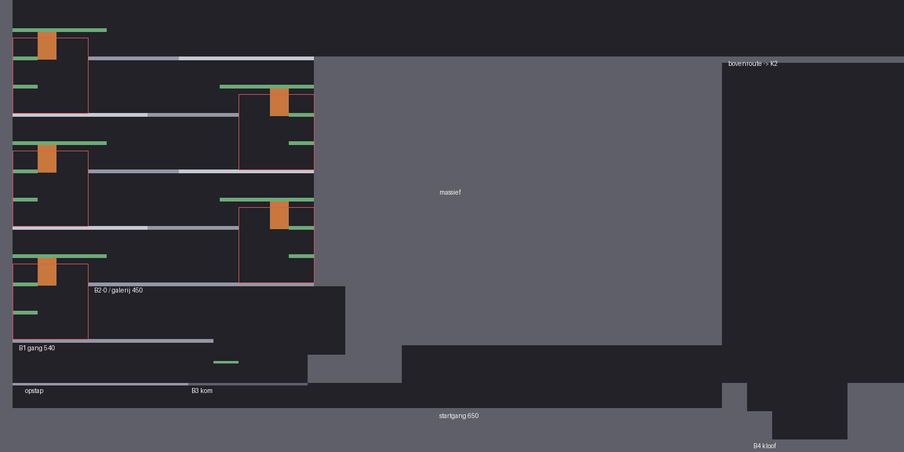

# Kamers: de grijze flow-kamer (mijlpaal 1, F0; na F0)

Versie 0.5 · Eigenaar: World & Level Designer (met Gameplay Programmer) · Taken T16b (`docs/productie/fase-2-kader.md` §2) en T16d ([#176](https://github.com/cesarvangerwen-glitch/echoborn/issues/176)) · Reviewer: Lead Game Designer
Bron: `docs/design/gdd.md` v0.7.3 §2.5a, §2.12, §4 (flow-kamer-spec, bouwstenen B1–B4, FK-1–FK-6, MP-1–MP-7) en §4.7 (herontwerp na F0, bouwopdracht W-1–W-7), `docs/concept/pitch.md` v0.4.
Scène: `game/levels/flowkamer/flowkamer.tscn` (hoofdscène van het project). Code: `game/levels/flowkamer/` (kamer, maten, vijanden, meetlog, gescripte run, normberekening) en `game/scripts/light/` (lichtmeter, gemaal, pomprad). Tests: `game/tests/test_flowkamer.gd` (solo), `game/tests/test_flowkamer_na_f0.gd` (keerzone, paren, keren per D) en `game/tests/test_flowtest_duo.gd` (co-op, [#125](https://github.com/cesarvangerwen-glitch/echoborn/issues/125)).

**Stand van deze versie.** K1 (W-1, W-2) en K2 (W-3) zijn na F0 omgebouwd. K3 is nog die van F0 (één pomprad, sluis 180 ticks na `GEMAAL_VOL`): de pompgang (W-4) volgt na de regels van de Gameplay Programmer (G-1–G-3), net als de gescripte run per D op de nieuwe kamer (W-5) en de wachtbot en de late bot (W-6, §9).

*K1 na F0, uit `flow_layout.gd` getekend (1 px = 1 wereldpixel). Donkergrijs is dicht, lichtgrijs eenrichting, wit het dichte stuk van een richel, groen de langzame lijn (treden op 45 en 90, richel op 135), oranje de overhang, rood de keerzone (120 × 120 px) bij elk keerpunt.*

## 1. Doel

Eén grijze kamer waarin we meten of de echo je in beweging houdt (pillar 1, normen (1)–(3)), bij welke staartlengte D, en of de springplank vóór je ligt (R-V12). Geen puzzel, geen slot (FK-1, FK-2). De kamer is af als de QA Lead er de flow-test (T17) in kan draaien: een speler of een gescripte run speelt, het meetlog schrijft één CSV per run. Na F0 (gdd §4.7): **wachten loont zo min mogelijk, en de echo komt je tegemoet**. In K1 brengt wachten bij de keerwand je nergens (keerzone) en is keren sneller dan de treden; in K2 staan de vijanden in paren, zodat er altijd een volgend doel is.

## 2. Indeling

Drie kamers in één scène, buren in een lus K1 → K2 → K3 → K1 (FK-3, E-04a). Maten in wereldpixels, y naar beneden; "vloer" is de bovenkant van een blok.

```mermaid
flowchart LR
    S([RUN_START<br/>K1 rechtsonder]) --> B4[B4 lanceerkloof] --> G[startgang<br/>40 px lager] --> O[opstap<br/>omkeren] --> B3[B3 lus<br/>keert om] --> B1[B1 keren-opstap<br/>keerzone] --> B2[B2 zigzag<br/>4 richels, keerzones] --> T[bovenroute]
    T --> K2[K2 merk-arena<br/>golf 1 + 2 in paren]
    K2 -- gat rechts --> K3[K3 gemaal<br/>pomprad, Diepwater]
    K3 -- trap terug --> K2
    K3 -- sluis, na GEMAAL_VOL --> E([RUN_EIND<br/>K1])
```

| Kamer | Rect (x, y, b, h) | Inhoud |
|---|---|---|
| **K1 Sprongketen** | 0, 0, 1440, 720 | B4 (start, rechtsonder), startgang op 650 naar links onder de kom van B3 door, opstap (x 20–300), B3 (kom x 300–490), B1 tegen de linkerwand (gang x 20–340 op 540), B2 in een schacht recht boven B1 (x 20–500), bovenroute op y = 90 naar K2; rechts van de schacht massief |
| **K2 Merk-arena** | 1440, 0, 640, 360 | Vloer op 340, twee eenrichtingsplatforms op 70 px (y = 270), gat rechts (x 2000–2060) naar K3; vijanden in paren (§4) |
| **K3 Gemaal** | 1440, 360, 960, 360 | Vloer op 610. Rechts de oever met het pomprad, links de ondergelopen straat met `Diepwater` en de sluis naar K1; rechts een trap van vijf richels terug naar het gat van K2 (F0-versie, W-4 volgt) |

K1 is 1440 breed in plaats van ± 1280: B4 heeft aan de landingskant ≥ 180 px vrije hoogte nodig.

**Waarom de opstap (omkeren zonder echo).** K1 begint naar links (de sluis van K3 komt rechtsonder uit) en eindigt naar rechts (de bovenroute naar K2). Elk keerpunt met de echo keert je om: B3 één keer, B1 één keer, B2 vier keer; samen zes, een even aantal. Er is dus precies één omkeer zonder echo nodig. In F0 zat die in B1 (bounce recht omhoog bij de wand, dan terug over de wand de schacht in); de keerzone maakt dat onmogelijk, en dat is de bedoeling. Nu zit hij aan het eind van de startgang: een eenrichtingsrichel van 40 px boven de startgang, waar je op springt en naar rechts de kom van B3 in loopt (± 30 ticks, 0,5 s). Daarvoor ligt de startgang 40 px lager dan B4 (650 in plaats van 610) en loopt hij onder de kom door (36–40 px vrij; P1 is 30 px hoog). Zo blijven B3, B1 en B2 op dezelfde hoogtes als in F0 en past de richel op 135 van de bovenste verdieping van B2 onder het plafond (y = 45).

## 3. Bouwstenen (gdd §4.3) en hoe ze hier liggen

Alle maten uit gdd §4.3 en §4.7.4; per bouwsteen alleen wat ik koos of moest kiezen. Afstanden "van de wand" zijn vanaf het wandvlak.

| Bouwsteen | Ligging | Echolijn | Langzame lijn | Keuzes |
|---|---|---|---|---|
| **B4 Lanceerkloof** | Vloer 610, kloof x 1190–1350 (160 px), bodem 700; aanloop 90 px; aan de overkant 40 px vloer op 610 (x 1150–1190), dan de stap van 40 px naar de startgang; ≥ 180 px vrij boven kloof en aanloop | Lancering (C-11). Solo: aan de rand (x 1352) slaan en AANVAL 32 ticks vasthouden, springen als de echo nog 24 px van je is; je landt op hem terwijl hij in houding staat. Co-op: P1 staat in houding aan de rand, P2 springt op hem; P1 neemt de langzame lijn | Kloof in, 160 px, trede van 45 en dan de vloer | Ongewijzigd na F0 (gdd §4.7.1). De landing aan de overkant (gemeten x ± 1158) valt op de 40 px vloer of de startgang erachter |
| **B3 Lus** | Kom x 300–490 (190 px) op 610, ingang links via de opstap; blok van 45 px tegen de rechterwand met bovenkant B = D − 60 (30 / 60 / 120); galerij op 70 px (y = 540) van de linkerwand tot x 340, 40 px de kom in | Door de kom naar rechts, op het blok, keren tegen de wand, **van de blokrand afspringen** en op de echo landen die net door de ingang komt (een vang, C-13), dan (zo nodig met dash) naar de galerij | Eenrichtingstrede van 35 px (x 340–380) en dan de galerij | Weer zoals in de gdd (ingang links, blok rechts); in F0 gespiegeld. De kom is een dichte vloer van 4 px boven de startgang: je komt er alleen in via de opstap. Het blok wisselt van breedte met D (debugmenu start dan een nieuwe run) |
| **B1 Keren-opstap** (W-1) | Gang van 320 px op y = 540 (x 20–340, = de B3-galerij), keerwand = linkerwand (x 20). Galerij op 90 px (y = 450) van **120 tot 480 px** van de wand (x 140–500); die galerij is de vloer van B2. Keerzone x 20–140 | Naar de wand (naar links), keren, je echo tegemoet, op hem als hij ± 130 px vóór je is, bounce naar de galerij zonder dash; je landt op D + 68 px van de wand | Treden van 45 px op 45 en 90 px tegen de wand (x 20–60), de richel op 135 px (y = 405, x 20–170) en je van de richel af laten vallen op de galerij | Achter de wand ligt niets (buitenwand). Overhang en dicht stuk: zie hieronder |
| **B2 Zigzag omhoog** (W-2) | Schacht x 20–500 (480 px), vloer 450 (= galerij van B1), vier richels van **360 px** op 90 / 180 / 270 / 360 (y 360, 270, 180, 90), om en om tegen links en rechts; aan de open kant een gat van **120 px** boven de keerwand van de richel eronder (de keerzone). Keerwanden: vloer rechts (x 500), richel 1 links, richel 2 rechts, richel 3 links | Per verdieping naar de keerwand, keren, je echo tegemoet, op hem, bounce naar de volgende richel en doorlopen naar de andere wand. Landing op ± D + 68 px van de vorige wand, dus ≥ 212 px van de volgende (≥ D + 24) | Per verdieping treden op 45 en 90 tegen de keerwand, de richel op 135 (45 px onder de richel daarboven) en je zakken op de volgende richel | Richel 4 loopt over in de bovenroute. De rechterwand van de schacht is het massief, met de bovenroute erop |

**Keerzone (W-1, W-2).** Bij elk keerpunt ligt binnen 120 px van de keerwand niets waarop P1 kan landen lager dan 120 px boven zijn vloer, behalve de twee treden. Wie bij de wand op zijn echo wacht en bounct (± 100 px), komt dus nergens behalve op de trede op 90, en is dan op de langzame lijn. De weg omhoog begint op 120 px van de wand en loopt door tot 480 px (galerij van B1) of 360 + 120 px (richels van B2); de test controleert per keerpunt dat 120–270 px gedekt is (`test_keerzone_geometry`).

**Overhang (afwijking, WLD).** Zonder extra blok haal je de weg omhoog ook vanaf de trede op 45: aflopen, coyote-sprong en op de top dashen geeft ± 105 px opzij op 90 px hoogte, genoeg voor de rand op 120 px. Dat is ± 78 ticks vanaf de wand, even snel als keren bij D = 90 (79) en sneller bij D = 120 en 180, en vanaf de trede op 90 kun je zelfs gewoon opzij springen. Daarom ligt tussen de treden en de weg omhoog een **overhang**: dicht, 40–70 px van de wand, van 85 tot 129 px boven de vloer (strak onder de richel op 135). Een sprong vanaf de vloer haalt met het lichaam 80 px en gaat eronder door (de echolijn bij D = 90 zet af op ± 32 px van de wand), een bounce vanaf de echo gebeurt op ≥ 90 px van de wand en dus ernaast; van de treden kun je alleen nog recht omhoog naar de richel op 135. Gemeten: de langzame lijn duurt vanaf de wand **142 ticks** bij elke D (gdd: ± 145), keren **80 / 95 / 125–133** (gdd: 79 / 94 / 124).

**Dicht stuk aan de wandkant van elke richel (afwijking, WLD).** De richel op 135 van een verdieping ligt 45 px onder de richel twee hoger (gdd: "45 px onder de richel daarboven"), en een sprong haalt 50 px. Met een gewone eenrichtingsrichel spring je dus van de richel op 135 naar de richel twee hoger en sla je een verdieping over (vier sprongen voor twee verdiepingen, sneller dan twee keer keren). Daarom zijn de eerste **215 px** van elke richel aan de wandkant dicht: van onder spring je ertegen, van boven land je er gewoon op. 215 px dekt de verste afzet vanaf de richel op 135 (rand + coyote met een dash ervoor, ± 181 px, en de sprong passeert de richel op ± 208 px); de echolijn passeert de richel op ≥ 256 px (D = 180) en blijft in het eenrichtingsdeel. Hetzelfde geldt voor B1: de galerij-richel 1 boven de richel op 135 van B1 is ook dicht.

**Treden als eenrichtingsrichel** (sinds F0). De gdd rekent het keerpunt vanaf de wand (D + 24 px vlakke vloer). Een massieve trede tegen de wand schuift het keerpunt op; daarom zijn de treden dunne eenrichtingsrichels: je loopt eronder door tot de wand, en springt er recht omhoog op voor de langzame lijn.

**Nagerekend per D** (gdd §4.3, met deze kamer; `test_keerzone_geometry` controleert het per D):

| | D = 90 | D = 120 | D = 180 |
|---|---|---|---|
| Vlakke vloer vóór elke keerwand (nodig D + 24) | B1 320, B2 480 | gelijk | gelijk (nodig 204) |
| Landing na keren zonder dash (rand weg omhoog op 120 + 8, ≥ 30 marge) | 158 px | 188 px | 248 px |
| B2: landing (≤ D + 88) tot de volgende wand (nodig D + 24) | 302 px | 272 px | 212 px |
| B2: marge van de bounce tot het dichte stuk van de volgende richel (begint op 480 − 215 = 265 px van de wand; de bounce passeert de richel op ± D + 76): zonder dash / met dash (+ 20 px) | ± 99 / ± 79 px | ± 69 / ± 49 px | **± 9 / ± −11 px**: zonder dash krap, met dash kan de bounce tegen het dichte stuk komen |
| Afzet onder de overhang (40–70 px van de wand): speling tussen lichaam en overhang | **5 px** (afzet op ± 32 px van de wand) | afzet verder van de wand, niet onder de overhang | idem |
| Gemeten: keren tot het volgende niveau / langzame lijn vanaf de wand | 80 / 142 ticks (1,8×) | 95 / 142 (1,5×) | 125–133 / 142 (1,1×) |

Bij D = 180 is keren nog maar 9–17 ticks sneller dan de langzame lijn (gdd: 124 tegen 145). Dat is de prijs van een lange staart; de tweede flow-test meet welke lijn spelers kiezen. De geometrie blijft zo (LGD, §12). De krappe marges (D = 180 met dash, D = 90 onder de overhang) test de late bot (W-6, open punt in §12).

**Restgat** (gdd §4.3, bekend risico): wie onder de weg omhoog stilstaat (120–270 px van de wand, ook op weg naar binnen), krijgt na ≤ D ticks zijn echo onder zich en haalt de weg omhoog. De geometrie sluit dat niet uit; de wachtbot (W-6) en de tweede flow-test meten het.

**Vallen (vangen, C-13)** heeft geen eigen bouwsteen (gdd §4.3, O-11). De startgang (± 850 px rechtdoor) is de plek waar zo'n bouwsteen in T3c kan komen.

## 4. Encounters: K2 merk-arena (W-3)

| | Inhoud | Wanneer |
|---|---|---|
| Golf 1 | 3 paren basisvijanden: x 1560 + 1588, 1750 + 1778, 1940 + 1968 | P1 komt K2 voor het eerst binnen |
| Golf 2 | 3 paren basisvijanden aan de kant van de ingang: x 1470 + 1498, 1660 + 1688, 1850 + 1878, en 1 pantserdoel (x 1579, tussen de eerste twee paren) | Nu: alle basisvijanden van golf 1 zijn op. Na G-3 (Gameplay Programmer): zodra elke basisvijand van golf 1 een merk heeft of op is |
| Terugkeer | De basisvijanden van golf 2 die op zijn, komen terug; een pantserdoel dat nog staat, blijft | Elke keer dat P1 K2 binnenkomt na golf 2, zolang het gemaal niet vol is |

**Paren** (gdd §4.2, §4.7.1 (c)): de twee vijanden van een paar beginnen **28 px** uit elkaar (≤ 32: één merk raakt ze allebei; ≤ 48 = K: L-13 (d)), paren beginnen **≥ 162 px** uit elkaar (tussen de naaste vijanden; eis ≥ 160). Beide vijanden van een paar lopen even snel naar P1, dus de afstand blijft tot een van de twee een treffer krijgt. De ingang is links (de bovenroute komt linksboven binnen); golf 2 staat dus links, en wie golf 1 rechts afmaakt, keert ernaartoe. Vijanden blijven in K2 (x 1458–1992) en doen alleen iets zolang P1 in K2 is. De arena sluit niet af. Waarden van de basisvijand en het pantserdoel: gdd §4.3 (werkaanname LGD).

**3 + 3 paren** (gdd §4.2: eerst de aantallen bijstellen, niet de LP). Gemeten met de gescripte run (LP na K1 + één keer K2, doel ≥ 100; run zonder echo bij D = 180):

| Golf 1 + golf 2 | LP na K1 + K2 | Zonder echo: terugkeren, run D = 180 |
|---|---|---|
| 2 + 2 paren | 97 | 3 (niet gemeten: > 7000 ticks) |
| 3 + 2 paren | 109 | 2, 6895 ticks |
| **3 + 3 paren** | **119 / 119 / 121** (D = 90 / 120 / 180); na G-3 (golf 2 bij "alles gemerkt of op", #178): **121 / 121 / 111** | **1, 5822 ticks** (na G-3: 5696) |

De rijen 2 + 2 en 3 + 2 zijn gemeten vóór G-3. Met 2 + 2 paren haalt de run de 100 LP niet. 3 + 2 haalt ze wel, maar dan duurt de run zonder echo bij D = 180 6895 ticks (twee terugkeren), en de co-op-ondergrenzen van T17 (schaduwpartner, meeloper) halen `RUN_EIND` niet binnen 7000 ticks; de testrunner geeft een test 7200 frames. Met 3 + 3 paren is één terugkeer genoeg.

**Een paar levert minder licht dan twee losse vijanden** (bevinding voor de LGD). P1 raakt met één slag allebei (aanvalsvlak 20 px, de vijanden 28 px uit elkaar): twee merken. De echo laat het eerste merk knallen; de ontploffing (20 SE, E = 32) doodt allebei, zodat het tweede merk niet meer knalt en er geen ketting komt. Een paar geeft met echo dus ± 2 + 2 + 2 + 6 = 12 LP, twee losse vijanden 16. De verwachting in gdd §4.7.2 ("de paren geven meer kettingschakels") komt in deze kamer niet uit; MP-6 blijft gehaald (66–69 % van de LP met de echo). Een ketting in K2 komt er alleen als de tweede vijand de eerste ontploffing overleeft (bv. een paar op 33–48 px: buiten E, binnen K).

**FK-2-grens met 3 + 3 paren** (gdd §4.4; zonder echo komt licht alleen uit P1-treffers: 3 treffers × 2 LP = 6 LP per basisvijand, en één slag raakt beide vijanden van een paar; het pantser breekt niet en geeft 0 LP):

| | Basisvijanden | LP | Totaal |
|---|---|---|---|
| Eerste keer K2 (golf 1 + 2) | 6 + 6 | 12 × 6 = 72 | 72 |
| Terugkeer 1 | 6 | 6 × 6 = 36 | **108 ≥ 100** |

Het gemaal is zonder echo dus vol na **1 terugkeer** (grens FK-2: ≤ 4). Gemeten: 1 bij elke D.

**Hooguit 5 vijanden tegelijk (L-13 (f))** haalt K2 niet: een golf heeft 6 basisvijanden (golf 2 met het pantserdoel 7), en na G-3 staat golf 2 er al terwijl de gemerkte vijanden van golf 1 nog niet geknald zijn (tot 13). In F0 waren het er 6 (golf 2). Dat volgt uit het LP-doel met paren en de tijdgrens van de tests; de LGD laat (f) voor de flow-kamer vallen tot de tweede flow-test (§12); W-5 meet per D het maximum aantal vijanden tegelijk in K2 (§9).

## 5. K3 gemaal en lichtmeter

- **Pomprad** (32 × 48, niet `Merkbaar`) op x = 1960, middelpunt 30 px boven de vloer (FK-5: 15–40). Je raakt het lopend en vanuit een sprong, van links en van rechts. Geen vijand binnen 80 px (K2 ligt erboven, achter de vloer).
- **Straat met `Diepwater`**: x 1470–1800, waterlijn 570 (40 px boven de vloer), zakt na `GEMAAL_VOL` in 180 ticks naar 610; dan verdwijnt de sluis (x 1440–1460). Alleen het middelpunt van P1 telt; 30 ticks in het water = terug op de laatste droge vloerpositie (respawn, E-04b).
- **Trap terug naar K2**: vijf eenrichtingsrichels van 45 px (y 565 … 385), de bovenste onder het gat van K2. Zo kan wie te weinig licht had, terug naar de arena voor meer (FK-2), zonder de sluis.
- **Lichtmeter** (LM-01, LM-02): `game/scripts/light/light_meter.gd`. **Gemaal** (LM-03, LM-04, LM-06): `game/scripts/light/gemaal.gd`. Na het gemaal wordt de achtergrond van K3 warm (geen `FelLicht`).

## 6. Geheimen en shortcuts

Geen. De flow-kamer meet flow; geheimen komen met de slice (T8a).

## 7. Meetlog

Elke run schrijft `user://meetlog_<datum-tijd>_<solo|coop>_D<D>_p1.csv` (gdd §4.5) bij `RUN_EIND`, en opnieuw na de scores. Op Linux staat `user://` in `~/.local/share/godot/app_userdata/Echoborn/`, op Windows in `%APPDATA%\Godot\app_userdata\Echoborn\`. Een run die je afbreekt (F1–F4, F6) wordt bewaard als `…_afgebroken.csv`.

| Norm | Wat in de CSV | Event(s) |
|---|---|---|
| (1) stilstand, MP-1 | Elke stilstand van P1 met lengte | `STIL_START`, `STIL_EIND` (definitie T16a, `meetlog.gd`) |
| MP-7 (b), co-op | Elke stilstand van P2 met lengte, in dezelfde CSV (werkaanname W5, `testplan-f0.md` §6; [#125](https://github.com/cesarvangerwen-glitch/echoborn/issues/125)) | `STIL_START`, `STIL_EIND` met bron `p2`; voor MP-1 van P1 filter je op bron `p1` |
| (2) echo-acties, MP-2 | Springplank-landing, merksprong met ontploffing (eerste schakel), later lancering en vang | `SPRINGPLANK`, `BOUNCE`, `MERKSPRONG`, `ONTPLOFFING`, (`LANCERING`, `VANGEN`: T16c) |
| (3) vloeiend, MP-5 | Score 1–5 per kamer na de run | `SCORE` (waarde = score, bron = kamer) |
| R-V12, MP-3 | Landingen en de stilstanden ervoor | `SPRINGPLANK` + `STIL_*` |
| MP-4 | Echo Leeg | `ECHO_LEEG_START`, `ECHO_LEEG_EIND` (de echo begint Leeg tot tick D) |
| MP-6 | Licht per bron, pompslagen | `LP` (bron `<bron>_<wie>`, bv. `springplank_echo`), `POMP`, `GEMAAL_VOL` |
| Overig | Kamer, drop-in/out | `KAMER`, `DROP_IN`, `DROP_OUT`, `RESPAWN`, `LOSLATEN`, `BREEK` |

`game/levels/flowkamer/flow_report.gd` rekent MP-1–MP-4 en MP-6 uit een log; de tests gebruiken het, en de QA Lead kan het voor T17 gebruiken (het rapport zelf is van de QA Lead).

## 8. Spelen en testen

- **Spelen**: open `game/` in Godot 4.6.3 en start het project (F5). P1: A/D lopen, spatie springen, linker Shift dash, E aanval/pompen, Q 0,5 s = Loslaten. P2: Enter doet mee, Backspace 1 s stopt (via de InputRouter; de echte drop-in/out is T16c).
- **Debugmenu** (§4.1): F1/F2/F3 = D 90/120/180 (nieuwe run, met het B3-blok van die D), F4 = echo aan/uit (nieuwe run), F5 = meetlog aan/uit, F6 = herstart. Na de run: 1–5 per kamer.
- **Headless**: `godot --headless --path game --fixed-fps 60 -s res://tests/run_tests.gd`. `test_flowkamer.gd` bouwt de kamer per D, draait de gescripte run (moet `RUN_EIND` en de normen halen), speelt de run van D = 90 opnieuw af met een `ScriptedInput` (zelfde log), en draait per D de run met echo uit (FK-2). De run met echo uit bij D = 180 duurt 5696 ticks; de runner geeft een test 7200 frames. `test_flowkamer_na_f0.gd` controleert de keerzone en de maten van B1 en B2 per D, de paren van K2 (ook in de kamer), en per D dat de gescripte run bij elk keerpunt keert en via de echo omhoog gaat zonder stilstand van 20 ticks vóór de landing (L-08 (c), MP-3 per keerpunt), sneller dan de langzame lijn en die hooguit 2× zo lang (FK-2). `test_flowtest_duo.gd` draait per D de gescripte co-op-run (`flow_duo.gd`, §9) en die van D = 120 twee keer (zelfde log).

## 9. Gemeten met de gescripte geoefende run

Uit het meetlog berekend (`flow_report.gd`; co-op met de MP-7-code van `test_flowtest_t17.gd`). Dit zijn geen speltestresultaten: de runs laten zien dat de kamer de normen **kan** halen (gdd §4.5). Mensen meten in T17.

**Solo** (`flow_bot.gd`; K1 en K2 na F0, K3 de F0-indeling met de regels van G-1–G-3 uit #178: sluis op `t_v`, golf 2 zodra golf 1 gemerkt of op is):

| | D = 90 | D = 120 | D = 180 | Norm |
|---|---|---|---|---|
| Runtijd | 66,2 s | 68,7 s | 74,6 s | ≤ 120 s |
| LP na K1 + één keer K2 | 121 | 121 | 111 | ≥ 100 |
| MP-1 langste stilstand | 86 ticks | 116 | 176 | ≤ 300 |
| MP-2 echo-acties/min (K1 / K2) | 13,6 (10,7 / 32,4) | 12,2 (10,5 / 25,8) | 11,3 (9,9 / 22,2) | ≥ 3,0, ook per kamer |
| MP-2 langste gat | 13,6 s | 13,9 s | 14,4 s | ≤ 40 s |
| MP-3 landingen/min, zonder wachten | 5,4 / 83 % | 5,2 / 83 % | 4,8 / 83 % | ≥ 75 % |
| MP-3 per keerpunt (B1, B2-0 … B2-3): echolijn zonder stilstand | 5 van 5 | 5 van 5 | 5 van 5 | rapporteren |
| Keren tot het volgende niveau / langzame lijn vanaf de wand | 80 / 142 ticks | 95 / 142 | 125–133 / 142 | keren sneller, ≤ 2× (FK-2) |
| MP-4 echo Leeg | 2 % | 3 % | 4 % | ≤ 40 % |
| MP-6 LP met de echo, pompslagen echo | 69 %, 4 | 69 %, 4 | 66 %, 4 | ≥ 40 %, ≥ 1 |
| Echo breekt | 0 | 0 | 0 | 0 (FK-4) |
| **Echo uit** (FK-2): runtijd, terugkeren K2 | 93,4 s (1,41×), 1 | 93,9 s (1,37×), 1 | 94,9 s (1,27×), 1 | ≤ 2×, ≤ 4 |

Na de rebase op #178 (G-1–G-3) is de langste stilstand gedaald van D + 17 naar D − 4 ticks (de sluis gaat open op `t_v`); de pompgang zelf volgt met W-4. Met de golf-2-regel van G-3 haalt D = 180 nog 111 LP na K1 + K2 (marge 11; D = 90 en 120: 121). De lancering in B4 kost een wachttijd aan de rand (P1 springt pas als de echo eraan komt, ± D − 12 ticks na zijn slag) en is daarom de enige landing met stilstand ervoor (MP-3 83 %, 6 van 7). Ten opzichte van F0 (64,4 / 66,8 / 78,9 s) is de run 1,8 / 1,9 s langer bij D = 90 / 120 en 4,3 s korter bij D = 180. MP-6 daalt van 83 naar 66–69 %: een paar geeft minder licht van de echo dan twee losse vijanden (§4). De wachtbot en de late bot (L-08 (a), (b)) komen hier met W-6.

**Co-op** (`flow_duo.gd`, #125): een geoefend duo, P1 en P2 allebei gescript. B4: P1 in houding aan de rand, P2 vliegt over. B3, B1 en B2: op elk niveau loopt de drager heen en weer onder het volgende niveau, de springer springt al lopend op hem en bounct omhoog, de drager neemt de trede; de rollen wisselen elk niveau (springer P1 in B3, B2-0, B2-2; P2 in B4, B1, B2-1, B2-3). K2: wie een merk van de ander ziet, laat het knallen; anders zet hij een merk. K3: beiden pompen, aan elke kant van het pomprad één. P2 doet mee vóór de eerste tick.

| | D = 90 | D = 120 | D = 180 | Norm |
|---|---|---|---|---|
| Runtijd | 68,9 s | 68,9 s | 68,9 s | — |
| MP-1 langste stilstand P1 | 46 ticks | 46 | 46 | ≤ 300 |
| MP-2 samenwerkingsacties/min (K1 / K2) | 13,9 (9,6 / 41,3) | gelijk | gelijk | ≥ 3,0, ook per kamer |
| MP-2 langste gat | 940 ticks (15,7 s) | gelijk | gelijk | ≤ 2400 |
| MP-3 landingen/min, zonder wachten | 6,1 / 86 % | gelijk | gelijk | ≥ 75 % |
| Lancering (B4) · bounce P1 / P2 · merk-combo (K2) | 1 (1) · 3 / 3 · 8 (8) | gelijk | gelijk | vraag 8: lancering ≥ 1 |
| MP-4 zonder tweede lichaam (W4) | 0 % | 0 % | 0 % | ≤ 40 % |
| MP-6 LP met P2 of samen; pompslagen P2 | 93 % van 117; 4 | gelijk | gelijk | ≥ 40 %; ≥ 1 |
| MP-7 (a) runtijd co-op ÷ solo | 1,04 | 1,00 | 0,92 | ≥ 0,5 |
| MP-7 (b) langste stilstand P2 (W5) | 60 ticks | 60 | 60 | ≤ 300 |
| MP-7 (c) samenwerkingsacties/min per speler (W6) | 13,9 | 13,9 | 13,9 | ≥ 1,0 |
| MP-7 (d) P2 opgelost | 0 % | 0 % | 0 % | ≤ 10 % |

Wat dit zegt:

- **De kamer kan de normen in co-op halen**, bij elke D, met de lancering, bounce in beide richtingen, merk-combo's en pompslagen van P2. MP-1, MP-2, MP-4, MP-6 en MP-7 (b)–(d) zijn daarom checks in de test (zoals de solo-run in `test_flowkamer.gd`); MP-3 en MP-7 (a) staan alleen in de uitvoer.
- **In co-op maakt D voor deze kamer niets uit**: er is geen echo (C-01), D zit alleen nog in de levensduur van een merk (D + 30), en het duo laat elk merk ruim binnen 120 ticks knallen. Het B3-blok gebruikt het duo niet: de drager gaat gewoon onder de galerij staan.
- **Na F0 is een geoefend duo ongeveer even snel als solo** (0,92–1,04×; in F0 0,73–0,89×). In K1 en K2 is co-op niet ingekort: de drager wacht onder het open (eenrichtings)deel van de volgende richel en neemt daarna de langzame lijn met drie sprongen en de richel op 135, en dat is na F0 langer. De keerzone werkt voor de bounce op P2 net als voor de echo; het dichte stuk van de richels bepaalt waar de drager kan staan (§3).
- **Lancering en vang zijn één actie** (LGD, antwoord 6 in §12): MP-2 en MP-7 (c) in `test_flowtest_duo.gd` tellen een lancering nu nog twee keer (`SPRINGPLANK` en `LANCERING` op dezelfde tick); MP-3 telt haar al als één landing (`flow_report.gd` telt alleen `SPRINGPLANK`). Met één actie per contact blijven MP-2 en MP-7 (c) ruim gehaald (één actie minder per run).
- **MP-3 in co-op meet de stilstand van de springer** (LGD, antwoord 7 in §12). De 86 % hierboven komt nog uit de stilstand van P1, ook als P1 de drager is: tot punt 3 van #125 klaar is, is het alleen indicatief.

## 10. Checklist levelregels (WLD; review LGD)

| Regel | Oordeel | Toelichting |
|---|---|---|
| FK-1 geen puzzel | ja | Elke bouwsteen: lopen, keren, springen; nergens een volgorde of schakelaar. Keren (B1, B2) is geen timing om te bedenken: de echo loopt naar je toe en je springt erop (gdd §4.7.6). B3 vraagt timing (afspringen als de echo de kom in komt), met de langzame lijn ernaast. De opstap is één sprong |
| FK-2 nooit een slot | ja | Elke echolijn heeft een langzame lijn. B1 en B2: langzame lijn 142 ticks vanaf de wand tegen keren 80 / 95 / 125–133 (≤ 1,8×, test per D). Met echo uit gemeten ≤ 1,40× en 1 terugkeer (tabel §9) |
| FK-3 open doorgangen | ja | Geen deur valt achter P1 dicht; kamerwissels resetten de echo niet (0 × `ECHO_LEEG_START` in de runs) |
| FK-4 echo breekt niet | ja | Geen schaduwgeometrie, `FelLicht` of `Schaduwgevaar`; 0 × `BREEK` |
| FK-5 pomprad in de route | ja | 30 px boven de vloer, lopend en springend te raken, geen vijand binnen 80 px |
| FK-6 maten | ja | Echolijnen 70–90 px; treden ≤ 45 px (B1, B2: 45, 90, 135; opstap 40); te overspringen gaten ≤ 64 px (trap K3). Het gat van 120 px aan de open kant van elke richel van B2 hoef je niet over te springen: je keert eronder (echolijn) of loopt er over de richel op 135 overheen (langzame lijn). De kloof van B4 (160) en het gat van B3 (150) idem |
| Keerzone (gdd §4.3, W-1, W-2) | ja | Bij elk van de 5 keerpunten binnen 120 px van de wand niets landbaars lager dan 120 px behalve de treden; weg omhoog 120–480 px (B1) en 120–480 px (B2); test per D |
| K2 in paren (W-3, L-13 (d)) | naar de letter (28 px ≤ K) | Een ketting kan in K2 niet: de eerste ontploffing doodt het paar (§4); zo bedoeld (besluit LGD, §12). Paren 28 px, paren ≥ 162 px uit elkaar, golf 2 aan de ingang; test op de maten en in de kamer |
| L-13 (f) ≤ 5 vijanden tegelijk | uitzondering flow-kamer (LGD) tot T17-2 | 6 per golf (golf 2 met pantserdoel 7); W-5 meet het maximum tegelijk per D (§9); zie §4 en §12 |
| C-15 optioneel samenwerken | ja | Geen object of poort vraagt een samenwerkingsactie; één kamer voor solo en co-op. Met een meeloper ≤ 2× de run met echo uit (`test_coop_deel2.gd`); de gescripte co-op-run haalt de normen (§9) |
| L-02 | ja | Elke plek op de route is lopend te halen; geen plek alleen voor een live P2 |
| L-03 | ja | De enige poort (sluis) gaat open door het gemaal |

## 11. Werkaannames (kader §5)

Uit de gdd (van de LGD): beweging §2.5a, basisvijand en pantserdoel §4.3, D = 90 / 120 / 180, lichtmeter LM-01–LM-06, MP-1-definitie zoals T16a hem bouwde. Van mij (WLD), voor deze kamer:

1. **De "scripted geoefende run" is een deterministische bot** (`flow_bot.gd`), geen vaste lijst bits: hij kijkt waar P1 en de echo staan. Zijn bits, afgespeeld als `ScriptedInput`, geven hetzelfde log (test). Zo hoeft de run niet opnieuw bij elke maatwijziging.
2. **K2: 3 paren in golf 1 en 3 paren in golf 2** (§4; F0: 4 + 5 losse basisvijanden).
3. **Treden van B1, B2 en B3 zijn eenrichtingsrichels** (§3).
4. **K3 heeft een trap terug naar K2**, zodat wie te weinig licht heeft niet vastzit achter de dichte sluis.
5. **`SCORE`** als extra event voor norm (3), in dezelfde CSV.
6. **Drop-in/out is een plaatshouder** (P2 verschijnt op de echo of op P1); C-03–C-13 komen in T16c. In co-op telt de lichtmeter P2 als drager en ontsteker.
7. **B4: de bot lanceert** (#125). Hij kijkt naar de echo, niet naar de klok: springen als de echo nog 24 px van P1 is (12 ticks vóór hij stilstaat), zodat de landing midden in de houding valt (gdd §4.3: afzet op T + D − 21 … T + D − 3). Wacht de bot 300 ticks zonder echo, of mist hij, dan de langzame lijn.
8. Een wissel van D of echo aan/uit in het debugmenu start een nieuwe run (één CSV per D).
9. **De gescripte geoefende co-op-run is een duo van twee bots** (`flow_duo.gd`, #125), elk een inputbron, net als `flow_bot.gd` alleen met wat spelers zien. Het duo gebruikt niet de proxy `_CoopView` uit `test_flowtest_t17.gd`: die laat de solo-bot P2 als echo lezen, en een levend lichaam kan, anders dan de echo, niet zelf omhoog zonder plank (`docs/qa/rapport-f0-flowtest.md` §4). Wel de MP-7-code van dat script, met W4–W6 (`docs/qa/testplan-f0.md` §6).
10. **Het duo begint samen**: P2 doet mee vóór de eerste tick (C-03, echo Leeg: P2 verschijnt bij P1). Een geoefend duo drukt samen op start; de ondergrenzen van T17 laten P2 pas op tick D + 1 meedoen.
11. **De drager wacht lopend** (± 30 px rond zijn plek) en blijft pas staan als de springer afzet; de springer springt al lopend (aanloop ≤ 66 px). Zo meet MP-3 geen wachten dat bij een geoefend duo niet hoort.
12. **Opstap aan het eind van de startgang** (na F0, §2): de enige omkeer zonder echo in K1; de startgang ligt daarvoor 40 px lager dan B4.
13. **Overhang** tussen de treden en de weg omhoog, en een **dicht stuk van 215 px** aan de wandkant van elke richel van B2 en van richel 1 boven B1 (§3). Beide zijn er alleen om de langzame lijn langzaam te houden; ze veranderen niets aan de echolijn.
14. **B1 en B2 in één kolom** tegen de linkerwand: de galerij van B1 is de vloer van B2, en de richel op 135 van B1 ligt 45 px onder richel 1 (zoals bij B2).
15. **De langzame lijn van de bot is de snelste zonder echo** (springen en al van de wand af sturen, dash op de richel op 135): daarmee meten we keren tegen de beste langzame lijn (FK-2).

## 12. Bevindingen, antwoorden en open punten

**Antwoorden van de Lead Game Designer** (Lead-review)

1. K1, echolijn niet sneller dan de langzame lijn: zo laten voor T17; K1 moet norm (2) en R-V12 halen, geen tempowinst. T17 telt per bouwsteen welke lijn spelers kiezen; kiest meer dan 50 % de langzame lijn, dan zet de WLD de trede verder van de wand.
2. B2 bij D = 180 (afzetten zodra de echo landt, ± 76 px): akkoord, dat is de prijs van D = 180; T17 meet het.
3. B3: afspringen van het blok wordt na T16c een vang (C-13); zo is het bedoeld.
4. Diepwater vóór het gemaal vol: klopt met LM-06 en E-04b; er gaat geen LP verloren, wat de echo niet pompt, blijft in de meter.
5. MP-1: de definitie uit T16a is de maat; `flow_report.gd` blijft zoals het is.
6. Lancering (#125, PR #131): één contact = één actie (gdd §4.5 blijft). Een lancering of vang telt in MP-2 en MP-7 (c) één keer en in MP-3 als één landing; het log houdt beide events.
7. MP-3 in co-op (#125, PR #131): de stilstand van de **springer** in de 120 ticks vóór zijn landing (R-V12: wie op zijn plank wacht). Wachten van de drager valt onder MP-1 en MP-7 (b).

**Open punten**

- K1–K3 worden na de AreaLoader (T5b) `Kamer`-nodes met de AreaLoader, in plaats van `Layout.NEIGHBOURS` (WLD).
- Gameplay Programmer, in T16c: review van de fix in `tail_echo.gd` (E-08a negeert eenrichtingsrichels, `_is_free`).
- Gameplay Programmer, in T16c: P1 die een richting vasthoudt tegen een wand op de vloer, is niet `on_floor` en springt niet (de bot laat één tick los).
- Gameplay Programmer, met punt 3 van #125: `flow_report.gd` en MP-7 (c) tellen `SPRINGPLANK` + `LANCERING`/`VANGEN` van dezelfde springer op dezelfde tick als één actie (antwoord 6); MP-3 in co-op meet de stilstand van de springer (antwoord 7).
- LGD of QA Lead (uit de TD-review van PR #127): de CSV `…_p1.csv` bevat in co-op ook P2-regels, terwijl gdd §4.5 `_<speler>` zegt: bevestigen of gdd §4.5 aanpassen.
- QA Lead (T17 deel 2, [#80](https://github.com/cesarvangerwen-glitch/echoborn/issues/80)): de co-op-cijfers van het duo (§9) en de nieuwe solo-cijfers met lancering. Omdat de bot nu in B4 lanceert, veranderen ook de solo-runs van T17 (64,4 / 66,8 / 78,9 s, was 63,5 / 65,4 / 76,6 s) en de co-op-ondergrenzen (de schaduwpartner lanceert P1 in B4).
- QA Lead of Gameplay Programmer bij T17 deel 2 ([#80](https://github.com/cesarvangerwen-glitch/echoborn/issues/80)), of de LGD past gdd §4.6 aan: co-op-replay per speler (de `recorded` van beide stoelen van `flow_duo.gd` afspelen als twee `ScriptedInput`s, met hetzelfde log; gdd §4.5/§4.6). De duo-test draait nu de bots twee keer opnieuw.
- Gameplay Programmer: de springplank-reeks `n` opnieuw laten beginnen bij aflopen van de echo kan van `flow_meetlog.gd` naar `meetlog.gd`.
- LGD: gdd §4.2/FK-2 naar 3 + 3 paren (72 + 36 per terugkeer, 1 terugkeer; was 36 + 18).
- W-6: de late bot krijgt er een variant bij met een dash bij D = 180 (dichte stuk, §3) en een met een bounce die 8 ticks te laat komt bij D = 90 (overhang op 66–70 px).
- W-6: de marge van de bounce tot het dichte stuk (D = 180: ± 9 px zonder dash) staat alleen als berekening in §3 en `test_keerzone_geometry` toetst haar niet: de late bot of een geometrietest legt haar per D vast (SM).
- W-6: haalt de dash-variant bij D = 180 het dichte stuk niet, dan zet de WLD dat in §9 en gaat de keuze (dicht stuk of echolijn) naar #81; geen ombouw vóór T17-2 (LGD).
- LGD: L-13 (d) in de gdd gelijktrekken met het besluit over de paren ("een paar binnen K" of "een ketting kan"; de flow-kamer is tot T17-2 een uitzondering).
- Deel 2: W-4–W-6 en de DoD van #176 (alle rijen W-1–W-7, W-7 voor K3/§9 compleet) blijven open; #176 pas sluiten na de volgende PR (SM).
- W-5: meet per D het maximum aantal vijanden tegelijk in K2 en zet dat in §9 (L-13 (f), uitzondering tot T17-2).
- LGD na T17: in B3 geeft de vang +3 tegen +5 voor landen plus bounce; met 3 + 3 paren en G-3 haalt de gescripte run 121 / 121 / 111 LP na K1 + K2 (marge 11 bij D = 180).

**Na F0, deel 1 (W-1–W-3): afwijkingen van de startmaten (werkaanname LGD (5))**

**Besluit LGD:** afwijkingen 1–5 akkoord, binnen werkaanname LGD (5).

- **Opstap (omkeer zonder echo)** en de startgang 40 px lager (§2): niet in de gdd, nodig omdat K1 zes keerpunten met de echo heeft en naar de andere kant uit moet. Kost ± 0,5 s per run.
- **Overhang** (§3): de langzame lijn uit §4.3 is zonder overhang via de trede op 45 (sprong + dash) of de trede op 90 (opzij springen) even snel als keren of sneller. De LGD neemt de overhang over in gdd §4.3 (*Keerzone*).
- **Dicht stuk van 215 px** aan de wandkant van de richels (§3): de richel op 135 ligt 45 px onder de richel twee hoger, zodat je anders een verdieping overslaat. De LGD neemt het dichte stuk over in gdd §4.3 (*B2*).
- **B1: galerij van 120 tot 480 px**, en het is de vloer van B2 (gdd: "tot ≥ 270"). Achter de keerwand ligt niets (buitenwand), dus "de vloer van B2 hoger, of een overhang" was niet nodig.
- **K2: 3 + 3 paren** in plaats van een open aantal (§4), en paren **28 px** uit elkaar.
- **Bevinding: paren geven geen ketting** (§4). Eén slag merkt beide vijanden van een paar, de eerste ontploffing doodt ze allebei, het tweede merk knalt niet. MP-6 met echo: 66–69 % (F0: 83 %). **Besluit LGD:** paren blijven op 28 px. "Eén knal, twee doden" was in F0 precies wat de speler niet zag (M2); MP-6 haalde 69–70 % (vóór G-3; nu 66–69 %). De LGD zet de gdd recht: in §4.2 en §4.7.1 (c) vervalt "twee merken geven een ketting", in §4.7.2 vervalt de MP-6-verwachting. Paren op 33–48 px gaan naar [#81](https://github.com/cesarvangerwen-glitch/echoborn/issues/81).
- **L-13 (f)** (≤ 5 vijanden tegelijk) haalt K2 niet: 6 per golf, en na G-3 overlappen de golven (tot 13). **Besluit LGD:** (f) geldt niet voor de flow-kamer tot de tweede flow-test (T17-2). F0 had er ook 6; drie golven breken G-3 open (scope T16e). W-5 meet per D het maximum aantal vijanden tegelijk in K2 en zet dat in §9; de QA Lead ziet het terug bij vraag 6.
- **Keren bij D = 180 nog maar 9–17 ticks sneller** dan de langzame lijn (142 ticks). **Besluit LGD:** de geometrie blijft zoals hij is. Een langzamere langzame lijn komt bij D = 90 te dicht bij FK-2 (2 × 80 = 160). Weinig winst bij D = 180 is de prijs van een lange staart en invoer voor de keuzeregel (§4.5); de tweede flow-test meet welke lijn spelers kiezen.

**Na F0: voor W-4–W-6 (volgende maak-taak)**

- W-4: K3 als pompgang (FK-5) na G-1 en G-2; de sluis open op `t_v` haalt de langste stilstand (aan de waterkant) weg.
- W-5: de gescripte run op de nieuwe K3 en golf 2 na G-3 (bij "alles gemerkt of op" start golf 2 eerder; de bot slaat dan golf 2 terwijl de echo golf 1 laat knallen). De bot en het duo zijn in deel 1 alleen aangepast aan K1 (opstap, B3 weer zoals in de gdd, de nieuwe langzame lijn) en zo dat de suite groen blijft; MP-1–MP-6 per D zijn nu al gehaald (§9).
- W-6: de wachtbot en de late bot (L-08 (a), (b)), met de tabel in §9.

## 13. Wijzigingen

| Versie | Wat |
|---|---|
| 0.1 | Eerste blockout van de flow-kamer (T16b) |
| 0.3 | Lead-review: vijfde basisvijand in golf 2 (108 LP na K1 + K2), FK-2-grens en metingen bijgewerkt |
| 0.2 | Merge met co-op 7A (#78): vang en lancering tellen in de lichtmeter (+3, +4), B3 landt met een vang; metingen bijgewerkt. Lead-review: FK-2-grens voor 4 + 4 vijanden voorgerekend (§4), FK-2-test per D, antwoorden van de LGD en open punten (§12) |
| 0.4 | #125: de bot lanceert in B4 (solo); gescripte co-op-run `flow_duo.gd` met test per D; §9 solo bijgewerkt en co-op erbij; werkaannames 7, 9–11; Lead-review: antwoorden 6 en 7 van de LGD, open punten; SM-review: B4-check op de rolverdeling, open punt co-op-replay |
| 0.5 | Na F0, deel 1 (T16d, W-1–W-3 en W-7 voor K1/K2): B1 en B2 met keerzone, overhang en dicht stuk in één kolom; B3 weer met de ingang links; opstap en lagere startgang; K2 in 3 + 3 paren; §2–§4, §9 (metingen), §10, §11 (werkaannames 2, 12–15) en §12 (afwijkingen, bevinding paren, vragen aan de LGD) bijgewerkt; nieuwe test `test_flowkamer_na_f0.gd`. Lead-review: marges bounce–dicht stuk en overhang per D (§3), besluiten van de LGD (§12), L-13 (f) uitzondering tot T17-2 (§10), open punten W-5 en W-6. Rebase op #178 (G-1–G-5): LP na K1 + K2 121 / 121 / 111, §4 en §9 opnieuw gemeten. Tweede Lead-review en SM-review: §9 co-op 86 % (was 88 %), §10 L-13 (d) "naar de letter" met de toevoeging over de ketting, open punten erbij |
