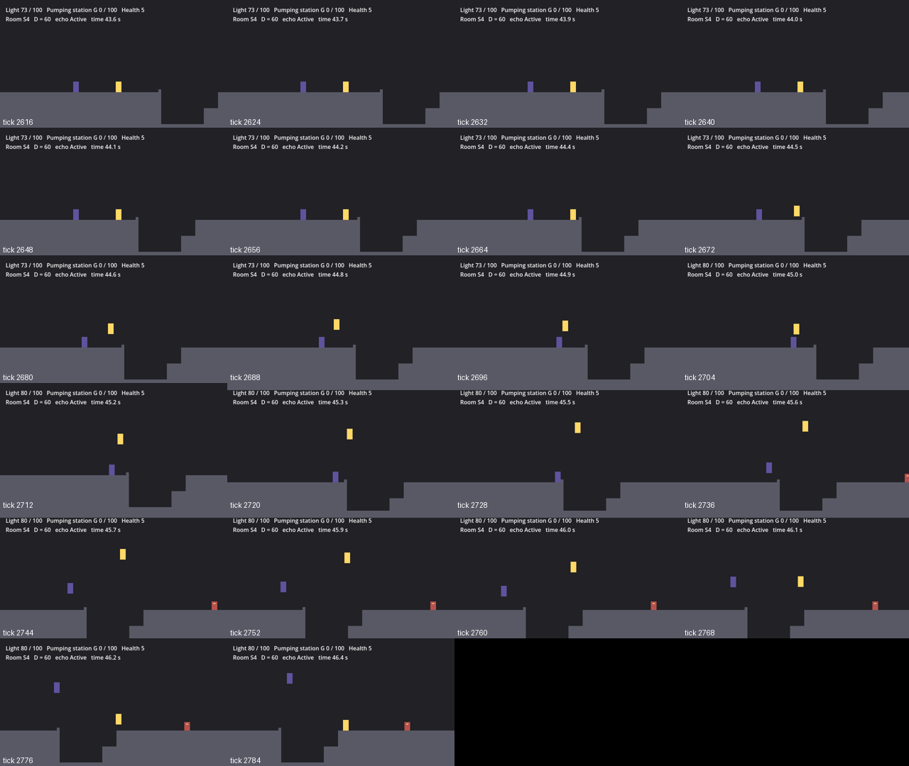

# Kamers: de Kadewijk (wijk 1.3, de slice): S1–S9

Versie 0.4.10 · Eigenaar: World & Level Designer · Issues [#83](https://github.com/cesarvangerwen-glitch/echoborn/issues/83) (T8a, eigenaar Gameplay Programmer met WLD; deel 1 S1–S4, deel 2 S5–S8, deel 3 S9) en [#217](https://github.com/cesarvangerwen-glitch/echoborn/issues/217) (S4 herontwerp, W-12) · Review: Lead Game Designer

Bronnen: `docs/design/wereld.md` v0.2 §2 (kamerlijst §2.2, SL-regels §2.3, vijandtypes §2.4, T8a §2.5, acceptatie §2.6), `docs/design/gdd.md` v0.8.2 (§4.3 bouwstenen met D in formules, L-08–L-14, §4.5 normen, §4.8.5 vaste basis, §4.8.7 de langzame lijn met dash), `docs/design/combat/slice-vijanden-en-boss.md` v0.1.3 (§2.6 plaatsing, VJ-01–VJ-08, §3.2 arena), `docs/design/gemaalmeester.md` v0.2.2 (GM-01, GM-07, GM-10, GM-11), `docs/productie/fase-2-kader.md` v0.4 §4, `docs/tech/ontwerp.md` v0.3 (§3a, §7, §12 "naar T8a"), de visie-review van de CD ([comment in #212](https://github.com/cesarvangerwen-glitch/echoborn/issues/212), `docs/concept/visie-review/kadewijk/`).

**Stand.** S1–S9 staan als grijze, speelbare kamers in `game/levels/kadewijk/`, op de systemen van T5b en T8b: `Kamer` + `AreaLoader` met meestreamende inhoud, `Progress` + `Checkpoint` + `Respawn`, `LightMeter`, `Gemaal` met vier schoepen, de `SliceEnemy`s. Een gescripte bot loopt elke kamer en de route van S1 door het gemaal tot in S7 bij D = 60, met 120 en 180 als regressie, en haalt de normen (§6, §6b). **Deel 2 (#83): S5 (B2 naar de zolder, het lampglas), S6 (de pompgang, het gemaal = `wijk_gemaal` van elke kamer, het checkpoint), S7 (het luik, het kanaal met twee Dwaallichten) en S8 als lege arena op de maten van de Gemaalmeester (§3b–§3e).** **SL-01: 112 LP vóór de eerste pompslag bij D = 60** (§6b). **Deel 3 (#83): S9, de lage kade terug naar S1** (§3f): de trap naar het plein (voor trap 2), het hoogwater (placeholder voor `s = 2`), de brugpijler (B2), het E-paar (verlicht), het luik (SL-04), B1 met logbladzijde 3 en de schacht naar het snelluik in de gang van S1 (`SLICE_EIND`); de bot loopt S9 bij D = 60/120/180 met en zonder echo (§6c). **De Gemaalmeester staat in S8** (GP, §3e): de deuren gaan met de boss open en dicht, en de boss-bot wint solo bij D = 60/90/120/180 in de echte arena (§6b). **Nog niet gebouwd** (GP, §9): de waterstand per wijk (trap 2, `s = 2`; nu het blok `Hoogwater`).

## 1. Doel

Deel 1 van T8a voor de WLD: de eerste vier kamers van de kritieke route maatvast maken op D = 60, met alles wat van D afhangt als formule (fasekader v0.4 §4, regel 2), zodat de art (T8c) later pas op maatvaste kamers komt. Placeholder: grijze blokken, geen tegels (de tegels van de AD in `docs/art/slice/tiles/` zouden een import en `.import`-bestanden vragen; dat is voor de art-pass, als de kamers maatvast verklaard zijn).

## 2. Indeling

```
 y=0    +----------+--------------------------+------------------+------------------+
        | S1       | S2 Kadegang              | S3 Vismarkt      | S4 Brugkloof     |
 y=70   |          |  [P]==galerij B1==>---------->+             |                  |
 y=160  |          |  [P]<==gang/B3-galerij   |    |             |                  |
 y=230  | =galerij=>---kade---> kom B3 |wand  |    v  markt      |  aanloop  kloof overkant
 y=260  |          |                          |  ===============  =====b     ===== |
 y=320  | <--gang B1 (start)                  |                  |    bodem    |eind
 y=360  +----------+--------------------------+------------------+------------------+
 x=     0         640                       1600               2560               3520
```

`b` = de bolder op de rand van de kloof, het keerpunt van B4 (§3a). Elke kamer van deel 1 is 360 px hoog (één scherm op 640 × 360) en hangt aan de vorige; de buren staan op een rij (S1–S2–S3–S4). P1 begint in S1 bij de proloogdeur. Sinds deel 2 loopt de overkant van S4 door naar S5 (de `EindWand` is weg); de streep `EindeDeel1` op x = 3440 blijft het einde van de runs van deel 1 (`RUN_EIND` bij `run_end` = S4).

**Deel 2** (S5–S8; S9 volgt, §9). Het sluiswachtershuis en het gemaalplein liggen hoger dan de kades (je klimt door het huis en ziet het gemaal van boven), de kelder en de machinehal liggen eronder:

```
 y=-200 +---- S5 ------+------------- S6 Gemaalplein ------------+
 y=-100 |  ____zolder==|=loopbrug=+          gemaal (gevel)      |
 y=-10  |=richel 3     |   |trap  |                              |
 y=80   |     richel 2=|   |      v                              |
 y=170  |=richel 1     |   |   paar   [s][s][s][s]   cp   sluis| |
 y=260  =kade (S4)===>|   ==========plein==================[==]=|
 y=360  +-------------+----- S8 Machinehal --+----- S7 Sluiskelder -----v-----------+
 y=440                |                      |          |kelder sokkel [luik]|      |
 y=620                |  arena 600 px        <=deur= vloer  kanaal (2 Dwaallichten)  |
 y=680                |=======vloer=======|  |        |__trede__|                   |
 y=720                +----------------------+----------------------------------------+
 x=                 3520 4160               4800 4960 5120   5260          5760
```

`[s]` = pompschoep, `cp` = het checkpoint van het gemaal, `[==]` = de sluis (de klep over de kelderingang). Buren: S4–S5 (de kade), S5–S6 (de zolder en de loopbrug), S6–S7 (de kelderingang, open op `t_v`), S7–S8 (de deur van de machinehal).

**Deel 3** (S9, §3f): de lage kade ligt onder S1–S5 en sluit de lus (L-14 f):

```
 y=320  |=gang S1=[u]|  (kademuur S1)                                                 S5 |trap|=plein (S6)
 y=360  +-----------+----------------------------- S9 Lage kade ------------------------+----+-- S8 --
 y=455  |           |                                   ___pijler==richel 2      |wand  |  T |
 y=545  | schacht^  |                       d                |   ==richel 1====|      |  T |
 y=610  |=galerij==^| (L3)                                   |                       |  T |
 y=635  |           |wand [luik]=kade==E-paar====kade========|pijler============kade=W|  T |
 y=680  |           |      |                                                         ===vloer==<=deur
 y=700  |=benedenkade======|                                                                    |
 y=720  +--------------------------------------------------------------------------------------+
 x=     0  20   460-500 520 560  700  1060     2310   2760 2820          3300  3920 3980 4100 4160
```

`[u]` = het snelluik (een eenrichtingsluik in de gang van S1), `L3` = logbladzijde 3, `W` = het hoogwater (dicht tot `s = 2`), `d` = het Dwaallicht boven de kade, `T` = de trap naar het plein (treden om en om). Buren: S8–S9 (de deur links van de arena), S5–S9 (de trap loopt door de hoek van S5 omhoog naar het plein), S6–S9 (dezelfde trap: het plein blijft geladen zolang de echo er op de trap terug nog loopt, #252) en S9–S1 (het snelluik).

| Kamer | Rechthoek (x, y, b, h) | Begin (LM-08) | Wat |
|---|---|---|---|
| **S1 Kade-ingang** | 0, 0, 640, 360 | (440, 305) | Gang op 320 naar de linkerwand (de gracht); **B1**: keren en bouncen naar de galerij op 230 (90 hoog, Z → 480), die overgaat in de kade naar S2. Checkpoint en proloogdeur bij het begin; bevroren echo van de bakker (beeld, geen collision, WS-09) op de kade |
| **S2 Kadegang** | 640, 0, 960, 360 | (660, 215) | Kade op 230 naar rechts, onder de brugpijler door, naar de kom van **B3** (bij D = 60 een keerpunt); bounce + dash naar de galerij op 160 (70 hoog), terug naar links: de lus om de pijler. Op de gang het **E-paar**; dan **B1** tegen de pijler (x 700) naar de bovenroute op 70, naar rechts naar S3 |
| **S3 Vismarkt** | 1600, 0, 960, 360 | (1620, 55) | Je valt van de bovenroute (70) de markt op (260, 800 px vlak). **Merk-arena** (L-13), sluit niet af; twee kramen (eenrichting, 70 hoog) als extra springplank. Uitgang rechts op dezelfde vloer |
| **S4 Brugkloof** | 2560, 0, 960, 360 | (2580, 245) | Aanloop 332 px op 260 tot de **bolder** (8 × 8 op de rand, de keerwand), **B4 achter een keerpunt** (§3a): AANVAL slaan en vasthouden op weg naar de bolder, keren, de echo komt je in houding tegemoet, erop springen = lancering over de kloof van 160 × 90. Langzame lijn: over de bolder de kloof in (trede van 45 tegen de overkant, "via de kademuur"); aan de overkant **één Kadeloper**; de kade loopt door naar S5 |
| **S5 Sluiswachtershuis** | 3520, −200, 640, 560 | (3540, 245) | Het trappenhuis: **B2** (zigzag omhoog, gdd §4.3) in een schacht van 480 px, vier verdiepingen van 90 px, elk een keerpunt; de bovenste richel is de **zolder**, met het **lampglas** (L-12) en de deur naar de loopbrug van S6. Beneden het logboek (logbladzijde 1) en de twee koppen. Geen gevecht (§3b) |
| **S6 Gemaalplein** | 4160, −200, 960, 560 | (4180, −115) | Van de loopbrug het plein op (260); een **K-paar** Kadelopers; de **pompgang** (4 schoepen, 80 px, FK-5) in de looprichting naar de **sluis** over de kelderingang; het **checkpoint** van het gemaal; een trap van treden van 45 px terug naar de loopbrug. Twee bevroren echo's (de kinderen), logbladzijde 2 (§3c) |
| **S7 Sluiskelder** | 4800, 360, 960, 360 | (5030, 425) | Door de kelderingang de kelder in (440): de **sokkel** (Neerslag), het **luik** in de kelderbodem (een neerslag opent het), de benedenvloer (620), het **kanaal van 160 px** met **twee Dwaallichten**: stuiten in plaats van overspringen (langzame lijn: de bodem, een trede, de kademuur); de deur van de machinehal (§3d) |
| **S8 Machinehal** | 4160, 360, 640, 360 | (4790, 605) | **Lege arena** van de Gemaalmeester: 600 px vlakke vloer tussen twee muren, geen richels, 320 px vrij; deur rechts (van S7) open, deur links (naar S9) dicht (§3e) |
| **S9 Lage kade** | 0, 360, 4160, 360 | (4060, 665) | Door de deur links van de arena: de **trap naar het plein** (voor trap 2), het **hoogwater** (dicht tot `s = 2`), de lage kade (635) met de **brugpijler** (B2, twee verdiepingen) en het **E-paar** (verlicht), het **luik** (SL-04) vóór de kadewand, de benedenkade (700), **B1** tegen de grachtwand met **logbladzijde 3** op de galerij, en de **schacht** naar het snelluik in de gang van S1 (`SLICE_EIND`) (§3f) |

## 3. Bouwstenen en maten

Alle maten staan in `kadewijk_layout.gd`; wat van D afhangt is een formule daar, en elke kamerscène bouwt zijn blokken daaruit (`kadewijk_inhoud.gd`, met de D van de sessie). Zo verschuift een andere D de geometrie zonder nieuwe scène of art (gdd §4.8.5, *maatvast*).

| Maat (gdd §4.3) | Formule | D = 60 | 90 | 120 | 180 | Waar |
|---|---|---|---|---|---|---|
| Keerzone, begin weg omhoog | `Z = D + 30` | **90** | 120 | 150 | 210 | Galerij S1 (x 20 + Z … 500), galerij B1 in S2 (x 700 + Z … 1180) |
| Weg omhoog boven de vloer | 90 (70–100) | 90 | 90 | 90 | 90 | S1: 320 → 230; S2: 160 → 70 |
| Trede op 90 van de langzame lijn | 40 bij D ≤ 60, anders `Z − 14` (**werkaanname WLD**) | **40** | 106 | 136 | 196 | Tegen elke keerwand van B1, met treden van 40 px op 30 en 60 |
| B1-aanloop (vlak vóór de wand) | ≥ `D + 24` (en gang ≥ 320) | 84 | 114 | 144 | 204 | S1: 480 px; S2: 400 px |
| B3-blok (bovenkant) | `max(D − 60, 0)` × 45 | **geen blok** | 30 | 60 | 120 | S2, tegen x 1250; de wand schuift mee |
| B3-kom / gat tot de galerij | 190 / ≥ 150 | 190 / 150 | idem | idem | idem | S2: ingang 1060, tip 1100, wand 1250 |
| B4: kloof, diepte, aanloop, vrij erboven | 160, 90, ≥ 40, ≥ 180 | 160, 90, 332 (tot de bolder), 260 | idem | idem | idem | S4: rand 2900, overkant 3060 |
| B4-bolder (keerpunt, #217) | 8 breed, ≤ 12 hoog, op de rand | 8 × 8 | idem | idem | idem | S4: x 2892–2900; P1 keert met zijn middelpunt op 2884 (`B4_TURN_X`) |
| B4: ontmoeting met de echo na het keren | `b4_meet = D − 6` px vóór het keerpunt; op de echo springen + dash als `b4_meet + 16 ≤ 80` (`b4_hop`), anders laat je je dragen | 54: **springen + dash** | 84: dragen | 114: dragen | 174: dragen | Waar je AANVAL slaat: `b4_strike_x` (springen: 40 px vóór de ontmoeting; dragen: 28 px vóór de bolder) |
| Vlak stuk in de arena (L-13 b) | ≥ `D + 24` | 800 | 800 | 800 | 800 | S3 |

**Waarom de trede op 90 met D groeit** (gdd §4.3, §4.8.5: in de slice staan Z en de treden per D in data, en de eis bij keren geldt bij elke D). Keren duurt ± `D/2 + 34` ticks (gemeten 68 / 80 / 95 / 125); de langzame lijn moet zonder dash ≥ 30 ticks trager zijn, met dash ≥ 20 (gdd v0.8.2 §4.8.7), en ≤ 2×. Met de drie treden van de flow-kamer (30, 60, 90; elk 40 breed) blijft de langzame lijn ± 104 ticks bij elke D, en bij D = 180 is hij dan sneller dan keren (flow-kamer §9). Hier loopt de trede op 90 bij een langere D door tot 14 px vóór Z: de langzame lijn is dan drie sprongen plus het stuk lopen tot de galerij, en groeit mee (§6). Bij D = 60 is hij gelijk aan de flow-kamer (W-8). De trede ligt binnen de keerzone en is eenrichting: de bounce van de echolijn gaat er van onder doorheen.

### 3a. S4: B4 achter een keerpunt (#217, visie-review CD)

**Wat de CD zag** (D = 60, v0.1): voor de lancering moest je aan de rand remmen, 32 ticks AANVAL vasthouden, een stap terug zetten en ± 0,8 s wachten tot de echo je inhaalde; de echolijn was trager dan de langzame lijn (305 tegen 283 ticks vanaf het begin van S4). De echo lag achter je.

**Het herontwerp.** Een **bolder** van 8 × 8 px op de rand van de kloof is de keerwand, zoals de grachtwand in S1. Je slaat AANVAL op de aanloop en houdt hem vast terwijl je naar de bolder loopt; je echo loopt D ticks achter je en staat in houding (C-11a: AANVAL ≥ 12 ticks vast, gezicht naar de kloof). Tegen de bolder keer je, en de echo komt je tegemoet, zoals bij B1. Bij **D = 60** spring je meteen op hem (± 54 px vóór de bolder, 62 px van de rand), je wordt gelanceerd en je dasht na de top over de kloof (de lancering geeft je dash terug, C-11b). Geen stilstand, en de echolijn is **19 ticks sneller** dan de langzame lijn (268 tegen 287; sinds de motorfix van #231 284, §6d). Bij **D ≥ 90** is de ontmoeting te ver van de rand voor de lancering (`D − 6` px vóór de bolder). Dan sla je pas 28 px vóór de bolder, zodat de houding van de echo pas aan de bolder begint: je springt op de echo die je tegemoetkomt, hij draagt je naar de bolder en daar gaat de lancering in (16 px van de rand, zonder dash). Ook dan geen stilstand van 20 ticks (MP-1: 4 en 6 ticks).



*Contactblad: gerenderde bot-doorloop op D = 60 (S1 → S4, Godot 4.6.3 met xvfb, zoals de beelden van PR #214), elke 8 ticks.*

**Waarom een bolder en geen wand.** De lancering vliegt over de bolder (de voeten zijn daar ± 60 px hoog); lopen niet. Een sprong + dash van de bolder af haalt de overkant niet: met de dash op elk moment 0 … 40 ticks na de afzet is het verste middelpunt op vloerhoogte x 3046 bij 8 px hoog, 3048 bij 12, 3050 bij 16, en bij 20 px kom je over (de overkant begint voor het middelpunt op 3052). Daarom 8 × 8, en in de test ≤ 12 hoog. Zonder bolder is het 3042. De kloof zelf (160 × 90, ≥ 40 px vlak vóór de rand, ≥ 180 vrij) blijft zoals gdd §4.3.

**Waarom de echo je bij D = 60 niet tot de rand draagt.** Dat kan ook (de variant van D ≥ 90), maar dan sta je op de echo tot hij bij de bolder is: gemeten 279 ticks (8 minder dan de langzame lijn) en een korte stilstand van 6 ticks (MP-1). Springen en dashen is 11 ticks sneller. Op de echo springen waar hij je tegemoetkomt en dashen is de snelle lijn; wie de dash mist, valt in de kloof en neemt de langzame lijn (geen vastlopen, test).

**Geen overhang, geen B5** (gdd §4.8.3, L-09): bij D = 60 niet. **Geen schaduwgeometrie, FelLicht of Schaduwgevaar** (L-06): de echo breekt in S1–S4 nergens (test).

### 3b. S5: B2 naar de zolder (deel 2)

**Opzet** (gdd §4.3 B2, `wereld.md` S5: "het trappenhuis is een B2 zonder B5"). Een schacht van **480 px** (x 3600–4080) met vier eenrichtingsrichels op **90, 180, 270 en 360 px** boven de kade (260): richel 1 (170) en 3 (−10) tegen de linkerwand, richel 2 (80) en de zolder (−100) tegen de rechterwand. Elke richel is **`480 − Z`** breed, met aan de open kant een gat van **Z** boven de keerwand van de verdieping eronder (de keerzone). Elke verdieping is een B1: je loopt naar de wand, keert, ontmoet je echo op ± D px van die wand en bounct door het gat naar de volgende richel; je landt op ± `D + 70` px en loopt naar de andere wand. Langzame lijn per verdieping: de treden 30, 60, 90 tegen de keerwand (de trede op 90 per D zoals in deel 1, `tread_90_width`). De gang van S4 loopt onder de linkerwand door (84 px hoog) tot de rechterwand: ≥ 480 px vlak vóór het eerste keerpunt.

| Maat | Formule | D = 60 | 90 | 120 | 180 |
|---|---|---|---|---|---|
| Keerzone B2 (`b2_keerzone`) | `D + 30`; `D + 40` als `(480 − (D + 88)) / 2 < D` | **90** | 120 | 150 | **220** |
| Richel (`b2_ledge`) | `480 − Z` (gdd: `450 − D`) | **390** | 360 | 330 | 260 |
| Van de landing tot de volgende wand | `480 − (D + 88)`, nodig ≥ `D + 24` | 332 (84) | 302 (114) | 272 (144) | 212 (204) |

**Waarom `D + 40` bij D = 180** (afwijking 9, §8). Bij D = 180 duurt de loop over de richel (± 106 ticks) korter dan D: als je keert, hangt je echo nog in zijn bounce naar jouw richel. Keren duurt dan bij de verdiepingen tegen de linkerwand 133 ticks in plaats van 124, en de snelste langzame lijn met dash was nog maar 18 ticks trager (gdd §4.8.7: ≥ 20). Met de rand van de richel 10 px verder (Z = D + 40, de grens van gdd §4.3) is het +22. Bij D ≤ 120 verandert er niets.

**Het lampglas** (L-12, WS-08; het object `Lampglas`, een `Pickup` van de GP: +1 maximum levenspunt, LM-07) hangt op de zolder op x 3900, **105 px boven richel 3**: met een sprong van richel 3 kom je er niet bij (je lichaam komt tot 80 px), met de bounce van de laatste verdieping wel; de langzame lijn is de treden. Elke run neemt het mee (het ligt op de route). **Logbladzijde 1** ligt beneden in het huis op de vloer (`Logbladzijde1`, een `Pickup`).

### 3c. S6: het gemaalplein, de pompgang en het gemaal (deel 2)

- **Loopbrug** van de zolder (−100) tot x 4260; je valt het plein op (260) en ziet het gemaal en de pompgang van boven.
- **Pompgang** (FK-5, L-14 b): vier schoepen op x 4480, 4560, 4640, 4720, **80 px** uit elkaar, middelpunt **38 px** boven de vloer, in de looprichting naar de **sluis** (x 5000–5060, een klep van 10 px over de kelderingang). Van de laatste schoep tot de sluis **280 px** (≥ `2 × (D − 40)` tot D = 180).
- **Het gemaal** (`S6/Gemaal`, `gemaal.gd` met `vane_paths`) is de **`wijk_gemaal` van elke kamer S1–S9** (L-14 a, LM-13: de Kadelopers komen terug tot het gemaal vol is). De sluis gaat open op `t_v` (LM-06); het water van de kelderingang (`Diepwater`, de schacht onder de sluis, 272 → 400) zakt in 180 ticks. Wie er vlak na `t_v` doorheen valt, is er korter dan 30 ticks in (de straat eindigt 40 px boven de kelderbodem).
- **Checkpoint** (`Checkpoint` met `gemaal_path`) op x 4760 achter de laatste schoep: een pompslag van P1 zet het (LM-08), en daarna is het gemaal de respawnplek (SL-03, test).
- **Trap terug** naar de loopbrug: zeven eenrichtingstreden van 45 px recht boven elkaar op x 4200 (FK-6). Voor wie te weinig licht heeft (zonder echo): even S5 in en terug, dan staat het paar er weer (LM-13), zoals de trap van K3 naar K2 in de flow-kamer (FK-2). Ook L-10: van het plein kom je altijd terug naar boven.
- **Bevroren echo's** (twee kinderen, WS-09, beeld zonder collision, placeholders) aan de voet van de loopbrug; **logbladzijde 2** bij de sluis (`Logbladzijde2`, een `Pickup`).
- **Twee trappen** (LM-08, SL-02, WS-03; GP, #83): het gemaal heeft `trappen = 2` en `boss_cap`: tot `BOSS_VERSLAGEN` pompt het niet verder dan G = 100 (de slagen pompen dan 0), daarna tot 200. Trap 1 is wat hierboven "vol" heet (`t_v`, de sluis, het water van de kelderingang). Trap 2 (G = 200) zet de wijk na 180 ticks op `s = 2` (LM-10) en opent het hoogwater van S9 (§3f). Na de boss heb je 100 LP (GM-10): 4 slagen van P1 en 4 van de echo vullen trap 2 in één doorgang.

### 3d. S7: de sluiskelder, het luik en het kanaal (deel 2)

- **Kelder** (bovenvloer 440, x 4960–5340), dicht aan beide kanten: je valt er door de kelderingang in, loopt langs de **sokkel** (V-01; de `Pickup` `Neerslag` op `Layout.SOKKEL`, daarna `Art/Objecten.set_sokkel_aan(false)`, #244) naar het **luik** (x 5260–5300). Het luik is een stuk vloer dat alleen een **neerslag** raakt (`scripts/objects/luik.gd`, systeemobject van de GP; met de schaduwklep van V-01d, #227): springen en in de lucht AANVAL met omlaag, de klep verdwijnt, P1 stuit en valt door naar de benedenvloer (620). De klep heeft een scheur (L-03). Open blijft open (`verslagen` in de save).
- **Kanaal** van **160 px** (x 4960–5120), 90 diep, met **twee Dwaallichten** op 1/3 en 2/3 (x 5013 en 5067), banen van 32 px, onderkant 40 px boven de vloer (§2.6). **Stuitlijn** (V-01b): naar links tot de rand, springen (met coyote), boven het eerste Dwaallicht een neerslag, stuiten, boven het tweede weer, en de overkant op. De neerslag zet een merk; de echo herhaalt hem D + 3 ticks later als merksprong en laat het knallen (V-01e): **2 ontploffingen** bij D = 60. **Langzame lijn**: het kanaal in, over de bodem, een trede van 45, de kademuur van 45 (FK-6). Een Dwaallicht duikt tot 16 px boven de vloer, dus niet het kanaal in (test: geen treffer).
- **De deur** van de machinehal: de benedenvloer loopt west tot x 4800, de deur rechts van S8; je valt 60 px de arena in.
- **Van het gemaal tot de arena-deur**: **555 ticks (9,2 s)** (SL-03, GM-11: ≤ 10 s), met het gemaal vol, het luik open en de stuitlijn (test). Krap: een langzamere speler of de langzame lijn door het kanaal (+19 ticks) haalt het net.

### 3e. S8: de lege arena van de Gemaalmeester (deel 2)

Op de maten van GM-01 en `slice-vijanden-en-boss.md` §3.2, als layout-data (`kadewijk_layout.gd`): één scherm (4160–4800 × 360–720), **vloer van 600 px** (x 4180–4780, bovenkant y 680), muren van 20 px, plafond op 360: **320 px vrij** boven de vloer (het rad hangt op 100–140, de lancering komt tot ± 142 + 30). Geen eenrichtingsvloer, geen richels, geen zones (GM-01, GMB-06). Aan elke kant van het lichaam (arena-x 252–348) 252 px vlak: ≥ D + 24 tot D = 180.

- **`Layout.ARENA_ORIGIN` = (4180, 680)**: de linkermuur op de bovenkant van de vloer, de `origin` van `gemaalmeester.gd`; `ARENA_W` = 600.
- **Deuren** (blokken `DeurRechts` en `DeurLinks`): rechts (van S7, x 4780–4800, y 360–620) staat bij het laden open; links (naar S9) is dicht. `Kadewijk.set_door(&"S8", "DeurRechts", true)` sluit hem (bij `BOSS_START`); de koppeling met de boss is van de GP.
- **Getest**: keren tegen de linkermuur en op de echo springen brengt het aanvalsvlak in de hurtbox van het rad (x `D − 14 … D + 82` van de muur, y 100–140), bij D = 60, 90, 120 en 180 (bounce op 54 / 92 / 122 / 182 px van de muur).
- **De boss** (GP, #83): als S8 laadt, zet `kadewijk.gd` de Gemaalmeester op `ARENA_ORIGIN` met `ARENA_W`; als S8 ontlaadt, gaat hij weg (`Boss.detach`: boss, delen, adds en signalen los van de Sim). `BOSS_START` sluit `DeurRechts`, `BOSS_VERSLAGEN` opent `DeurLinks` (`set_door`); een reset opent `DeurRechts` weer. Na `BOSS_VERSLAGEN` komt hij niet terug zolang de scène loopt; de lichtmeter gaat naar 100 LP (GM-10). `run_end = Kadewijk.RUN_END_BOSS` eindigt de run op `BOSS_VERSLAGEN`.
- **Wanneer `BOSS_START`** (besluit LGD, #229): pas als P1 24 px binnen de muren staat (het lichaam is dan helemaal binnen), elk lichaam (P1, P2, de echo die afspeelt) in de arena is, en met een echo P1 al D ticks binnen staat. Anders gaat de deur dicht op de echo, die erop breekt (E-08; gemeten: 1× per run bij elke D), of staat P2 buiten. Bij binnenkomst van rechts is dat 77 / 107 / 137 / 197 ticks bij D = 60 / 90 / 120 / 180. Een punt in S6 boven de arena (zelfde x) start hem niet (`arena_height` = 320).
- **Verslagen in de save** (GM-10, LM-12; GP, #83): `BOSS_VERSLAGEN` zet de vlag van het object `S8/BossVerslagen` (`scripts/objects/staat_vlag.gd`). Na laden staat er geen boss, is `DeurLinks` open en pompt het gemaal tot 200.
- **De drempel onder `DeurLinks`** (GP, #83; afwijking 20): de deur liep tot 720 door, dus na `BOSS_VERSLAGEN` lag er een gat van 20 px in de vloer tussen de arena en S9 (in de lus viel P1 erdoor). Nu loopt `DeurLinks` tot de vloer (360–680) en is het stuk eronder een vast blok `Drempel` (4160–4180 × 680–720).
- **Respawn** (GM-11, SL-03, §5): bij 0 levenspunten in S8 respawnt P1 op het checkpoint van het gemaal (S6); S8 ontlaadt, en terug in S8 (555 ticks) staat er een nieuwe boss op 100 % in fase 1.
- Placeholders: de plek van het lichaam en de twee spuigaten (GMB-03), alleen beeld; de boss tekent zijn eigen placeholder-lichaam.

### 3f. S9: de lage kade, de lus terug naar S1 (deel 3)

Wereld.md §2.2: na de boss terug naar het plein voor trap 2, het water naar `s = 2`, en de lage kade die vrijkomt loopt terug naar S1, met het luik (V-01, de poort van de lus) en een snelkoppeling. Alles als layout-data (`kadewijk_layout.gd`, `S9_*`), de inhoud in `s9_lage_kade.tscn`. Van rechts naar links:

- **De deur** (x 4160): de vloer van de arena (680) loopt door tot de kademuur (x 3980). De **trap naar het plein** staat in de hoek (x 4100–4150, wanden tot 640, zodat je er van de deur onderdoor loopt): negen eenrichtingstreden van 30 px, **om en om tegen de linker- en de rechterwand, 42 px boven elkaar** (FK-6), van 638 tot 302; de bovenste twee liggen in S5 (x 4100–4160 onder de rechterwand van het huis, achter een wand van 20 px: geen weg van het huis naar het plein). Van de bovenste spring je naar rechts het plein op (260). Omlaag stap je aan de open kant van een trede af en vang je de volgende. Gemeten: omhoog 318 ticks (5,3 s), omlaag 307.
- **Het hoogwater** (x 3920–3980, 360–635): tot `s = 2` staat de lage kade onder water: een blok `Hoogwater` dat je niet over komt (L-14 d: je ziet wat er onder water ligt). **Gekoppeld** (GP, #83): is trap 2 vol, dan zakt het water in 180 ticks (LM-10, meetlog `TRAP_VOL` 2 en `WATERSTAND` 2) en daarna opent `kadewijk.gd` het met `set_door(&"S9", "Hoogwater", false)`, of zodra S9 laadt; uit een save met vulstand 200 meteen. Het blok blijft het beeld van het water (geen `Diepwater`/`Sluis`: dat vraagt nu niets, §9).
- **De lage kade** (635, 45 boven de vloer bij de deur, FK-6) naar links. **Het rustpunt na de boss** (#227): van de deur tot de pijler 940 px vlakke kade, de verlichte wijk en het gezakte water in beeld (10,9 s bij D = 60, 11,9 s bij D = 180; ≤ ± 12 s). **De brugpijler** (x 2760–2820, top 455): een **B2 van twee verdiepingen** in een schacht van 480 px (x 2820–3300), zoals in S5: keren tegen de pijler, bounce naar richel 1 (545, tegen de pijlerwand rechts, die tot 551 hangt: je loopt eronder de schacht in), keren tegen de wand, bounce naar richel 2 (455, tegen de pijler), over de pijler naar links eraf, terug op de kade. Richels `480 − Z`, gat Z (`b2_keerzone`), treden 30/60/90 (langzame lijn). Nieuw ten opzichte van de opzet in §9 v0.3.1: zonder pijler haalt S9 MP-2 per kamer niet (afwijking 16).
- **Het Dwaallicht** (x 2310, baan 2294–2326, onderkant 40 px boven de kade, verlicht; #227, afwijking 19): je springt ± 44 px ervoor, stuit erop met een neerslag (V-01b) en de echo laat het merk achter je knallen (V-01e). Zonder echo stuit P1 ook; het Dwaallicht blijft dan gestund achter.
- **Het E-paar** (x 1060 / 1088 op de kade, halverwege tussen het Dwaallicht en het luik; #227, afwijking 19): 2 Kadelopers, **verlicht** (VJ-06: `lit = true` in de scène; v × 0,5, aanloop +10), 28 px (`paar_e`).
- **Het luik** (x 560–600, in een plaat van 16 px vlak vóór de kadewand op x 520–540): de lage kade loopt dood (SL-04: zonder V-01 een doodlopende kade, L-03: de scheur in de klep). Een neerslag opent het (`scripts/objects/luik.gd`, zoals in S7); P1 valt 65 px naar de benedenkade (700), die onder de plaat en de kadewand door naar links loopt.
- **B1 tegen de grachtwand** (x 20, onder de wand van S1): dezelfde maten als S1, één verdieping lager: aanloop van de landing onder het luik tot de wand 560 px (≥ D + 24), galerij op 90 (610) vanaf Z tot de schacht, treden 30/60/90. **Logbladzijde 3** (`Logbladzijde3`, een `Pickup`) ligt op de galerij (x 300), **105 px boven de benedenkade**: in één beweging alleen met de bounce (L-12), langzame lijn de treden (C-15).
- **De schacht en het snelluik**: van het eind van de galerij (x 460) eenrichtingstreden recht boven elkaar (569 … 362, ≤ 42 px) naar het **snelluik** in de gang van S1 (x 460–500 op 320, een eenrichtingsvloer achter het begin, buiten de aanloop van B1): van onder spring je erdoor, van boven loop je eroverheen. Wie er van S9 door komt en op de gang staat, is rond: **`SLICE_EIND`** (het object `S1/SliceEind`, `kadewijk_slice_eind.gd`: gewapend als P1 onder het snelluik in de schacht is, gemeld als hij daarna op de gang staat; met `run_end` = `RUN_END_LUS` eindigt de run daar). De snelkoppeling ligt op een echolijn (L-12: de bounce van B1 naar de galerij), met de treden als langzame lijn.

## 4. Encounters (`slice-vijanden-en-boss.md` §2.6)

| Kamer | Vijanden (scène) | Hoe | Afwijking |
|---|---|---|---|
| S2 | `Paar1A`, `Paar1B`: 2 Kadelopers op de gang (y 160), x 880 / 908 | **E-paar**, 28 px (`paar_e`), op het vlakke stuk na B3 | — |
| S3 | Golf 1: `Paar1A/B` (2140 / 2168) + `Los` (2360). Golf 2: `Paar1A` = **Schotdrager** (1770) + `Paar1B` Kadeloper (1798), `Los` (1990) | Golf 1 een E-paar + een losse 192 px verder; golf 2 aan de kant van de ingang, de Schotdrager in een E-paar | Golf 2 wacht ook op ≤ 5 tegelijk (hieronder) |
| S4 | `Overkant`: 1 Kadeloper op x 3260 | ≥ 80 px van de landing van de lancering (± 3090) | — |
| S6 | `Paar1A`, `Paar1B`: 2 Kadelopers op het plein, x 4340 / 4382 | **K-paar**, 42 px (`paar_k`): twee merken, de ketting; ≥ 98 px van de eerste schoep (FK-5: ≥ 80). Komen terug zolang het gemaal niet vol is | — |
| S7 | `Dwaallicht1`, `Dwaallicht2` boven het kanaal, x 5013 / 5067 | Banen van 32 px (de level-regel zet ze bij het laden met `setup_enemy`; de `@export` volgt van de GP), onderkant 40 px boven de vloer | — |
| S9 | `Dwaallicht1` boven de kade, x 2310 (baan 32 px, verlicht), en `Paar1A`, `Paar1B`: 2 Kadelopers op de lage kade, x 1060 / 1088 | **E-paar**, 28 px (`paar_e`), **verlicht** (VJ-06, `lit` in de scène tot de waterstand het zet, GP); tussen de brugpijler en het luik | — |

De **paren** (VJ-05) zet het gebiedsscript bij het laden met `SliceEnemy.make_pair` en de afstand uit `slice.csv`. Een `@export` voor de paargenoot (zodat het paar in de scène staat) volgt van de Gameplay Programmer (ontwerp.md §12).

Twee regels van het level-script (`kadewijk.gd`), keuze WLD:

1. **Wekken.** Een vijand doet pas mee als P1 in zijn kamer op zijn vloer staat (voeten ± 40 px) en binnen een half scherm (320 px); daarna tot P1 de kamer verlaat. Daarvóór doet hij niets (`hold_until`), raakbaar blijft hij. Zonder die regel loopt een `SliceEnemy` overal naar P1 toe, ook vanuit een andere kamer of verdieping: het paar van S2 stond dan onder de landing van B3 of aan de keerwand van B1, en de Kadeloper van S4 aan de rand van de kloof, op de landing van de lancering. Hetzelfde als `is_awake` in K2 van de flow-kamer.
2. **Golf 2 in S3** start op de eerste tick waarop elke Kadeloper van golf 1 een merk heeft of op is (§2.6, gdd §4.7.1 c) **én** golf 2 erbij hooguit 5 vijanden tegelijk geeft (L-13 f, strikt in de slice). Met alleen de eerste voorwaarde zouden er 6 tegelijk kunnen staan (3 gemerkt + 3 nieuw). Tot de start is golf 2 niet bij de Sim aangemeld en niet in beeld. De Schotdrager blokkeert niet: de golf is op zonder hem (L-13 e).

LM-13: de Kadelopers komen terug (`slice.csv`), de Schotdrager niet, tot het gemaal van S6 vol is: elke kamer heeft `wijk_gemaal` = `S6/Gemaal` (deel 2). De Dwaallichten komen terug zolang de wijk donker is.

## 5. Checkpoint, respawn, streamen en water

- **Checkpoint** (`Checkpoint` in S1, bij de proloogdeur): P1 begint erop. Tot het gemaal van S6 is dat de respawnplek (SL-03); `Respawn` met `Progress` in de gebiedsscène (ontwerp.md §12 punt 1c). Test: P1 sterft in S3 en verschijnt op S1, één `RESPAWN`. **Het checkpoint van het gemaal** (S6, §3c) neemt het over bij de eerste pompslag van P1 (test: `checkpoint_kamer` = S6).
- **Begin van elke kamer** (LM-08): `Layout.ROOM_START`, een vaste, veilige plek bij de ingang; voor het debugmenu (F8) en zonder checkpoint.
- **Streamen**: geladen zijn de kamer van P1 en zijn buren; S3 laadt pas als P1 in S2 is. Kamerwissels naar een buur resetten de echo niet (E-04a).
- **Water**: S1–S6 op `s = 0` (wereld.md §2.2). Het gemaal van S6 heeft zijn eigen water (de kelderingang, LM-06): dat zakt op `t_v` en opent de route naar S7 (L-14 d, "je ziet vooraf wat onder water ligt": de schacht onder de sluis). De waterstand van de wijk is de stand van het gemaal (`Gemaal.stand()`, het aantal volle trappen, LM-10); `s = 2` opent het blok `Hoogwater` van S9 (§3c, §3f). `Sluis`-objecten per stand (`open_vanaf_stand`) zijn er nog niet: in de slice is het hoogwater de enige doorgang van `s = 2` (§9).
- **Streamen in deel 3**: S9 is een buur van S1, S5, S6 en S8, dus S9 laadt mee als P1 in S1, S5 of S6 is, en S6 als P1 in S9 is (#252: anders brak de echo bij D ≥ 120 op de trap terug) (de vijanden slapen tot P1 in S9 is). De runs van deel 1 en 2 geven dezelfde ticks (§6c); de suite is ± 6 s langer.

## 6. Gemeten met de gescripte geoefende run (`kadewijk_bot.gd`, `test_kadewijk.gd`)

Solo, P1 alleen. Ticks bij 60 Hz. "Keren" en "langzame lijn" vanaf de keerwand tot het volgende niveau, voorbij Z.

| | **D = 60** | D = 120 | D = 180 | Norm |
|---|---|---|---|---|
| Run S1 → einde S4, met echo | **2963 ticks (49 s)** (v0.1: 2997) | 3208 | 3592 | — |
| Per kamer S1 / S2 / S3 / S4 | 525 / 1038 / 941 / **458** | 517 / 1083 / 1077 / 530 | 517 / 1141 / 1343 / 590 | — |
| Zonder echo (C-15) | 3321 (1,12×) (v0.4.4: 3324; motor #231, §6d) | 3328 | 3382 | ≤ 2×, ook per kamer: ✓ (per kamer ≤ 1,16×) |
| Echolijn genomen: S1-B1, S2-B3, S2-B1, S4-B4 | alle vier | alle vier | alle vier | L-08 |
| S1-B1 keren / langzame lijn zonder dash | **68 / 104 (+36, 1,53×)** | 95 / 145 (+50, 1,53×) | 125 / 186 (+61, 1,49×) | ≥ 30 trager, ≤ 2×: ✓ |
| S2-B1 keren / langzame lijn zonder dash | **68 / 104 (+36, 1,53×)** | 95 / 134 (+39, 1,41×) | 124 / 164 (+40, 1,32×) | idem: ✓ |
| S1-B1 / S2-B1: snelste langzame lijn met dash (W-12, tabel hieronder) | **94 / 94 (+26, 1,38×)** | 118 / 118 (+23) | 151 / 148 (+24–26) | ≥ 20 trager, ≤ 2×: ✓ (ook bij 90: 103, +23) |
| S2-B3 echolijn / langzame lijn | 85 / 124 | 115 / 124 | 145 / 124 | ≤ 2× (FK-2) |
| B1: bounce / landing van de wand | 54 / 120 | 122 / 190 | 182 / 250 | rand op Z + 8 |
| B3: landing voorbij de tip van de galerij | **26 px** | 30 px (v0.1: 2) | 30 px (v0.1: 2) | ≥ 9 (§8, besluit B3) |
| **S4-B4 vanaf het begin van S4: echolijn / langzame lijn** | **268 / 284 (16 sneller)** (v0.4.4: 268 / 287; motor #231, §6d) (v0.1: 305 / 283) | 339 / 284 | 399 / 284 | D = 60: echolijn sneller (#217); ≤ 2× |
| S4-B4: stilstand vóór de lancering | **geen** (v0.1: 15) | 4 + 6 ticks (v0.1: 15 + 42) | 4 + 6 (v0.1: 15 + 102) | D = 60 geen; anders < 20 |
| S4-B4: lancering van de rand / landing voorbij de overkant | **62 px (springen + dash) / 12 px** | 16 px (dragen) / 18 px | 16 / 18 | landen vanaf − 8 px |
| MP-1 langste stilstand (kamer) | **8 (S3)** (v0.1: 15, S4) | 7 (S3) | 7 (S3) (v0.1: 102, S4) | ≤ 300 per kamer: ✓ |
| MP-1 zonder echo | 102 (S2, slaan) | 102 | 102 | ✓ |
| MP-2 echo-acties per minuut (S1 / S2 / S3 / S4) | **12,2** (6,9 / 10,4 / 15,3 / 15,7) | 12,3 | 11,0 | ≥ 3,0, ook per kamer: ✓ |
| MP-2 / L-11 langste gat zonder echo-actie | **715 ticks (11,9 s)** | 742 | 780 | ≤ 40 s: ✓ |
| MP-3 landingen zonder stilstand | **100 % van 4** | 100 % van 4 | 100 % van 4 | ≥ 75 % (getoetst bij 60; zie de noot) |
| MP-4 echo Leeg | 2 % | 4 % | 5 % | ≤ 40 %: ✓ |
| MP-6 LP met de echo | 75 % | 76 % | 74 % | ≥ 40 %: ✓ |
| LP na S1–S4 (met / zonder echo) | **88** / 48 | 90 / 48 | 84 / 48 | SL-01: ≥ 100 bij S6 (§9) |
| Vijanden tegelijk (L-13 f) | ≤ 5 ✓ | ≤ 5 ✓ | ≤ 5 ✓ | ≤ 5 |
| Treffers op P1 | 0 | 0 | 0 | — |
| Elke kamer los vanaf zijn begin (D = 60) | 526 / 1028 / 931 / 449 | — | — | haalt de volgende kamer |

De run is deterministisch: dezelfde bits als `ScriptedInput` geven hetzelfde meetlog (test).

**Noot MP-3 bij D = 120 en 180** (SM-review PR #208). MP-3 is een norm op de gekozen D (60) en wordt alleen daar getoetst; bij 120 en 180 rapporteert de test. In v0.1 was het daar 67–75 %: bij B4 stond de bot aan de rand op de echo te wachten, dus die landing kwam na 42 of 102 ticks stilstand. Met de bolder als keerpunt (§3a) is dat weg: 100 % bij elke D. Dezelfde uitleg staat als `note` in `test_kadewijk.gd`.

**B4: late bot bij D = 60** (`test_kadewijk_b4_late_bot`). Landing voorbij de overkant in px (je landt vanaf − 8), per sprong later op de echo en dash later na de top:

| Sprong op de echo | dash op de top | + 8 ticks | + 16 ticks |
|---|---|---|---|
| op tijd | **12** | 26 | 34 |
| 4 ticks later | 20 | 34 | 42 |
| 8 ticks later | 28 | 42 | 50 |
| zonder dash | de kloof in, langzame lijn (S4 klaar op tick 474 in plaats van 449; v0.4.4: 475) | | |

**Langzame lijn met dash** (W-12, gdd v0.8.2 §4.8.7; `test_kadewijk_langzame_lijn_met_dash_d60` … `_d180`). Echo uit; de bot neemt de langzame lijn en dasht `n` ticks na de afzet van de trede op 60 (de sprong naar de weg omhoog; bij D ≥ 90 naar de trede op 90, die tot Z − 14 loopt). Ticks van het keren tegen de wand tot voorbij Z; "mist" = terug op de vloer. Eis: de snelste is ≥ 20 ticks trager dan keren en ≤ 2×, bij elke D.

| Dash na de afzet | D = 60: S1-B1 / S2-B1 | D = 90 | D = 120 | D = 180 |
|---|---|---|---|---|
| geen dash | 104 / 104 | 145 / 134 | 145 / 134 | 186 / 164 |
| 4 | mist | mist | mist | mist |
| 8 | **94 / 94** | 135 / 124 | 135 / 124 | 176 / 154 |
| 12 | 103 / 103 | **103 / 103** | 144 / 133 | 185 / 163 |
| 16 | 110 / 110 | 110 / 110 | 151 / 140 | **151** / 170 |
| 20 | 114 / 114 | 114 / 114 | 155 / 144 | 155 / 174 |
| 24 | 118 / 118 | 118 / 118 | **118 / 118** | 159 / **148** |
| **Keren / snelste met dash** | **68 / 94: +26 (1,38×)** | 80 / 103: +23 (1,29×) | 95 / 118: +23 (1,24×) | 125 / 151: +26; 124 / 148: +24 (1,19–1,21×) |

Dat is het beeld van v0.1.1 (toen met de hand gemeten: +27 bij 60, ± +22 bij 90 en 120), nu als test en ook bij 180. Bij een langere D is de snelste dash later (12, 24 of 16 ticks): dan haal je met de dash de galerij rechtstreeks, over de trede op 90 heen.

## 6b. Deel 2 gemeten (`test_kadewijk_deel2.gd`)

Solo. De run loopt van S1 tot P1 door de kelderingang S7 binnenkomt (`run_end` = S7), dus door het gemaal. Per kamer los vanaf het begin van de kamer.

| | **D = 60** | D = 120 | D = 180 | Norm |
|---|---|---|---|---|
| Run S1 → S7 met echo | **4810 ticks (80 s)** | 5022 | 5438 | — |
| S4 / S5 / S6 (kamertijd) | 499 / **1304** / **503** | 571 / 1271 / 503 | 631 / 1303 / 503 | — |
| **SL-01: LP vóór de eerste pompslag** (S1 tot het gemaal) | **112** (88 na S4, +24 het K-paar) | 114 | 114 | ≥ 100 (L-14 c): ✓ |
| Gemaal vol op de eerste doorgang (POMP P1 / echo) | ✓ (4 / 4), `GEMAAL_VOL` op tick 4637 | ✓ (4 / 4) | ✓ (4 / 4) | geen terugweg met echo |
| Zonder echo: run, terug naar S5 voor licht | 9138 ticks (**1,90×**; v0.4.4: 9141, motor #231), 4× terug, LP vóór het gemaal 60 | 9149 (1,82×), 4× | 9201 (1,69×), 4× | ≤ 2× (LM-09c, C-15), ≤ 4 terugkeren (FK-2): ✓ |
| S5 zonder echo | 1483 (1,14×) | 1483 (1,17×) | 1483 (1,14×) | ≤ 2×: ✓ |
| S6 zonder echo, zelfde licht bij binnenkomst (88 LP) | 713 tegen 492 (**1,45×**), 0× terug | — | — | ≤ 2× (C-15): ✓ |
| S6 zonder echo in de run (48 LP bij binnenkomst) | 4294 tegen 503 (8,5×) | 4298 | 4296 | zie afwijking 10 |
| S6 met 0 LP en zonder echo | 8003 ticks, 8× terug | — | — | geen slot (FK-2) |
| B2 (S5-B2a … d) keren / langzame lijn zonder dash | **68 / 104 (+36, 1,53×)** elke verdieping | 95 / 145 (+50) | 124–133 / 186 (+53 … +62) | ≥ 30, ≤ 2×: ✓ |
| B2 snelste langzame lijn met dash (n = 4 … 24) | **94 (+26, 1,38×)** (dash 8) | 118 (+23) (dash 24); bij 90: 103 (+23) | 155 (+22 … +31) (dash 20) | ≥ 20, ≤ 2×: ✓ |
| B2 bounce / landing (van de wand) | 54 / 120 | — | — | landing ≥ Z + 8 |
| MP-1 langste stilstand S5 / S6 | 0 / 5 | 4 / 5 | 4 / 5 | ≤ 300: ✓ |
| MP-2 per kamer S5 / S6 / S7 (los) | **11,0 / 7,2 / 16,7** per min | ≥ 3 | ≥ 3 | ≥ 3,0: ✓ |
| MP-2 langste gat (S1 → S7) | 715 ticks (S2 → S3, zoals deel 1) | — | — | ≤ 40 s: ✓ |
| MP-3 / MP-4 / MP-6 (S1 → S7) | 100 % van 8 / 1 % / 79 % | — | — | ≥ 75 / ≤ 40 / ≥ 40 %: ✓ |
| Lampglas (S5) | gehaald (S5 los: tick 1157 van 1293) | ✓ | ✓ | op de route |
| S7 los: luik, stuitlijn, deur | **430 ticks**, 3 stuits (luik + 2), 2 ontploffingen (de echo) | — | — | — |
| S7 langzame lijn (het kanaal door) | 449 ticks (1,04×), geen treffer | — | — | ≤ 2×: ✓ (afwijking 12) |
| Van het checkpoint van het gemaal tot de arena-deur | **555 ticks (9,2 s)**, met en zonder echo | — | — | ≤ 10 s (SL-03, GM-11): ✓ |
| S8: bounce na keren tegen de muur haalt het rad | ✓ (54 px van de muur) | ✓ (122) | ✓ (182); bij 90: 92 | GM-07 |
| Treffers op P1, vijanden tegelijk | 0, ≤ 5 | 0, ≤ 5 | 0, ≤ 5 | L-13 f |

De runs van deel 1 (§6, tot `END_X`) zijn met deel 2 niet veranderd (zelfde ticks; S4 duurt in de run van deel 2 41 ticks langer, omdat hij nu doorloopt tot x 3520).

**De lege loop na golf 2 in S3** (punt van de CD, #212). Gemeten bij D = 60: de laatste ontploffing in S3 is op tick 2161 (x 1862), de volgende echo-actie de lancering in S4 op tick 2701: **540 ticks (9,0 s)**, waarvan ± 5 s in S3 (van x 1954 tot de uitgang) en ± 4 s de aanloop van S4. MP-2 en L-11 houdt het (≤ 40 s; het langste gat blijft 715 ticks, S2 → S3). **Niet opgelost in deze run**: in de overgang S3 → S4 is er geen plek voor een echo-actie zonder (a) een vijand meer of een verplaatste vijand (de plaatsing van §2.6 is van de Combat Designer; bv. de Kadeloper van S4 aan het begin van de aanloop in plaats van aan de overkant), (b) een bouwsteen in het oostelijke deel van de markt (S3 is maatvast, geen herontwerp), of (c) een kortere aanloop in S4 (de bolder kan ± 110 px naar links, aanloop ≥ D + 24 tot D = 180: ± 55 ticks minder, het gat blijft ± 8 s). Voorstel aan de LGD en de CD in §9.

### De Gemaalmeester in S8 (`test_kadewijk_boss.gd`, #83)

De gescripte geoefende boss-run (`boss_bot.gd`, B-9/B-9b: 2 slagen per bounce, met ontwijken, 5 LP), solo, van het begin van S8 (de drempel bij de deur rechts) tot `BOSS_VERSLAGEN`. Ter vergelijking de lege arena van `test_boss_runs.gd` (P1 begint daar al binnen).

| D | Tot BOSS_START | Fase 1 | Fase 2 | Totaal (s) | Arena-test (s) | MP-1 | Treffers | Kanten (tijd) |
|---|---|---|---|---|---|---|---|---|
| 60 | 77 | 1680 | 3808 | 5853 (**97,5**) | 97,9 | 56 | 0 | 10 (0) |
| 90 | 107 | 1382 | 3806 | 5568 (92,8) | 89,1 | 59 | 0 | 10 (0) |
| 120 | 137 | 1276 | 3819 | 5490 (91,5) | 89,8 | 92 | 0 | 10 (0) |
| 180 | 197 | 1836 | 3903 | 6164 (102,7) | 101,4 | 56 | 0 | 10 (0) |

*v0.4.6 (#247): de data van de boss is v0.1.5 van `slice-vijanden-en-boss.md`: 1750 SE, 7 openingen, radtreffer 33, ± 10 kanten. De norm is 95–150 s bij D = 60, met fase 1 ≥ 24 s en fase 2 ≤ 65 s. Tot v0.4.5 stond hier 129,3 s bij D = 60, met 16 kanten. Van `BOSS_START` tot `BOSS_VERSLAGEN` staat de camera vast op de arena (`arena_view`, GM-01). Wie in S8 of S9 begint, krijgt de vlag van de Neerslag in de opzet.*

Normen (gemaalmeester.md §7, GM-09, GM-10; §3.9): verslagen zonder dood ✓, MP-1 ≤ 300 ✓, de echo breekt niet ✓, schot gebroken (GM-06) en het rad met een bounce geraakt (GM-07; 34× per run) ✓, `RAD_DRAAI` tijd ≤ 1 bij D ≤ 120 ✓, D = 60 binnen 90–150 s ✓, deur rechts dicht bij `BOSS_START` en links open na `BOSS_VERSLAGEN` ✓, 100 LP na afloop ✓, P1 het hele gevecht in de arena ✓. Fase 1 verschilt per D en met de arena-test (de plek van P1 en de echo bij de start bepaalt wanneer de merksprong de eerste keer het schot haalt); fase 2 is bij elke D gelijk.

## 6c. Deel 3 gemeten (`test_kadewijk_s9.gd`)

Solo. De run loopt van het begin van S9 (bij de deur van de arena, het hoogwater open: `s = 2` als placeholder) tot P1 door het snelluik op de gang van S1 staat (`SLICE_EIND`). De boss staat er niet in (GP); de run van S1 tot S9 door de arena volgt als de boss en de deur gekoppeld zijn.

| | **D = 60** | D = 120 | D = 180 | Norm |
|---|---|---|---|---|
| S9 → gang S1 met echo | **3004 ticks (50,1 s)** (S9 2953, S1 50) | 2980 | 2996 | — |
| Zonder echo | 3222 (**1,07×**, marge 2786 ticks tot 2×) | 3221 (1,08×) | 3222 (1,08×) | ≤ 2× (C-15, FK-2): ✓ |
| **Gaten zonder echo-actie** (#227: rustpunt, B2a → B2b, → Dwaallicht, → E-paar, → B1, → SLICE_EIND) | **656** / 246 / 524 / 590 / **597** / 390 (rustpunt 10,9 s, daarna ≤ 9,9 s) | 682 / 238 / 550 / 591 / 562 / 356 | **712** / 246 / 588 / **597** / 526 / 326 | rustpunt ≤ 720 (± 12 s), daarna ≤ 600 (± 10 s): ✓ (test bij D = 60, rapport bij de andere D, [Lead-review #239](https://github.com/cesarvangerwen-glitch/echoborn/pull/239#issuecomment-6840184277); krap, zie §9) |
| Keren / langzame lijn zonder dash: B2a, B2b (pijler), B1 (grachtwand) | **68 / 104 (+36, 1,53×)** elk (B1 105) | 95 / 145 (+50) | 124–133 / 186 (+53 … +62) | ≥ 30, ≤ 2× (gdd §4.3): ✓ |
| Snelste langzame lijn met dash (W-12, n = 4 … 24), B2a, B2b, B1 | **94 (+26, 1,38×)** elk (dash 8; dash 4 mist) | — | — | ≥ 20, ≤ 2× (gdd §4.8.7): ✓ (alleen D = 60, [Lead-review #231](https://github.com/cesarvangerwen-glitch/echoborn/pull/231#issuecomment-6836179983); de andere D dekken de maatcheck en S5/S1) |
| Bounce / landing (van de wand) | 54 / 120 | 122 / 190 | 166–182 / 234–250 | landing ≥ Z + 8 |
| MP-1 langste stilstand S9 (met / zonder echo) | 2 / 46 | 4 / 46 | 4 / 46 | ≤ 300: ✓ |
| **MP-2 per kamer S9** | **6,1 per min** (pijler 2, het Dwaallicht 1, het E-paar 1, B1 1) | 6,1 | 6,1 | ≥ 3,0: ✓ |
| MP-2 langste gat | 656 ticks (10,9 s, het rustpunt) | 682 | 712 | ≤ 40 s: ✓ |
| MP-3 / MP-4 / MP-6 | 100 % van 3 / 2 % / 77 % van 35 LP | — / 4 % / 77 % | — / — / 77 % | (rapport) |
| Luik (alleen een neerslag), logbladzijde 3, SLICE_EIND | ✓, ✓ (tick 2722), ✓ | ✓ | ✓ | SL-04, L-12 |
| Hoogwater dicht: P1 komt niet op de lage kade | ✓ | — | — | L-14 d |
| Trap naar het plein en terug | omhoog 318, omlaag 307 ticks | — | — | FK-6, L-10 |
| Treffers op P1, vijanden tegelijk | 0, ≤ 5 | 0 | 0 | L-13 f |

**Voor #227 (v0.4.2)** waren de gaten bij D = 60 776 / 246 / 673 / 917 / 390 ticks (rustpunt 12,9 s, pijler → E-paar 11,2 s, E-paar → B1 15,3 s); de CD gaf S9 "past niet". Nu: de pijler 240 px naar de deur (rustpunt ≤ 12 s), een Dwaallicht tussen pijler en E-paar, en het E-paar naar x 1060 (§3f, afwijking 19). De runs van deel 1 en 2 geven nog steeds dezelfde ticks (vergeleken met `main`, groep `lang`).

**De runs van deel 1 en 2 zijn niet veranderd**: dezelfde ticks in elke run (S1–S4, S1 → S7, per kamer los, B2 met dash, gemaal → arena-deur 555), ook met S9 als buur van S1 en S5 en het snelluik in S1. **De run zonder echo van deel 2 op de grens** (SM-review #223): de test meldt nu de marge per D: **D = 60 482 ticks tot 2× (1,90×), D = 120 895 (1,82×), D = 180 1675 (1,69×); terugkeren 4 van 4 bij elke D (marge 0)** (v0.4.4: 479 / 892 / 1672; motor #231, §6d). De test van S6 los meldt dat C-15 bewust met gelijk licht wordt vergeleken (1,45×, LGD-besluit bij afwijking 10).

**Suite** (headless, Godot 4.6.3): na de merge met #229/#230 **401 tests, 277 s**, met de Gemaalmeester in S8 dezelfde ticks in deel 1, 2 en S9. Vóór de merge 389 tests, **275 s** tegen 258 s voor `main` op dezelfde machine kort na elkaar (+17 s, + 7 %): `test_kadewijk_s9.gd` ± 11 s, en deel 1 + 2 samen ± 6 s langer doordat S9 meelaadt als buur van S1 en S5. De duur hangt af van de belasting (`main` eerder die dag: 220 s).

## 6d. De lus gemeten (`test_kadewijk_lus.gd`, #83)

Solo, de gescripte geoefende run door de hele slice: `kadewijk_bot.gd` met `lus` van S1 tot de arena, in S8 de bot van de boss-runs (`boss_bot.gd`, B-9: 2 slagen per bounce, met ontwijken), dan de deur links uit, de trap naar het plein, trap 2, de trap af, S9 en door het snelluik terug op de gang van S1 (`RUN_END_LUS`, `SLICE_EIND`). Ticks bij 60 Hz.

| | **D = 60** | D = 120 | D = 180 |
|---|---|---|---|
| **S1 → S8 → S9 → S1 (tot `SLICE_EIND`)** | **15 504 ticks (258,4 s)** (v0.4.5: 17 399) | 15 392 (256,5 s) | 16 838 (280,6 s) |
| S1 → binnenkomst S8 | 5240 | 5452 | 5868 |
| S8 → `BOSS_START` / de boss (`BOSS_START` → `BOSS_VERSLAGEN`) | 82 / 5853 (97,6 s; v0.4.5: 7748) | 142 / 5491 | 202 / 6443 |
| `BOSS_VERSLAGEN` → op het plein (de deur links, de trap op) | 461 | 463 | 465 |
| Op het plein → trap 2 vol (`TRAP_VOL` 2) | 278 (P1 4 + echo 4 slagen) | 338 | 398 |
| Trap 2 → terug in S9 (de trap af) | 545 | 485 | 425 |
| S9 → `SLICE_EIND` | 3045 | 3021 | 3037 |
| Hoogwater open (`WATERSTAND` 2) | trap 2 + 180 ticks, vóór P1 terug in S9 is | idem | idem |
| Opgepakt: lampglas, logbladzijde 1/2/3, Neerslag | ✓ (5 van 5), P1 6 levenspunten | ✓ | ✓ |
| In de save na `store_world` | de 5 vlaggen, `S8/BossVerslagen`, gemaal 200 / vol | ✓ | ✓ |
| Treffers op P1 / respawns | 1 (in de arena) / 0 | 0 / 0 | 0 / 0 |
| MP-1 langste stilstand | 56 (de arena) | 92 | 61 |
| Echo-breuken | **0** | **0** (was 1 vóór S6–S9 als buren) | **0** (idem) |
| Vijanden tegelijk | ≤ 5 | ≤ 5 | ≤ 5 |

De normen van de lus: de boss verslagen zonder dood (≤ 4 treffers), trap 2 pas na `BOSS_VERSLAGEN` (SL-02), het hoogwater 180 ticks na trap 2 (LM-10), één `SLICE_EIND`, alles opgepakt en in de save, MP-1 ≤ 300, ≤ 5 vijanden; de echo breekt bij **elke D** niet (hard; sinds S6–S9 buren zijn, LGD-besluit 4 in #252). Vóór die wijziging brak hij bij D ≥ 120 één keer: P1 liep na trap 2 de trap af naar S9, S6 ontlaadde terwijl de echo nog op het plein liep. Met S6 als buur van S9 blijft het plein geladen; de ticks van de lus (17 399 / 17 275 / 18 080) en van alle andere runs zijn gelijk.

**De runs van deel 1–3 geven dezelfde ticks** (vergeleken met `main`, hele suite), op één ding na: **de motorfix van #231** (§9). Tegen een muur aan houdt P1 nu de vloer. De bot van de langzame lijn springt daardoor eerder: in S4 de treden van de kloof 3 ticks eerder (de runs zonder echo van deel 1 en 2 −3, de langzame lijn van B4 287 → 284), en in de co-op-meeloper van de flow-kamer (T17) −2. Elke run mét echo is gelijk, ook S9, de boss-runs en W-12. Het lampglas geeft in de runs van deel 2 6 levenspunten; daar is niemand geraakt, dus dezelfde ticks.

### De lus zonder echo (G-3, `test_kadewijk_lus_zonder_echo.gd`, [#291](https://github.com/cesarvangerwen-glitch/echoborn/issues/291))

Dezelfde bot en dezelfde route als hierboven, solo met de echo uit: de bot neemt bij elke bouwsteen de langzame lijn (FK-2) en haalt in S6 licht in S5 (afwijking 10). Ter vergelijking draait de test de lus mét echo opnieuw bij dezelfde D. Ticks bij 60 Hz; een kamer = alle bezoeken samen (FlowReport); **S8 zonder de boss** (`BOSS_START` … `BOSS_VERSLAGEN` telt in geen verhouding mee).

**Keuze voor S8: een testuitzondering.** Solo met de echo uit is de Gemaalmeester niet te verslaan (C-16 a). De lus gaat de arena in, vecht 1800 ticks (30 s, langer dan fase 1 mét echo) met de boss-bot en toetst daar C-16 in de echte arena: het schot breekt niet, de boss verliest geen SE, de bot verslaat hem niet. Dat venster is alleen negatief bewijs; het bewijs voor C-16 (a) blijft B-5/B-7 in `test_boss.gd`. Daarna breekt de test een lopende aanval af (`abort_attack`) en verslaat hij de boss langs dezelfde weg als de finisher (`BOSS_VERSLAGEN`, de deuren open, 100 LP, de vlag), zodat trap 2, het hoogwater, S9 en het snelluik zonder echo getoetst zijn. Zo eindigt de lus niet vóór de boss en mist de test geen kamer.

| Per kamer: zonder / met echo (ticks, ×) | **D = 60** | D = 120 | D = 180 |
|---|---|---|---|
| S1 | 619 / 575 (1,08×) | 619 / 567 (1,09×) | 619 / 567 (1,09×) |
| S2 | 1200 / 1038 (1,16×) | 1199 / 1083 (1,11×) | 1199 / 1141 (1,05×) |
| S3 | 1034 / 941 (1,10×) | 1042 / 1077 (0,97×) | 1096 / 1343 (0,82×) |
| S4 | 558 / 499 (1,12×) | 558 / 571 (0,98×) | 558 / 631 (0,88×) |
| S5 (twee bezoeken + licht halen) | 1628 / 1449 (1,12×) | 1628 / 1416 (1,15×) | 1628 / 1448 (1,12×) |
| S6 (4× terug voor licht, afwijking 10) | 4868 / 1031 (**4,72×**) | 4872 / 1031 (4,73×) | 4870 / 1031 (4,72×) |
| S7 | 430 / 430 (1,00×) | 430 / 430 (1,00×) | 430 / 430 (1,00×) |
| S8 route (arena in en uit) | 166 / 230 (0,72×) | 166 / 292 (0,57×) | 166 / 354 (0,47×) |
| S9 (met de trap en trap 2) | 3675 / 3457 (1,06×) | 3674 / 3433 (1,07×) | 3675 / 3449 (1,07×) |
| **Route (zonder de boss)** | **14 179 / 9651 (1,47×, marge 5123 tot 2×)** | 14 189 / 9901 (1,43×) | 14 242 / 10 395 (1,37×) |
| Run tot `SLICE_EIND` (boss = C-16-venster) | 15 979 (1800) | 15 989 (1800) | 16 042 (1800) |

**S6 (4,7×) is de enige kamer waar C-15 per kamer hier niet getoetst wordt**: zonder echo komt P1 er met minder licht aan en moet hij 4× terug; C-15 voor S6 is getoetst met gelijk licht bij binnenkomst in §6b (1,45×, `test_kadewijk_deel2.gd`). **D = 90 is bewust niet gemeten**: de lus met echo (`test_kadewijk_lus.gd`) draait bij 60/120/180, de verhouding van de route daalt van 60 naar 120 (1,47× → 1,43×), en 90 ligt tussen twee D die allebei met ruime marge groen zijn (5123 en 5613 ticks tot 2×); een vierde D kost ± 10 s in de lange groep. Niet gemeten is dus ook niet bewezen: bij een twijfel over 90 komt hij erbij.

Normen (alle groen bij 60/120/180): de route ≤ 2× (C-15 a, FK-2); per kamer ≤ 2× buiten S6 (daar rapport: 4× terug voor licht zonder echo, afwijking 10; C-15 in S6 met gelijk licht staat in §6b, 1,45×); ≤ 4× terug voor licht (4); **elke plek bereikbaar**: alle negen kamers, de vijf verzamelobjecten en `S8/BossVerslagen` in de save, het gemaal vol (200), trap 2 en 180 ticks later het hoogwater, de luiken van S7 en S9, één `SLICE_EIND`; **geen echolijn** op de 13 bouwstenen met een echolijn (B1–B4, het gemaal, trap 2); 0 respawns, MP-1 ≤ 300, ≤ 5 vijanden. De stuit op het luik, het kanaal, het Dwaallicht en de schacht is de Neerslag van P1 zelf (V-01), geen samenwerkingsactie, en telt dus niet als echolijn. In de lus mét echo zijn S3 en S4 bij D ≥ 120 trager dan zonder (de bot wacht op de lange staart); samenwerken levert op de route dus alleen tempo op, nooit een plek (C-15 b).

## 7. Checklist (wereld.md §2.6, voor S1–S4)

| Punt | Stand |
|---|---|
| Lus S1–S9, zonder echo te doen ≤ 2×, geen puzzel | S1–S4: zonder echo 1,12× (per kamer ≤ 1,16×); elke bouwsteen is lopen, keren, springen (FK-1); B4: slaan en vasthouden op weg naar de bolder, keren, springen. S1 → S7 zonder echo 1,90× (S5 1,14×; S6 met gelijk licht 1,45×). **De lus**: S9 is gebouwd, S9 → S1 zonder echo 1,07× (§6c); **de run S1 → S8 → de boss → S9 → S1 is gemeten** bij D = 60/120/180 (§6d: 290 s bij D = 60). Zonder echo door de arena: open (§9) |
| Bouwstenen op de maten van §4.3 bij D = 60; wat van D afhangt in data | ✓ (§3; test `test_kadewijk_maten_per_d`) |
| SL-01 gemeten bij D = 60, solo en co-op | **Solo: 112 LP vóór de eerste pompslag** (114 bij 120 en 180). Co-op: open (§9) |
| Elke waterstand opent een route | `s = 0 → 1`: het gemaal opent de kelderingang (S6 → S7). `s = 2` (trap 2, na de boss): opent de lage kade van S9 (het blok `Hoogwater`, 180 ticks na trap 2; §3c, §3f, §6d) |
| ≤ 3 vijandtypes, ≤ 5 tegelijk | 3 types in S1–S9 (Kadeloper, Schotdrager, Dwaallicht); max. 4 tegelijk |
| Lampglas en logbladzijde 3 op een echolijn | Lampglas: op de zolder, 105 px boven richel 3 (echolijn: de bounce van B2; langzame lijn: de treden). Logbladzijde 3: op de galerij van B1 in S9, 105 px boven de benedenkade (echolijn: de bounce van B1; langzame lijn: de treden). De snelkoppeling (het snelluik) ligt achter dezelfde bounce (L-12) |
| MP-1 in elke kamer, solo en co-op | Solo ✓ bij 60, 120, 180 (S1–S7, S9). De arena met de boss: de GP (B-9). Co-op: open (§9) |

## 8. Afwijkingen, besluiten en visie-review

Besluiten uit de Lead-review van PR #208 ([comment](https://github.com/cesarvangerwen-glitch/echoborn/pull/208#issuecomment-6830106858)) en gdd v0.8.2 §4.8.7 (PR #215); nieuw in #217: 7 en 8.

| # | Afwijking | Besluit LGD |
|---|---|---|
| 1 | **Trede op 90 groeit met D** (`Z − 14` bij D > 60), zodat de eis bij keren bij elke D geldt (§3). De variant met dash staat in §6 | **Akkoord**: de uitwerking van v0.8.1 (Z en treden per D in data, de eis bij elke D). Met dash: gdd v0.8.2 §4.8.7, ≥ 20 ticks; nu een test bij elke D (W-12, §6: +23 … +26) |
| 2 | **Golf 2 wacht ook op ≤ 5 tegelijk** (§4, regel 2) | **Akkoord** (L-13 f strikt in de slice; het wachten is kort, een merk knalt na D + 3) |
| 3 | **Wekken** als level-regel (§4, regel 1): 320 px, op de vloer ± 40 px | **Akkoord als werkaanname WLD**; gaat later naar `SliceEnemy` (GP, §9) |
| 4 | ~~B4 is met de echo niet sneller dan de langzame lijn (305 tegen 283)~~ | Was "mag blijven"; **vervangen door 7** (visie-review CD: past niet) |
| 5 | **S3 alleen vooruit**: van de markt niet terug naar de bovenroute; terug via de lus (S9) | **Akkoord**: geen vastlopen (L-10 gaat over missen) |
| 6 | **Geen tegels** van de AD: grijze blokken | — (opdracht) |
| 7 | **B4 achter een keerpunt** (#217, §3a): een bolder van 8 × 8 op de rand als keerwand; de echo komt je in houding tegemoet. Wijkt af van de solo-werkwijze in gdd §4.3 B4 (aan de rand slaan, `T + D − 21 … T + D − 3` springen): bij **D = 60** spring je op de echo 62 px van de rand en heb je **na de lancering een dash nodig** (gdd: drager ≤ 8 px van de rand, 14 px marge zonder dash); zonder dash de kloof in en de langzame lijn. Bij D ≥ 90 draagt de echo je naar de bolder (16 px van de rand, zonder dash), maar is de echolijn trager dan de langzame lijn (309–399 tegen 287) | **Akkoord** ([Lead-review #220](https://github.com/cesarvangerwen-glitch/echoborn/pull/220)) |
| 8 | **Besluit B3-galerij S2** (SM-review #208, besluit WLD): **de galerij blijft zoals ze is.** De 2 px bij D ≥ 90 kwam van de bot: hij dashte 14 ticks na de bounce, het vroegste moment waarop de dash de galerij nog haalt. Het venster loopt van 14 tot ± 38 ticks (2 … 42 px); op de top dashen, zoals bij D = 60, geeft **30 px**. De bot dasht nu op de top, en de test eist ≥ 9 px bij elke D. De randen van het venster (dash 14 en 38 ticks na de bounce) draaien bij D ≥ 90 als late bot (`test_kadewijk_b3_late_bot`, rapport), zodat de krapste marge zichtbaar blijft: dash + 14 → 2 px, + 38 → 40 px, bij 90, 120 en 180 gelijk. Verder de kom in laten steken kan niet zonder het gat onder 150 px te brengen (FK-6, test) | WLD (binnen de maten); ter info |

**Nieuw in deel 2** (Lead-review van de PR van #83 deel 2):

| # | Afwijking | Besluit LGD |
|---|---|---|
| 9 | **B2: `Z = D + 40` als de loop over de richel korter is dan D** (alleen D > 130, dus D = 180; §3b). De richel wordt dan `480 − Z` = 260 in plaats van `450 − D` = 270. Zonder: bij de verdiepingen tegen de linkerwand keren 133 en de langzame lijn met dash 151 (+18, < 20). Gdd §4.3 staat Z tot D + 40 toe | **Akkoord** ([Lead-review #223](https://github.com/cesarvangerwen-glitch/echoborn/pull/223#issuecomment-6834676160)): Z tot D + 40 mag (gdd §4.3), alleen bij D > 130; de LGD zet `480 − Z` in gdd §4.3 B2 |
| 10 | **S6 zonder echo per kamer 8,5×** (4294 tegen 503 ticks bij D = 60): zonder echo komt P1 er met 48 LP aan in plaats van 88 en moet hij 4× terug voor licht (de trap, S5 in en uit, het paar staat er weer). De run houdt LM-09c en FK-2 (1,90×, 4 terugkeren); met hetzelfde licht bij binnenkomst is S6 zonder echo 1,45× (C-15). Ik toets C-15 voor S6 dus met gelijk licht, en het tekort aan licht met FK-2/LM-09c. Klopt dat met de bedoeling van C-15 per kamer? Zo niet: meer licht in S6 zonder echo (een tweede paar) | **Bedoeld** ([Lead-review #223](https://github.com/cesarvangerwen-glitch/echoborn/pull/223#issuecomment-6834676160)): C-15 per kamer met gelijk licht bij binnenkomst; het tekort aan licht toetsen LM-09c en FK-2 op de run. De run zit op de grens (1,90×, 4 terugkeren), de tests bewaken dat; valt hij erover, dan meer licht in S6 (een tweede paar), geen ruimere norm |
| 11 | **Trap terug van het plein naar de loopbrug** (S6, §3c): nieuw, niet in de kamerlijst; nodig voor FK-2 (licht halen zonder echo) en L-10 | **Akkoord** ([Lead-review #223](https://github.com/cesarvangerwen-glitch/echoborn/pull/223#issuecomment-6834676160)): eenrichting, buiten de val van de loopbrug |
| 12 | **S7: de langzame lijn door het kanaal is maar 19 ticks trager dan de stuitlijn** (449 tegen 430, 1,04×). Dat mag (FK-2: ≤ 2×; de stuitlijn is een V-01-lijn, geen echolijn), maar het stuiten loont in tijd weinig; de beloning is de ketting van merken (2 ontploffingen) en dat je boven blijft. Een dieper kanaal (twee treden) maakt de langzame lijn ± 35 ticks trager. Keuze LGD/CD | **Mag blijven** ([Lead-review #223](https://github.com/cesarvangerwen-glitch/echoborn/pull/223#issuecomment-6834676160)): geen dieper kanaal (marge SL-03); MT2 meet of spelers stuiten |
| 13 | **Placeholders van de WLD**: het luik (`kadewijk_luik.gd`, een `CombatTarget` met een klep; alleen een neerslag raakt het), het lampglas, de sokkel en de logbladzijden zijn markeringen zonder spelregel (behalve het luik). Het eindobject (WS-08, de pick-up van V-01, L-03-beeld) is van de GP | — (ter info). **Gedaan** (GP, #83): `Pickup`s op dezelfde plekken (§3b–§3d, §3f) |

**Nieuw in deel 3** (S9; Lead-review van de PR van #83 deel 3):

| # | Afwijking | Besluit LGD |
|---|---|---|
| 14 | **Het snelluik in S1** (maatvast): de gang van S1 heeft nu een eenrichtingsvloer van 40 px op x 460–500 (achter het begin op 440, buiten de aanloop van B1), de uitgang van de schacht van S9. De runs van deel 1 geven dezelfde ticks. De art van S1 (TA, #226) tekent daar nu dichte vloer: het luik moet erbij | **Akkoord** ([Lead-review #231](https://github.com/cesarvangerwen-glitch/echoborn/pull/231#issuecomment-6836179983)): een toevoeging achter het begin, buiten de aanloop van B1, dezelfde ticks; S1 blijft maatvast. De art van S1 (#226) neemt het luik mee |
| 15 | **De trap naar het plein loopt door de hoek van S5** (x 4100–4160, y 260–360, onder de rechterwand van het huis, achter een wand van 20 px): S5 en S9 worden buren. Anders kan het niet: tussen S9 (x < 4160, y ≥ 360) en het plein (x ≥ 4160, y < 360) liggen alleen S5 en S8. De runs van deel 2 geven dezelfde ticks | **Akkoord** ([Lead-review #231](https://github.com/cesarvangerwen-glitch/echoborn/pull/231#issuecomment-6836179983)): anders kan het niet; S5 is nog kandidaat |
| 16 | **De brugpijler (B2, twee verdiepingen) op de lage kade**, niet in de opzet van §9 v0.3.1. Zonder haalde S9 MP-2 per kamer niet: **2,93 per min** (één bounce en één ketting in 41 s, waarvan ± 29 s lopen over 3500 px kade). Met de pijler 4,9 per min. De pijler gebruikt de maten van B2 in S5 (schacht 480, `b2_keerzone`) | **Akkoord** ([Lead-review #231](https://github.com/cesarvangerwen-glitch/echoborn/pull/231#issuecomment-6836179983)): MP-2 4,9 met de maten van B2 en de eis bij keren bij elke D; of de ± 29 s kade past, is een vraag voor de CD |
| 17 | **De lage kade op 635** in plaats van 620 (voorstel §9 v0.3.1): 45 boven de vloer bij de deur (één trede, FK-6), en onder het luik 49 px vrij boven de benedenkade (700) | **Akkoord** ([Lead-review #231](https://github.com/cesarvangerwen-glitch/echoborn/pull/231#issuecomment-6836179983)): FK-6, één trede van 45 |
| 18 | **Placeholders van de WLD**: het hoogwater (een blok tot `s = 2`), `SLICE_EIND` (in `kadewijk.gd` als P1 van S9 op de gang van S1 staat), logbladzijde 3 (een markering; `LOGBLAD` in de meetlog), `lit` van het E-paar met de hand. De echte objecten (trap 2, `Diepwater`/`Sluis`, de pick-up) zijn van de GP | Ter info ([Lead-review #231](https://github.com/cesarvangerwen-glitch/echoborn/pull/231#issuecomment-6836179983)) |
| 20 | **De drempel onder `DeurLinks`** (GP, #83, §3e): de deur loopt nu tot de vloer (360–680) en eronder ligt een vast blok `Drempel` (680–720). Zonder viel P1 na `BOSS_VERSLAGEN` door het gat van 20 px in de vloer tussen de arena en S9. De arena verandert niet (de vloer van 600 px, de muren), de runs geven dezelfde ticks | **Akkoord LGD** ([comment in #252](https://github.com/cesarvangerwen-glitch/echoborn/pull/252#issuecomment-6842692883), besluit 3): GM-01 verandert niet |
| 19 | **S9 na de visie-review (#227, voorstel A; de plaatsing van vijanden is van de Combat Designer)**: (a) de pijler 240 px naar de deur (x 2760–3300; WLD), zodat het rustpunt na de boss ≤ ± 12 s is bij elke D; (b) **een Dwaallicht erbij** boven de kade op x 2310 (verlicht, baan 32, 40 px boven de kade; nieuw in S9, §2.6 noemt alleen het E-paar); (c) **het E-paar van x 1700 naar 1060**. Zonder (b) haalt geen plaatsing van het E-paar "geen gat > ± 10 s" na een korter rustpunt: van de pijler tot B1 is ± 23 s lopen. Nog steeds 3 vijandtypes, ≤ 5 tegelijk. De gaten zitten krap onder 600 (590–597 bij D = 60 en 180) | **Akkoord** ([Lead-review #239](https://github.com/cesarvangerwen-glitch/echoborn/pull/239#issuecomment-6840184277)); de Combat Designer ter info |

**Visie-review van S5–S7** (CD, [comment in #227](https://github.com/cesarvangerwen-glitch/echoborn/issues/227#issuecomment-6835171911), bot-doorloop op D = 60; één regel per kamer):

- **S5 Sluiswachtershuis: Visie-review: past** (CD, #227): vier keer keren, de echo tegemoet, een verdieping hoger (68 tegen 104 ticks), geen stilstand; het trappenhuis is een ritme. Punten: vier keer hetzelfde (variatie), de meter vol na B2b (R-V2), het lampglas op de zoldervloer (telt niet voor R-V2).
- **S6 Gemaalplein: Visie-review: past** (CD, #227): de sterkste kamer van deel 2; de echo is je tweede slag en je pomp (K-paar, vier schoepen, het gemaal vol in één doorgang). Punt voor art en audio: de pompslag van de echo even zwaar als die van P1.
- **S7 Sluiskelder: Visie-review: past** (CD, her-review [comment in #227](https://github.com/cesarvangerwen-glitch/echoborn/issues/227#issuecomment-6839394512); eerst "past niet", #227): met de schaduwklep (#232) speelt de echo je neerslag op het luik af en valt achter je aan, 0 breuken in S1 → S8; hij laat de Dwaallichten in het kanaal knallen. Punt voor de AD, geen blokkade: maak de schaduwklep zichtbaar (een holle afdruk van de klep).
- **S9 Lage kade: Visie-review: past niet → aangepast** (CD, [comment in #227](https://github.com/cesarvangerwen-glitch/echoborn/issues/227#issuecomment-6839394512)): de echo-momenten zijn goed (pijler, E-paar, B1, de echo valt mee door het luik), maar drie stukken vlakke kade van 12,9 / ± 9,5 / 15,3 s, ± 60 % van de kamer. Aangepast volgens voorstel A (afwijking 19, §6c): het eerste stuk is het rustpunt (10,9 s), daarna geen gat > 10 s. Her-review alleen van de doorloop van S9.

**Besluiten LGD bij #252** ([comment in #252](https://github.com/cesarvangerwen-glitch/echoborn/pull/252#issuecomment-6842692883)):

1. **Neerslag vóór de sokkel: vergrendeld.** Zonder de vlag van de pick-up (`opgepakt` van de Neerslag in S7) is AANVAL + `DOWN` in de lucht een gewone aanval in de lucht (E-10a), geen neerslag (V-01a); de vlag is de vaardigheid in de save (LM-12). Runs die in S8 of S9 beginnen zetten de vlag in hun opzet. Vervolg-PR met een test (GP), de TD kijkt naar de save.
2. **LM-13 met twee trappen: trap 1.** Terugkerende vijanden blijven weg zodra trap 1 van het wijkgemaal vol is (de LGD zet het in LM-13).
3. **Afwijking 20 (de drempel onder `DeurLinks`): bevestigd** (hierboven).
4. **De echo-breuk op de trap terug (D ≥ 120): echt oplossen, geen uitzondering in de test.** Opgelost door de WLD: **S6 en S9 zijn buren** (§2, §5); `test_kadewijk_lus.gd` eist nu bij elke D 0 breuken (§6d).

**Besluiten LGD bij de visie-review** ([comment in #227](https://github.com/cesarvangerwen-glitch/echoborn/issues/227#issuecomment-6836180810)):

1. **S7 (en S9), de echo breekt op het luik: voorstel A.** V-01d krijgt een aanvulling (E-08 blijft): breekt P1 solo een luik terwijl de echo Actief is, dan blijft er een **schaduwklep op laag 5** tot de echo zijn neerslag op dat luik afspeelt, uiterlijk `D + G` ticks. P1 valt erdoor, de echo valt achter je aan. In co-op geen schaduwklep. Voorstel B (de sokkel) gaat niet door. De **GP** bouwt het in `Luik` (naar `scripts/`), de **WLD** zet daarna de check "de echo breekt 0×" in de runs S1 → S8 en S9 (§9).
2. **S5, de meter vol na B2b: zo laten.** Licht vóór S6 is de bedoeling (SL-01, LM-01); de echo loont in S5 in hoogte en tempo (C-15 b), en een volle meter vóór het gemaal zegt: ga pompen.
3. **S5, een Kadeloper op richel 2: nee.** Hij staat in de landingszone van de bounce en breekt het ritme; variatie komt uit art en audio (#226, T8c/T8d). MT2 meet of het verveelt.

**Visie-review per kamer** (CD, [comment in #212](https://github.com/cesarvangerwen-glitch/echoborn/issues/212#issuecomment-6831045448) op D = 60; één regel per kamer):

- **S1 Kade-ingang: Visie-review: past** (CD, #212): keren tegen de grachtwand, de echo loopt je tegemoet, bounce naar de galerij (68 tegen 104 ticks).
- **S2 Kadegang: Visie-review: past** (CD, [#212](https://github.com/cesarvangerwen-glitch/echoborn/issues/212), doorloop PR #221): drie echo-momenten in ± 5 s zonder stilstand (B3, het E-paar, B1 tegen de pijler). Punt van de CD, geen blokkade: ± 5 s kade aan het begin en ± 6,5 s bovenroute aan het eind, de echo alleen als spoor (langste gat 11,9 s, ≤ 40); mee naar deel 2 en de art.
- **S3 Vismarkt: Visie-review: past** (CD, #212): de echo is je tweede slag (46 van 88 LP). Punt van de CD, geen blokkade: na golf 2 ± 5 s leeg lopen naar de uitgang (§9).
- **S4 Brugkloof: Visie-review: past** (CD, [#212](https://github.com/cesarvangerwen-glitch/echoborn/issues/212), na het herontwerp van #217, doorloop PR #221; eerst "past niet"): keren tegen de bolder, de echo tegemoet, lancering en dash over de kloof, 19 ticks sneller dan de langzame lijn. Kanttekeningen van de CD: ± 10 ticks in de lucht boven de naderende echo (MT1: leest het als wachten?), en bij D ≥ 90 is de echolijn trager (stijgt D, dan terug naar de CD).

**Maatvast per kamer** (fasekader §4 regel 3: bots groen op D = 60 + `Visie-review: past` van de CD + geen open herontwerp):

| Kamer | Stand |
|---|---|
| S1 | **Maatvast** na de merge van #217 (LGD bevestigt): bots groen, `past`, en het dash-punt dat de CD noemde is besloten (gdd v0.8.2 §4.8.7) en getest (W-12) |
| S2 | **Maatvast** ([Lead-review #223](https://github.com/cesarvangerwen-glitch/echoborn/pull/223#issuecomment-6834676160)): bots groen, `Visie-review: past` (#212), het B3-punt besloten (8) |
| S3 | **Maatvast** na de merge van #217 (LGD bevestigt): bots groen, `past`; het lege stuk na golf 2 is een punt, geen herontwerp |
| S4 | **Maatvast** ([Lead-review #223](https://github.com/cesarvangerwen-glitch/echoborn/pull/223#issuecomment-6834676160)): bots groen, `Visie-review: past` (#212), afwijking 7 akkoord (#220) |
| S5, S6 | **Maatvast** (#228 gemerged; LGD, #227): bots groen, `Visie-review: past`, besluiten 2 en 3 |
| S7 | **Maatvast** ([Lead-review #239](https://github.com/cesarvangerwen-glitch/echoborn/pull/239#issuecomment-6840184277)): de schaduwklep is er (#232), `Visie-review: past` na de her-review (#227), bots groen |
| S8 | **Maatvast** (LGD, [comment in #83](https://github.com/cesarvangerwen-glitch/echoborn/issues/83#issuecomment-6844964137)): `Visie-review: past` (CD, #247/#248); bots groen op `main` (boss verslagen zonder dood, GM-03 bij D = 60: 97,9 s, fase 2 63,5 s, fase 1 28,4 s, co-op 85 s met MP-7 0,87–0,95, #253); vaste arena-camera van `BOSS_START` tot `BOSS_VERSLAGEN` (#253); de arena volgt GM-01, afwijking 20 akkoord. Fase 2 inkorten is data, geen layout |
| S9 | **Maatvast** (LGD, [comment in #83](https://github.com/cesarvangerwen-glitch/echoborn/issues/83#issuecomment-6844964137)): `Visie-review: past` na de her-review van voorstel A (CD, #227, contactbladen #240); bots groen (zonder echo 1,07×, rustpunt ≤ 12 s en daarna geen gat > 10 s bij D = 60, de lus 0 echo-breuken bij elke D, #254), de schaduwklep op het luik (#232); geen open herontwerp, afwijking 14–20 akkoord |

## 9. Open punten

**Gameplay Programmer (T8a, systemen):**
- ~~**Waterstand per wijk**~~ **Deels gedaan** (#83): `s` = het aantal volle trappen van het gemaal (`Gemaal.stand()`, in de save als vulstand 0–200), `s = 2` opent het hoogwater. Nog open: `Sluis`-objecten met `open_vanaf_stand` en `Diepwater` per stand (LM-10) voor wijken met meer doorgangen; in de slice is het hoogwater de enige.
- **`lit` volgt de waterstand** (VJ-06): verlicht bij `s = 2`, niet per vijand met de hand (ontwerp.md §12).
- **De arena van de Gemaalmeester in S8**: de kamer zelf (maten GM-01 `D + 24` per kant, GM-07 `D + 34`) bouwt de WLD als layout-data zoals hier; de boss-code (#190, deel 2b) en `BOSS_START`/`BOSS_VERSLAGEN` zijn van de GP.
- `@export` voor de paargenoot van een `SliceEnemy`, zodat paren in de scène staan; nu zet `kadewijk.gd` de paren (de baan van het Dwaallicht staat al in de scène, #83).
- Een **weksone** per vijand in `SliceEnemy` (nu de regel in `kadewijk.gd`, §4).
- `Meetlog` en de camera van de flow-kamer (`flow_meetlog.gd`, `flow_room.gd` `camera_view`) worden hier alleen gelezen; naar `scripts/` verplaatsen mag.
- Co-op-bot (duo) voor de Kadewijk, zoals `flow_duo.gd`, voor MP-7 en SL-01 co-op (ook B4 in co-op met de bolder: de drager staat dan tegen de bolder, 16 px van de rand).

**Gameplay Programmer (deel 2, S5–S8):**
- ~~**De boss in de arena**~~ **Gedaan** (#83, §3e, §6b): boss op `ARENA_ORIGIN`, deuren met `set_door`, respawn op het gemaal, boss-bot solo bij D = 60/90/120/180.
- ~~**LGD**: de werkaanname voor `BOSS_START` bevestigen~~ **Besloten** (LGD, #229; §3e).
- ~~**`BOSS_VERSLAGEN` in de save**~~ **Gedaan** (#83, §3e): de vlag `S8/BossVerslagen`.
- **Co-op in de Kadewijk-arena**: de boss-bot speelt hier alleen solo; co-op (MP-7) met de co-op-bot van de Kadewijk (§9 T8a).
- ~~`@export` voor de baan van het Dwaallicht~~ **Gedaan** (#83): `lane_from`, `lane_to`, `floor_top` van `SliceEnemy` staan in `s7_sluiskelder.tscn`; `kadewijk.gd` zet ze niet meer.
- ~~**Het luik als systeemobject**~~ **Gedaan** (#232): `scripts/objects/luik.gd` (open = `verslagen`). Het beeld van de scheur blijft voor de art.
- ~~**Lampglas, logbladzijden 1–2 en de sokkel** als objecten~~ **Gedaan** (#83): `scripts/objects/pickup.gd` (P1 en P2 pakken op, de echo niet; opgepakt is een vlag in de save), het lampglas +1 maximum levenspunt (LM-07), de sokkel uit na de Neerslag (#244).
- ~~Trap 2 en `s = 2` (SL-02) voor S9~~ **Gedaan** (#83, §3c, §3f). Nog open: `lit` van de vijanden uit de waterstand (VJ-06; nu `lit` in de scène van S9).
- ~~**De Neerslag vóór de sokkel**~~ **Gedaan** (#247, besluit LGD in #252): zonder de vlag `S7/Neerslag` is AANVAL + DOWN in de lucht een gewone aanval (`Sim.neerslag_unlocked`), ook voor de echo en P2. De vlag is de vaardigheid. Runs die in S8 of S9 beginnen zetten hem in hun opzet (`Kadewijk.give_neerslag`), en F8 naar S8/S9 doet dat ook. Test: `test_neerslag_vergrendeld_tot_de_sokkel`. De runs van deel 1–3 geven dezelfde ticks, want de sokkel ligt vóór het kanaal.
- **LM-13 met twee trappen** (LGD): "het gemaal is vol" blijft trap 1 (`is_full`), dus na trap 1 komen de Kadelopers niet meer terug, zoals nu. Bedoelt LM-13 "de laatste trap" (de wijk verlicht)? Dan komen ze tot na de boss terug.
- **Art bij `s = 2`** (TA, #226): de staat `kleur` van de kamers (WS-09a) en het water van het hoogwater als beeld; nu zet niemand `set_staat("kleur")`.
- **Levenspunten in de save** (LM-12): het maximum komt na laden uit de vlag van het lampglas; de levenspunten zelf staan niet in schema v1 (je laadt met vol leven).

**Gameplay Programmer (deel 3, S9):**
- ~~**De run S1 → S9 → S1 door de arena**~~ **Gedaan** (#83, §6d): solo bij D = 60/120/180. ~~Dezelfde lus zonder echo~~ **gedaan** ([#291](https://github.com/cesarvangerwen-glitch/echoborn/issues/291), §6d "De lus zonder echo"): route 1,47× bij D = 60, elke plek bereikbaar, S8 met een C-16-testuitzondering. Nog open: de lus in co-op; en komt er een derde test die de private `Boss._defeat` aanroept (nu `test_kadewijk_lus_zonder_echo.gd`), dan een publieke testingang op `Boss` (TD-review [#296](https://github.com/cesarvangerwen-glitch/echoborn/pull/296)).
- ~~**`SLICE_EIND`** als echt event, en logbladzijde 3 als object~~ **Gedaan** (#83): `S1/SliceEind` (`kadewijk_slice_eind.gd`) en `S9/Logbladzijde3` (een `Pickup`).
- ~~**De schaduwklep in `Luik`**~~ **Gedaan** (#232; besluit 1, #227, uitgebreid door de LGD in #232: altijd bij een solo-breuk met de echo aan, ook als die Leeg is).
- **Schaduwklep en drop-in van P2** (TD, Lead-review #232): komt P2 erbij terwijl de schaduwklep er nog ligt, dan kan P2 hooguit `D + G` ticks op een onzichtbare klep op laag 5 staan. Mogelijke oplossing: bij `combat.coop` de schaduwklep in `sim_update` meteen weghalen (`"tijd"`). Komt niet voor in de slice-runs.
- ~~**Motor: wie tegen een muur aan loopt, verliest de vloer**~~ **Opgelost** (#83, `motor.gd` `_floor_collider`, test `test_against_wall_keeps_floor_and_jumps`): `move_and_slide` botst op de muur en zet het lichaam met de floor snap terug op de vloer, zonder de vloer bij de botsingen van de stap; tegen een muur vraagt de motor nu de vloer eronder op (alleen testen). De bot springt in S9 nog steeds 16 px vóór de kademuur (dezelfde ticks); de runs zonder echo zijn 3 ticks sneller (§6d).

**World & Level Designer (na de lus, #83):**
- ~~**De echo breekt op de trap terug van het plein** bij D ≥ 120~~ **Opgelost** (#252, besluit 4): S6 en S9 zijn buren; `test_kadewijk_lus.gd` eist bij elke D 0 breuken. Een algemene regel "de AreaLoader houdt de kamer van de echo geladen" (TD, E-04a) is daarvoor niet nodig; blijft een idee voor kamers die verder uit elkaar liggen.
- ~~**Afwijking 20** ter bevestiging~~ **Akkoord LGD** (#252).

**Technical Artist / Art (deel 3):** het snelluik in de gang van S1 (x 460–500, afwijking 14) in de art van S1 (#226); S9 heeft nog geen art.

**Volgende WLD-run:**
- **Na MT2, B-1** (LGD, [comment in #83](https://github.com/cesarvangerwen-glitch/echoborn/issues/83#issuecomment-6845655429)): na de pomp van trap 2 de trap af en over de kade tot de pijler is ± 20 s zonder echo-moment, boven de grens van het rustpunt (± 12 s, #227) en onder 40 s (MP-2/L-11); de pompslag van de echo telt voor de gaten wel mee, voor MP-2 niet. `test_kadewijk_lus.gd` rapporteert het (note: laatste `POMP` van de echo → eerste echo-actie in S9), geen check; gemeten in CI op `main` (f9a490c): **1202 ticks (20,0 s) bij D = 60**, 1168 (19,5 s) bij 120, 1138 (19,0 s) bij 180. Beslissing na MT2. Is het in MT2 "leeg": eerst **een keerpunt aan de voet van de trap terug** (een echo-moment op of onder de trap, de maatvaste kamers blijven heel); de kade inkorten raakt de gaten van voorstel A en komt pas als tweede keuze. S9 blijft maatvast tot er een herontwerp is (stopregel).
- ~~S9 de lage kade~~ gebouwd (deel 3, §3f, §6c).
- Co-op door alle kamers (C-15 d, MP-7, SL-01 co-op), ook S9 (het snelluik en de trap in co-op).
- **Na de schaduwklep van de GP** (besluit 1, #227): in `test_kadewijk_deel2.gd` en `test_kadewijk_s9.gd` de check "de echo breekt 0×" in de run S1 → S8 en in S9, en het luik opnieuw naar de CD.
- **S3, punt van de CD**: zie §6b (gemeten 9,0 s tussen de laatste ontploffing en de lancering). Voorstel: de Kadeloper van S4 naar het begin van de aanloop (Combat Designer), of de aanloop van S4 korter (± 55 ticks).

**Lead Game Designer:**
- ~~**Afwijking 7 (B4 achter een keerpunt)**~~ **Akkoord** (Lead-review #220; §8).
- **Bevinding B4 (geldt al zonder bolder)**: gdd §4.3 zegt "bounce + dash haalt tot op de vloer ± 145 px", dus niet over de kloof. Dat klopt met de dash op de top. Wie aan de rand op zijn echo wacht, bounct en pas laat in de val dasht (de dash zet `v.y` op 0), komt wél over: middelpunt tot x 3076 (de overkant begint op 3052), met of zonder bolder. Het blijft een echolijn (een bounce op de echo), maar geen lancering. Zonder echo kom je niet over (test, ook van de bolder af: 3046).
- **Flow-kamer B4** heeft nog de oude werkwijze (stap terug, 15 ticks stilstand bij D = 60, `flowkamer.md` §9). Geen nieuwe geometrie in de flow-kamer zolang MT1 erop speelt; de bolder kan daar na MT1, als de LGD dat wil.

**Creative Director:** visie-review van S5–S7 (§3b–§3d; in de run van deel 2 bij D = 60: S5 tick ± 3005–4310, S6 ± 4310–4810). S2 en S4: "past" (#212, gedaan). S9: ~~past dat bij "de wijk is je beloning"?~~ "past niet" (#227); aangepast (afwijking 19), **her-review van de doorloop van S9** (§6c: rustpunt 10,9 s, daarna ≤ 9,9 s).

**Lead Game Designer (#227):** ~~afwijking 19~~ akkoord ([Lead-review #239](https://github.com/cesarvangerwen-glitch/echoborn/pull/239#issuecomment-6840184277)).

**Gaten in S9 (besluit LGD, [Lead-review #239](https://github.com/cesarvangerwen-glitch/echoborn/pull/239#issuecomment-6840184277)):** de gaten zitten krap onder ± 10 s (590–597 ticks bij D = 60). Brengt een wijziging een gat boven 600, kijk dan eerst naar **voorstel B van de CD** (een kortere kade, of een korte val of trede naar de benedenkade), **niet naar een ruimere grens**. De test is hard bij D = 60; bij 120 en 180 rapport.

**Lead Game Designer (deel 3):** ~~afwijking 14–17~~ akkoord ([Lead-review #231](https://github.com/cesarvangerwen-glitch/echoborn/pull/231#issuecomment-6836179983)).

**Lead Game Designer (deel 2):** ~~afwijking 9–12~~ besloten (Lead-review #223, §8). De lege loop na golf 2 (§6b): binnen MP-2 en L-11, geen ombouw nu; de Kadeloper van S4 verplaatsen is een punt voor de CD na MT2.

**W-13** (`flowkamer.md` §9, K2-cijfers na de hoogtegrens) wacht op G-11 van de Gameplay Programmer (#218).

## 10. Spelen en testen

```bash
godot --path game res://levels/kadewijk/kadewijk.tscn      # spelen (F1/F2/F3/F7 D, F4 echo, F6 opnieuw, F8 volgende kamer)
godot --headless --path game --fixed-fps 60 -s res://tests/run_tests.gd   # alle tests, waaronder test_kadewijk.gd
```

Bestanden: `game/levels/kadewijk/kadewijk.tscn` (gebiedsscène, kamers S1–S9), `kadewijk.gd` (systemen en level-regels; `run_end`, `set_door`), `kadewijk_layout.gd` (maten en formules), `kadewijk_inhoud.gd` (bouwt de blokken van een kamer), `s1_kade_ingang.tscn` … `s9_lage_kade.tscn` (inhoud per kamer: vijanden, gemaal, checkpoint, luik, beeld), `kadewijk_bot.gd` (gescripte run S1–S9, met `b4_jump_delay`/`b4_dash_delay` en `kanaal_no_stuit`; de trap van S9 als losse stappen `S9-trap`/`S9-trap-af`), `game/tests/test_kadewijk.gd` (deel 1, met de B4-tests en W-12), `game/tests/test_kadewijk_deel2.gd` (deel 2), `game/tests/test_kadewijk_s9.gd` (deel 3), `game/scripts/objects/luik.gd` (het luik in S7 en S9, met de schaduwklep; tests in `game/tests/test_luik.gd`) en `game/tests/slow_dash_input.gd` (W-12).

## 11. Werkaannames (kader §5)

Besluiten: D = 60 als werkaanname, bereik 1–3 s, en fase 2 parallel, ook bouwen (CEO, 2026-11-12); #51 deel 2 (1A geen puzzels op de kritieke route, 7A), #18 (2D, 640 × 360). Van de LGD: de maten van gdd v0.8.1 §4.3 en §4.8.5 als startwaarden; de kamerlijst van wereld.md §2.2. Van de Combat Designer: de plaatsing van §2.6 en de waarden in `slice.csv`. Van mij (WLD): de coördinaten van §2, de trede op 90 per D (§3), de bolder van 8 × 8 en de werkwijze van B4 per D (springen + dash als `b4_meet + 16 ≤ 80`, anders dragen; §3a), wekken en de 5-grens voor golf 2 (§4), en de bot als "scripted geoefende run". gdd v0.8.2 voor de eis met dash (§4.8.7). Deel 2, van mij (WLD): de ligging van S5–S8 (§2: huis en plein hoger, kelder en hal eronder), B2 met `Z = D + 40` bij D > 130 (§3b), de trap terug in S6, het luik als placeholder en de deuren van S8 (open/dicht bij het laden), de banen van de Dwaallichten als level-regel, en `LP_INTO_S6` = 88 (gemeten) voor de test van S6 los. Deel 3, van mij (WLD): de ligging van S9 (§2) en de maten van §3f (de kade op 635, de trap om en om door de hoek van S5, de brugpijler als B2, het luik vóór de kadewand, B1 tegen de grachtwand, het snelluik in S1), het hoogwater als blok tot `s = 2`, en `SLICE_EIND` op de gang van S1.

## 12. Wijzigingen

| Versie | Datum | Wat |
|---|---|---|
| 0.1 | 2026-11-12 | Eerste versie: S1–S4 als grijze kamers, bot en tests bij D = 60 (120/180 regressie) |
| 0.1.1 | 2026-11-12 | Lead-review #208: langzame lijn met dash gemeten bij 60/90/120 (§6), besluiten van de LGD per afwijking en maatvast-stand per kamer (§8), open punten bijgewerkt (§9) |
| 0.4.10 | 2026-11-14 | GP, [#291](https://github.com/cesarvangerwen-glitch/echoborn/issues/291) (G-3): de lus zonder echo gemeten bij D = 60/120/180, per kamer met de verhouding tot de lus met echo, en de keuze voor S8 (C-16-testuitzondering) in §6d; §9 bijgewerkt; TD-review #296: S5 ≤ 2×, `abort_attack` vóór `_defeat`, venster = negatief bewijs; SM-review #296: S6 de enige kamer zonder toets per kamer, waarom geen D = 90 |
| 0.4.9 | 2026-11-13 | §9 B-1: de grens van het rustpunt (± 12 s, #227) en de gemeten waarden van de note uit CI op `main` (D = 60/120/180: 20,0 / 19,5 / 19,0 s) erbij (LGD, [comment in #83](https://github.com/cesarvangerwen-glitch/echoborn/issues/83#issuecomment-6845655429)) |
| 0.4.8 | 2026-11-13 | §8: S8 en S9 maatvast (LGD, [comment in #83](https://github.com/cesarvangerwen-glitch/echoborn/issues/83#issuecomment-6844964137)): S1–S9 alle negen maatvast. B-1 (LGD, [comment in #83](https://github.com/cesarvangerwen-glitch/echoborn/issues/83#issuecomment-6845655429)): het gat na trap 2 als rapport in `test_kadewijk_lus.gd`, de terugvaloptie (keerpunt aan de voet van de trap) in §9 als na-MT2-punt |
| 0.4.7 | 2026-11-13 | GP, [#247](https://github.com/cesarvangerwen-glitch/echoborn/issues/247): de boss op de data van v0.1.5 (§6b en §6d opnieuw gemeten), de vaste arena-camera, de Neerslag vergrendeld tot de sokkel (§9); merge met 0.4.6 van de WLD (S6 en S9 buren); co-op-norm van de boss na de review van de LGD (#253) |
| 0.4.6 | 2026-11-13 | WLD, [comment in #252](https://github.com/cesarvangerwen-glitch/echoborn/pull/252#issuecomment-6842692883) besluit 4: **S6 en S9 buren** (§2, §5), de echo breekt in de lus bij elke D 0× (§6d, test strakker); afwijking 20 akkoord LGD en de besluiten 1–4 van #252 in §8; open punten (§9) |
| 0.4.5 | 2026-11-13 | GP, [#83](https://github.com/cesarvangerwen-glitch/echoborn/issues/83): de laatste placeholders echt: het gemaal met twee trappen en de grens van de boss (§3c), `s = 2` opent het hoogwater (§3f, §5), de pick-ups (lampglas, logbladzijde 1–3, de Neerslag op de sokkel) en `SLICE_EIND` als objecten, de boss verslagen in de save (§3e); de lus S1 → S9 → S1 door de arena gemeten (§6d); de motorfix tegen een muur (#231, §9) en de cijfers zonder echo die daardoor 3 ticks lager zijn (§6, §6b); afwijking 20 (de drempel onder `DeurLinks`, §8); open punten (§9) |
| 0.4.4 | 2026-11-13 | [Lead-review #239](https://github.com/cesarvangerwen-glitch/echoborn/pull/239#issuecomment-6840184277): afwijking 19 akkoord, S7 maatvast; de gaten-test hard bij D = 60 en rapport bij 120/180 (§6c); §9: bij een gat boven 600 eerst voorstel B. Merge met `main` (#236–#238) |
| 0.4.3 | 2026-11-13 | [#227](https://github.com/cesarvangerwen-glitch/echoborn/issues/227), visie-review S9 "past niet": voorstel A gebouwd (§3f): de pijler naar de deur (rustpunt ≤ 12 s), een Dwaallicht boven de kade, het E-paar naar x 1060; gat-meting in `test_kadewijk_s9.gd` (§6c). Afwijking 19 (§8). §8: S7 "past" na de her-review, S9 "past niet → aangepast", S5 en S6 maatvast |
| 0.4.2 | 2026-11-12 | Merge met `main` na #229 (de Gemaalmeester in S8, GP) en #230 (art S1/S3, TA): §3e, §6b en §9 van de GP en de S9-delen samen; `BOSS_START` is een besluit van de LGD (#229) in plaats van een werkaanname van de GP |
| 0.4.1 | 2026-11-12 | [Lead-review #231](https://github.com/cesarvangerwen-glitch/echoborn/pull/231#issuecomment-6836179983): besluiten bij afwijking 14–18 (§8); kleine punten: maatcheck van de pijler per D en W-12 voor de drie keerpunten van S9 bij D = 60 (§6c). Visie-review S5–S7 (#227) per kamer en de besluiten 1–3 van de LGD (§8), maatvast-stand, open punten (§9) |
| 0.4 | 2026-11-12 | [#83](https://github.com/cesarvangerwen-glitch/echoborn/issues/83) deel 3: **S9 de lage kade** grijs en speelbaar (§2, §3f): de trap naar het plein (voor trap 2), het hoogwater (placeholder voor `s = 2`), de brugpijler (B2), het E-paar verlicht, het luik (SL-04), B1 met logbladzijde 3 (L-12) en de schacht naar het snelluik in S1 (`SLICE_EIND`). Bot en `test_kadewijk_s9.gd` (§6c) bij D = 60/120/180: zonder echo 1,07×, MP-2 S9 4,9 per min. SM-punten #223: de marge per D bij de run zonder echo, C-15 met gelijk licht in de melding van S6. Afwijkingen 14–18 (§8), open punten (§9) |
| 0.3.2 | 2026-11-12 | GP, [#83](https://github.com/cesarvangerwen-glitch/echoborn/issues/83): **de Gemaalmeester in S8** (§3e: plaatsing, deuren, wanneer `BOSS_START`, respawn op het gemaal), boss-bot solo bij D = 60/90/120/180 in de arena (§6b), de baan van het Dwaallicht als `@export` in de scène; open punten (§9) |
| 0.3.1 | 2026-11-12 | Lead-review #223: besluiten bij afwijking 7 en 9–12 (§8), visie-review per kamer (S2 en S4 "past", #212), S2 en S4 maatvast |
| 0.3 | 2026-11-12 | [#83](https://github.com/cesarvangerwen-glitch/echoborn/issues/83) deel 2: **S5–S8** grijs en speelbaar (§2, §3b–§3e): S5 B2 naar de zolder met het lampglas, S6 de pompgang, het gemaal (`wijk_gemaal` = `S6/Gemaal` voor elke kamer), het checkpoint en de trap terug, S7 het luik en het kanaal met twee Dwaallichten, S8 de lege arena (GM-01). Bot en `test_kadewijk_deel2.gd` (§6b): **SL-01 112 LP** bij D = 60, B2 bij elke D met en zonder dash, gemaal → arena-deur 9,2 s, de bounce haalt het rad. Afwijkingen 9–13 (§8), de lege loop na golf 2 gemeten (§6b), open punten (§9) |
| 0.2 | 2026-11-12 | [#217](https://github.com/cesarvangerwen-glitch/echoborn/issues/217): **S4 herontworpen**, B4 achter een keerpunt (bolder 8 × 8 op de rand; §2, §3, §3a); bot en tests (geen stilstand vóór de lancering, bij D = 60 sneller dan de langzame lijn, late bot, zonder lancering niet over). **W-12**: de langzame lijn met dash als test bij elke D (§6). SM-punten #208: noot MP-3 bij 120/180, besluit B3-galerij (galerij blijft, bot dasht op de top: 30 px; §8 punt 8). Visie-review per kamer en maatvast-stand (§8), open punten (§9); §6 opnieuw gemeten |
