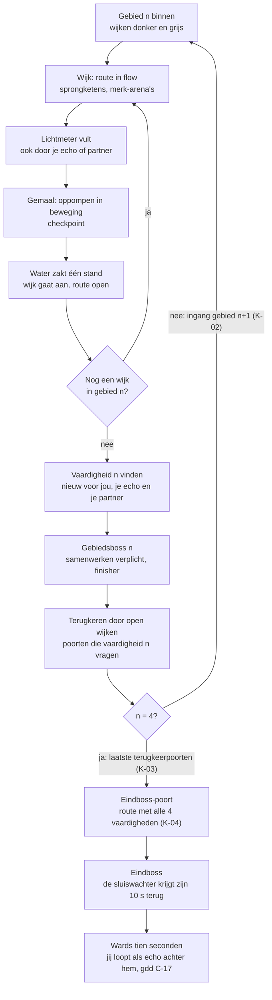
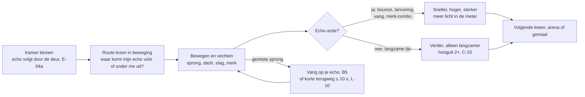
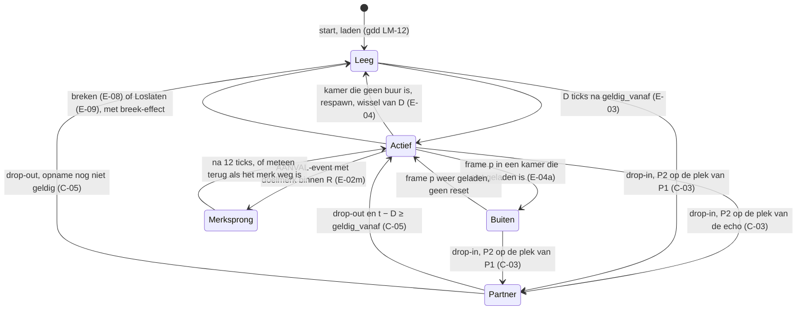

# Kernloop *Polderlight*

Versie 0.5 · Eigenaar: Lead Game Designer · Issue [#81](https://github.com/cesarvangerwen-glitch/echoborn/issues/81) (T3c) · vorige versies: #6
Werktitel *Polderlight* (besluit #96); repo en mappen heten nog "echoborn", de mechaniek heet "echo".
Bronnen: `docs/concept/pitch.md` **v0.4** (pillars P1–P3, puzzeldefinitie en normen §4, R-V4), `docs/beslissingen.md` (#2 randvoorwaarden, #18 stijl 2D, **#51 deel 2**: 1A, 7A, 8A), `docs/productie/fase-2-kader.md` v0.2.
De exacte regels staan in `docs/design/gdd.md` v0.6; de wereldstructuur en de slice in `docs/design/wereld.md`, de boss van de slice in `docs/design/gemaalmeester.md`. Dit document laat zien hoe ze in de loop passen, legt de aantallen en de terugkeerregels vast, toetst alles aan de pillars (§6) en zet op een rij wat de partner in co-op van de echo houdt (§7).

**Werkaanname** (kader §5): CEO-besluiten #2 (5–7 uur, 3–4 gebieden, 4–5 bosses, PEGI 12) en #51 deel 2, fasekader v0.2. Daarnaast **werkaanname LGD**: alle aantallen in §5 zijn een **maximum** en startwaarden van vóór F0. **4 gebieden** is sinds v0.5 een keuze van de LGD binnen #2 (`wereld.md` WS-01); de terugvaloptie met 3 gebieden staat in `wereld.md` §1.7.

---

## 1. De loop in één zin

**Bewegen en vechten in flow → je lichtmeter vult, ook door wat je echo doet → bij een gemaal pomp je dat licht de stad in → het water zakt, de wijk gaat aan, routes gaan open → een vaardigheid vinden → oude plekken opnieuw openen.**

Er staan **geen puzzels op de kritieke route** (pillar 1; puzzeldefinitie in pitch §4: een plek waar je pas verder komt nadat je stilstaat om een volgorde of timing te bedenken). De echo is op de route nooit een slot: hij maakt je sneller, hoger en sterker (gdd C-15). Bij bosses is samenwerken verplicht, solo met je echo en in co-op met je partner (C-16).

De loop draait op vier tijdschalen. Alle vier leunen ze op de echo (P1), lezen ze af aan licht, schaduw en water (P2), en zijn ze solo en co-op dezelfde (P3).

| Schaal | Duur | Wat de speler doet | Wat het tweede lichaam doet (solo de echo, co-op de partner) |
|---|---|---|---|
| **Moment** | ± 2 s (D, gdd E-02) | Springen, dashen, slaan, merken | Komt een tel later vóór of onder je uit: springplank, vang, tweede slag die je merk laat knallen |
| **Keten** | 20–60 s | Een sprongketen of een merk-arena in één beweging | Minstens één echo-actie per ± 20 s (norm 2, L-11); vult de meter het snelst |
| **Wijk** | 18–25 min (`wereld.md` WS-05) | Door een donkere, grijze wijk naar het gemaal, oppompen, de geopende route nemen | Pompt mee (LM-03); zonder echo kan het ook, hooguit 2× zo lang (LM-09) |
| **Gebied** | 60–70 min eerste bezoek, **exclusief minibaas, boss en terugkeren** (die tellen apart, §5) | 3 wijken en een vaardigheid; een minibaas in wijk 2, de boss in wijk 3; daarna terugkeren | Krijgt bij elke vaardigheid een nieuwe betekenis (gdd §3); verplicht bij de boss |

## 2. Diagram: macro-loop (gebied en spel)

## 3. Diagram: kamerloop (minuut tot minuut)

Geen stap "plannen" of "oplossen": de speler leest de route in beweging en kiest waar zijn schaduw straks onder hem staat (pitch §5).

## 4. Diagram: toestand van het tweede lichaam

In *Actief* is de echo **dragend** of **zwevend**: hij draagt alleen waar P1 in frame `p` vanaf de grond liep of sprong (E-07c); waar P1 op hem stond, zweeft hij zonder te breken (E-08b) en draagt hij niet. In *Partner* loopt de opname van P1 door en blijven kamerwissel, respawn en Loslaten `geldig_vanaf` zetten (C-04). P2 die oplost (C-06) blijft in *Partner*: er is dan geen echo (C-01), en hij komt na 120 ticks terug.

## 5. Hoe de loop past binnen de randvoorwaarden

Randvoorwaarden (besluit #2): 5–7 uur, 3–4 gebieden, 4–5 bosses, PEGI 12. Alle aantallen zijn **maxima** (werkaanname LGD), zodat de Producer en de EP ermee kunnen plannen (F6, R20). Uitwerking: Systems Designer en World & Level Designer.

| Onderdeel | Maximum / richtgetal |
|---|---|
| Gebieden | **4** (`wereld.md` WS-01), elk **60–70 min** bij een eerste bezoek, **exclusief minibaas, boss en terugkeren**; plus een proloog van 10–15 min en een finale-route van 5–8 min (K-04) |
| Wijken | **3 per gebied** (12 in totaal): wijk *n*.1 18–20 min met een gemaal van 1 trap, *n*.2 en *n*.3 elk 21–25 min met 2 trappen (gdd L-14, LM-08; `wereld.md` WS-02, WS-05) |
| Vaardigheden | **4**, één per gebied (gdd §3: Neerslag, Snijlijn, Wandgreep, Meerlijn); geen vaardigheid zonder echo-betekenis |
| Bosses | Max. **5**: 4 gebiedsbosses + 1 eindboss, 8–12 min per boss inclusief pogingen; elke boss vraagt samenwerken (C-16) |
| **Scopeplafond combat** (pitch R-V4, voor F6) | Max. **4 nieuwe vijandtypes per gebied**, max. **14 in totaal** inclusief varianten; max. **1 minibaas per gebied** (3–5 min); de 4–5 bosses hierboven. Weinig types die veel kunnen (merk, pantser, neerslag, snijlijn). De slice meet de kost per vijandtype en per boss tegen dit plafond (F6) |
| Kamers | Max. **30 per gebied** (120 totaal). **Puzzelkamers op de kritieke route: 0.** Grote kamers mogen weer, maar zijn niet meer nodig voor de echo (E-04a) |
| Optionele echo-uitdagingen | Alleen in beweging (springparcours, tijdrit; pitch §11 vraag 8), nooit op de kritieke route, **max. 2 per gebied**, pas in fase 3 en alleen als de scope het toelaat |
| Terugkeerpoorten | **2–3 per gebied** in gebied 1–3 (max. 9; het plan heeft er 7, `wereld.md` §1.4), zie de terugkeerregels hieronder |
| Toon (PEGI 12) | Echo en vijanden lossen op in licht of schaduw; geen bloed. Water is een droom, geen ramp in beeld (pitch §6). De "breek" van de echo is een oplossing in schaduwdeeltjes, geen sterfscène |

**Rekensom** (inclusief terugkeren, A3: SM-punt 4 op PR #16). De 60–70 min van een gebied zijn **exclusief** minibaas, boss en terugkeren: die drie tellen apart (kolommen hieronder). Terugkeren kost **2–3 min per terugkeerpoort**: ≤ 2 min lopen (heen vanaf het dichtstbijzijnde gemaal en terug, elk ≤ 1 min, K-05) plus ≤ 1 min voor de poort en wat erachter ligt.

| | Proloog | Gebieden | Bosses | Minibazen | Terugkeren | Totaal |
|---|---|---|---|---|---|---|
| Ondergrens | 10 | 4 × 60 + 5 (finale) = 245 | 5 × 8 = 40 | 4 × 3 = 12 | 6 × 2 = 12 | **319 min ≈ 5,3 uur** |
| Bovengrens | 15 | 4 × 70 + 8 (finale) = 288 | 5 × 12 = 60 | 4 × 5 = 20 | 9 × 3 = 27 | **410 min ≈ 6,8 uur** |

Beide binnen 5–7 uur (de finale-route zit in de kolom Gebieden). **Met 3 gebieden** (alleen als terugvaloptie, `wereld.md` §1.7) (4 bosses, terugkeerpoorten alleen in gebied 1–2) haalt de ondergrens de 5 uur pas als een gebied **± 85 min** duurt (10 + 3 × 85 + 4 × 8 + 3 × 3 + 4 × 2 = 314 min). Dat zijn grotere gebieden met meer wijken (4 per gebied).

**Gekozen (v0.5):** 4 gebieden van 3 wijken; met 3 wijken van gemiddeld ± 22 min en max. 30 kamers per gebied komt een wijk op ≤ 10 kamers van ± 2 min (`wereld.md` WS-01, WS-05).

### Terugkeerregels (backtracking)

Voor de World & Level Designer. Gebied *n* is het gebied waar vaardigheid *n* ligt.

| ID | Regel |
|---|---|
| **K-01** | Gebied 1, 2 en 3 hebben elk **2–3 terugkeerpoorten**: poorten die pas opengaan met de vaardigheid van een *later* gebied. Over gebied 1–3 samen vraagt elk van vaardigheid 2, 3 en 4 minstens één terugkeerpoort. Een terugkeerpoort is een vaardigheidspoort die zichzelf leest (gdd L-03, §3.2): een luik, rietgordijn, kale schacht of kloof met meerringen. |
| **K-02** | De ingang van gebied *n + 1* (n = 1–3) ligt in gebied 1 t/m *n* achter een poort die vaardigheid *n* vraagt. Zo is terugkeren de brug naar het volgende gebied (diagram §2). Een **K-02-poort is geen terugkeerpoort**: ze ligt op de kritieke route, telt **niet** mee in de 2–3 poorten van K-01 en **niet** in de 2–3 min per terugkeerpoort van de rekensom; de loop erheen valt in de 60–70 min van gebied *n + 1* (het eerste bezoek begint bij de poort). |
| **K-03** | **Gebied 4 heeft geen terugkeerpoorten**: alles in gebied 4 is te openen met vaardigheid 1–4 tijdens het eerste bezoek. Gebied 4 rondt het terugkeren af: met vaardigheid 4 gaan de laatste terugkeerpoorten in gebied 1–3 open (K-01). |
| **K-04** | De **eindboss-poort** is **geen echo-puzzel** maar een **route in beweging** die elke vaardigheid minstens één keer vraagt (een luik, een rietgordijn, een greep-schacht, een kloof met meerringen), met een echolijn en een langzame lijn per stuk (gdd L-08) en zonder stap waarin je stilstaat om iets te bedenken (FK-1). De eindboss vraagt samenwerken (C-16) en mag alle vier vaardigheden gebruiken. Achter terugkeerpoorten ligt verder alleen optionele inhoud (verzamelobjecten, snelkoppelingen); de kritieke route gaat alleen door de poorten uit K-02 en K-04. |
| **K-05** | **Terugkeren gaat door open wijken.** Elke terugkeerpoort ligt binnen **≤ 1 min lopen, enkele reis,** van een gemaal (checkpoint, LM-08) via wijken die al zijn opgepompt (lussen en snelkoppelingen, L-12, L-14f); heen en terug dus ≤ 2 min. Zo blijft terugkeren in flow en klopt de rekensom hierboven (2–3 min per poort). Gemeten bij een eerste speler zonder omwegen; de World & Level Designer toetst het met de wereldkaart. |

Toetsing: checklist bij de wereldkaart (World & Level Designer, review LGD), in fase 3; het plan per wijk staat in `wereld.md` §1.3–§1.5.

## 6. Toets aan de drie pillars

Toetsvragen uit `docs/concept/pitch.md` v0.4 §4:
- **P1, De echo houdt je in beweging:** *Maakt de echo deze actie vloeiender of krachtiger, zonder dat de speler ervoor moet stilstaan?*
- **P2, Licht terugwinnen opent de stad:** *Gaat deze weg open door licht dat de speler terugwon of door een vaardigheid die hij heeft, en niet door een raadsel?*
- **P3, Samen bewegen = sterker bewegen:** *Werkt deze actie zowel met een partner (co-op) als met je echo (solo), in dezelfde kamer zonder aparte versie?*

### 6.1 Per groep regels (`gdd.md` v0.5)

| Regels | P1 | P2 | P3 |
|---|---|---|---|
| **Opname en staart** (E-01–E-04e) | **Ja.** De echo loopt ± 2 s achter je en volgt je door de deur, dus hij is er bijna altijd (MP-4 ≤ 40 %). | **Ja.** Hij staat altijd in de schaduwlaag, gerasterd met de contour van P1 (vol = levend, hol = echo). | **Ja.** De opname loopt in co-op door; bij drop-out neemt de echo naadloos over (C-05). |
| **Lagen, plank en springplank** (E-05–E-07c) | **Ja.** Landen op je echo houdt je vaart en geeft je dash terug; geen toren, dus hij maakt routes niet overbodig. | **Ja.** Eén eigenaarslaag per object; zones zijn zichtbaar bij een lamp of gevaar. | **Ja.** P2 heeft dezelfde plank, en P1 is voor P2 een lichtplank (C-09). |
| **Breken** (E-08, L-06) | **Ja.** Breken kost hooguit ± 2 s; op je echo staan breekt hem niet. | **Ja.** De oorzaak staat in beeld: schaduwmuur, fel licht, schaduwgevaar. | **Ja.** P2 lost op door dezelfde oorzaken (C-06). |
| **Aanval en schaduwmerk** (E-10–E-14, E-02m) | **Ja.** Je slaat, een tel later slaat je schaduw daar nog eens en laat je merk knallen; geen ontsteekknop, geen wachten. | **Ja.** Het merk is een lichtvonk (peilmerk) en de ontploffing licht en schaduw. | **Ja.** Co-op: de een zet, de ander laat knallen (C-12). |
| **Loslaten** (E-09) | **Ja.** Een ongelukkige echo is in een tel leeg; je nieuwe is er ± 2 s later. | n.v.t. | **Ja.** In co-op zet het alleen `geldig_vanaf`. |
| **Co-op 7A** (C-01–C-16) | **Ja.** Vier acties in beweging; optioneel op de route, verplicht bij bosses, nooit een slot. | **Ja.** Max. twee lichamen; de finisher-echo is half licht, half schaduw. | **Ja.** Elke actie heeft een solo- en een co-op-vorm in dezelfde kamer. |
| **Lichtmeter, gemalen, water** (LM-01–LM-12) | **Ja.** Flow vult de meter het snelst; oppompen en genezen kunnen lopend. | **Ja.** Pillar 2 zelf: licht terugwinnen laat het water zakken en opent routes. | **Ja.** Eén gedeelde meter; P2 pompt mee. |
| **Vaardigheden** (V-01–V-04) | **Ja.** Elke vaardigheid geeft de echo iets nieuws (tweede neerslag, snijlijn, plank aan de muur, lijn naar je echo); geen dubbele sprong. | **Ja.** Elke poort leest zichzelf (luik, riet, schacht, meerring). | **Ja.** P1 en P2 krijgen ze tegelijk, met dezelfde regel. |
| **Levelregels en terugkeren** (L-02–L-14, K-01–K-05) | **Ja.** Bouwstenen waar de echo vóór je uitkomt, elke ± 20 s een kans, missen kost weinig. | **Ja.** Poorten via licht, water of een vaardigheid, nooit een sleutel of raadsel (L-03). | **Ja.** Geen co-op-only plekken (L-02), geen aparte versie van een kamer (C-15d). |

### 6.2 Per onderdeel van de loop

| Onderdeel | P1 | P2 | P3 |
|---|---|---|---|
| **Moment** | Ja: de echo is springplank en tweede slag binnen ± 2 s (norm 1 en 2). | Ja: de echo is altijd zichtbaar in de schaduwlaag. | Ja: in co-op doet de partner hetzelfde, live. |
| **Keten** | Ja: L-08 en L-11; normen gemeten in de flow-kamer (F0) en de slice (F4, F4b). | Ja: ketens vullen de meter (LM-02). | Ja: dezelfde bouwstenen voor beide modi. |
| **Wijk en gemaal** | Ja: oppompen zonder stilstand (LM-04), de echo pompt mee. | Ja: het water zakt, de wijk gaat aan. | Ja: samen oppompen uit één meter. |
| **Vaardigheid vinden** | Ja: elke vaardigheid versterkt de echo (gdd §3.1). | Ja: een vaardigheid opent een route die je eerder zag maar niet haalde. | Ja: P1 en P2 krijgen hem tegelijk. |
| **Boss** | Ja: samenwerken is verplicht, in beweging, vensters ≥ 10 ticks, ≤ 5 s stilstand (C-16). | Ja: een boss gebruikt fel licht en schaduwgevaar en leest je echo (O-1). | Ja: dezelfde boss en arena, de finisher speelt jullie laatste 10 s (C-14). |
| **Terugkeren** | Ja: oude poorten gaan open door wat je nu kunt, via open wijken (K-05). | Ja: de poort laat zelf zien waarom hij dicht was. | Ja: geen co-op-only poorten. |

**Bewuste uitzonderingen** (pitch §4 staat ze toe als ze benoemd zijn):
1. Basisbeweging (lopen, springen, slaan, dash) bestaat zonder echo; de echo voegt er iets aan toe als hij haar herhaalt.
2. Alleen P1 verzamelt (E-12), zodat er één duidelijke eigenaar van de voortgang is.
3. Vijanden doen de echo en P2 niets (E-14h). Gevaar voor de schaduw loopt alleen via licht en schaduwgevaar (pillar 2); bosses lezen je echo zonder hem schade te doen (O-1).

## 7. Co-op: wat de partner van de echo houdt

Co-op 7A (besluit #51): één rol, solo de echo en in co-op de partner (P2). Co-op mag de game niet triviaal maken en niemand mag wachten (pillar 3, R10, R-V5). Daarom houdt P2 de beperkingen van de schaduw; wat hij extra heeft, is dat hij live speelt en meeslaat.

**Wat P2 houdt**

| Beperking | Echo (solo) | P2 (co-op) | Regel |
|---|---|---|---|
| Laag | Alleen schaduw (laag 3) | Alleen schaduw (laag 3) | E-05, C-02 |
| Botst met | Wereld en schaduwgeometrie (breekt erop) | Wereld en schaduwgeometrie (botst ertegen) | E-08a, C-02 |
| Lichtgeometrie | Bestaat niet | Bestaat niet | E-05 |
| Fel licht, schaduwgevaar | Breekt | Lost op, terug na 120 ticks | E-08c/d, C-06 |
| Lichtobjecten | Kan ze niet bedienen of raken | Kan ze niet bedienen of raken | E-06, C-02 |
| Verzamelen | Nee | Nee | E-12, C-02 |
| Levenspunten | Geen; vijanden doen niets | Geen; vijanden doen niets | E-14h, C-02 |
| Camera | Veroorzaakt geen kamerwissel | Veroorzaakt geen kamerwissel; moet in beeld blijven (leiband) | E-04e, C-07 |
| Aantal | Eén tweede lichaam | Eén tweede lichaam; geen echo ernaast | C-01 |

**Wat P2 extra heeft, en wat het afdekt**

| Extra van P2 | Risico | Wat het afdekt |
|---|---|---|
| **Live timing en een eigen route** | P2 komt waar de echo nooit komt | Plekken die alleen P2 bereikt, bevatten niets (L-02); samenwerken levert alleen tempo, nooit een plek (C-15) |
| **Slaan, merken en pompen** (10 SE) | Co-op wordt te makkelijk | MP-7: co-op hooguit 2× zo snel als solo; daarna eerst de boss-SE in co-op bijstellen (O-13) |
| **Op P1 staan** (lichtplank) en springer zijn | Eindeloos op elkaar klimmen | Ladderregel (C-09), solo dezelfde regel via E-07c |
| **Botsen in plaats van breken** | Goedkoper herstel | Bedoeld: de minder ervaren speler faalt vergevingsgezind (pitch §11 vraag 3) |
| **Geen merksprong** | — | P2 richt zelf; de merksprong is er voor de echo, die niet kan richten (C-02) |

Iedereen kan alles ook alleen, alleen langzamer (C-15), dus niemand hoeft op de ander te wachten. Gemeten met MP-7 vanaf de flow-kamer, in de slice per kamer en bij de boss (T11).

## 8. Wat we willen leren

- **Flow-kamer (F0, T17):** de playtestvragen in `gdd.md` §5: welke staart (1,5 / 2 / 3 s), houdt de echo je in beweging (normen 1–3), is hij niet te vaak Leeg, ligt de springplank niet achter je (R-V12), leest het merk als *Nine Sols*, en wacht in co-op iemand.
- **Slice (F3, F4, F4b, T11):** dezelfde normen in een echte polderwijk (de Kadewijk, `wereld.md` §2) met gemaal en de Gemaalmeester (playtestvragen in `gemaalmeester.md` §8), de vragen per vaardigheid die in de slice zit (`gdd.md` §3.5), en of de echo ook buiten verplichte boss-acties gebruikt wordt (grens F4b(b), `gdd.md` §5.1).

## 9. Wijzigingen

| Versie | Wat |
|---|---|
| 0.1 | Eerste versie (PR #16). |
| 0.2 | Lead-review EP (PR #16): terugkeerregels K-01–K-04 (gebied 4 en eindboss), aantallen als maximum met rekensom 5,1–6,6 uur, toestandsdiagram met Leeg → Overgenomen, macro-diagram met eindboss-poort. Fasekader v1.1: pillartoets per groep echo-regels (§6.1, E2a) en overzicht wat P2 van de echo houdt (§7, E2b). Stijlbesluit 2D verwerkt. |
| 0.2.1 | Werktitel *Polderlight* (besluit #96, [#37](https://github.com/cesarvangerwen-glitch/echoborn/issues/37)); verwijzing naar gdd v0.4 voor staart en co-op 7A. |
| 0.4.1 | Herstel na de Lead-review van de EP (PR #108): de 60–70 min per gebied zijn **exclusief** minibaas, boss en terugkeren (§1, §5); **K-05** ≤ 1 min lopen enkele reis (heen en terug ≤ 2 min), passend bij 2–3 min per terugkeerpoort in de rekensom (5,2–6,9 uur blijft); open punt 3 gebieden (± 85 min per gebied) naar de wereldstructuur. Na de SM-review: K-02-poort telt niet als terugkeerpoort. |
| 0.4 | Herschreven naar pitch v0.4 en `gdd.md` v0.5 (T3c, [#81](https://github.com/cesarvangerwen-glitch/echoborn/issues/81)); het versienummer volgt de pitch. Loop in één zin met licht oppompen en **0 puzzels op de kritieke route** (§1); vier tijdschalen met de staart D (moment, keten, wijk, gebied); macro-loop met wijken en gemalen, kamerloop zonder plannen/oplossen, toestandsdiagram met Buiten, Merksprong en Partner (§2–§4). §5: wijken, vaardigheden bij naam, **scopeplafond combat (R-V4)**, 0 puzzelkamers, optionele echo-uitdagingen max. 2 per gebied; rekensom met minibazen en **terugkeertijd** (A3: SM-punt 4 op PR #16), 5,2–6,9 uur, en het gevolg van 3 gebieden. **K-04** zonder echo-puzzel (route in beweging met alle vier vaardigheden), nieuw **K-05** (terugkeren door open wijken). §6 pillartoets op de pillars van v0.4; §7 co-op 7A; §8 flow-kamer en slice. |
| 0.5 | GDD v1, deel 2 (T3c, [#81](https://github.com/cesarvangerwen-glitch/echoborn/issues/81)): 4 gebieden gekozen (`wereld.md`); wijken 3 per gebied met duur en trappen; terugkeerpoorten 2–3 per gebied (K-01, max. 9); rekensom met de finale-route: 5,3–6,8 uur; open punt 3 gebieden gesloten (terugvaloptie in `wereld.md` §1.7); macro-diagram met Wards tien seconden (gdd C-17). |
