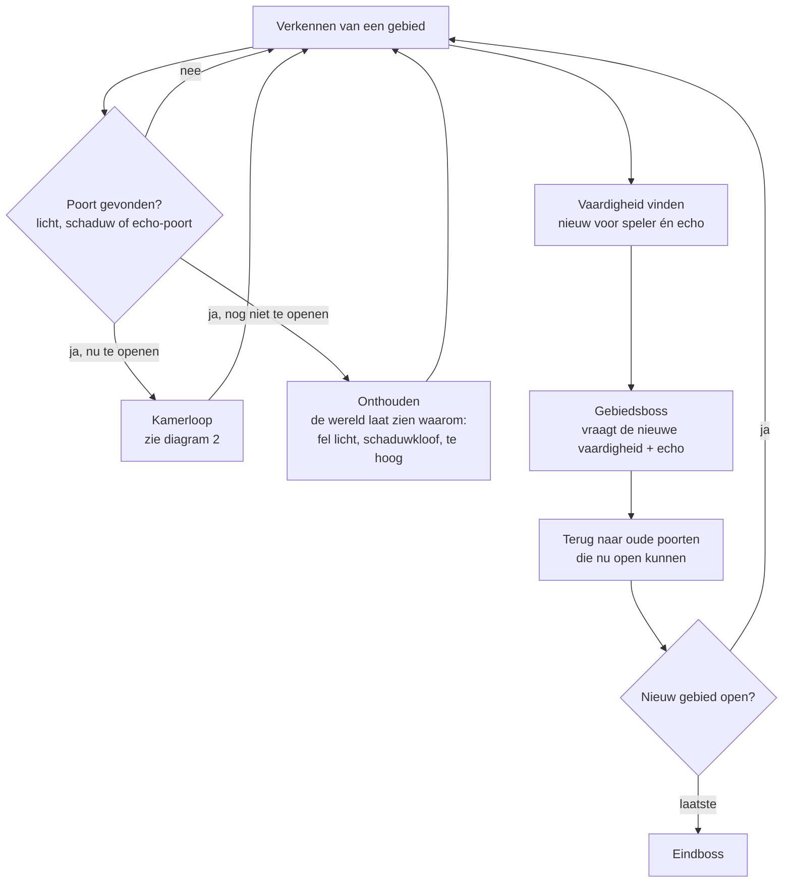
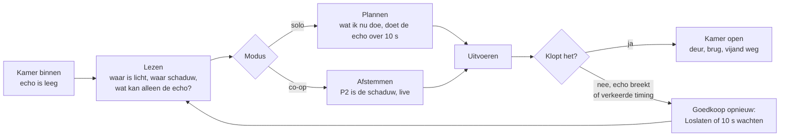
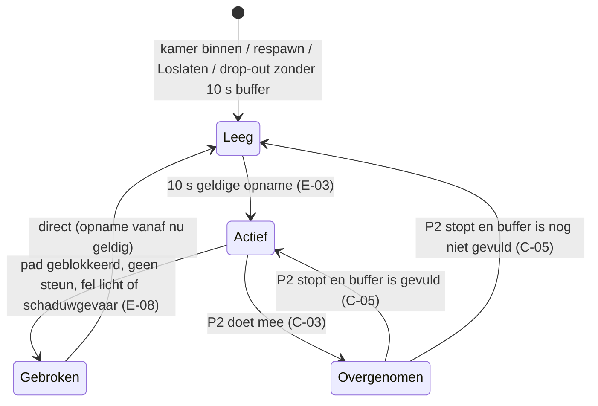

# Kernloop *Echoborn*

Versie 0.1 · Eigenaar: Lead Game Designer · Issue #6 · Status: interne review (Executive Producer)
Bronnen: `docs/concept/pitch.md` (pillars), `docs/tech/ontwerp.md` (echo-spike), `docs/beslissingen.md` (randvoorwaarden 2026-11-08).
De exacte echo-regels staan in `docs/design/gdd.md` §2. Dit document laat zien hoe ze in de loop passen.

---

## 1. De loop in één zin

**Verkennen → een plek vinden die je met één lichaam niet haalt → een vaardigheid vinden (bijna altijd: iets nieuws wat de echo kan) → oude plekken opnieuw openen.**

De loop draait op drie tijdschalen. Alle drie leunen ze op de echo (pillar 1) en lezen ze af aan licht en schaduw (pillar 2). Solo en co-op doorlopen precies dezelfde stappen (pillar 3).

| Schaal | Duur | Wat de speler doet | Wat de echo doet |
|---|---|---|---|
| **Moment** | 10 s | Handelen voor nu én voor straks | Herhaalt jouw laatste 10 s in de schaduwlaag |
| **Kamer** | 1–5 min | Lezen → plannen (solo) of afstemmen (co-op) → uitvoeren → kijken wat de echo doet | Lost de kamer samen met jou op, of breekt en laat zien waar het misging |
| **Gebied** | 60–100 min | Verkennen, poorten in licht/schaduw tegenkomen, vaardigheid vinden, boss, terug naar oude poorten | Krijgt per gebied een nieuwe vaardigheid |

## 2. Diagram: macro-loop (gebied en spel)

## 3. Diagram: kamerloop (de minuut-tot-minuut ervaring)

## 4. Diagram: toestand van de echo (solo)

## 5. Hoe de loop past binnen de randvoorwaarden

Randvoorwaarden (besluit 2026-11-08): 5–7 uur, 3–4 gebieden, 4–5 bosses, PEGI 12.

| Onderdeel | Voorstel (werkaanname LGD, uitwerking Systems/World & Level) |
|---|---|
| Gebieden | 4 gebieden, elk 60–100 min speeltijd bij een eerste run; plus een korte proloog (10–15 min) |
| Vaardigheden | 4 echo-vaardigheden, één per gebied (zie `gdd.md` §3); geen vaardigheid zonder echo-betekenis |
| Bosses | 4 gebiedsbosses + 1 eindboss = 5; elke boss toetst de vaardigheid van zijn gebied plus de basis-echo |
| Kamers | Richtgetal 25–35 kamers per gebied, waarvan ±1/3 met een echo-puzzel op de kritieke route |
| Terugkeren | Elk gebied heeft minstens 2 poorten die pas met een latere vaardigheid opengaan (backtracking zonder grind) |
| Toon (PEGI 12) | Echo en vijanden lossen op in licht of schaduw; geen bloed. De "breek" van de echo is een oplossing in schaduwdeeltjes, geen sterfscène. |

Rekensom: 15 min proloog + 4 × 80 min + 5 bosses à ±6 min (incl. pogingen) ≈ 6 uur. Valt binnen 5–7 uur.

> Let op: de pitch (v0.1, §8) noemt nog 10–14 uur en PEGI 12–16. Het CEO-besluit van 2026-11-08 is leidend (5–7 uur, PEGI 12). Doorgegeven aan de Creative Director in #15.

## 6. Toets aan de drie pillars

Toetsvragen uit `docs/concept/pitch.md` §4.

| Onderdeel van de loop | Pillar 1: *Gebruikt of versterkt het de echo, of maakt het hem overbodig?* | Pillar 2: *In één oogopslag welke laag, en loopt de gating via licht/schaduw/echo?* | Pillar 3: *Werkt het met echo (solo) én live schaduw (co-op), zonder aparte versie?* |
|---|---|---|---|
| **Moment** (echo loopt altijd 10 s achter je aan, E-01) | Ja: elke basisactie (lopen, springen, slaan, hendel) krijgt een tweede betekenis, ook buiten puzzelkamers. Dat dekt het pitch-risico "te weinig flow". | Ja: de echo staat altijd in de schaduwlaag (E-05) en is daar zichtbaar. | Ja: in co-op is P2 diezelfde schaduw, met dezelfde laagregels (C-01, C-02). |
| **Kamer** (lezen → plannen/afstemmen → uitvoeren) | Ja: kritieke-route-kamers zijn niet op te lossen met één lichaam (level-regel L-01). | Ja: poorten zijn licht-, schaduw- of echo-poorten, nooit gekleurde sleutels (L-03). | Ja: zelfde kamer, solo gepland, co-op afgestemd; elke schaduwplek op de kritieke route is ook voor de echo bereikbaar (L-02). |
| **Breken en opnieuw** (E-08, E-09) | Ja: falen is zichtbaar in de echo zelf; opnieuw kost hooguit 10 s. | Ja: de echo breekt op schaduwgeometrie, ontbrekende schaduwsteun of fel licht: de oorzaak staat in beeld. | Ja: P2 "lost op" door dezelfde oorzaken (C-06). |
| **Vaardigheid vinden** | Ja: alle 4 vaardigheden zijn echo-vaardigheden (`gdd.md` §3). Geen dubbele sprong of dash die de echo overbodig maakt. | Ja: Dempen en Dragen werken op licht; Ankeren en Wisselen op de echo. | Ja: P1 en P2 krijgen elke vaardigheid tegelijk. |
| **Boss** | Ja: elke boss heeft minstens één fase die de echo vraagt (bv. een schild dat alleen breekt bij twee gelijktijdige treffers). | Ja: bosses wisselen het licht en dus de lagen. | Ja: zelfde boss, zelfde regels; in co-op voelt hij anders (live in plaats van gepland). |
| **Terugkeren** | Ja: oude poorten gaan open door wat de echo nu kan. | Ja: de poort laat zelf zien waarom hij dicht was (te fel, te donker, te hoog). | Ja: geen co-op-only poorten (L-02). |

**Bewuste uitzonderingen:** basisbeweging (lopen, springen, slaan) bestaat zonder echo, zoals de pitch toestaat. Het verzamelen van items en vaardigheden doet alleen het lichtpersonage (E-12); dat is nodig zodat er één duidelijke "eigenaar" van de voortgang is.

## 7. Wat we met het prototype willen leren

De drie playtestvragen voor het prototype staan in `gdd.md` §5.
