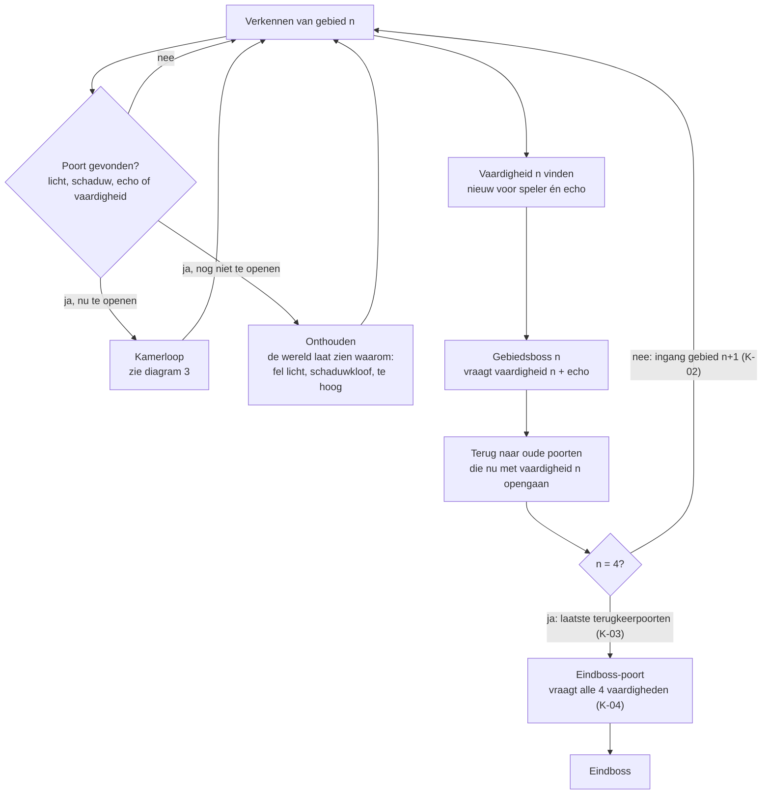
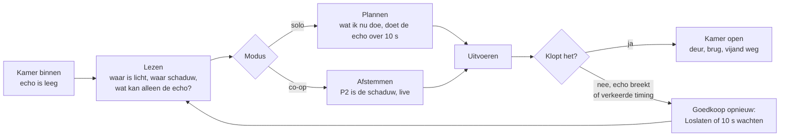
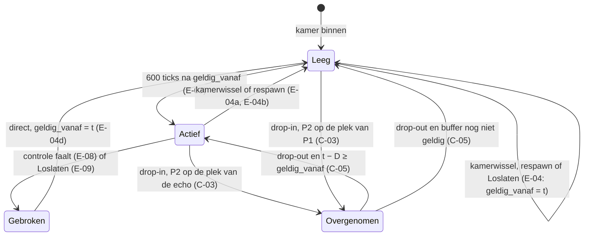

# Kernloop *Echoborn*

Versie 0.2 · Eigenaar: Lead Game Designer · Issue #6 · Status: interne review (Executive Producer)
Bronnen: `docs/concept/pitch.md` (pillars), `docs/tech/ontwerp.md` (echo-spike), `docs/productie/fase-1-kader.md` (E2a, E2b), `docs/beslissingen.md` (randvoorwaarden #2, stijl 2D #18).
De exacte echo-regels staan in `docs/design/gdd.md` §2. Dit document laat zien hoe ze in de loop passen, toetst ze aan de pillars (§6, fasekader E2a) en zet op een rij wat de schaduwspeler in co-op van de echo houdt (§7, fasekader E2b).

---

## 1. De loop in één zin

**Verkennen → een plek vinden die je met één lichaam niet haalt → een vaardigheid vinden (bijna altijd: iets nieuws wat de echo kan) → oude plekken opnieuw openen.**

De loop draait op drie tijdschalen. Alle drie leunen ze op de echo (pillar 1) en lezen ze af aan licht en schaduw (pillar 2). Solo en co-op doorlopen precies dezelfde stappen (pillar 3).

| Schaal | Duur | Wat de speler doet | Wat de echo doet |
|---|---|---|---|
| **Moment** | 10 s | Handelen voor nu én voor straks | Herhaalt jouw laatste 10 s in de schaduwlaag |
| **Kamer** | 1–5 min | Lezen → plannen (solo) of afstemmen (co-op) → uitvoeren → kijken wat de echo doet | Lost de kamer samen met jou op, of breekt en laat zien waar het misging |
| **Gebied** | 65–80 min | Verkennen, poorten in licht/schaduw tegenkomen, vaardigheid vinden, boss, terug naar oude poorten | Krijgt per gebied een nieuwe vaardigheid |

## 2. Diagram: macro-loop (gebied en spel)

## 3. Diagram: kamerloop (de minuut-tot-minuut ervaring)

## 4. Diagram: toestand van de schaduw (solo en co-op)

In *Overgenomen* loopt de opname van P1 door en blijven kamerwissel, respawn en Loslaten `geldig_vanaf` zetten (C-04). P2 die oplost (C-06) blijft in *Overgenomen*: hij komt na 120 ticks terug.

## 5. Hoe de loop past binnen de randvoorwaarden

Randvoorwaarden (besluit #2): 5–7 uur, 3–4 gebieden, 4–5 bosses, PEGI 12. Alle aantallen hieronder zijn **maxima** (werkaanname LGD), zodat de Producer ermee kan plannen. Uitwerking: Systems Designer en World & Level Designer.

| Onderdeel | Maximum / richtgetal |
|---|---|
| Gebieden | Max. **4**, elk 65–80 min bij een eerste run; plus een proloog van 10–15 min |
| Vaardigheden | **4** echo-vaardigheden, één per gebied (`gdd.md` §3); geen vaardigheid zonder echo-betekenis |
| Bosses | Max. **5**: 4 gebiedsbosses + 1 eindboss; elke boss toetst de vaardigheid van zijn gebied plus de basis-echo; 6–12 min per boss inclusief pogingen |
| Kamers | Max. **30 per gebied** (120 totaal), waarvan max. **10 echo-puzzelkamers op de kritieke route** per gebied (40 totaal). Verkenning bij voorkeur in grote kamers (`gdd.md` L-07). Dit is de grootste werkpost in productie. |
| Terugkeerpoorten | **2–4 per gebied** in gebied 1–3 (max. 12), zie de terugkeerregels hieronder |
| Toon (PEGI 12) | Echo en vijanden lossen op in licht of schaduw; geen bloed. De "breek" van de echo is een oplossing in schaduwdeeltjes, geen sterfscène. |

Rekensom: ondergrens 15 min proloog + 4 × 65 min + 5 × 6 min = 305 min ≈ **5,1 uur**; bovengrens 15 + 4 × 80 + 5 × 12 = 395 min ≈ **6,6 uur**. Beide binnen 5–7 uur, ook als de bosses het dubbele van de oorspronkelijke 6 min kosten.

### Terugkeerregels (backtracking)

Voor de World & Level Designer. Gebied *n* is het gebied waar vaardigheid *n* ligt.

| ID | Regel |
|---|---|
| **K-01** | Gebied 1, 2 en 3 hebben elk **2–4 terugkeerpoorten**: poorten die pas opengaan met de vaardigheid van een *later* gebied. Over gebied 1–3 samen vraagt elk van vaardigheid 2, 3 en 4 minstens één terugkeerpoort. |
| **K-02** | De ingang van gebied *n + 1* (n = 1–3) ligt in gebied 1 t/m *n* achter een poort die vaardigheid *n* vraagt. Zo is terugkeren de brug naar het volgende gebied (diagram §2). |
| **K-03** | **Gebied 4 heeft geen terugkeerpoorten**: alles in gebied 4 is te openen met vaardigheid 1–4 tijdens het eerste bezoek. Gebied 4 rondt het terugkeren af: met vaardigheid 4 gaan de laatste terugkeerpoorten in gebied 1–3 open (K-01). |
| **K-04** | De **eindboss-poort** vraagt alle vier vaardigheden: een echo-poort met vier stappen, één per vaardigheid (`gdd.md` L-03, L-04). De eindboss toetst alle vier vaardigheden plus de basis-echo. Achter terugkeerpoorten ligt verder alleen optionele inhoud (verzamelobjecten, snelkoppelingen); de kritieke route gaat alleen door de poorten uit K-02 en K-04. |

Toetsing: checklist bij de wereldkaart (World & Level Designer, review LGD), in fase 2.

## 6. Toets aan de drie pillars (fasekader E2a)

Toetsvragen uit `docs/concept/pitch.md` §4:
- **P1:** *Gebruikt of versterkt het wat de echo kan, of maakt het de echo overbodig?*
- **P2:** *Kan een speler in één oogopslag zien in welke laag dit hoort, en loopt de gating via licht, schaduw of de echo?*
- **P3:** *Werkt het zowel met de 10-secondenecho (solo) als met een live gespeelde schaduw (co-op), zonder aparte versie?*

### 6.1 Per groep echo-regels

| Regels (`gdd.md`) | P1 | P2 | P3 |
|---|---|---|---|
| **Opnamemodel** (E-01–E-04e): altijd 10 s achter je aan, toestandsopname, één reset | **Ja.** De echo doet altijd mee, ook buiten puzzels; elke basisactie krijgt een tweede betekenis. | **Ja.** De echo staat altijd in de schaduwlaag; in 2D gerasterd met de contour van P1 (vol = levend, hol = echo, stijltest #7). | **Ja.** Dezelfde buffer loopt in co-op door; bij drop-out neemt de echo over zonder kamer-reset. |
| **Lagen en platform** (E-05–E-07b, E-11, E-12) | **Ja.** De echo is een lichaam met gewicht: P1 staat erop en beweegt mee, hij houdt drukplaten vast. | **Ja.** Wat de echo raakt, volgt uit één eigenaarslaag per object; fel licht is een zone die bij een zichtbare lamp hoort. | **Ja.** P2 gebruikt dezelfde lagen, maskers en schaduwplank. |
| **Breken** (E-08, L-06) | **Ja.** Falen is zichtbaar in de echo zelf; opnieuw kost hooguit 10 s. | **Ja.** De oorzaak staat in beeld: schaduwmuur, ontbrekende schaduwsteun, fel licht of schaduwgevaar. | **Ja.** P2 lost op door dezelfde licht- en gevaaroorzaken (C-06). |
| **Events en aanval** (E-10–E-10b, E-13, E-14, tweeslagschild) | **Ja.** Een slag nu is een slag over 10 s; het tweeslagschild vraagt twee lichamen tegelijk (pitch: "past"). | **Ja.** De echo raakt alleen gedeelde en schaduwobjecten; welke dat zijn, zie je aan het object. | **Ja.** P2 slaat en bedient met dezelfde bits en dezelfde laagregels. |
| **Loslaten** (E-09) | **Ja.** Geen "slow motion": je wacht nog steeds 10 s op je nieuwe echo, de tijdsdruk blijft. | n.v.t. (geen gating) | **Ja.** In co-op zet het alleen `geldig_vanaf`, zodat een drop-out klopt. |
| **Co-op** (C-01–C-08) | **Ja.** P2 neemt precies de rol van de echo over; er komt geen derde lichaam bij. | **Ja.** Altijd één lichaam in het licht en één in de schaduw; P2 is vol, de echo hol. | **Ja.** Zelfde kamers, zelfde regels; zie §7 voor wat P2 van de echo houdt. |
| **Levelregels en terugkeren** (L-01–L-07, K-01–K-04) | **Ja.** Kritieke-route-kamers zijn niet met één lichaam op te lossen (L-01); de eindboss-poort vraagt alle echo-vaardigheden. | **Ja.** Poorten zijn licht, schaduw, echo of vaardigheid, nooit gekleurde sleutels (L-03). | **Ja.** Geen co-op-only plekken (L-02). |

### 6.2 Per onderdeel van de loop

| Onderdeel | P1 | P2 | P3 |
|---|---|---|---|
| **Moment** (E-01) | Ja: lopen, springen, slaan en hendels hebben een tweede betekenis. Dat dekt het pitch-risico "te weinig flow". Playtestvraag 1 meet hoe vaak de echo tijdens verkennen Leeg is. | Ja: de echo is altijd zichtbaar in de schaduwlaag. | Ja: in co-op is P2 diezelfde schaduw. |
| **Kamer** | Ja: L-01. | Ja: L-03. | Ja: solo gepland, co-op afgestemd (L-02). |
| **Vaardigheid vinden** | Ja: alle 4 vaardigheden zijn echo-vaardigheden; geen dubbele sprong of dash die de echo overbodig maakt. | Ja: Dempen en Dragen werken op licht; Ankeren en Terugstappen op de echo. | Ja: P1 en P2 krijgen elke vaardigheid tegelijk. |
| **Boss** | Ja: elke boss heeft minstens één fase die de echo vraagt (bv. het tweeslagschild). | Ja: bosses wisselen het licht en dus de lagen. | Ja: zelfde boss, zelfde regels; in co-op voelt hij anders (live in plaats van gepland). |
| **Terugkeren** (K-01–K-04) | Ja: oude poorten gaan open door wat de echo nu kan. | Ja: de poort laat zelf zien waarom hij dicht was (te fel, te donker, te hoog). | Ja: geen co-op-only poorten. |

**Bewuste uitzonderingen** (pitch §4 staat ze toe als ze benoemd zijn):
1. Basisbeweging (lopen, springen, slaan) bestaat zonder echo.
2. Alleen P1 verzamelt (E-12), zodat er één duidelijke eigenaar van de voortgang is.
3. Vijanden doen de echo en P2 niets (E-14). Gevaar voor de schaduw loopt alleen via licht en schaduwgevaar (pillar 2). Of vijanden de echo later toch als doelwit kiezen, is open vraag O-1 (Combat Designer).

## 7. Co-op: wat de schaduwspeler van de echo houdt (fasekader E2b)

Doel: co-op mag de puzzels niet triviaal maken (pillar 3, risico R10). Daarom houdt P2 alle beperkingen van de echo. Het enige echte verschil is dat P2 *live* speelt.

| Beperking | Echo (solo) | P2 (co-op) | Regel |
|---|---|---|---|
| Laag | Alleen schaduw (laag 3) | Alleen schaduw (laag 3) | E-05, C-02 |
| Botst met | Wereld en schaduwgeometrie (breekt erop) | Wereld en schaduwgeometrie (botst ertegen) | E-08a, C-02 |
| Lichtgeometrie | Bestaat niet: geen steun, geen muur | Bestaat niet: geen steun, geen muur | E-05, E-08b |
| Fel licht | Breekt | Lost op, terug na 120 ticks | E-08c, C-06 |
| Schaduwgevaar | Breekt | Lost op, terug na 120 ticks | E-08d, C-06 |
| Lichtobjecten (lichtplaat, lichtschakelaar, lichtwezen) | Kan ze niet bedienen of raken | Kan ze niet bedienen of raken | E-06, C-02 |
| Gedeelde en schaduwobjecten | Bedient en raakt ze | Bedient en raakt ze | E-06, C-02 |
| Verzamelen (items, vaardigheden, gezondheid) | Nee | Nee | E-12, C-02 |
| Levenspunten, vijandelijke treffers | Geen; vijanden doen niets | Geen; vijanden doen niets | E-14, C-02 |
| Op P1 staan | Kan niet | Kan niet | E-05, C-02 |
| P1 op de schaduw | P1 kan erop staan en beweegt mee | P1 kan erop staan en beweegt mee | E-07, E-07a |
| Duwen | Duwt niets | Duwt niets | E-07, C-02 |
| Kamerwissel, camera | Veroorzaakt geen kamerwissel | Veroorzaakt geen kamerwissel; moet in beeld blijven (leiband), P1 bepaalt de camera | E-04e, C-07 |
| Aantal | Eén schaduwlichaam | Eén schaduwlichaam; geen echo ernaast | C-01 |

**Wat P2 extra heeft, en waarom dat de puzzel niet triviaal maakt:**

| Extra van P2 | Risico | Wat het afdekt |
|---|---|---|
| **Live timing** (nu in plaats van 10 s later) | Bedoeld verschil: van plannen naar afstemmen (pillar 3) | Playtestvraag 3: co-op niet meer dan 2× zo snel als solo |
| **Eigen route** (niet gebonden aan het pad van P1) | P2 bereikt plekken waar de echo nooit komt | L-02: elke plek die de schaduw op de kritieke route of voor een verzamelobject moet bereiken, is ook voor de solo-echo bereikbaar; plekken die alleen P2 bereikt, bevatten niets |
| **Botsen in plaats van breken** | Goedkoper herstel bij een fout | P2 komt nog steeds niet door een schaduwmuur; alleen de straf is kleiner (pitch-vraag 3: vergevingsgezind) |
| **Onbeperkt wachten** (bv. lang op een plaat staan) | Tijdsdruk valt weg | Solo kan P1 ook lang op een plaat staan, de echo herhaalt dat; puzzels met een tijdsvenster gebruiken Eenmalige of Wissel-schakelaars (L-04, L-05) of het tweeslagschild |

In fase 2 wordt elke puzzel van de verticale slice in beide modi gespeeld (R10, fasekader §5).

## 8. Wat we met het prototype willen leren

De drie playtestvragen voor het prototype staan in `gdd.md` §5: de lengte van 10 s (inclusief hoe vaak de echo tijdens verkennen Leeg is), of breken eerlijk voelt, en of co-op afstemmen is zonder triviaal te worden.

## 9. Wijzigingen

| Versie | Wat |
|---|---|
| 0.1 | Eerste versie (PR #16). |
| 0.2 | Lead-review EP (PR #16): terugkeerregels K-01–K-04 (gebied 4 en eindboss), aantallen als maximum met rekensom 5,1–6,6 uur, toestandsdiagram met Leeg → Overgenomen, macro-diagram met eindboss-poort. Fasekader v1.1: pillartoets per groep echo-regels (§6.1, E2a) en overzicht wat P2 van de echo houdt (§7, E2b). Stijlbesluit 2D verwerkt. |
