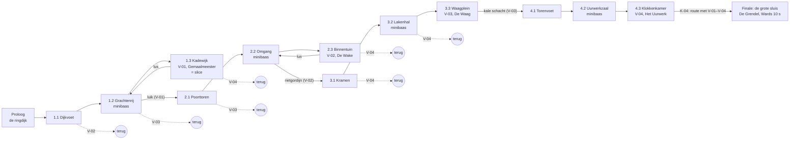

# Wereld en slice *Polderlight*

Versie 0.1.4 (GDD v1, deel 2) · Eigenaar: Lead Game Designer (met World & Level Designer voor §1–§2, Systems Designer voor de lichtbalans, Combat Designer voor de vijandtypes) · Issue [#81](https://github.com/cesarvangerwen-glitch/echoborn/issues/81) (T3c) en [#87](https://github.com/cesarvangerwen-glitch/echoborn/issues/87) (T10, namen), `docs/productie/fase-2-kader.md` §2
Hoort bij `docs/design/gdd.md` v0.6.2 (regels E-, C-, L-, LM-, V-) en `docs/design/kernloop.md` v0.5.1 (aantallen, rekensom, terugkeerregels K-01–K-05). De boss van de slice staat apart in `docs/design/gemaalmeester.md`.
Bronnen: `docs/concept/pitch.md` v0.4 (P1–P3, §4 puzzeldefinitie en normen, §5 rondgangen, R-V4), `docs/narrative/verhaal-v2.md` (gebieden, bosses, bevroren echo's, logboeken), `docs/beslissingen.md`.

**Werkaanname** (kader §5): CEO-besluiten #2 (5–7 uur, 3–4 gebieden, 4–5 bosses, PEGI 12), #18 (2D, 640×360) en #51 deel 2 (1A: geen puzzels op de kritieke route, gating via vaardigheden en routes, water geen speellaag; 2A: slice-art pas na F0; 7A; 8A), fasekader fase 2 v0.2 (F3, F4b, R-V4, T8a–d). Daarnaast **werkaanname LGD**: alle tijden, aantallen en maten in dit document zijn **startwaarden van vóór de flow-test (F0, [#80](https://github.com/cesarvangerwen-glitch/echoborn/issues/80))**; ze worden bijgesteld na F0 (gdd §8) en gemeten in de slice (T11). D = 120 ticks tot F0 een staart kiest; maten die van D afhangen, staan in de gdd als formule. Geen andere aannames.

**Wat dit document kiest** (binnen de besluiten, dus geen CEO-vraag): **4 gebieden** met elk **3 wijken**, een proloog en een finale; de volgorde van de gebieden ligt vast; de slice is wijk 1.3, *de Kadewijk*. Waarom geen CEO-vraag: 4 gebieden en 5 bosses liggen binnen besluit #2, de rekensom blijft binnen 5–7 uur (§1.6) en de kosten worden in F6 tegen het scopeplafond gemeten. Blijkt in F6 (T15) dat 4 gebieden niet te betalen zijn, dan legt de EP 3 gebieden voor in het gate-voorstel (F8); de terugvaloptie staat in §1.7.

---

## 1. Wereldstructuur

### 1.1 Doel

Een stad die je wijk voor wijk aanzet (pillar 2), met een route die altijd in beweging blijft (pillar 1) en die solo en in co-op dezelfde is (pillar 3). Gating gebeurt **alleen** via vaardigheden (gdd §3), de waterstand (LM-10) en routes die opengaan (L-03, #51: 1A). **Puzzelkamers op de kritieke route: 0** (`kernloop.md` §5).

### 1.2 Regels

| ID | Regel |
|---|---|
| **WS-01** | **Opbouw.** De wereld is: een **proloog** (de ringdijk), **4 gebieden** van elk **3 wijken**, en een **finale** (de grote sluis). Een wijk volgt L-14 (één waterstand, één gemaal, een lus). Een gebied heeft **max. 30 kamers** (dus gemiddeld ≤ 10 per wijk), één vaardigheid, één minibaas en één gebiedsboss. |
| **WS-02** | **Trappen per wijk.** Wijk *n*.1 heeft een gemaal van **1 trap**, wijk *n*.2 en *n*.3 elk **2 trappen** (LM-08). Totaal: 4 × 5 = **20 trappen**, plus de polderpomp van de proloog (1 trap, de regels van de flow-kamer, LM-01–LM-06). Elke trap vraagt 100 LP (LM-09b). |
| **WS-03** | **De bosswijk.** Wijk *n*.3 is de bosswijk: trap 1 van zijn gemaal opent de weg naar de **vaardigheid van het gebied** en daarachter de **boss-arena**; trap 2 kan pas na `BOSS_VERSLAGEN` (zolang de boss leeft, pompt LM-03 tot `G = 100`, niet verder). Na trap 2 is de wijk verlicht en gaat de lus terug open (L-14f). Zo volgt elk gebied de macro-loop: wijken → vaardigheid → boss → terugkeren (`kernloop.md` §2). |
| **WS-04** | **Volgorde vast.** De gebieden komen in de volgorde 1 → 2 → 3 → 4 → finale, volgens K-02: de ingang van gebied *n* + 1 vraagt vaardigheid *n*. Binnen een gebied liggen de wijken *n*.1 → *n*.2 → *n*.3 op de kritieke route; terugkeerpoorten (K-01) liggen ernaast. Waarom geen vrije volgorde van gebied 2 en 3 (voorstel uit `verhaal-v2.md` §0): elke boss en elke merk-arena mag dan maar op de helft van de vaardigheden rekenen, en de CEO speelt de slice en later het spel als eerste speler; een vaste curve is goedkoper te bouwen en te balanceren. Het verhaal kan beide aan (`verhaal-v2.md` §4.1); in fase 3 kan het opnieuw, als de kost het toelaat. |
| **WS-05** | **Duur per wijk** (eerste bezoek, eerste speler, zonder minibaas, boss en terugkeren): wijk *n*.1 **18–20 min**, *n*.2 en *n*.3 elk **21–25 min**. Samen **60–70 min** per gebied (`kernloop.md` §5). De World & Level Designer toetst het met de scripted geoefende run × 2 (een eerste speler doet ± 2× zo lang, FK-2) en daarna in T11. |
| **WS-06** | **Terugkeerpoorten.** Gebied 1–3 hebben samen **7** terugkeerpoorten (K-01: 2–3 per gebied), zoals in §1.4. Elke poort ligt ≤ 1 min lopen van een gemaal (K-05) en heeft achter zich alleen optionele inhoud: een lampglas, logbladzijden of een snelkoppeling. |
| **WS-07** | **Persbuis: reizen tussen gemalen.** Van elk **vol** gemaal (alle trappen vol) reist P1 naar elk ander vol gemaal: INTERACTIE bij het gemaal, een kaart van de opgepompte stad, kies, **≤ 90 ticks** reisbeeld, aankomst op het andere gemaal. In co-op reist P2 mee (C-07: hij komt naast P1 aan). De echo is na aankomst D ticks Leeg (E-04, kamerwissel naar een niet-buur). Zo houdt K-05 ook bij terugkeren over gebieden heen (≤ 1 min van gemaal tot poort). Niet in de slice (één gemaal). Uitwerking: UX Designer (T10, kaart), Technical Director (T5b, laden). |
| **WS-08** | **Verzamelobjecten** (LM-11; geen LP, geen grind). Twee soorten: (a) **lampglas**: één per gebied (4 in het spel); oppakken geeft **+1 maximum levenspunt** en vult de levenspunten aan (5 → max. 9, LM-07). (b) **logbladzijde**: lore van max. 2 regels (`verhaal-v2.md` §4.4), **± 30** in het spel (2 in de proloog, ± 7 per gebied); je leest ze lopend, zonder stilstand (UX, T10). Volgens L-12 ligt minstens de helft van de verzamelobjecten van elk gebied, het lampglas inbegrepen, op een echolijn; elk heeft een langzame lijn (C-15). Bewaard volgens LM-12. Geen verzamelobject is nodig voor de kritieke route of om het verhaal te snappen. |
| **WS-09** | **Bevroren echo's dragen niet.** Een bevroren echo (`verhaal-v2.md` §5) is beeld en klank: hij heeft geen collision, geen plank en is nooit een springplank of richtpunt van een regel. Zo heeft terugkeren hem nooit nodig als hij na het oppompen vervaagt (sluit het open punt van de WLD in `verhaal-v2.md` §5.2). Hij staat nooit onder de waterlijn (toonregel W-3, `verhaal-v2.md` §8). Richting: 8–15 per gebied, waarvan de helft rond het gemaal (`verhaal-v2.md` §5.4); de kost raamt de EP (T15). |
| **WS-09a** | **Fragmenten en oppompen zonder stilstand.** Het oppompmoment (kleurgolf, bevroren echo's die hun 10 s uitspelen) en het fragment van Ward na elke boss spelen af **in het speelveld**: geen camera-overname, geen invoerblokkade, geen tussenfilm. Ze tellen dus mee als gewone speeltijd (MP-1): de wijk na het gemaal biedt de route waarlangs je het ziet (L-14d). |
| **WS-10** | **Vijandtypes per gebied** (R-V4, `kernloop.md` §5): **max. 4 nieuw per gebied, max. 14 in totaal** inclusief varianten. Plan: gebied 1 **3** (+ 1 reserve), gebied 2–4 elk **3**, samen **12**; de 2 vrije plekken zijn reserve voor de Combat Designer (fase 3). Geen apart type per lichtstand (O-18). Elk type haalt L-13c (de merksprong haalt het) of krijgt eerst O-9. Bosses en minibazen tellen hier niet; hun adds zijn bestaande types. |
| **WS-11** | **Bosses en minibazen.** 4 gebiedsbosses + 1 eindboss = **5** (het maximum van #2), elk **8–12 min** inclusief pogingen; 1 minibaas per gebied (3–5 min), in wijk *n*.2, in een arena die mag sluiten (L-13a). Elke boss volgt C-14 en C-16 en "bosses lezen je echo" (O-1). Werknamen uit het verhaal (`verhaal-v2.md` §4.2); vorm en mechaniek: Combat Designer (T8b voor de Gemaalmeester, fase 3 voor de rest). |

### 1.3 De gebieden

Thema's, bosses en fragmenten volgen `verhaal-v2.md` §4.2. Poorten volgen gdd §3.2. De namen van gebieden en wijken volgen `docs/narrative/namen.md` §2; de EN-namen en de vaste id's staan in §1.3a.

| | Gebied | Wijken | Vaardigheid (in wijk *n*.3) | Boss (werknaam) | Wat de ruimte vraagt | Ingang (K-02) |
|---|---|---|---|---|---|---|
| Proloog | **De ringdijk** (10–15 min) | — (één polderpomp, 1 trap) | — | — | Lopen, springen, dash, aanval, de eerste echo; bounce en merk leren in de flow-kamervorm (B1, K2-arena) | Start |
| 1 | **De polderwijk** | 1.1 *De Dijkvoet*, 1.2 *De Grachtenrij*, 1.3 *De Kadewijk* (slice) | V-01 **Neerslag** | **De Gemaalmeester** (`gemaalmeester.md`) | Kades, bruggen en grachten op één hoogte: keren (B1), lussen (B3), lanceerkloven (B4) over grachten; luiken in kades en bruggen | Vanaf de proloog |
| 2 | **Het begijnhof** | 2.1 *De Poorttoren*, 2.2 *De Omgang*, 2.3 *De Binnentuin* | V-02 **Snijlijn** | **De Wake** | Omgangen en een binnentuin: lussen (B3) en merk-arena's met groepen; rietgordijnen als hagen en netten | In 1.2, achter een **luik** (V-01) |
| 3 | **De markt en de waag** | 3.1 *De Kramen*, 3.2 *De Lakenhal*, 3.3 *Het Waagplein* | V-03 **Wandgreep** | **De Waag** | De drukste merk-arena's (veel types door elkaar), hoge gevels met hijsbalken: omhoog (B2) en terugvallen (B5) | In 2.2, achter een **rietgordijn** (V-02) |
| 4 | **Het belfort** | 4.1 *De Torenvoet*, 4.2 *De Uurwerkzaal*, 4.3 *De Klokkenkamer* | V-04 **Meerlijn** | **Het Uurwerk** | Verticaal: greepschachten, zigzag omhoog (B2), terugvalbochten (B5), kloven tussen balken met meerringen. De waterstand is die van de **torenbakken** (het water van het uurwerk), met dezelfde regels (LM-10) | In 3.3, achter een **kale schacht** (V-03) |
| Finale | **De grote sluis** (5–8 min route) | — | — | **De Grendel** (eindboss), daarna **Wards tien seconden** (gdd C-17) | De eindboss-route (K-04): over de daken van het belfort en langs de ringdijk, met elke vaardigheid minstens één keer, in beweging | In 4.3, na het Uurwerk |

### 1.3a Wijk-id's (NM-O1, NM-O5)

Elke wijk, de proloog en de finale hebben een **vaste id**: ascii, snake_case, zonder lidwoord, en nooit hernoemd (ook niet als de naam later verandert; dan verandert alleen de tekst achter de sleutel in `strings.csv`). Een wijk-id is **uniek in het hele spel**, anders dan een `kamer_id`, dat alleen binnen zijn gebied uniek is (`ontwerp.md` §3a). **Werkaanname** (fase-2-kader §5): de indeling in wijken van §1.3 geldt tot T8a; valt een wijk weg, dan vervalt haar id en wordt hij niet opnieuw gebruikt. De id is wat de save en de code gebruiken om de wijkregel onder *Doorgaan* en in `MENU_SLOT_DETAILS` (`hud-menus.md` §4.2, §4.7) te kiezen: `state.gebied` bevat alleen het gebied (`docs/tech/ontwerp.md` §7). Hoe de id in de save komt, staat in OW-9. De namen zijn die van `namen.md` §2 en `game/locale/strings.csv`; bij verschil geldt `strings.csv`.

| Gebied | Wijk | Id | Sleutel | NL | EN |
|---|---|---|---|---|---|
| Proloog | — | `ringdijk` | `COMMON_DISTRICT_PROLOGUE` | De Ringdijk | The Ring Dyke |
| 1 *De polderwijk* | 1.1 | `dijkvoet` | `COMMON_DISTRICT_1_1` | De Dijkvoet | Dykefoot |
| 1 | 1.2 | `grachtenrij` | `COMMON_DISTRICT_1_2` | De Grachtenrij | Canal Row |
| 1 | 1.3 (slice) | `kadewijk` | `COMMON_DISTRICT_1_3` | De Kadewijk | The Quayside |
| 2 *Het begijnhof* | 2.1 | `poorttoren` | `COMMON_DISTRICT_2_1` | De Poorttoren (keuze: zie onder de tabel) | The Gatehouse |
| 2 | 2.2 | `omgang` | `COMMON_DISTRICT_2_2` | De Omgang | The Cloister Walk |
| 2 | 2.3 | `binnentuin` | `COMMON_DISTRICT_2_3` | De Binnentuin | The Inner Garden |
| 3 *De markt en de waag* | 3.1 | `kramen` | `COMMON_DISTRICT_3_1` | De Kramen | The Stalls |
| 3 | 3.2 | `lakenhal` | `COMMON_DISTRICT_3_2` | De Lakenhal | The Cloth Hall |
| 3 | 3.3 | `waagplein` | `COMMON_DISTRICT_3_3` | Het Waagplein | Weigh House Square |
| 4 *Het belfort* | 4.1 | `torenvoet` | `COMMON_DISTRICT_4_1` | De Torenvoet | Towerfoot |
| 4 | 4.2 | `uurwerkzaal` | `COMMON_DISTRICT_4_2` | De Uurwerkzaal | The Clockwork Hall |
| 4 | 4.3 | `klokkenkamer` | `COMMON_DISTRICT_4_3` | De Klokkenkamer | The Bell Chamber |
| Finale | — | `grote_sluis` | `COMMON_DISTRICT_FINALE` | De Grote Sluis | The Great Sluice |

**Wijk 2.1 heet *De Poorttoren*, niet *De Poort*** (NM-O2a; keuze van de World & Level Designer). Waarom: in de ontwerpdocumenten is *poort* de spelterm voor elke vaardigheidspoort (terugkeerpoort K-01, K-02-poort, eindboss-poort K-04, L-03); "de poort in De Poort" maakt regels en kamerdocumenten dubbelzinnig, en een speler die *De Poort · Licht 40* leest, denkt eerder aan een doorgang dan aan een plek. *De Poorttoren* is een gebouw (NM-2), botst niet met een boss, vaardigheid of gebied (NM-4), ligt dichter bij de EN-naam *The Gatehouse*, en de terugkeerpoort van 2.1 lag er al in (§1.4). Breedte: 63 / 76 px (normaal / groot, `polderletter.py` `text_width`), binnen 165 px (NM-1). De EN-naam blijft. De id is meteen `poorttoren`.

### 1.4 Terugkeerpoorten (K-01, WS-06)

| Wijk | Poort | Vraagt | Wat erachter ligt |
|---|---|---|---|
| 1.1 *De Dijkvoet* | Rietgordijn voor een steeg | V-02 | Logbladzijde + snelkoppeling naar de proloog |
| 1.2 *De Grachtenrij* | Kale schacht in een pakhuis | V-03 | Snelkoppeling naar 1.3 + logbladzijde |
| 1.3 *De Kadewijk* | Brede gracht met meerringen | V-04 | Logbladzijde (in de slice zichtbaar, niet bereikbaar) |
| 2.1 *De Poorttoren* | Kale schacht in de toren | V-03 | Logbladzijde + snelkoppeling |
| 2.3 *De Binnentuin* | Kloof boven de kapel met meerringen | V-04 | Logbladzijde |
| 3.1 *De Kramen* | Kloof tussen twee daken | V-04 | Logbladzijde + snelkoppeling |
| 3.2 *De Lakenhal* | Kloof over de hal | V-04 | Logbladzijde |

Toets K-01: vaardigheid 2 (1 poort), 3 (2 poorten) en 4 (4 poorten) vragen er elk minstens één. Gebied 4 heeft er geen (K-03).

### 1.5 Wereldkaart (schema)

Een rondgang (pitch §5): de gebieden liggen in een ring binnen de ringdijk, met het belfort in het midden; de finale ligt aan de dijk, naast de proloog. Vaste pijlen = kritieke route, stippellijnen = terugkeren.

De echte kaart (kamers, deuren, gemalen, snelkoppelingen) maakt de World & Level Designer in fase 3, met de checklist van `kernloop.md` §5 (K-01–K-05), WS-01–WS-11 en L-08–L-14 (review LGD).

### 1.6 Rekensom

Volgens `kernloop.md` §5 (v0.5.1), met dezelfde kolommen; de grenzen gaan uit van 6 en 9 terugkeerpoorten (K-01), het plan van 7:

| | Proloog | Gebieden | Finale-route | Bosses | Minibazen | Terugkeren | Totaal |
|---|---|---|---|---|---|---|---|
| Ondergrens (6 poorten) | 10 | 4 × 60 = 240 | 5 | 5 × 8 = 40 | 4 × 3 = 12 | 6 × 2 = 12 | **319 min ≈ 5,3 uur** |
| Bovengrens (9 poorten) | 15 | 4 × 70 = 280 | 8 | 5 × 12 = 60 | 4 × 5 = 20 | 9 × 3 = 27 | **410 min ≈ 6,8 uur** |
| **Plan** (7 poorten, `wereld.md` §1.4) | 10–15 | 240–280 | 5–8 | 40–60 | 12–20 | 7 × 2–3 = 14–21 | **321–404 min ≈ 5,4–6,7 uur** |

Het plan haalt 5,4–6,7 uur, binnen 5–7 uur. Het einde na Wards tien seconden (`verhaal-v2.md` §7.4–7.5, ± 2 min) is een tussenscène en telt niet mee.

### 1.7 Terugvaloptie: 3 gebieden

Alleen als F6 laat zien dat 4 gebieden niet binnen het budget passen (beslissing via het gate-voorstel, F8). Dan: gebied 3 (de markt en de waag) vervalt, V-03 Wandgreep schuift naar gebied 3 (het belfort), **V-04 Meerlijn vervalt** (gdd §3.2), 4 bosses, 3 gebieden van 4 wijken (± 85 min, `kernloop.md` §5) en terugkeerpoorten alleen in gebied 1–2. De proloog, gebied 1 en de slice veranderen niet; daarom kan T8 zonder deze keuze starten.

---

## 2. Slice-inhoud (F3; wat T8a–d bouwen)

### 2.1 Wat de slice is

De slice is **wijk 1.3, *de Kadewijk***, los speelbaar: van de ingang aan de kade tot en met de Gemaalmeester en het oppompen erna (F3: "polderwijk met het eerste gemaal en de Gemaalmeester"). Het is het eerste gemaal dat de speler van de slice ziet. In het spel komt deze wijk na 1.1 en 1.2; voor de slice nemen de eerste drie kamers de uitleg van de proloog over, in de vorm van de flow-kamer (B1 en een K2-arena), zodat de CEO zonder voorkennis kan beginnen (F4b(a)).

**Duur** (startwaarden, WS-05): de scripted geoefende run haalt de route (S1 tot de arena en S9) in **10–12 min** en de boss in **3–4 min**. Een eerste speler: route ± 20 min, boss 8–12 min inclusief pogingen, samen **± 30 min per modus**, dus ± 1 uur voor solo plus co-op (F4b(a)).

**Wat erin zit:** de echo (E-regels, D instelbaar 90 / 120 / 180 in het debugmenu), co-op 7A met drop-in en drop-out (C-01–C-16), de lichtmeter met genezen (LM-01–LM-04, LM-07), één gemaal met **2 trappen** en **3 waterstanden** (LM-08–LM-10, WS-03), checkpoint en opslaan (LM-08, LM-12), **één vaardigheid: V-01 Neerslag** (zonder `Doorns` en `Meerpaal`), **3 vijandtypes** (§2.4), de Gemaalmeester, 1 lampglas, 3 logbladzijden, 4 bevroren echo's, fragment 1 en het meetlog van gdd §4.5 met de events van §5.1.

**Wat er níét in zit:** V-02–V-04, doorns en meerpalen, de persbuis (WS-07), minibazen, terugkeerpoorten die openen (de meerringgracht uit §1.4 is zichtbaar maar dicht), optionele echo-uitdagingen, Wards tien seconden (C-17) en het pareren (O-17).

### 2.2 Kamerlijst

De kamers liggen in een lus (L-14f): S1 → S8 is de kritieke route, S9 brengt je via een luik terug naar S1. Waterstand `s`: 0 = hoog, 1 na trap 1, 2 na trap 2. Maten voor bouwstenen: gdd §4.3 (per D); vijandtypes: §2.4.

| Kamer | Wat | Bouwstenen en regels | Vijanden | Water |
|---|---|---|---|---|
| **S1 Kade-ingang** | Aankomst langs de gracht; het sluiswachtershuis aan de overkant in beeld, het gemaal in de verte. Uitleg zonder tekst: lopen, springen, dash, de echo verschijnt | **B1** keren-opstap onder een galerij (eerste bounce); eerste bevroren echo (de bakker) | — | `s = 0` |
| **S2 Kadegang** | Een lange kade met een lus om een brugpijler | **B3** lus, daarna **B1**; L-11 (een echo-kans per ± 20 s) | 2 Kadelopers | `s = 0` |
| **S3 Vismarkt** | Merk-arena (L-13) op het pleintje aan het water; sluit niet af | L-13 (a)–(g): vlak stuk ≥ D + 24 px, paren binnen 48 px, ≤ 5 tegelijk | 2 golven: 3 Kadelopers; 2 Kadelopers + 1 Schotdrager | `s = 0` |
| **S4 Brugkloof** | Een opgehaalde brug over de gracht | **B4** lanceerkloof (solo met de houding, co-op met de partner); langzame lijn via de kademuur | 1 Kadeloper aan de overkant | `s = 0` |
| **S5 Sluiswachtershuis** | Het huis van Ward: trappenhuis omhoog, één kamer, twee koppen, het logboek (logbladzijde 1). Geen gevecht | **B5** terugvalbocht in het trappenhuis (L-09), **B2** naar de zolder; het **lampglas** op een echolijn boven de zolder (L-12) | — | `s = 0` |
| **S6 Gemaalplein** | Het gemaal met zijn pomprad aan de gevel; **checkpoint** (LM-08). Trap 1 vullen (L-14c: de run vanaf S1 vult ≥ 100 LP). Op `s = 1` zakt het water van de kelderingang | Pomprad in de route (FK-5); 2 bevroren echo's (twee kinderen bij de kademuur); logbladzijde 2 | 2 Kadelopers die terugkomen zolang het gemaal niet vol is (LM-09a) | `s = 0 → 1` |
| **S7 Sluiskelder** | De vaardigheid **Neerslag** op een sokkel; meteen erna de eerste luiken in de kelderbodem en twee Dwaallichten boven een kanaal: stuiten (V-01b) in plaats van overspringen | V-01 (a), (b), (d); een kanaal van 160 px breed met 2 Dwaallichten erboven (langzame lijn: kademuur en een trede); **≤ 10 s lopen** van S6 naar de arena-deur (boss opnieuw proberen) | 2 Dwaallichten | `s = 1` |
| **S8 Machinehal** | Boss-arena: **de Gemaalmeester** (`gemaalmeester.md`). Sluit bij `BOSS_START` | GM-01–GM-11. Het gemaal van S6 en de Gemaalmeester zijn hetzelfde gebouw: het pomprad aan de gevel is de buitenkant, in de machinehal eronder staat de machine die levend werd (`verhaal-v2.md` §6) | Adds: Kadelopers | `s = 1` |
| **S9 Lage kade** | Terug op het gemaalplein: trap 2 vullen (de meter is vol, GM-10), water naar `s = 2`, de wijk kleurt (WS-09a), de bevroren echo's spelen hun 10 s uit, fragment 1 bij het sluiswachtershuis. De lage kade die vrijkomt, loopt terug naar S1 met een **luik** (V-01, de poort van de lus) en een snelkoppeling | L-14d (de stand opent een route), L-14e (warm licht, geen `FelLicht`), L-14f (lus); logbladzijde 3 op een echolijn; de meerringgracht (dicht, §1.4) | 2 Kadelopers op de lage kade (de wijk is verlicht; O-18) | `s = 1 → 2` |

**Einde van de slice:** P1 loopt via de lage kade terug naar S1, langs het verlichte sluiswachtershuis, en gaat door de deur van de proloog terug: event `SLICE_EIND` (dat is het eind van de route-tijd, §5.1).

### 2.3 Regels voor de slice

| ID | Regel |
|---|---|
| **SL-01** | **Lichtbalans.** De scripted geoefende run van S1 tot S6 vult minstens **100 LP** met echo, solo en co-op (L-14c), en zonder echo binnen 2× de speeltijd (LM-09c). De World & Level Designer meet het met het meetlog per D en zet zo nodig een golf of een bouwsteen bij (review LGD). |
| **SL-02** | **Trap 2 wacht op de boss** (WS-03). Tot `BOSS_VERSLAGEN` pompt het pomprad tot `G = 100`; daarna weer tot `G_max = 200` (LM-03). |
| **SL-03** | **Respawn.** Vóór het gemaal is S1 de respawnplek, daarna het gemaal (LM-08). Bij 0 levenspunten in S8 begint de boss opnieuw op 100 % en zijn de adds weg; de meter blijft (LM-01). De weg van het gemaal tot de arena-deur is ≤ 10 s lopen (L-10 in de geest: opnieuw proberen kost weinig). |
| **SL-04** | **Poort van de lus.** Het luik in S9 is de enige vaardigheidspoort van de slice (L-03: je ziet de scheur in de klep). Zonder V-01 is de lage kade een doodlopende kade. P1 breekt het luik zelf met een neerslag; de echo of P2 kan het ook breken (V-01d), maar is er nooit voor nodig (L-03). |
| **SL-05** | **Debug voor T11.** Het debugmenu zet D (90 / 120 / 180), de echo uit (C-15-test) en een sprong naar elk checkpoint. De echo uit geldt niet in S8 (C-16: dan is de boss niet te verslaan). |
| **SL-06** | **Toetsing.** Elke kamer en de boss solo én co-op (T11), met de flownormen MP-1–MP-7 per kamer, de grens van F4b(b) (gdd §5.1) en de playtestvraag V-01 (gdd §3.5). |

### 2.4 Vijandtypes van de slice (scopeplafond R-V4)

**Max. 4 vijandtypes in de slice** (T8b, R-V4); dit ontwerp gebruikt er **3** en houdt **1 plek reserve** voor de Combat Designer (bv. een type dat op afstand aanvalt, als de playtest laat zien dat spelers te veel op één plek blijven). De Gemaalmeester telt niet als type; zijn adds zijn Kadelopers. Schade, levens en animatie: Combat Designer (T8b), met deze rollen en grenzen:

| Type | Rol | Wat de echo of partner ermee doet | Grenzen |
|---|---|---|---|
| **Kadeloper** | De basisvijand van de flow-kamer (gdd §4.3) | Merken en laten knallen; ketting in paren (L-13d) | `36 + v × (D − 27) ≤ R` (L-13c); bij 0,25 px/tick ok voor alle D |
| **Schotdrager** | Een Kadeloper met een geroest schot voor zich: een **pantser** (E-14g) dat alleen een merk-ontploffing breekt | Leert in S3 wat de Gemaalmeester in fase 1 vraagt; laat zien dat de echo loont | Blokkeert de route nooit (L-13e: de golf is op zonder hem); zelfde snelheid als de Kadeloper |
| **Dwaallicht** | Zweeft op een vaste baan van 40–80 px boven een vloer of kanaal, valt aan met een korte duik (30 ticks aanloop) | Stuitdoel voor de Neerslag (V-01b); de echo herhaalt de neerslag met een merksprong als het gemerkt is | Baan ≤ 0,25 px/tick, zodat de merksprong het haalt (L-13c); geen grind: komt niet terug als de wijk verlicht is |

Alle drie zijn `Merkbaar`. De kost per type (runs, animaties) meet de EP in F6 tegen het plafond van `kernloop.md` §5.

### 2.5 Wat T8a–d bouwen

| Taak | Bouwt voor de slice | Bron in de design-docs |
|---|---|---|
| **T8a** level en systemen (Gameplay Programmer, World & Level Designer) | Kamers S1–S9 met de bouwstenen en het luik; gemaal met 2 trappen en SL-02; waterstand met 3 standen, `Diepwater` en de `Sluis`-objecten (LM-10); genezen (LM-07); checkpoint en opslaan (LM-08, LM-12, met T5b); V-01 Neerslag zonder doorns en meerpaal; lampglas en logbladzijden (WS-08); bevroren echo's als beeld zonder collision (WS-09); meetlog met `SLICE_EIND`, `BOSS_START`, `BOSS_VERSLAGEN`; debugmenu (SL-05) | §2.2, §2.3; gdd §2.12, §3 (V-01), §4.5, §5.1 |
| **T8b** boss en vijanden (Combat Designer, Gameplay Programmer, Animator) | De Gemaalmeester (GM-01–GM-11) en de 3 vijandtypes (§2.4), met de finisher (C-14) en de checklist van C-16 | `gemaalmeester.md`; gdd C-14, C-16, E-14 |
| **T8c** slice-art (Art Director e.a.) | De Kadewijk in drie waterstanden, grijs → kleur bij stand 2; het luik met zichtbare scheur, het pomprad, de Gemaalmeester, 3 vijandtypes, 4 bevroren echo's, fragment 1, lampglas | §2.2; `verhaal-v2.md` §4.3, §6; art bible |
| **T8d** slice-audio (Composer/Sound Designer) | Carillon (korte maat voor de staart, tien tellen bij het oppompen), gemaal en water bij elke stand, het ritme van de Gemaalmeester (GM-04), finisher | `gemaalmeester.md` GM-04; `verhaal-v2.md` §2.3, §6 |
| T10 UX/UI (UX Designer, UI Artist) | Lichtmeter met trappen, genezen (vasthouden), merk-aftelling, het lampglas, het logboekkader zonder stilstand | gdd LM-07, WS-08 |

### 2.6 Acceptatie van de slice-inhoud (checklist, review LGD)

- [ ] S1–S9 liggen in een lus; elke kamer op de kritieke route is zonder echo te doen, hooguit 2× zo lang (C-15, FK-2), en heeft geen puzzel (FK-1).
- [ ] Elke bouwsteen houdt de maten van gdd §4.3 voor D = 90, 120 en 180.
- [ ] SL-01 gemeten per D, solo en co-op.
- [ ] Elke waterstand opent een route (L-14d), en je ziet vooraf wat onder water ligt.
- [ ] Max. 3 vijandtypes (4 met de reserve), ≤ 5 vijanden tegelijk in beeld (L-13f).
- [ ] Het lampglas en logbladzijde 3 liggen op een echolijn met een langzame lijn (L-12).
- [ ] De scripted geoefende run haalt MP-1 (≤ 300 ticks stilstand) in elke kamer en in de arena, solo en co-op.

---

## 3. Open punten

| # | Punt | Wie | Wanneer |
|---|---|---|---|
| OW-1 | **Bijstellen na F0** ([#80](https://github.com/cesarvangerwen-glitch/echoborn/issues/80)): D vastzetten, de duur per wijk (WS-05) en de lichtbalans (SL-01) met de gemeten flow-kamerwaarden herrekenen | LGD, World & Level Designer, Systems Designer | Na F0, vóór T8a |
| OW-2 | ~~Namen van wijken zijn werknamen; afstemmen met het verhaal~~ **Afgestemd** in `docs/narrative/namen.md`; overgenomen in §1.3–§1.5 en §1.3a (v0.1.3) | — | — |
| OW-3 | De waterstand in het belfort (torenbakken, §1.3) leest misschien niet als "water zakt, wijk gaat aan" | Art Director, World & Level Designer | Fase 3, bij gebied 4 |
| OW-4 | Of de 4e vijandtype-plek in de slice nodig is | Combat Designer | T8b, na de eerste playtest |
| OW-5 | Bovengrens 410 van 420 min, dus na F0 nog ± 10 min marge: gaat WS-05 omhoog, dan eerst minder kamers per wijk, geen extra wijk | LGD, World & Level Designer | Na F0 |
| OW-6 | De 4 minibazen komen bovenop de 5 bosses: hun kost apart meten in F6, naast R-V4 | Executive Producer | T15 |
| OW-7 | C-17 wijkt af van de rolverdeling uit 7A (max. twee lichamen blijft); geen CEO-vraag (8A legt de 10 s bij het einde), wel een melding in het fase-2-statusrapport | Executive Producer | T15 |
| OW-8 | De EP leidt in T15 de kost per kamer af uit T8a en T11, en legt het moment van de terugval naar 3 gebieden (§1.7) vast vóór de start van fase 3 | Executive Producer | T15 |
| OW-9 | **Wijk-id in de save** (NM-O5): `state.gebied` heeft geen wijk (`ontwerp.md` §7); hoe de id uit §1.3a in de save komt (bv. een veld naast het checkpoint), kiezen GP en TD in schema v2. `wijk_gemaal` en het begin per kamer volgen met de slice-wijk (T8a, [#83](https://github.com/cesarvangerwen-glitch/echoborn/issues/83)). Daarna sluit de UX Designer NM-O5 | Gameplay Programmer, Technical Director, daarna UX Designer | Schema v2, vóór T8a |
| OW-10 | ~~Naam 2.1 *De Poorttoren* in `namen.md` en `strings.csv`~~ **Uitgevoerd** in `namen.md` v0.1.3 (§2.3, rij voor 2.1 in §3, NM-O2 en NM-O2a gesloten) en `COMMON_DISTRICT_2_1` in `strings.csv` (NL *De Poorttoren*, EN *The Gatehouse*); uitzondering in §1.3a vervallen (v0.1.4) | — | — |
| OW-11 | De poort-botsing van NM-O2a speelt ook in het EN: *The Gatehouse* naast *gate* voor een vaardigheidspoort. Meenemen met de EN-toets van NM-O4 | Creative Director | Met NM-O4, vóór de eerste publieke build |

---

## 4. Wijzigingen

| Versie | Wat |
|---|---|
| 0.1.4 | OW-10 afgestreept (#87): `namen.md` v0.1.3 en `strings.csv` hebben 2.1 *De Poorttoren*; in §1.3a vervalt de uitzondering voor 2.1 op "bij verschil geldt `strings.csv`", en in de tabel verwijst 2.1 naar de keuze onder de tabel in plaats van naar OW-10. |
| 0.1.3 | Namen uit `namen.md` (#87, NM-O2, NM-O2a, NM-O5): wijk 3.3 *Het Waagplein* en 2.1 *De Poorttoren* in §1.3–§1.5; nieuwe §1.3a met de vaste wijk-id's (gebied → wijk → id → sleutel → NL/EN) en de keuze voor *De Poorttoren*; OW-2 afgestemd; open punten OW-9 (wijk-id in de save) en OW-10 (naam 2.1 in `namen.md` en `strings.csv`). Na de Lead-review (PR #152): uitzondering 2.1 op "bij verschil geldt `strings.csv`", werkaanname over de indeling tot T8a, wijk-id uniek in het spel, OW-9 en OW-10 aangevuld, OW-11 (EN *Gatehouse*). |
| 0.1.2 | Na de SM-review (PR #123): verwijzing naar `kernloop.md` v0.5.1 in §1.6; open punt OW-8. |
| 0.1.1 | Herstel na de Lead-review van de EP (PR #123): rekensom met het plan als aparte regel (321–404 min ≈ 5,4–6,7 uur) en dezelfde kolommen als `kernloop.md`; open punten OW-5–OW-7. |
| 0.1 | Eerste versie (GDD v1, deel 2; T3c, [#81](https://github.com/cesarvangerwen-glitch/echoborn/issues/81)). Wereldstructuur: 4 gebieden van 3 wijken, proloog en finale (WS-01–WS-11), gebieden en ingangen, 7 terugkeerpoorten, wereldkaart, rekensom 5,3–6,8 uur (plan 5,4–6,7), terugvaloptie 3 gebieden. Verzamelobjecten: lampglas en logbladzijde (LM-11). Slice: de Kadewijk, kamers S1–S9, SL-01–SL-06, 3 vijandtypes binnen het plafond van 4 (R-V4), wat T8a–d bouwen, checklist. |
