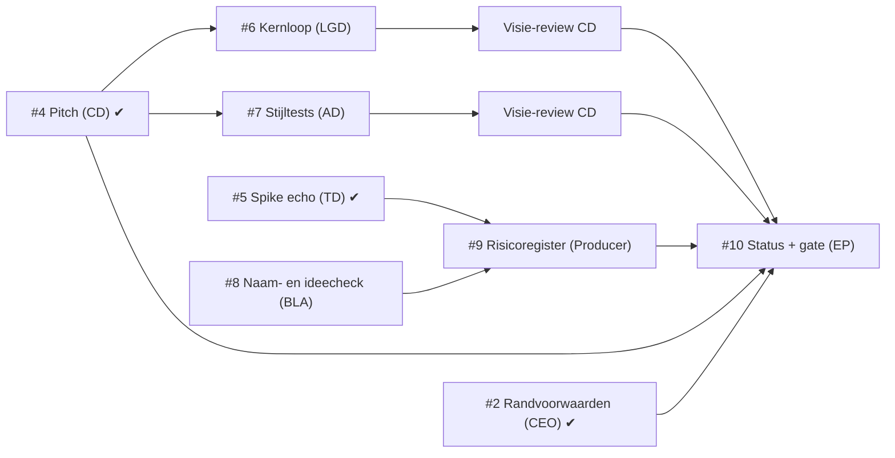

# Fasekader fase 1: Concept

Versie 1.1 · 2026-11-08 · Eigenaar: Executive Producer · Issue: #3 · Lead-review: Creative Director

## 1. Doel

Aan het eind van fase 1 weet de CEO **of concept B, *Echoborn*, definitief wordt** en heeft de studio genoeg zekerheid om fase 2 (Preproductie, verticale slice) te plannen. Fase 1 beantwoordt vier vragen:

1. **Visie**: is de draai (je schaduw herhaalt je laatste 10 seconden) in één zin uit te leggen en op papier speelbaar? (pitch, kernloop)
2. **Design**: is de echo-mechaniek precies genoeg beschreven om te bouwen en te testen, en houdt ze de 3 pillars overeind? (kernloop)
3. **Techniek**: kan Godot 4.6 een echo exact herhalen, ook met 2 lokale spelers? (spike)
4. **Risico naar buiten**: kunnen we de naam en het idee gebruiken, en welke stijl kiezen we? (naamcheck met ideecheck, stijltest)

Fase 1 levert géén speelbare game op, alleen documenten, een technische spike en stijltests.

**Eerlijk over wat fase 1 bewijst:** fase 1 verkleint het risico dat de draai niet werkt (R3) alleen op papier. Of de draai echt speelbaar en leuk is, blijkt pas in de verticale slice van fase 2. Het gate-voorstel (#10) zegt dat expliciet, zodat de CEO weet waar "concept definitief" op rust.

## 2. Scope

### Binnen scope
| Deliverable | Pad | Eigenaar | Issue |
|---|---|---|---|
| Pitch | `docs/concept/pitch.md` | Creative Director | #4 (v0.2: #15) |
| Technisch ontwerp v0, setup, standaarden + spike echo-opname met test | `docs/tech/`, `game/` | Technical Director | #5 (fixes: #14) |
| Kernloop en echo-mechaniek, GDD v0 (sectie Echo) | `docs/design/kernloop.md`, `docs/design/gdd.md` | Lead Game Designer | #6 |
| Stijltests 2D vs 2.5D + `ceo-beslissing` | `docs/art/stijltests/` | Art Director | #7 |
| Naamcheck en ideecheck | `docs/business/naamcheck.md` | Business/Legal Advisor | #8 |
| Risicoregister v1 | `docs/productie/risico.md` | Producer | #9 |
| Fasekader + roadmap v1 (dit document) | `docs/productie/` | Executive Producer | #3 |
| Statusrapport + gate-voorstel aan CEO, incl. budgetaanvraag fase 2 | `docs/productie/fase-1-status.md` | Executive Producer | #10 |
| Subsidieonderzoek (bv. VAF Gamefonds): welke regelingen, voorwaarden, deadlines. **Geen exit-criterium**; voedt de budgetaanvraag fase 2. | `docs/business/` | Business/Legal Advisor | volgt (zie §6, logboek 1.1) |

### Buiten scope (bewust niet in fase 1)
- Speelbaar prototype met levels, vijanden of combat (fase 2).
- Art bible, audio-richting, narratief, wereldkaart (fase 2, na de stijlkeuze).
- Steam-pagina, accounts, marketinguitingen of andere publicatie buiten de repo.
- Subsidie- of financieringsaanvragen **indienen** (onderzoeken mag wel; indienen is publicatie buiten de repo en vraagt een CEO-besluit).
- Contact met publishers (CEO-besluit #2: geen publisher voorlopig).
- Andere talen dan Engels (CEO-besluit #2: alleen Engels bij launch).

Wil een rol iets buiten deze lijst doen in fase 1, dan is dat een **scope-wijziging** (zie §6).

### Randvoorwaarden (CEO-besluit #2) en werkaannames
De CEO heeft de randvoorwaarden vastgelegd in #2 (`docs/beslissingen.md`, 2026-11-08). Voor fase 1 betekent dat:

| Onderwerp | Wat geldt | Status |
|---|---|---|
| Budget | Per fase. De EP vraagt aan het eind van elke fase het budget voor de volgende fase aan (fase 2: in het gate-voorstel #10). | **Besluit** #2 |
| Budget fase 1 | € 0 extern: alleen gratis tools en eigen werk, geen betaalde assets of diensten | **Aanname** EP (binnen besluit #2) |
| Timing | Geen deadline, kwaliteit eerst. De EP stelt na fase 2 een releasevenster voor. | **Besluit** #2 |
| Duur fase 1 | 7–10 regie-runs (raming voor planning, geen deadline) | **Aanname** EP (§7) |
| Omvang game | 5–7 uur, 3–4 gebieden, 4–5 bosses | **Besluit** #2 |
| Verdienmodel | ≈ €20 eenmalig, geen microtransacties; DLC alleen na nieuw besluit | **Besluit** #2 |
| Financiering | Zelf financieren + subsidies uitzoeken (Business/Legal); geen publisher voorlopig | **Besluit** #2 |
| Toon en rating | Duister maar niet gruwelijk, doel PEGI 12 | **Besluit** #2 |
| Bereik | Alleen Engels bij launch; Steam (pc), Steam Deck verified als doel | **Besluit** #2 |
| No-go's / must-haves | Geen extra; de studio stelt ze voor als dat nodig is | **Besluit** #2 |

Deliverables die nog op de oude werkaannames staan (bv. pitch: 10–14 uur, PEGI 12–16) passen dat aan in hun volgende versie; voor de pitch is dat #15.

## 3. Exit-criteria

Fase 1 sluit pas als **alle** criteria E1–E8 gehaald zijn. Een criterium is gehaald als het bewijs bestaat; "bijna" telt niet. "Gemergd" betekent: Lead-review akkoord en `status:goedgekeurd` van de Studio Manager (alle vier rubricscores ≥ 7), daarna gemergd in `main`.

E1–E7 zijn allemaal te toetsen **vóór** het gate-besluit: het statusrapport (E8) meldt ze als gehaald of niet, en vraagt de CEO pas daarna om een besluit. Geen criterium hangt af van het gate-besluit zelf.

**Visie-review** (bij E2 en E3): de Creative Director zet op de PR een comment `Visie-review: past` of `Visie-review: past niet`, met per pillar (P1–P3, pitch §4) het antwoord op de toetsvraag en waarom. Dit is geen extra Lead-review; het is de rolverantwoordelijkheid van de CD om grote deliverables aan de visie te toetsen. "Past niet" blokkeert het criterium tot een nieuwe versie wel past.

| # | Exit-criterium | Toets (wanneer is het gehaald?) | Bewijs | Issue | Stand 2026-11-08 |
|---|---|---|---|---|---|
| E1 | **Pitch goedgekeurd** | `docs/concept/pitch.md` is gemergd en bevat: logline van één zin, kernfantasie, 3 pillars die elk een ja/nee-toetsvraag hebben ("past feature X?"), referenties, USP's, doelgroep, toon, en solo én co-op. De CEO-bevestiging van het concept is geen deel van E1, maar een aparte vraag in het gate-voorstel (E8). | gemergde PR | #4 | **Gehaald** (PR #11) |
| E2 | **Kernloop en echo-mechaniek beschreven** | `docs/design/kernloop.md` (met Mermaid-diagram) en `docs/design/gdd.md` (sectie Echo) zijn gemergd. Ze leggen vast: wat wordt opgenomen, hoe lang (als **parameter**, standaard 10 s), start/stop van de opname, wat de echo wel/niet kan, licht- vs. schaduwlaag, solo vs. co-op. Elke regel is te bouwen en te testen; er staan 3 playtestvragen in. Daarnaast: **(a)** kernloop.md beantwoordt voor de echo-regels de toetsvraag van elk van de 3 pillars (pitch §4); **(b)** kernloop.md legt vast welke beperkingen van de echo de live schaduwspeler in co-op houdt (laag, licht, wat hij wel/niet kan), zodat co-op de puzzels niet triviaal maakt (P3, R10). | gemergde PR + `Visie-review: past` van de CD op die PR | #6 | Bezig |
| E3 | **Stijlkeuze 2D/2.5D voorgelegd** | Beide stijltests staan als PNG in `docs/art/stijltests/` en tonen dezelfde scène, volgens de pitch: **solo** (speler + echo) en **co-op** (lichtspeler + schaduwspeler), plus een vijand en de overgang licht/schaduw. Er is een `ceo-beslissing`-issue met voor- en nadelen, aanbeveling en een leesbaarheidsoordeel dat **(a)** speler, echo/schaduwspeler en vijand van elkaar onderscheidt en **(b)** expliciet pillar 2 toetst: "kan een speler in één oogopslag zien in welke laag iets hoort?". **Voorleggen** is het exit-criterium; het besluit zelf is een startvoorwaarde voor art-werk in fase 2 (zie §3, kritiek pad). | gemergde PR + `Visie-review: past` van de CD op die PR + open of besloten `ceo-beslissing`-issue | #7 | Bezig |
| E4 | **Echo-techniek bewezen in een spike** | Een Godot 4.6-project in `game/` neemt 10 s van een bewegend object op en speelt het af als echo. Een automatische test draait **headless** en slaagt: de echo bereikt dezelfde eindpositie als het origineel (tolerantie vastgelegd door de TD). De spike draait met 2 lokale spelers tegelijk. `docs/tech/ontwerp.md` bevat een aanbeveling *input opnemen* vs. *toestand opnemen* met reden, en de co-op-risico's. `docs/tech/setup.md` beschrijft hoe je de test zelf draait. | gemergde PR + testuitvoer in PR | #5 | **Gehaald** (PR #13; kleine fixes in #14 zijn geen voorwaarde) |
| E5 | **Naam- en ideecheck gedaan** | `docs/business/naamcheck.md` is gemergd en bevat: **(a) naam**: botsingen met games (Steam, itch.io, consoles) en merken onderzocht, plus een duidelijk advies *houden* of *wijzigen* (met 3 alternatieven bij wijzigen); **(b) idee**: de vergelijkbare games, minstens alle gevonden games waarin je samenwerkt met een opname of echo van jezelf, en per titel of USP 1 van de pitch ("een metroidvania met een tweede lichaam") overeind blijft, met een conclusie voor USP 1 als geheel. Elke bewering met bron en datum. Bij advies *wijzigen* (naam) of als USP 1 niet overeind blijft: een `ceo-beslissing`-issue (naam) of een issue voor de Creative Director (USP-tekst) is aangemaakt. | gemergde PR | #8 | Todo |
| E6 | **Randvoorwaarden beantwoord of bewust uitgesteld** | #2 heeft een `Besluit:` van de CEO, óf het gate-voorstel (E8) vraagt als aparte vraag om bewust uitstel. | `Besluit:` in #2, of de uitstelvraag in het E8-issue | #2 | **Gehaald** (`Besluit:` in #2, 2026-11-08) |
| E7 | **Risicoregister v1 staat** | `docs/productie/risico.md` is gemergd met minstens R1–R10 uit §5; elk risico met impact H heeft een lopende maatregel en één eigenaar. | gemergde PR | #9 | Todo |
| E8 | **Gate-besluit CEO** | `docs/productie/fase-1-status.md` (max. 1 pagina) toetst E1–E7 met links naar het bewijs, en een `ceo-beslissing`-issue stelt de vragen hieronder. De CEO antwoordt met `Besluit:`. | `Besluit:` van de CEO | #10 | Todo |

**Vragen in het gate-voorstel (E8)**, elk apart te beantwoorden:
1. **Concept B definitief?** "*Echoborn* wordt definitief, op basis van pitch v0.x (PR #11, met #15 als die gemergd is) met pillars P1–P3." Met de kanttekening uit §1: fase 1 bewijst de draai op papier en technisch, de speelbaarheid blijkt in de slice van fase 2.
2. **Start fase 2** op basis van het concept-fasekader fase 2.
3. **Budget fase 2** (besluit #2: budget per fase), met wat het subsidieonderzoek heeft opgeleverd.
4. **Stijl 2D of 2.5D**, als het stijlbesluit uit #7 dan nog open staat.
5. **Naam** en eventuele USP-aanpassing, alleen als E5 *wijzigen* adviseert en de CEO nog niet besloten heeft.

### Volgorde en afhankelijkheden

- **Kritiek pad**: #6 en #7 → visie-review CD → #10. Het stijlbesluit van de CEO zit **niet** op het kritieke pad van fase 1: E3 vraagt alleen *voorleggen*. Staat het stijlbesluit bij de gate nog open, dan neemt het gate-voorstel het mee als aparte vraag (zie vraag 4 hierboven). Art bible en slice in fase 2 wachten wel op dat besluit; leg #7 dus zo vroeg mogelijk voor.
- #6 moet de pillars uit de gemergde pitch volgen (E2a); dat is nu mogelijk, want #4 is gemergd.
- #8 en #9 hangen nergens meer van af en kunnen meteen; #9 wordt definitief na #8.

## 4. Kwaliteitslat

- Elke deliverable doorloopt de reviewketen uit `WERKWIJZE.md` §5. De Executive Producer sluit de fase niet met een deliverable onder de 7 op een rubriccriterium.
- Kernloop (#6) en stijltests (#7) krijgen daarnaast een visie-review van de Creative Director (§3).
- Elke deliverable vermeldt welke werkaanname ze gebruikt, zodat een nieuw CEO-besluit gericht kan worden doorgevoerd.

## 5. Belangrijkste risico's

Kans en impact: L(aag), M(idden), H(oog). De Producer neemt deze over in het risicoregister (#9) en beheert ze daarna.

| ID | Risico | Kans | Impact | Maatregel | Eigenaar |
|---|---|---|---|---|---|
| R1 | De echo herhaalt niet exact (physics niet deterministisch, framerate-afhankelijk), waardoor puzzels onbetrouwbaar worden | M | H | Spike eerst (#5), headless test op eindpositie; TD kiest tussen input of toestand opnemen met onderbouwing; vaste physics-tick. Stand: spike gemergd (PR #13), echo exact op 0 px. | technical-director |
| R2 | Co-op wordt onleesbaar: 2 spelers + echo('s) + vijanden op één gedeelde camera | M | H | Spike met 2 spelers (#5); stijltest beoordeelt leesbaarheid speler/echo/vijand en de lagen (E3); LGD legt vast hoeveel echo's tegelijk mogen (#6) | lead-game-designer |
| R3 | De draai is niet in één zin uit te leggen of voelt solo als "trucje", in co-op als "tweede speler zonder eigen doel" | M | H | Toetsbare pillars (#4), 3 playtestvragen en pillar-toets in #6 (E2), visie-review CD. Fase 1 verkleint dit risico alleen op papier; de echte toets is de verticale slice in fase 2 (roadmap) | creative-director |
| R4 | De naam *Echoborn* botst met een bestaande game of merk, of het idee lijkt sterk op een bestaande game | M | M | Naam- en ideecheck vóór er marketing of art met de naam ontstaat (#8, E5); werktitel blijft "werktitel" tot E8 | business-legal-advisor |
| R5 | Code-gegenereerde art haalt het niveau van een goede indie-release niet | H | H | Stijltests beoordelen op eindkwaliteit, niet alleen op stijl (#7); kies de stijl die we met onze tools op niveau kunnen maken; bij twijfel `brainstorm`-issue met de CEO (`WERKWIJZE.md` §9) | art-director |
| R6 | Budget per fase wordt pas bij de gate gevraagd, waardoor fase 2 niet op tijd te plannen is of subsidiedeadlines gemist worden | M | M | Budgetaanvraag fase 2 als vaste vraag in het gate-voorstel (#10); subsidieonderzoek (BLA) start al in fase 1 en noemt deadlines | executive-producer |
| R7 | Doorlooptijd van de reviewketen (maken → Lead → SM → merge = minstens 3 runs per deliverable, max. 3 maak-agents per run) vertraagt de fase | H | M | Kleine deliverables, één per issue; regisseur geeft voorrang aan blokkerend werk (#6, #7); afgekeurd werk binnen één run herstelbaar maken | producer |
| R8 | Scope-sluip: rollen beginnen aan fase-2-werk (levels, art bible, combat) vóór de gate | M | M | Buiten-scope-lijst in §2; elke uitbreiding via §6 met zichtbare kost | executive-producer |
| R9 | **De 10 seconden zelf** voelen te lang of te kort. De hele draai hangt aan die ene waarde, en afwijken van 10 s is een CEO-besluit. | M | H | LGD legt de duur vast als parameter in #6 (E2), standaard 10 s; de spike ondersteunt al een variabele duur (`EchoRecorder`-capaciteit in ticks, #5); testen met 6, 10 en 14 s in de verticale slice van fase 2. Wijkt de beste waarde af van 10 s: `ceo-beslissing`-issue, door de CD mee voorbereid (§6). | lead-game-designer |
| R10 | **Co-op maakt de puzzels triviaal**, omdat een live schaduwspeler meer kan dan een opname. Dan breekt pillar 3. | M | H | E2b: kernloop.md legt vast welke beperkingen van de echo de schaduwspeler houdt (laag, licht, wat hij wel/niet kan); visie-review CD op #6 toetst dit aan P3; in fase 2 elke slice-puzzel in beide modi playtesten. | creative-director |

## 6. Scope-wijzigingen

Een scope-wijziging is alles wat deliverables toevoegt, schrapt of de exit-criteria verandert.

1. De rol opent een issue voor de Executive Producer met: wat, waarom, kost in **regie-runs** en **betrokken rollen**, en welk exit-criterium het raakt.
2. Past het binnen fase 1 en de randvoorwaarden: de EP beslist en werkt dit kader bij (nieuwe versie, regel in het logboek hieronder).
3. Raakt het visie, totale scope, budget of timing: de EP maakt een `ceo-beslissing`-issue (probleem, 2–3 opties, aanbeveling). Raakt het de visie (pillars, kernfantasie, de 10 seconden), dan bereidt de Creative Director dat issue mee voor.

### Logboek wijzigingen
| Versie | Datum | Wijziging | Kost |
|---|---|---|---|
| 1.0 | 2026-11-08 | Eerste versie | n.v.t. |
| 1.1 | 2026-11-08 | Lead-review CD (PR #12): E1 en E6 los van het gate-besluit; CEO-vragen expliciet in E8; E2 en E3 getoetst aan de pillars met visie-review CD; E3-scène volgt de pitch (solo/co-op); E5 met ideecheck; R9 (10 s) en R10 (co-op triviaal) toegevoegd; stijlbesluit van het kritieke pad af. Randvoorwaarden-besluit #2 verwerkt (omvang, budget per fase, geen deadline, alleen Engels, PEGI 12). Subsidieonderzoek (BLA) toegevoegd aan de scope, zonder exit-criterium. | Visie-review: +1 CD-taak op #6 en #7, binnen de bestaande reviewrun (≈ 0 extra runs). E2b/E3/E5 iets meer werk voor LGD, AD en BLA binnen hun lopende issue. Subsidieonderzoek: ≈ 1 BLA-run, niet op het kritieke pad. Totale raming blijft 7–10 runs. |

## 7. Planning op hoofdlijnen (raming)

Indicatief, in regie-runs (de dagelijkse planning is van de Producer). Er is geen deadline (besluit #2); deze raming is er om te plannen en afwijkingen zichtbaar te maken.

| Run | Wat |
|---|---|
| 1–2 | #4, #5 gemaakt en gemergd; #3 in review; #8 maken |
| 2–4 | #6 en #7 maken; review van #8; #3 v1.1 |
| 4–6 | `ceo-beslissing` stijl voorgelegd; visie-reviews CD op #6 en #7; #9 maken; subsidieonderzoek |
| 6–8 | Laatste correcties; #10 statusrapport, budgetaanvraag fase 2 en gate-voorstel |
| 8–10 | Buffer voor afgekeurd werk en het wachten op CEO-besluiten |

Totaal **7–10 runs (raming)**. De grootste onzekerheid is de wachttijd op CEO-besluiten (stijl, gate); die telt niet mee in de raming.
