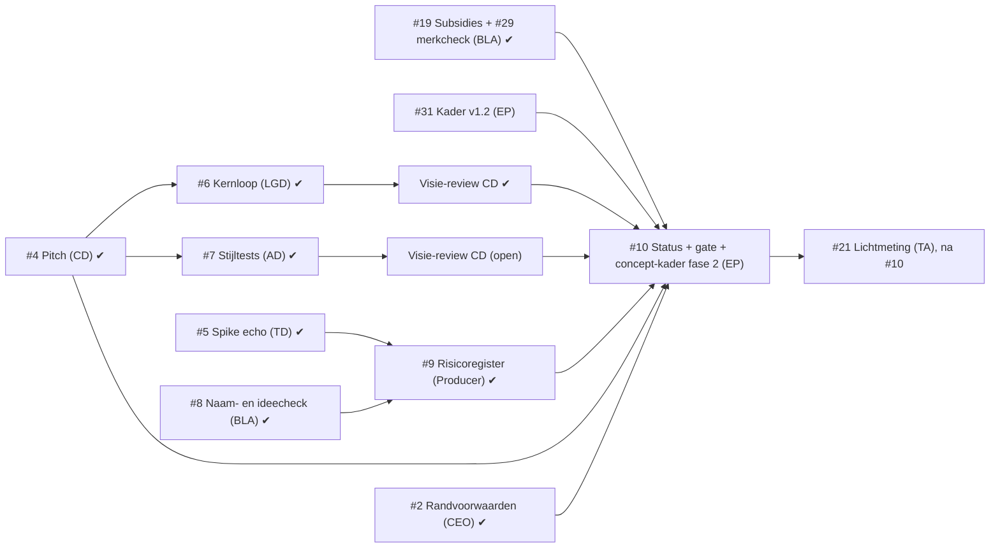

# Fasekader fase 1: Concept

Versie 1.2 · 2026-11-08 · Eigenaar: Executive Producer · Issues: #3 (v1.0–1.1), #31 (v1.2) · Lead-review: Creative Director

Werktitel: ***Wraithstep*** (besluit #24, voorheen *Echoborn*). Repo- en mapnamen blijven voorlopig "echoborn". De naam is niet publiek tot de formele merkcheck door een specialist (besluit #24, 3A).

## 1. Doel

Aan het eind van fase 1 weet de CEO **of concept B (werktitel *Wraithstep*) definitief wordt** en heeft de studio genoeg zekerheid om fase 2 (Preproductie, verticale slice) te plannen. Fase 1 beantwoordt vier vragen:

1. **Visie**: is de draai (je schaduw herhaalt je laatste 10 seconden) in één zin uit te leggen en op papier speelbaar? (pitch, kernloop)
2. **Design**: is de echo-mechaniek precies genoeg beschreven om te bouwen en te testen, en houdt ze de 3 pillars overeind? (kernloop)
3. **Techniek**: kan Godot 4.6 een echo exact herhalen, ook met 2 lokale spelers? (spike)
4. **Risico naar buiten**: kunnen we de naam en het idee gebruiken, en welke stijl kiezen we? (naamcheck met ideecheck, stijltest)

Fase 1 levert géén speelbare game op, alleen documenten, een technische spike en stijltests.

**Eerlijk over wat fase 1 bewijst:** fase 1 verkleint het risico dat de draai niet werkt (R3) alleen op papier. Of de draai echt speelbaar en leuk is, blijkt pas in de verticale slice van fase 2. Het gate-voorstel (#10) zegt dat expliciet, zodat de CEO weet waar "concept definitief" op rust.

## 2. Scope

### Binnen scope
| Deliverable | Pad | Eigenaar | Issue | Exit-criterium |
|---|---|---|---|---|
| Pitch | `docs/concept/pitch.md` | Creative Director | #4 (v0.2: #15; werktitel en reviewpunten: #25) | E1 |
| Technisch ontwerp v0, setup, standaarden + spike echo-opname met test | `docs/tech/`, `game/` | Technical Director | #5 (fixes: #14; testrunner: #30) | E4 |
| Kernloop en echo-mechaniek, GDD v0 (sectie Echo) | `docs/design/kernloop.md`, `docs/design/gdd.md` | Lead Game Designer | #6 | E2 |
| Stijltests 2D vs 2.5D + `ceo-beslissing` | `docs/art/stijltests/` | Art Director | #7 (besluit: #18) | E3 |
| Naamcheck en ideecheck | `docs/business/naamcheck.md` | Business/Legal Advisor | #8 (besluit: #24) | E5 |
| Korte merkcheck *Wraithstep* + richtprijs specialist | `docs/business/naamcheck-wraithstep.md` | Business/Legal Advisor | #29 | geen; voedt gate-vraag 3 en 5 |
| Risicoregister v1 | `docs/productie/risico.md` | Producer | #9 (v1.2: #32) | E7 |
| Fasekader + roadmap (dit document) | `docs/productie/` | Executive Producer | #3, v1.2: #31 | geen |
| Statusrapport + gate-voorstel aan CEO, incl. budgetaanvraag fase 2 | `docs/productie/fase-1-status.md` | Executive Producer | #10 | E8 |
| **Concept-fasekader fase 2** (bijlage bij het gate-voorstel; gate-vraag 2 besluit erop) | `docs/productie/fase-2-kader.md` | Executive Producer | #10 | E8 (onderdeel) |
| Subsidieonderzoek (VAF Gamefonds e.a.). **Geen exit-criterium**; voedt de budgetaanvraag fase 2. | `docs/business/subsidies.md` | Business/Legal Advisor | #19 (gemergd, PR #28) | geen; voedt gate-vraag 3 |
| Lichtmeting 2D op Steam Deck (C7, risicoverkleining R17). **Geen exit-criterium**; lagere prioriteit dan #10. | volgt uit #21 | Technical Artist (met Engine & Platform Programmer) | #21 | geen |

### Buiten scope (bewust niet in fase 1)
- Speelbaar prototype met levels, vijanden of combat (fase 2).
- Art bible, audio-richting, narratief, wereldkaart (fase 2, na de stijlkeuze). **Art bible v0 en assetlijst (#20) staan op `fase:2-preproductie`** (scopebesluit v1.2, §6).
- Steam-pagina, accounts, marketinguitingen of andere publicatie buiten de repo. Dat geldt ook voor de naam *Wraithstep*: niet publiek vóór de formele merkcheck (besluit #24, 3A).
- Een merkenspecialist inschakelen of offertes opvragen (kost geld, budget fase 1 is € 0 extern; de post gaat in de budgetaanvraag, zie §3 vraag 3).
- Subsidie- of financieringsaanvragen **indienen**, een MyVAF-account of intake aanvragen, een vennootschap oprichten (onderzoeken mag wel; de rest is publicatie of handelen buiten de repo en vraagt een CEO-besluit, zie `docs/business/subsidies.md` §6).
- Contact met publishers (CEO-besluit #2: geen publisher voorlopig).
- Andere talen dan Engels (CEO-besluit #2: alleen Engels bij launch). Het VAF eist een Nederlandse versie; dat ligt als **voorgestelde scope-wijziging** bij de CEO via gate-vraag 3 (§6), en geldt pas na een `Besluit:`.

Wil een rol iets buiten deze lijst doen in fase 1, dan is dat een **scope-wijziging** (zie §6).

### Randvoorwaarden (CEO-besluit #2) en werkaannames
De CEO heeft de randvoorwaarden vastgelegd in #2 (`docs/beslissingen.md`, 2026-11-08). Voor fase 1 betekent dat:

| Onderwerp | Wat geldt | Status |
|---|---|---|
| Budget | Per fase. De EP vraagt aan het eind van elke fase het budget voor de volgende fase aan (fase 2: in het gate-voorstel #10). | **Besluit** #2 |
| Budget fase 1 | € 0 extern: alleen gratis tools en eigen werk, geen betaalde assets of diensten | **Aanname** EP (binnen besluit #2) |
| Timing | Geen deadline, kwaliteit eerst. De EP stelt na fase 2 een releasevenster voor. | **Besluit** #2 |
| Duur fase 1 | 7–10 regie-runs (raming voor planning, geen deadline) | **Aanname** EP (§7) |
| Omvang game | 5–7 uur, 3–4 gebieden, 4–5 bosses | **Besluit** #2 |
| Verdienmodel | ≈ €20 eenmalig, geen microtransacties; DLC alleen na nieuw besluit | **Besluit** #2 |
| Financiering | Zelf financieren + subsidies uitzoeken (Business/Legal); geen publisher voorlopig | **Besluit** #2 |
| Toon en rating | Duister maar niet gruwelijk, doel PEGI 12 | **Besluit** #2 |
| Bereik | Alleen Engels bij launch; Steam (pc), Steam Deck verified als doel | **Besluit** #2 |
| No-go's / must-haves | Geen extra; de studio stelt ze voor als dat nodig is | **Besluit** #2 |
| Stijl | 2D pixel art op 640×360 (Deck 640×400) met dynamisch 2D-licht | **Besluit** #18 |
| Werktitel | *Wraithstep*; formele merkcheck door een specialist vóór de eerste publicatie met de naam | **Besluit** #24 |

Deliverables die nog op oude werkaannames of de oude titel staan, passen dat aan in hun volgende versie; voor de pitch en README is dat #25.

## 3. Exit-criteria

Fase 1 sluit pas als **alle** criteria E1–E8 gehaald zijn. Een criterium is gehaald als het bewijs bestaat; "bijna" telt niet. "Gemergd" betekent: Lead-review akkoord en `status:goedgekeurd` van de Studio Manager (alle vier rubricscores ≥ 7), daarna gemergd in `main`.

E1–E7 zijn allemaal te toetsen **vóór** het gate-besluit: het statusrapport (E8) meldt ze als gehaald of niet, en vraagt de CEO pas daarna om een besluit. Geen criterium hangt af van het gate-besluit zelf.

**Visie-review** (bij E2 en E3): de Creative Director zet op de PR een comment `Visie-review: past` of `Visie-review: past niet`, met per pillar (P1–P3, pitch §4) het antwoord op de toetsvraag en waarom. Dit is geen extra Lead-review; het is de rolverantwoordelijkheid van de CD om grote deliverables aan de visie te toetsen. "Past niet" blokkeert het criterium tot een nieuwe versie wel past. Een visie-review mag ook op een al gemergde PR worden gezet.

**Over de kolom "Stand":** die wordt alleen bijgewerkt bij een nieuwe versie van dit kader en is dus een momentopname. **De bindende stand is `docs/productie/fase-1-status.md` (E8, #10).** Wie de stand nu wil weten, kijkt naar de PR's en issues in de kolom Bewijs.

| # | Exit-criterium | Toets (wanneer is het gehaald?) | Bewijs | Issue | Stand v1.2 (2026-11-08) |
|---|---|---|---|---|---|
| E1 | **Pitch goedgekeurd** | `docs/concept/pitch.md` is gemergd en bevat: logline van één zin, kernfantasie, 3 pillars die elk een ja/nee-toetsvraag hebben ("past feature X?"), referenties, USP's, doelgroep, toon, en solo én co-op. De CEO-bevestiging van het concept is geen deel van E1, maar een aparte vraag in het gate-voorstel (E8). | gemergde PR | #4 | **Gehaald** (PR #11; v0.2 PR #22). #25 (werktitel, logline-zin, toetsvraag P1) is geen voorwaarde. |
| E2 | **Kernloop en echo-mechaniek beschreven** | `docs/design/kernloop.md` (met Mermaid-diagram) en `docs/design/gdd.md` (sectie Echo) zijn gemergd. Ze leggen vast: wat wordt opgenomen, hoe lang (als **parameter**, standaard 10 s), start/stop van de opname, wat de echo wel/niet kan, licht- vs. schaduwlaag, solo vs. co-op. Elke regel is te bouwen en te testen; er staan 3 playtestvragen in. Daarnaast: **(a)** kernloop.md beantwoordt voor de echo-regels de toetsvraag van elk van de 3 pillars (pitch §4); **(b)** kernloop.md legt vast welke beperkingen van de echo de live schaduwspeler in co-op houdt (laag, licht, wat hij wel/niet kan), zodat co-op de puzzels niet triviaal maakt (P3, R10). | gemergde PR + `Visie-review: past` van de CD op die PR | #6 | **Gehaald** (PR #16, `Visie-review: past`). Open reviewpunten: A3 in `risico.md`, mag in fase 2. |
| E3 | **Stijlkeuze 2D/2.5D voorgelegd** | Beide stijltests staan als PNG in `docs/art/stijltests/` en tonen dezelfde scène, volgens de pitch: **solo** (speler + echo) en **co-op** (lichtspeler + schaduwspeler), plus een vijand en de overgang licht/schaduw. Er is een `ceo-beslissing`-issue met voor- en nadelen, aanbeveling en een leesbaarheidsoordeel dat **(a)** speler, echo/schaduwspeler en vijand van elkaar onderscheidt en **(b)** de **leesbaarheidseis van pillar 2** toetst (pitch v0.2 §4: "alles wat via pillar 2 werkt, laat in het beeld zelf zien in welke laag het hoort, zonder icoon of uitleg"). **Voorleggen** is het exit-criterium; het besluit zelf is een startvoorwaarde voor art-werk in fase 2 (zie kritiek pad). | gemergde PR + `Visie-review: past` van de CD op die PR + open of besloten `ceo-beslissing`-issue | #7 | **Nog niet gehaald.** PR #17 gemergd en besluit 2D genomen (#18). **Ontbreekt: `Visie-review` van de CD op PR #17** (niet gevonden in de comments). Zonder die review haalt E3 de gate niet. |
| E4 | **Echo-techniek bewezen in een spike** | Een Godot 4.6-project in `game/` neemt 10 s van een bewegend object op en speelt het af als echo. Een automatische test draait **headless** en slaagt: de echo bereikt dezelfde eindpositie als het origineel (tolerantie vastgelegd door de TD). De spike draait met 2 lokale spelers tegelijk. `docs/tech/ontwerp.md` bevat een aanbeveling *input opnemen* vs. *toestand opnemen* met reden, en de co-op-risico's. `docs/tech/setup.md` beschrijft hoe je de test zelf draait. | gemergde PR + testuitvoer in PR | #5 | **Gehaald** (PR #13; fixes PR #26). #30 (testrunner) is geen voorwaarde. |
| E5 | **Naam- en ideecheck gedaan** | `docs/business/naamcheck.md` is gemergd en bevat: **(a) naam**: botsingen met games (Steam, itch.io, consoles) en merken onderzocht, plus een duidelijk advies *houden* of *wijzigen* (met 3 alternatieven bij wijzigen); **(b) idee**: de vergelijkbare games, minstens alle gevonden games waarin je samenwerkt met een opname of echo van jezelf, en per titel of USP 1 van de pitch ("een metroidvania met een tweede lichaam") overeind blijft, met een conclusie voor USP 1 als geheel. Elke bewering met bron en datum. Bij advies *wijzigen* (naam) of als USP 1 niet overeind blijft: een `ceo-beslissing`-issue (naam) of een issue voor de Creative Director (USP-tekst) is aangemaakt. | gemergde PR | #8 | **Gehaald** (PR #23; naamvraag besloten in #24, USP-tekst bij de CD in #25). De korte check op *Wraithstep* (PR #33, oranje) is geen voorwaarde voor E5. |
| E6 | **Randvoorwaarden beantwoord of bewust uitgesteld** | #2 heeft een `Besluit:` van de CEO, óf het gate-voorstel (E8) vraagt als aparte vraag om bewust uitstel. | `Besluit:` in #2, of de uitstelvraag in het E8-issue | #2 | **Gehaald** (`Besluit:` in #2) |
| E7 | **Risicoregister v1 staat** | `docs/productie/risico.md` is gemergd met minstens R1–R10 uit §5; elk risico met impact H heeft een lopende maatregel en één eigenaar. | gemergde PR | #9 | **Gehaald** (PR #27, v1.1). v1.2 (#32) is geen voorwaarde. |
| E8 | **Gate-besluit CEO** | `docs/productie/fase-1-status.md` (max. 1 pagina) toetst E1–E7 met links naar het bewijs, en een `ceo-beslissing`-issue stelt de vragen hieronder. Het concept-fasekader fase 2 (`docs/productie/fase-2-kader.md`) ligt erbij. De CEO antwoordt met `Besluit:`. | `Besluit:` van de CEO | #10 | Todo |

**Vragen in het gate-voorstel (E8)**, elk apart te beantwoorden:
1. **Concept B definitief?** "Concept B (werktitel *Wraithstep*) wordt definitief, op basis van pitch v0.x (PR #11 en #22, met #25 als die gemergd is) met pillars P1–P3." Met de kanttekening uit §1: fase 1 bewijst de draai op papier en technisch, de speelbaarheid blijkt in de slice van fase 2.
2. **Start fase 2** op basis van het concept-fasekader fase 2 (`docs/productie/fase-2-kader.md`, #10).
3. **Budget fase 2** (besluit #2: budget per fase), met wat het subsidieonderzoek heeft opgeleverd. Daarin, uit de gemergde business-documenten:
   - **Subsidie: reken fase 2 met € 0** (`docs/business/subsidies.md` §5). Het VAF Gamefonds is de enige passende regeling, maar we halen drie drempels nog niet: (1) een **vennootschap** met zetel in Vlaanderen of Brussel, (2) de culturele test eist dat de game **minstens ook in het Nederlands** verschijnt (botst met besluit #2 "alleen Engels"), (3) het **(Vlaamse) kernteam** en vorig werk worden beoordeeld (wij: één mens plus AI-rollen). Aanbevolen route (c): fase 2 zelf financieren en in fase 2 een aanvraag voor **productiesteun voor fase 3** voorbereiden, zonder in te dienen. Het gate-issue neemt **bevestiging V en vragen 1–3** uit `subsidies.md` §6 over (hernummerd), inclusief de kost van een Nederlandse versie (§6 hieronder).
   - **Merkcheck door een specialist** (besluit #24, 3A; actie A8): **€ 3.750 excl. btw** als post (bovenkant van de bandbreedte in `naamcheck-wraithstep.md` §4 met de eigen koersaanname; Lead-review PR #33). De post hoort in de fasebegroting waarin de eerste publicatie met de naam valt. Omdat route (c) tractie vraagt (wishlists, dus een Steam-pagina) en fase 2 al een mogelijk demo-besluit kent, vraagt #10 de post aan als **reservering in budget fase 2**; uitgeven pas vlak vóór een publicatiebesluit. Optionele tussenstap van € 0 vooraf: handmatige zoekactie in TMview en de WIPO Global Brand Database in een gewone browser.
4. ~~**Stijl 2D of 2.5D**~~: **vervalt**, besloten in #18 (2D).
5. **Naam**: geen beslisvraag meer; besloten in #24 (*Wraithstep*, 3A). Het gate-voorstel meldt als informatie: de korte merkcheck staat op **oranje** (`naamcheck-wraithstep.md`): bruikbaar als werktitel, niet publiek vóór de specialist. Het Diablo II-item *Wraithstep* (G4) is een vindbaarheidsvraag voor de Creative Director en Marketing (zelfde route als R15: eventueel een nieuwe naamvraag aan de CEO **vóór** de betaalde check, niet vóór de gate).

### Volgorde en afhankelijkheden

- **Kritiek pad (stand v1.2)**: de visie-review van de CD op PR #17 (E3) en dit kader v1.2 (#31) → #10. Alles daarvoor is gemergd.
- Het stijlbesluit (#18) en het naambesluit (#24) zijn genomen; ze zitten niet meer in het gate-voorstel als beslisvraag.
- **#21** (lichtmeting) mag in fase 1, maar ligt niet op het kritieke pad en komt na #10 in prioriteit (§6).
- **#25** (pitch: werktitel, reviewpunten), **#30** (testrunner) en **#32** (risicoregister v1.2) lopen parallel en zijn geen voorwaarde voor de gate. #32 moet wel klaar zijn vóór #10, zodat het statusrapport de actuele H-risico's overneemt.

## 4. Kwaliteitslat

- Elke deliverable doorloopt de reviewketen uit `WERKWIJZE.md` §5. De Executive Producer sluit de fase niet met een deliverable onder de 7 op een rubriccriterium.
- Kernloop (#6) en stijltests (#7) krijgen daarnaast een visie-review van de Creative Director (§3).
- Elke deliverable vermeldt welke werkaanname ze gebruikt, zodat een nieuw CEO-besluit gericht kan worden doorgevoerd.

## 5. Belangrijkste risico's

Kans en impact: L(aag), M(idden), H(oog). **Sinds PR #27 is `docs/productie/risico.md` (Producer) de bron voor alle risico's**, met de actuele kans, impact, status en de nieuwe risico's R11–R21. De tabel hieronder is de **uitgangsstand van v1.1** waarmee het register is gestart; hij wordt hier niet meer bijgewerkt. E7 toetst tegen deze ID's.

| ID | Risico | Kans | Impact | Maatregel | Eigenaar |
|---|---|---|---|---|---|
| R1 | De echo herhaalt niet exact (physics niet deterministisch, framerate-afhankelijk), waardoor puzzels onbetrouwbaar worden | M | H | Spike eerst (#5), headless test op eindpositie; TD kiest tussen input of toestand opnemen met onderbouwing; vaste physics-tick. Stand: spike gemergd (PR #13), echo exact op 0 px. | technical-director |
| R2 | Co-op wordt onleesbaar: 2 spelers + echo('s) + vijanden op één gedeelde camera | M | H | Spike met 2 spelers (#5); stijltest beoordeelt leesbaarheid speler/echo/vijand en de lagen (E3); LGD legt vast hoeveel echo's tegelijk mogen (#6) | lead-game-designer |
| R3 | De draai is niet in één zin uit te leggen of voelt solo als "trucje", in co-op als "tweede speler zonder eigen doel" | M | H | Toetsbare pillars (#4), 3 playtestvragen en pillar-toets in #6 (E2), visie-review CD. Fase 1 verkleint dit risico alleen op papier; de echte toets is de verticale slice in fase 2 (roadmap) | creative-director |
| R4 | De naam botst met een bestaande game of merk, of het idee lijkt sterk op een bestaande game | M | M | Naam- en ideecheck vóór er marketing of art met de naam ontstaat (#8, E5); werktitel blijft "werktitel" tot E8 | business-legal-advisor |
| R5 | Code-gegenereerde art haalt het niveau van een goede indie-release niet | H | H | Stijltests beoordelen op eindkwaliteit, niet alleen op stijl (#7); kies de stijl die we met onze tools op niveau kunnen maken; bij twijfel `brainstorm`-issue met de CEO (`WERKWIJZE.md` §9) | art-director |
| R6 | Budget per fase wordt pas bij de gate gevraagd, waardoor fase 2 niet op tijd te plannen is of subsidiedeadlines gemist worden | M | M | Budgetaanvraag fase 2 als vaste vraag in het gate-voorstel (#10); subsidieonderzoek (BLA) start al in fase 1 en noemt deadlines | executive-producer |
| R7 | Doorlooptijd van de reviewketen (maken → Lead → SM → merge = minstens 3 runs per deliverable, max. 3 maak-agents per run) vertraagt de fase | H | M | Kleine deliverables, één per issue; regisseur geeft voorrang aan blokkerend werk (#6, #7); afgekeurd werk binnen één run herstelbaar maken | producer |
| R8 | Scope-sluip: rollen beginnen aan fase-2-werk (levels, art bible, combat) vóór de gate | M | M | Buiten-scope-lijst in §2; elke uitbreiding via §6 met zichtbare kost | executive-producer |
| R9 | **De 10 seconden zelf** voelen te lang of te kort. De hele draai hangt aan die ene waarde, en afwijken van 10 s is een CEO-besluit. | M | H | LGD legt de duur vast als parameter in #6 (E2), standaard 10 s; de spike ondersteunt al een variabele duur (`EchoRecorder`-capaciteit in ticks, #5); testen met 6, 10 en 14 s in de verticale slice van fase 2. Wijkt de beste waarde af van 10 s: `ceo-beslissing`-issue, door de CD mee voorbereid (§6). | lead-game-designer |
| R10 | **Co-op maakt de puzzels triviaal**, omdat een live schaduwspeler meer kan dan een opname. Dan breekt pillar 3. | M | H | E2b: kernloop.md legt vast welke beperkingen van de echo de schaduwspeler houdt (laag, licht, wat hij wel/niet kan); visie-review CD op #6 toetst dit aan P3; in fase 2 elke slice-puzzel in beide modi playtesten. | creative-director |

## 6. Scope-wijzigingen

Een scope-wijziging is alles wat deliverables toevoegt, schrapt of de exit-criteria verandert.

1. De rol opent een issue voor de Executive Producer met: wat, waarom, kost in **regie-runs** en **betrokken rollen**, en welk exit-criterium het raakt.
2. Past het binnen fase 1 en de randvoorwaarden: de EP beslist en werkt dit kader bij (nieuwe versie, regel in het logboek hieronder).
3. Raakt het visie, totale scope, budget of timing: de EP maakt een `ceo-beslissing`-issue (probleem, 2–3 opties, aanbeveling). Raakt het de visie (pillars, kernfantasie, de 10 seconden), dan bereidt de Creative Director dat issue mee voor.

### 6.1 Scopebesluit v1.2 (EP, Lead-review PR #27, actie A6)

| Issue | Besluit | Waarom | Kost in tijd en werk | Raakt exit-criterium |
|---|---|---|---|---|
| **#21** Lichtmeting 2D op Steam Deck (C7) | **Blijft in fase 1**, na #10 in prioriteit | Risicoverkleining (R17, C7); besluit #18 noemt de meting al; levert geen nieuwe fase-1-deliverable op | ≈ 1 run Technical Artist, met de Engine & Platform Programmer, plus de gewone review (Lead + SM, binnen bestaande reviewruns). Niet op het kritieke pad. € 0 extern. | Nee |
| **#20** Art bible v0 + assetlijst | **Naar fase 2** (label `fase:2-preproductie` staat) | De art bible staat buiten scope (§2); het concept is pas definitief na de gate (vraag 1) | **0 runs**: er was nog geen werk aan gedaan. Wordt het eerste art-issue van fase 2. | Nee |
| **#20, eis R5** | Art bible v0 bevat **één scène op beoogde eindkwaliteit**, beoordeeld met de SM-rubric (**Kwaliteit ≥ 7**), **vóórdat het slice-art-werk start**. Haalt die scène geen 7, dan geen slice-art op die stijl, maar een `brainstorm`-issue met de CEO (`WERKWIJZE.md` §9) en een herziene slice-raming. | R5 (art op eindkwaliteit) staat op H/H en niets is nog bewezen | Fase 2: ≈ +1 run Art Director/2D Environment Artist binnen #20, plus één rubricbeoordeling. Kan de slice vertragen als de scène faalt; dat is precies het doel. | Nee (fase 1); exit-eis voor art bible v0 in het fasekader fase 2 |

### 6.2 Voorgestelde scope-wijziging bij de CEO (nog geen besluit)

**Nederlandse versie bij release** (voorwaarde VAF, `subsidies.md` §6 vraag 2). Wijzigt besluit #2 ("alleen Engels"), de buiten-scope-lijst (§2) en de roadmap. Nodig bij release, niet in fase 2. Grove raming (BLA, door de EP overgenomen als orde van grootte): ± 1 run lokalisatie inbouwen (Engine & Platform Programmer, fase 2–3), UI en font binnen bestaande runs (fase 3), ± 2–4 runs vertaling (Narrative Designer, Marketing, fase 4), ± 1–2 runs lokalisatietest (QA Lead, fase 4), en mogelijk een externe moedertaalreviewer (geld, offerte via de EP). Totaal ≈ 4–7 runs plus een mogelijke externe post. De EP maakt de definitieve raming vóór het indienen bij het VAF. Het besluit valt via gate-vraag 3 (#10); tot dan geldt "alleen Engels".

### Logboek wijzigingen
| Versie | Datum | Wijziging | Kost |
|---|---|---|---|
| 1.0 | 2026-11-08 | Eerste versie | n.v.t. |
| 1.1 | 2026-11-08 | Lead-review CD (PR #12): E1 en E6 los van het gate-besluit; CEO-vragen expliciet in E8; E2 en E3 getoetst aan de pillars met visie-review CD; E3-scène volgt de pitch (solo/co-op); E5 met ideecheck; R9 (10 s) en R10 (co-op triviaal) toegevoegd; stijlbesluit van het kritieke pad af. Randvoorwaarden-besluit #2 verwerkt (omvang, budget per fase, geen deadline, alleen Engels, PEGI 12). Subsidieonderzoek (BLA) toegevoegd aan de scope, zonder exit-criterium. | Visie-review: +1 CD-taak op #6 en #7, binnen de bestaande reviewrun (≈ 0 extra runs). E2b/E3/E5 iets meer werk voor LGD, AD en BLA binnen hun lopende issue. Subsidieonderzoek: ≈ 1 BLA-run, niet op het kritieke pad. Totale raming blijft 7–10 runs. |
| 1.2 | 2026-11-08 | #31. **Scopebesluit** (§6.1): #21 in fase 1 na #10, #20 naar fase 2 met de R5-eis. **SM-punten PR #12**: (1) concept-fasekader fase 2 als deliverable in de scope-tabel (#10); (2) subsidieonderzoek heeft issue #19 (gemergd, PR #28); (6) stand-kolom is een momentopname, `fase-1-status.md` is bindend. Punten 3–5 in de roadmap v1.2. **EP-punt 17 PR #22**: E3(b) toetst nu de leesbaarheidseis van pillar 2 (pitch v0.2), niet de oude toetsvraag. **Werktitel *Wraithstep*** (#24) in doel, randvoorwaarden en gate-vraag 1; gate-vragen 4 (stijl, #18) en 5 (naam, #24) zijn geen beslisvragen meer. **Gate-vraag 3**: VAF-drempels en € 0 subsidie (PR #28), bevestiging V en vragen 1–3 uit `subsidies.md` §6, merkcheck-post € 3.750 excl. btw (PR #33, A8). Scope-tabel aangevuld met #14, #25, #29, #30, #32 en een kolom exit-criterium. Stand E1–E8 bijgewerkt; **E3 mist nog de visie-review van de CD op PR #17**. §5 bevroren als uitgangsstand; `risico.md` is de bron. Kritiek pad bijgewerkt. Voorgestelde scope-wijziging NL-versie zichtbaar met kost (§6.2). | #21: ≈ 1 run TA (+ EPP), na #10. #20: 0 runs nu; R5-eis ≈ +1 run in fase 2. Al ingeplande vervolgissues buiten het kritieke pad: #25 (≈ 1 CD-run), #29 (1 BLA-run, gedaan), #30 (≈ 1 TD-run), #32 (≈ 1 Producer-run). Visie-review PR #17: ≈ 0 runs (CD, binnen een reviewrun). NL-versie: ≈ 4–7 runs + mogelijke externe post, alleen na `Besluit:` (fase 2–4). **Raming fase 1 blijft 7–10 runs**: de extra issues lopen parallel en zitten niet op het kritieke pad. |

## 7. Planning op hoofdlijnen (raming)

Indicatief, in regie-runs (de dagelijkse planning is van de Producer). Er is geen deadline (besluit #2); deze raming is er om te plannen en afwijkingen zichtbaar te maken.

| Run | Wat | Stand v1.2 |
|---|---|---|
| 1–2 | #4, #5 gemaakt en gemergd; #3 in review; #8 maken | Gedaan |
| 2–4 | #6 en #7 maken; review van #8; #3 v1.1 | Gedaan |
| 4–6 | `ceo-beslissing` stijl voorgelegd; visie-reviews CD op #6 en #7; #9 maken; subsidieonderzoek | Gedaan, behalve de visie-review op #7 (PR #17) |
| 6–8 | Laatste correcties (#25, #30, #31, #32); #10 statusrapport, concept-fasekader fase 2, budgetaanvraag fase 2 en gate-voorstel | Volgende |
| 8–10 | Buffer voor afgekeurd werk en het wachten op CEO-besluiten; #21 lichtmeting | |

Totaal **7–10 runs (raming)**. De grootste onzekerheid is de wachttijd op het CEO-gatebesluit; die telt niet mee in de raming.
