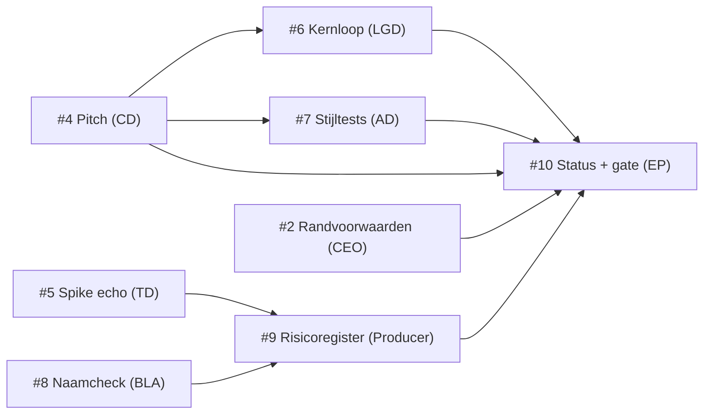

# Fasekader fase 1: Concept

Versie 1.0 · 2026-11-08 · Eigenaar: Executive Producer · Issue: #3 · Lead-review: Creative Director

## 1. Doel

Aan het eind van fase 1 weet de CEO **of concept B, *Echoborn*, definitief wordt** en heeft de studio genoeg zekerheid om fase 2 (Preproductie, verticale slice) te plannen. Fase 1 beantwoordt vier vragen:

1. **Visie**: is de draai (je schaduw herhaalt je laatste 10 seconden) in één zin uit te leggen en speelbaar? (pitch)
2. **Design**: is de echo-mechaniek precies genoeg beschreven om te bouwen en te testen? (kernloop)
3. **Techniek**: kan Godot 4.6 een echo exact herhalen, ook met 2 lokale spelers? (spike)
4. **Risico naar buiten**: kunnen we de naam en het idee gebruiken, en welke stijl kiezen we? (naamcheck, stijltest)

Fase 1 levert géén speelbare game op, alleen documenten, een technische spike en stijltests.

## 2. Scope

### Binnen scope
| Deliverable | Pad | Eigenaar | Issue |
|---|---|---|---|
| Pitch | `docs/concept/pitch.md` | Creative Director | #4 |
| Technisch ontwerp v0, setup, standaarden + spike echo-opname met test | `docs/tech/`, `game/` | Technical Director | #5 |
| Kernloop en echo-mechaniek, GDD v0 (sectie Echo) | `docs/design/kernloop.md`, `docs/design/gdd.md` | Lead Game Designer | #6 |
| Stijltests 2D vs 2.5D + `ceo-beslissing` | `docs/art/stijltests/` | Art Director | #7 |
| Naamcheck | `docs/business/naamcheck.md` | Business/Legal Advisor | #8 |
| Risicoregister v1 | `docs/productie/risico.md` | Producer | #9 |
| Fasekader + roadmap v1 (dit document) | `docs/productie/` | Executive Producer | #3 |
| Statusrapport + gate-voorstel aan CEO | `docs/productie/fase-1-status.md` | Executive Producer | #10 |

### Buiten scope (bewust niet in fase 1)
- Speelbaar prototype met levels, vijanden of combat (fase 2).
- Art bible, audio-richting, narratief, wereldkaart (fase 2, na de stijlkeuze).
- Steam-pagina, accounts, marketinguitingen of andere publicatie buiten de repo.
- Budget-, financierings- of subsidieaanvragen (wacht op #2).

Wil een rol iets buiten deze lijst doen in fase 1, dan is dat een **scope-wijziging** (zie §6).

### Werkaannames (geen besluit)
Fase 1 loopt op de werkaannames in `docs/beslissingen.md`. Specifiek voor dit kader:

| Onderwerp | Aanname | Bron | Status |
|---|---|---|---|
| Budget fase 1 | € 0 extern: alleen gratis tools en eigen werk, geen betaalde assets of diensten | dit kader | **Aanname**, open in #2 |
| Duur fase 1 | 7–10 regie-runs (≈ 1,5–2 weken bij één run per dag) | §7 | **Aanname**, open in #2 |
| Omvang game | 10–14 uur, 6–8 gebieden, 8–10 bosses | beslissingslog | **Aanname**, open in #2 |
| Platform | Steam (Windows/Linux), Steam Deck verified als doel | beslissingslog | **Aanname** |

## 3. Exit-criteria

Fase 1 sluit pas als **alle** criteria E1–E8 gehaald zijn. Een criterium is gehaald als het bewijs bestaat; "bijna" telt niet. "Gemergd" betekent: Lead-review akkoord en `status:goedgekeurd` van de Studio Manager (alle vier rubricscores ≥ 7), daarna gemergd in `main`.

| # | Exit-criterium | Toets (wanneer is het gehaald?) | Bewijs | Issue |
|---|---|---|---|---|
| E1 | **Pitch goedgekeurd** | `docs/concept/pitch.md` is gemergd en bevat: logline van één zin, kernfantasie, 3 pillars die elk een ja/nee-toets hebben ("past feature X?"), referenties, USP's, doelgroep, toon, en solo én co-op. De CEO bevestigt de pitch in het gate-besluit (E8). | gemergde PR + Besluit in E8-issue | #4 |
| E2 | **Kernloop en echo-mechaniek beschreven** | `docs/design/kernloop.md` (met Mermaid-diagram) en `docs/design/gdd.md` (sectie Echo) zijn gemergd. Ze leggen vast: wat wordt opgenomen, hoe lang, start/stop van de opname, wat de echo wel/niet kan, licht- vs. schaduwlaag, solo vs. co-op. Elke regel is te bouwen en te testen; er staan 3 playtestvragen in. | gemergde PR | #6 |
| E3 | **Stijlkeuze 2D/2.5D voorgelegd** | Beide stijltests (zelfde scène: speler 1, speler 2, echo, vijand, overgang licht/schaduw) staan als PNG in `docs/art/stijltests/`, en er is een `ceo-beslissing`-issue met voor- en nadelen, leesbaarheidsoordeel en aanbeveling. **Voorleggen** is het exit-criterium; het besluit zelf is een startvoorwaarde voor art-werk in fase 2. | gemergde PR + open of besloten `ceo-beslissing`-issue | #7 |
| E4 | **Echo-techniek bewezen in een spike** | Een Godot 4.6-project in `game/` neemt 10 s van een bewegend object op en speelt het af als echo. Een automatische test draait **headless** en slaagt: de echo bereikt dezelfde eindpositie als het origineel (tolerantie vastgelegd door de TD). De spike draait met 2 lokale spelers tegelijk. `docs/tech/ontwerp.md` bevat een aanbeveling *input opnemen* vs. *toestand opnemen* met reden, en de co-op-risico's. `docs/tech/setup.md` beschrijft hoe je de test zelf draait. | gemergde PR + testuitvoer in PR | #5 |
| E5 | **Naamcheck gedaan** | `docs/business/naamcheck.md` is gemergd: botsingen met games (Steam, itch.io, consoles) en merken onderzocht, elke bewering met bron en datum, plus een duidelijk advies *houden* of *wijzigen* (met 3 alternatieven bij wijzigen). Bij advies *wijzigen*: een `ceo-beslissing`-issue is aangemaakt. | gemergde PR | #8 |
| E6 | **Randvoorwaarden beantwoord of bewust uitgesteld** | De CEO heeft in #2 een `Besluit:` gegeven op budget en timing, óf heeft in het gate-besluit (E8) bevestigd dat fase 2 op de werkaannames start. | `Besluit:` in #2 of in E8-issue | #2 |
| E7 | **Risicoregister v1 staat** | `docs/productie/risico.md` is gemergd met minstens R1–R8 uit §5; elk risico met impact H heeft een lopende maatregel en één eigenaar. | gemergde PR | #9 |
| E8 | **Gate-besluit CEO** | `docs/productie/fase-1-status.md` (max. 1 pagina) toetst E1–E7 met links naar het bewijs, en een `ceo-beslissing`-issue vraagt: concept B definitief + start fase 2. De CEO antwoordt met `Besluit:`. | `Besluit:` van de CEO | #10 |

### Volgorde en afhankelijkheden

- **Kritiek pad**: #4 → #7 → CEO-besluit stijl → #10. De stijlkeuze wacht op de CEO; leg #7 dus zo vroeg mogelijk voor.
- #6 mag parallel aan #4 starten op basis van `docs/beslissingen.md`, en moet na de pitch worden nagelopen op de pillars.
- #5 en #8 hangen nergens van af en kunnen meteen.

## 4. Kwaliteitslat

- Elke deliverable doorloopt de reviewketen uit `WERKWIJZE.md` §5. De Executive Producer sluit de fase niet met een deliverable onder de 7 op een rubriccriterium.
- Elke deliverable vermeldt welke werkaanname ze gebruikt, zodat een CEO-besluit in #2 gericht kan worden doorgevoerd.

## 5. Belangrijkste risico's

Kans en impact: L(aag), M(idden), H(oog). De Producer neemt deze over in het risicoregister (#9) en beheert ze daarna.

| ID | Risico | Kans | Impact | Maatregel | Eigenaar |
|---|---|---|---|---|---|
| R1 | De echo herhaalt niet exact (physics niet deterministisch, framerate-afhankelijk), waardoor puzzels onbetrouwbaar worden | M | H | Spike eerst (#5), headless test op eindpositie; TD kiest tussen input of toestand opnemen met onderbouwing; vaste physics-tick | technical-director |
| R2 | Co-op wordt onleesbaar: 2 spelers + echo('s) + vijanden op één gedeelde camera | M | H | Spike met 2 spelers (#5); stijltest beoordeelt leesbaarheid speler/echo/vijand (#7); LGD legt vast hoeveel echo's tegelijk mogen (#6) | lead-game-designer |
| R3 | De draai is niet in één zin uit te leggen of voelt solo als "trucje", in co-op als "tweede speler zonder eigen doel" | M | H | Toetsbare pillars (#4) en 3 playtestvragen (#6); gate-besluit pas na beide | creative-director |
| R4 | De naam *Echoborn* botst met een bestaande game of merk, of het idee lijkt sterk op een bestaande game | M | M | Naamcheck vóór er marketing of art met de naam ontstaat (#8); werktitel blijft "werktitel" tot E8 | business-legal-advisor |
| R5 | Code-gegenereerde art haalt het niveau van een goede indie-release niet | H | H | Stijltests beoordelen op eindkwaliteit, niet alleen op stijl (#7); kies de stijl die we met onze tools op niveau kunnen maken; bij twijfel `brainstorm`-issue met de CEO (`WERKWIJZE.md` §9) | art-director |
| R6 | Budget en timing blijven open, waardoor fase 2 niet te plannen is | M | M | Werk op werkaannames en markeer ze; E6 dwingt een besluit of bewust uitstel af bij de gate | executive-producer |
| R7 | Doorlooptijd van de reviewketen (maken → Lead → SM → merge = minstens 3 runs per deliverable, max. 3 maak-agents per run) vertraagt de fase | H | M | Kleine deliverables, één per issue; regisseur geeft voorrang aan blokkerend werk (#4, #5); afgekeurd werk binnen één run herstelbaar maken | producer |
| R8 | Scope-sluip: rollen beginnen aan fase-2-werk (levels, art bible, combat) vóór de gate | M | M | Buiten-scope-lijst in §2; elke uitbreiding via §6 met zichtbare kost | executive-producer |

## 6. Scope-wijzigingen

Een scope-wijziging is alles wat deliverables toevoegt, schrapt of de exit-criteria verandert.

1. De rol opent een issue voor de Executive Producer met: wat, waarom, kost in **regie-runs** en **betrokken rollen**, en welk exit-criterium het raakt.
2. Past het binnen fase 1 en de werkaannames: de EP beslist en werkt dit kader bij (nieuwe versie, regel in het logboek hieronder).
3. Raakt het visie, totale scope, budget of timing: de EP maakt een `ceo-beslissing`-issue (probleem, 2–3 opties, aanbeveling).

### Logboek wijzigingen
| Versie | Datum | Wijziging | Kost |
|---|---|---|---|
| 1.0 | 2026-11-08 | Eerste versie | n.v.t. |

## 7. Planning op hoofdlijnen (aanname)

Indicatief, in regie-runs (de dagelijkse planning is van de Producer):

| Run | Wat |
|---|---|
| 1–2 | #4, #5, #8 maken; #3 in review |
| 2–4 | #6 en #7 maken; reviews van #4, #5, #8 |
| 4–6 | `ceo-beslissing` stijl voorgelegd; #9 maken; reviews van #6, #7 |
| 6–8 | Laatste correcties; #10 statusrapport en gate-voorstel |
| 8–10 | Buffer voor afgekeurd werk en het wachten op CEO-besluiten |

Totaal **7–10 runs (aanname)**. De grootste onzekerheid is de wachttijd op CEO-besluiten (stijl, randvoorwaarden, gate); die telt niet mee in de raming.
