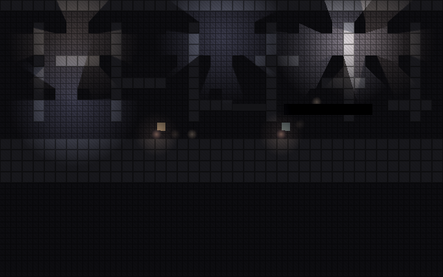

# Lichtmeting 2D (risico C7)

Eigenaar: Technical Artist · Versie 0 · Issue: [#21](https://github.com/cesarvangerwen-glitch/echoborn/issues/21)
Gebaseerd op besluit #18 (stijl 2D, 640×400 op de Deck), besluit #51 (echo-staart ± 2 s, co-op), `docs/art/stijltests.md` §2 en §6, `docs/tech/ontwerp.md` §6 (C7) en §8, `docs/tech/setup.md`.

---

## 1. Samenvatting

- **Dit is géén Steam Deck-meting.** Er is geen Deck in deze werkomgeving. Ik heb gemeten met Godot 4.6.3 (Compatibility-renderer, OpenGL 3) op **llvmpipe**: Mesa rendert daar op 2 CPU-kernen in plaats van op een GPU. De absolute milliseconden zeggen dus niets over de Deck. De **verhoudingen** (wat kost een extra licht, een schaduw, een occluder) zijn wel bruikbaar, en het meetscript draait ongewijzigd op een Deck (§6).
- **Grootste winst: render de wereld op 640×400 en schaal ×2 op.** Dezelfde kamer op native 1280×800 kost ±3× zoveel, en het licht zelf ±3,2× zoveel. Dat past ook bij pixel art (besluit #18).
- **Licht is grofweg additief en lineair.** Het eerste licht op het scherm kost een vaste opstap (±3 lichteenheden), elk volgend licht ±1 eenheid, met schaduw ±2,5. Occluders zijn goedkoop, het schaduwfilter weinig. De echo (licht + staart) kost minder dan één schaduwlicht.
- **Voorlopig lichtbudget per scherm: 20 lichteenheden (LE), kortstondig 30.** Voorbeelden (§5.2): een donkere kamer kost ±11 LE, een verlichte wijk met 3 grote warme schaduwlichten ±20 LE. Grote lichten (384 px) kosten ±1,5× een licht van 192 px, niet 4×. Het budget is veilig zolang de Deck minstens 5× sneller is dan deze llvmpipe-opstelling; naar verwachting is hij dat ruim (aanname, §5.3). De Deck-meting (§6) moet dat bevestigen of het getal bijstellen.

## 2. De testscène

Eén scène en één script: `game/prototypes/lichtmeting/lichtmeting.tscn` en `lichtmeting.gd`. Prototype, geen productiecode; niets in `game/scripts/` hangt ervan af.



| Onderdeel | Hoe | Waarom |
|---|---|---|
| Kamer | Achterwand (één getextureerde sprite over het hele scherm), ±320 tegels van 16 px (vloer, plafond, 6 zuilen, 6 richels), botsing uit `spike_world.gd` | Elke tegel en de achterwand vangen licht: zo telt de overdraw mee, zoals in een echte kamer |
| Grijs ↔ kleur | `CanvasModulate` grijs-donker (0,22 / 0,22 / 0,27); optioneel een saturatiepass over het hele scherm (`hint_screen_texture`) | Pitch v0.4: de wereld begint grijs-donker en wordt kleurrijk als je licht oppompt |
| Lichten | `PointLight2D`, radiale textuur 256 px, `texture_scale` 1,5: diameter 384 wereld-eenheden = 30 % van de schermbreedte (192 px op 640×400), in een raster dat overlapt. Scenario S4-groot: `texture_scale` 3,0 = 384 px op 640×400 | Een "gewone" lamp per kamerdeel; S4-groot voor het warme licht van een verlichte wijk |
| Schaduw | `shadow_enabled`, filter PCF5 (standaard), ook hard en PCF13 | Lichtlaag/schaduwlaag (ontwerp.md §8) |
| Occluders | `LightOccluder2D`, vierkant van één tegel, verdeeld over zuilen en richels | Schaduwwerpers |
| 2 spelers + echo's | `Sim`, `PlayerActor` en `EchoActor` (STATE) uit de spike, gescripte input; elke 2 s per speler een nieuwe echo van de laatste 2 s | Co-op 2 spelers, echo-staart ± 2 s (#51 8A) |
| Echo-effect | Per echo een klein licht zonder schaduw + 8 additieve nabeelden over de staart | Kosten van "de echo zichtbaar maken" |
| FelLicht-zone | Eén extra schaduwlamp + een `BLEND_MODE_SUB`-licht dat alleen schaduwgeometrie (`light_mask` 2, 8 tegels) raakt | "Verlicht ≠ FelLicht": FelLicht is lokaal en lost de schaduwbrug op |
| Resolutie | 640×400 via `content_scale_mode = viewport` in een venster van 1280×800, of native 1280×800 | Besluit #18 |

Elk scenario verandert één ding ten opzichte van "basis" (geen licht, 32 occluders, 640×400). Per scenario: 90 opwarmframes, 300 meetframes, vsync uit, geen fps-limiet. Het script logt per scenario de gemiddelde frametijd, p50 en p95, en de render-tijd die Godot zelf meet op CPU en GPU (`viewport_get_measured_render_time_*`). Het eindigt met "basis-eind" (gelijk aan "basis") om drift te zien.

## 3. Draaien

Vanuit de repo-root, met de Godot-build uit `docs/tech/setup.md` §2 (4.6.3):

```bash
# Met een echt scherm (Deck, pc)
godot --path game --resolution 1280x800 res://prototypes/lichtmeting/lichtmeting.tscn

# Zonder scherm (agent-omgeving): xvfb + llvmpipe
xvfb-run -a -s "-screen 0 1280x800x24" godot --path game --resolution 1280x800 \
  --audio-driver Dummy res://prototypes/lichtmeting/lichtmeting.tscn
```

Opties na `--`: `--frames=300`, `--warmup=90`, `--only=S4,typisch` (alleen die scenario's), `--shots` (een PNG per scenario). De tabel komt op stdout; een CSV staat in `user://lichtmeting.csv` (pad wordt geprint). Duur op llvmpipe: ±4 min. `--headless` werkt níét voor deze meting: dan rendert Godot niets.

## 4. Resultaten (llvmpipe, géén Deck)

**Opstelling:** Godot 4.6.3-stable official, `gl_compatibility`, Mesa 25.2.8 llvmpipe (LLVM 20.1.2, 256 bits), 2 vCPU Intel Xeon 2,1 GHz, Xvfb 1280×800. Twee volledige runs; de tabel geeft het gemiddelde. Verschil tussen de runs: meestal < 10 %. Drift: basis 2,8 ms GPU aan begin en eind, dus geen opwarm- of achtergrondeffect.

**Hoofdmaat: GPU-tijd** (`gpu ms`). Die hangt niet af van vsync of van de CPU-kant van het spel. **Lichtkosten** = GPU-tijd min die van "basis" (2,8 ms). **LE** = lichtkosten gedeeld door 0,75 ms: de kosten van één extra licht zonder schaduw, gemeten tussen L2 en L16.

| Scenario | Wat | Frame gem. ms | Frame p95 ms | CPU-render ms | GPU ms | Lichtkosten ms | LE |
|---|---|---:|---:|---:|---:|---:|---:|
| basis | geen licht, 640×400 | 6,6 | 9,4 | 0,5 | 2,8 | 0 | 0 |
| L1 | 1 licht, geen schaduw | 9,4 | 13,3 | 1,3 | 5,3 | 2,5 | 3,4 |
| L2 | 2 lichten | 10,1 | 16,1 | 1,0 | 5,9 | 3,1 | 4,2 |
| L4 | 4 lichten | 12,7 | 17,7 | 1,5 | 8,3 | 5,5 | 7,4 |
| L8 | 8 lichten | 15,4 | 21,4 | 1,3 | 11,1 | 8,3 | 11,3 |
| L16 | 16 lichten | 20,1 | 24,8 | 0,7 | 16,1 | 13,3 | 18,0 |
| S1 | 1 licht met schaduw (PCF5) | 8,6 | 11,7 | 1,7 | 5,1 | 2,3 | 3,1 |
| S2 | 2 schaduwlichten | 11,8 | 17,1 | 1,9 | 7,5 | 4,7 | 6,4 |
| S4 | 4 schaduwlichten | 16,3 | 23,0 | 2,9 | 11,1 | 8,3 | 11,3 |
| S8 | 8 schaduwlichten | 23,6 | 31,8 | 4,2 | 17,9 | 15,1 | 20,3 |
| S16 | 16 schaduwlichten | 35,2 | 44,2 | 7,0 | 28,6 | 25,8 | 34,9 |
| S4-occ0 | S4, 0 occluders | 13,6 | 19,2 | 1,8 | 9,8 | 7,0 | 9,5 |
| S4-occ8 | S4, 8 occluders | 15,1 | 22,0 | 2,0 | 10,8 | 8,0 | 10,7 |
| S4-occ128 | S4, 128 occluders | 20,4 | 28,1 | 6,7 | 14,5 | 11,7 | 15,8 |
| S4-hard | S4, filter uit | 15,4 | 21,9 | 3,0 | 10,4 | 7,6 | 10,3 |
| S4-pcf13 | S4, filter PCF13 | 17,1 | 23,5 | 2,9 | 12,4 | 9,6 | 13,0 |
| S4-echo | S4 + echo-effect (2 echo's) | 16,9 | 23,8 | 2,9 | 12,3 | 9,5 | 12,8 |
| S4-post | S4 + saturatiepass | 18,9 | 26,4 | 12,6 | 14,2 | 11,4 | 15,3 |
| S4-fel | S4 + FelLicht-zone | 17,6 | 24,3 | 3,3 | 12,7 | 9,9 | 13,4 |
| **typisch** | S4 + echo + saturatie + FelLicht | 22,2 | 30,4 | 15,8 | 17,2 | 14,4 | **19,5** |
| **zwaar** | 8 schaduwlichten, 64 occ., echo, saturatie, FelLicht | 31,0 | 39,3 | 24,5 | 25,4 | 22,6 | **30,5** |
| N-basis | basis op native 1280×800 | 12,0 | 15,2 | 0,8 | 8,3 | – | – |
| N-L4 | L4 native | 31,1 | 40,3 | 1,9 | 26,2 | 17,9¹ | – |
| N-S4 | S4 native | 39,9 | 48,8 | 4,5 | 34,4 | 26,1¹ | – |
| N-typisch | typisch native | 59,8 | 68,8 | 49,2 | 54,1 | 45,8¹ | – |
| basis-eind | controle drift | 6,5 | 10,4 | 0,5 | 2,8 | 0 | 0 |

¹ Ten opzichte van N-basis (8,3 ms).

### 4.1 Wat de cijfers zeggen

| Vraag | Antwoord (llvmpipe) |
|---|---|
| Kost per extra licht zonder schaduw | ±0,75 ms = **1 LE** (lineair van 2 tot 16 lichten) |
| Kost per extra schaduwlicht (PCF5) | ±1,5–2 ms = **2–2,7 LE**: een schaduw verdubbelt ruwweg de prijs van een licht |
| Opstap van het eerste licht | ±2,4 ms = **±3 LE**, met of zonder schaduw: de wereld gaat dan over op de belichte shader |
| Occluders | 0 → 128 occluders bij 4 schaduwlichten: +4,7 ms GPU en +5 ms CPU. Per occluder per schaduwlicht ±0,01 LE: **1 LE per ±20 occluders** bij 4 schaduwlichten. Occluders zonder schaduwlicht kosten niets meetbaars. |
| Schaduwfilter | Hard −0,7 ms, PCF13 +1,3 ms t.o.v. PCF5 bij 4 lichten: PCF13 kost **±0,4 LE per schaduwlicht** extra |
| Echo zichtbaar maken | 2 echo's (elk 1 licht zonder schaduw + 8 additieve nabeelden): +1,2 ms = **±0,8 LE per echo** |
| Grijs → kleur | `CanvasModulate` zit in elk scenario en is niet apart te zien (gratis). Een saturatiepass over het hele scherm kost **±4 LE** GPU. Op llvmpipe kost hij ook ±10 ms CPU-render: de schermkopie wacht daar op de CPU. Op een echte GPU verwacht ik dat niet (aanname, meten op de Deck). |
| FelLicht-zone | Schaduwlamp + SUB-licht op 8 tegels: +1,6 ms = **±2 LE**; het SUB-licht zelf is goedkoop omdat het alleen de schaduwgeometrie raakt |
| Native 1280×800 i.p.v. 640×400 | Hele frame **±3×** zo duur, het licht alleen **±3,1–3,3×** (4× zoveel pixels) |
| 2 spelers + echo-simulatie | Valt weg in de ruis (CPU-render basis 0,5 ms); zie ook ontwerp.md §4 |
| Optelbaar? | Ja, binnen ±10 %: S4 (11,3) + echo (1,5) + saturatie (4,0) + FelLicht (2,1) = 18,9 LE voorspeld, 19,5 gemeten |

### 4.2 Grote lichten (S4-groot)

Toegevoegd na de Lead-review: zelfde opzet als S4, maar lichten van 384 px (`texture_scale` 3,0) in plaats van 192 px. Aparte sessie op dezelfde machine, 2 runs met alleen basis, S4 en S4-groot. De machine was in deze sessie iets trager (basis 3,1 ms i.p.v. 2,8), dus vergelijk alleen binnen de sessie.

| Scenario | Frame gem. ms | GPU ms (run 1 / run 2) | GPU gem. ms | Lichtkosten ms |
|---|---:|---:|---:|---:|
| basis | 7,3 | 2,94 / 3,19 | 3,1 | 0 |
| S4 (192 px) | 18,3 | 13,39 / 11,92 | 12,7 | 9,6 |
| S4-groot (384 px) | 22,5 | 17,41 / 16,66 | 17,0 | 14,0 |

**Conclusie:** de lichtkosten worden **1,46× zo hoog** bij een dubbele diameter (4× zoveel oppervlak), niet 4×. Een deel van de kosten per licht hangt niet van de grootte af (o.a. de schaduwkaart). Bovendien snijdt het scherm grote lichten af, en de lichten overlappen. De oude regel "kosten × (diameter / 192)²" klopt dus niet en is vervangen in §5.1. In LE uit §4: S4 11,3 × 1,46 ≈ **16,5 LE** voor S4-groot. Lichten groter dan 384 px zijn niet gemeten.

## 5. Voorlopig lichtbudget

### 5.1 Rekenregel per scherm (640×400)

Kosten in lichteenheden (LE), afgerond naar de veilige kant:

| Onderdeel | LE |
|---|---:|
| Eerste licht op het scherm (eenmalig) | 3 |
| Elk volgend licht zonder schaduw | 1 |
| Elk volgend licht met schaduw (PCF5) | 2,5 |
| PCF13 i.p.v. PCF5 | +0,5 per schaduwlicht |
| Occluders (vierhoek) | 1 per 20 |
| Echo (licht + staart van 8 nabeelden) | 0,8 per echo |
| Saturatiepass grijs ↔ kleur (hele scherm) | 4 |
| FelLicht-zone (schaduwlamp + SUB-licht op de schaduwgeometrie) | 3 |
| Groter licht, 384 px (gemeten, §4.2) | × 1,5 op de kosten van dat licht |
| Groter licht, > 384 px tot schermvullend | × 2,5 (**aanname, niet gemeten**) |

Controle: S4 + 32 occluders = 3 + 3 × 2,5 + 1,6 = 12,1 LE berekend, 11,3 gemeten. Typisch = 20,7 berekend, 19,5 gemeten. Zwaar = 32,3 berekend, 30,5 gemeten. S4-groot = 3 × 1,5 + 3 × 2,5 × 1,5 + 1,6 = 17,4 berekend, ±16,5 gemeten (§4.2). De regel schat dus iets te hoog in, zoals bedoeld.

### 5.2 Budget

| | Budget | Voorbeeld dat past |
|---|---|---|
| **Normaal** (elke kamer, verkenning, combat) | **≤ 20 LE** | Zie de voorbeelden hieronder |
| **Piek** (kort: bossfase, oppomp-moment, ≤ ±10 s) | **≤ 30 LE** | 8 schaduwlichten van 192 px + 2 echo's + 64 occluders + saturatiepass |
| Altijd | Wereld op 640×400 renderen en ×2 opschalen | Native 1280×800 maakt hetzelfde licht ±3,2× duurder |
| Altijd | PCF5 als standaard; PCF13 alleen voor één hoofdlicht | |
| Liever niet | Een tweede volledige schermpass bovenop de saturatiepass | Elke schermpass ±4 LE |

**Voorbeelden.** FelLicht is een lokale zone bij een zichtbare lamp (`docs/design/gdd.md`, E-11), dus niet elk scherm heeft er een; zie de rekenregel (3 LE) als een kamer er wel een heeft.

| Voorbeeld | Inhoud | Som | LE |
|---|---|---|---:|
| **Donkere kamer** (grijs, vóór het oppompen) | 1 schaduwlicht 192 px, 1 licht zonder schaduw, 20 occluders, 2 echo's, saturatiepass | 3 + 1 + 1 + 1,6 + 4 | **±11** |
| **Verlichte wijk** (na het oppompen: warm gewoon licht, harde schaduwen, géén FelLicht) | 3 schaduwlichten van 384 px, 1 licht zonder schaduw 192 px, 32 occluders, 2 echo's, saturatiepass | 3 × 1,5 + 2 × 2,5 × 1,5 + 1 + 1,6 + 1,6 + 4 | **±20** |
| Verlichte wijk met een 4e groot schaduwlicht | als hierboven + 1 schaduwlicht van 384 px | 20 + 3,75 | ±24: boven normaal, binnen piek |

De verlichte wijk is de toestand waarin de speler het meest speelt, en hij vult het normale budget precies. Een 4e groot schaduwlicht past alleen als iets anders wegvalt, of als de Deck-meting (§6) ruimte geeft. Hoeveel LE een wijk krijgt, beslis ik pas na die meting (open punt 1).

Licht dat buiten beeld valt (en zijn occluders) telt niet mee zolang Godot het wegsnijdt; de meting zegt daar niets over (open punt).

### 5.3 Waarom dit veilig is (en wat de aanname is)

Ik stel voor dat licht op de Deck **maximaal 3 ms GPU per frame** mag kosten (van de 16,7 ms bij 60 fps). Het totale framebudget is van de Technical Director; die 3 ms is mijn voorstel voor het art-deel.

Op llvmpipe kost "typisch" 14,4 ms lichtkosten. Dat past in 3 ms zolang de Deck-GPU **minstens 5× sneller** is dan deze llvmpipe-opstelling. **Aanname, niet gemeten:** de Deck-GPU (RDNA 2, 8 CU, tot 1,6 GHz, ±1,6 TFLOPS) is grofweg 10–30× sneller dan llvmpipe op 2 Xeon-kernen (theoretisch ±0,07 TFLOPS). Dan kost "typisch" op de Deck ±0,5–1,5 ms en "zwaar" ±0,8–2,3 ms. Het budget heeft dus naar verwachting een marge van 2–6×. Valt de Deck tegen, dan rekent §6.3 het budget om; de rekenregel blijft gelden.

## 6. Meetprotocol voor de Steam Deck

Voor de Engine & Platform Programmer, met iemand die een Deck fysiek in handen heeft.

### 6.1 Voorbereiden

1. Deck volledig opgeladen en **aan de lader**. SteamOS bijgewerkt; noteer de SteamOS-versie (Instellingen → Systeem).
2. Desktopmodus, Konsole. Installeer Godot **4.6.3** precies zoals `docs/tech/setup.md` §2 (zelfde binary, checksum moet OK geven).
3. `git clone` van de repo en `git checkout` van de commit waarin deze meting zit; noteer de commit-hash.
4. Sluit andere programma's. Laat de Deck 5 min rusten na het opstarten.

### 6.2 Meten

```bash
cd echoborn
godot --path game --fullscreen --resolution 1280x800 --audio-driver Dummy \
  res://prototypes/lichtmeting/lichtmeting.tscn -- --frames=600 --shots 2>&1 | tee deck_run1.txt
```

5. Draai dit **3 keer** achter elkaar (`deck_run1..3.txt`). De eerste run telt mee; vergelijk "basis" met "basis-eind" voor opwarming.
6. Controleer in de kop dat de adapter AMD/radeonsi is en niet llvmpipe, en dat `gpu_ms` niet 0 is. Is `gpu_ms` 0 (timer niet beschikbaar), gebruik dan `gem_ms`, maar alleen als "basis" duidelijk onder 16,7 ms zit (anders staat vsync toch aan).
7. Optioneel, run B "zuinig": in Gamemodus de Godot-binary als niet-Steam-game toevoegen met dezelfde startopties, in het snelmenu (…) → Prestaties: framelimiet uit, tearing toegestaan, TDP-limiet 8 W. Eén run. Dat is de batterijsituatie.

### 6.3 Opleveren en omrekenen

8. Zet in issue #21 (of een vervolgissue): de 3 tabellen, `user://lichtmeting.csv` (in SteamOS: `~/.local/share/godot/app_userdata/Echoborn/`), `lichtmeting_typisch.png`, SteamOS-versie, commit-hash, run A/B.
9. Reken om:
   - **Deck-ms per LE** = (GPU S16 − GPU S4) / 30. (12 extra schaduwlichten × 2,5 LE.)
   - **Budget in LE** = 3 ms / Deck-ms per LE. Is dat ≥ 20, dan blijft het budget 20/30 LE. Is het lager, dan wordt het normale budget dat getal en de piek × 1,5.
   - Controleer de verhouding native/640×400 (N-S4 / S4). Is die op de Deck < 1,5, dan is native renderen een optie die de Art Director kan afwegen.
   - Controleer `cpu_ms` van S4-post en typisch: blijft die boven 5 ms, dan is de saturatiepass op de Deck ook een CPU-probleem (open punt §7).
10. **Geslaagd** als op de Deck (run A): "typisch" GPU ≤ 8 ms voor het hele frame én frame p95 ≤ 16,7 ms, en "zwaar" frame p95 ≤ 16,7 ms.

## 7. Open punten

| # | Punt | Wie | Wanneer |
|---|---|---|---|
| 1 | **Echte Deck-meting** volgens §6. Er is een Deck nodig en iemand die hem bedient; de agent-omgeving heeft er geen. | Engine & Platform Programmer (+ wie de Deck heeft) | Vóór of tijdens fase-2-taak T7 |
| 2 | C7 in `docs/tech/ontwerp.md` §6 bijwerken met een verwijzing naar dit document; dat bestand is van de TD. | Technical Director | Na review van deze PR |
| 3 | Framebudget: is 3 ms GPU voor licht (van 16,7 ms) akkoord? | Technical Director | Bij de review |
| 4 | **Besloten door de Art Director** (Lead-review PR #62): de wereld rendert met licht en al op 640×400; een licht met zichtbare pixeltrappen past bij de look. Open blijft alleen of de UI scherp blijft (wereld in een SubViewport van 640×400, UI native). | UX Designer en UI Artist | Fase 2, vóór T7 |
| 5 | Grijs ↔ kleur. **Art-eis (AD):** het moet lokaal kunnen, per wijk en per licht, met de echo erbij. Een globale schermpass met vaste saturatie (gemeten: ±4 LE) is dus hooguit een onderdeel van de oplossing, bv. met een saturatiemasker uit de lichten; de techniek kies ik op die eis en daarna op kosten (Deck-meting). | Technical Artist (met Art Director) | Fase 2 |
| 6 | FelLicht "lost de brug op": het SUB-licht maakt de schaduwgeometrie hier zwart, niet doorzichtig. Een echte oplossing (dissolve) vraagt een eigen `light()`-shader; de kosten daarvan zijn nog niet gemeten. | Technical Artist | Fase 2, bij de licht/schaduw-shader |
| 7 | Niet gemeten: licht buiten beeld en cullen, `TileMapLayer` i.p.v. losse sprites, normal maps, Windows/Proton, lagere klokken dan run B. | Technical Artist + Engine & Platform Programmer | Bij T7 |
| 8 | `game/prototypes/` is een nieuwe map; `docs/tech/standaarden.md` §5 noemt hem nog niet. | Technical Director | Bij de review |
| 9 | Lichtbudget opnemen in `docs/art/specificaties.md` zodra dat document bestaat. | Technical Artist | Fase 2 |
| 10 | Banding en dithering van lichtgradiënten op 640×400 controleren en vastleggen in de art bible. | Art Director | Fase 2 |
